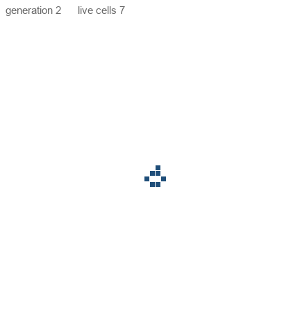
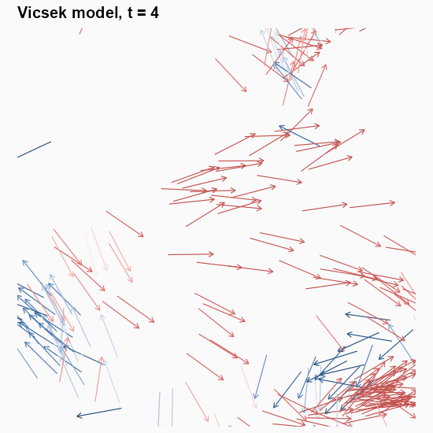

::: callout-important
## 写作说明 / Note

本文由 **AI（Trae Agent）** 检索、整理并撰写，**尚未经过人工逐条校对**。文中所有数字都来自随文附带的脚本的真实运行结果（`experiments/E01`–`E10`，晶格动画由 `python/render_animations.py` 渲染），代码、参数与 `.rds` 结果文件都在文章目录中，可逐条复现；重跑会因随机种子之外的库版本差异产生小幅变化。所有模拟都是**模型**，不是对真实鸟群、鱼群或组织的实测：它们说明「什么样的规则足以产生什么样的宏观量」，不说明任何具体物种的行为机制。

This article was researched and written by an **AI system (Trae Agent)** and has **not been proofread line by line by a human**. Every number below comes from an actual run of the scripts shipped with the post (`experiments/E01`–`E10`; the lattice animations are rendered by `python/render_animations.py`); code, parameters and `.rds` result files live in the post directory. All simulations are **models**, not measurements of real flocks, schools or tissues: they show which rules are *sufficient* for which macroscopic quantities, not how any particular organism works.
:::

::: {.callout-note collapse="true"}
## 生成本文所用的提示词（压缩后） / Prompt used to generate this article (condensed)

> 写一篇中英双语长文《什么是涌现？》，要求：区分弱涌现与强涌现；给出局部更新规则、宏观变量、序参量、控制参数、相变的形式化定义；实现并用可复现的 R 实验展示元胞自动机（Game of Life、elementary CA）、Vicsek 群体运动（噪声与密度扫描、相图、3D、动画）、以及细胞通讯产生的空间图案（参数扫描、空间自相关）；必须给出「视觉复杂 ≠ 涌现」的反例；讨论涌现与非线性、进化、信息的关系，以及对多智能体与「活模型」的启示。至少 12 张图，含动画、交互与 3D，红蓝配色，所有数字来自实际运行。

> A long bilingual essay on emergence: weak vs strong emergence; a formal account of local update rules, macroscopic variables, order parameters, control parameters and phase transitions; reproducible R experiments on cellular automata (Game of Life, elementary CA), the Vicsek model (noise and density sweeps, phase diagram, 3-D, animation) and pattern formation by cell signalling (parameter scan, spatial autocorrelation); a counter-example showing that visual complexity is not emergence; links to nonlinearity, evolution and information, and to multi-agent and "living" models. At least twelve figures including animation, interaction and 3-D, red/blue palette, every number from an actual run.
:::

```{r}
#| label: setup
#| include: false
post_dir <- dirname(knitr::current_input())
source(file.path(post_dir, "R", "00_theme.R"))
suppressPackageStartupMessages(library(patchwork))
source(file.path(post_dir, "R", "01_ca_models.R"))
source(file.path(post_dir, "R", "02_vicsek_model.R"))
source(file.path(post_dir, "R", "03_cell_communication.R"))
source(file.path(post_dir, "R", "04_metrics.R"))

rd <- function(f) readRDS(file.path(post_dir, "results", f))
gol  <- rd("e01_gol.rds")
eca  <- rd("e02_eca.rds")
vic  <- rd("e03_vicsek2d.rds")
vic3 <- rd("e04_vicsek3d.rds")
pat  <- rd("e05_patterns.rds")
ph   <- rd("e06_phase.rds")
fl   <- rd("e08_vicsek_fluct.rds")
gsd  <- rd("e09_gs_detail.rds")
rsp  <- rd("e10_rule_space.rds")

# compact number formatter used in the prose
nb <- function(x, d = 2) formatC(x, format = "f", digits = d)
pc <- function(x, d = 0) paste0(formatC(100 * x, format = "f", digits = d), "%")
```

## 1. 为什么「简单规则」会产生复杂世界？ / Why Can Simple Rules Produce Complex Worlds?

一群椋鸟在黄昏时分成几股，又忽然合拢；培养皿里的细胞在几小时内把自己排成一条条指状前沿；黏菌在找不到食物时聚成一个可以移动的「鼻涕虫」。每一只鸟、每一个细胞、每一个变形虫都只做很小的事：看邻近的几个同伴，调整自己的方向和状态。但没有一个个体知道整个群体的形状。

A flock of starlings splits into ribbons at dusk and closes again; cells in a dish organise themselves into finger-like fronts within hours; slime moulds aggregate into a migrating slug when food runs out. Each bird, each cell, each amoeba does something small: it looks at a few neighbours and adjusts its heading or its state. No individual knows the shape of the whole.

这就是本文要处理的现象。它有一个常见的名字——**涌现（emergence）**——而这个名称往往掩盖了真正重要的问题。真正重要的不是「整体大于部分之和」这类说法，而是：**如果规则这么简单，宏观结构为什么会出现？它什么时候出现？出现之后，我们又凭什么说它真的出现了？**

That is the phenomenon this article is about. It has a familiar name — **emergence** — and the name tends to hide the interesting question. The interesting question is not "the whole is more than the sum of its parts". It is: **if the rules are this simple, why does macroscopic structure appear at all? When exactly does it appear? And once it does, what entitles us to say that it has?**

### 1.1 微观与宏观之间没有同义词 / There is no dictionary between micro and macro

从一只鸟到一群鸟，中间缺的不是数据，而是**语言**。个体的状态是「位置 + 朝向」；群体的状态是「极化程度 + 密度涨落 + 空间关联长度」。这两套描述之间不存在逐项对照的词典：没有任何一只鸟「拥有」极化率，就像没有任何一个水分子「拥有」温度。

Between one bird and a flock, what is missing is not data but **vocabulary**. An individual's state is position plus heading; the flock's state is polarisation, density fluctuation, correlation length. There is no term-by-term dictionary between the two descriptions: no bird "has" a polarisation, just as no single water molecule "has" a temperature.

这一点是全文的技术核心。**涌现不是某种神秘的新物质，而是一次尺度变换之后，出现了新的、只在该尺度上定义的变量。** 这些变量是否可靠，取决于它们能否被独立测量、是否随参数发生系统性变化、以及是否在模型之外仍然成立。

This is the technical core of everything that follows. **Emergence is not a mysterious new substance; it is the appearance of variables that are defined only at a coarser scale.** Whether such variables are trustworthy depends on three things: they can be measured independently, they change systematically with parameters, and they survive outside the model that produced them.

### 1.2 本文的路线 / The route taken here

下面的十节按一条固定路线走：先给定义（第 2 节），再给数学（第 3 节），然后用三个模型把定义「跑起来」（第 4–6 节）：元胞自动机说明**规则如何生成结构**，Vicsek 模型说明**结构如何随参数突变**，细胞通讯模型说明**结构如何变成空间图案**。第 7 节把这三件事合成一套判据，并给出一个「看起来很复杂、其实不算涌现」的反例。第 8–9 节讨论它与进化、信息、AI 的关系，第 10 节收束。

The ten sections follow one fixed route: definitions (Section 2), mathematics (Section 3), then three models that make the definitions *run* (Sections 4–6). Cellular automata show **how rules generate structure**; the Vicsek model shows **how structure changes abruptly with a parameter**; the cell-signalling model shows **how structure becomes spatial pattern**. Section 7 turns the three into a checklist of criteria, and gives a counter-example that looks complex but is not emergent. Sections 8–9 connect this to evolution, information and AI; Section 10 closes.

所有模拟都用 R 完成，参数、种子和结果文件随文附带。文中每一个数字都由内联代码从 `.rds` 中读出，不是手抄的。

All simulations are in R, with parameters, seeds and result files shipped alongside. Every number below is read from the `.rds` files by inline code rather than copied by hand.

## 2. 什么是涌现？ / What Is Emergence?

### 2.1 一个可以操作的定义 / A definition that can be operated on

我们采用一个不神秘、但足够严格的说法：

> 设系统由 $N$ 个个体组成，每个个体按局部规则更新。若存在一个宏观量 $M$，它（i）只依赖个体的**集体**状态而非任何单个个体，（ii）在 $N$ 增大时趋于稳定，（iii）无法从任何单个个体的状态读出，则称 $M$ 是该系统的一个**涌现量（emergent quantity）**。

Take a non-mystical but strict formulation:

> Let a system consist of $N$ units, each updating by a local rule. A macroscopic quantity $M$ is an **emergent quantity** if (i) it depends on the *collective* state rather than on any individual, (ii) it stabilises as $N$ grows, and (iii) it cannot be read off any single unit's state.

这个定义把「涌现」从形容词变成了名词短语：不是「这个系统很涌现」，而是「这个系统的这个量是涌现量」。它同时要求做三件事：写下 $M$ 的公式、测量 $M$ 随 $N$ 的行为、证明 $M$ 不能由个体水平的信息重建。

This turns "emergent" from an adjective into a noun phrase: not "this system is very emergent" but "this quantity of this system is emergent". It demands three things at once: write down the formula for $M$, measure how $M$ behaves as $N$ grows, and show that $M$ cannot be reconstructed from individual-level information.

### 2.2 弱涌现与强涌现 / Weak and strong emergence

哲学文献通常区分两种涌现。**弱涌现（weak emergence）**指：宏观性质原则上可以由微观规则推导出来，但只能通过模拟或计算得到，无法用简洁的解析式预判。**强涌现（strong emergence）**指：宏观性质在原则上无法由微观规律推出，需要新的、不可还原的定律。

The philosophical literature usually separates two kinds. **Weak emergence** means the macroscopic property is in principle derivable from the microscopic rules, but only by simulation or computation — it cannot be predicted from a compact formula. **Strong emergence** means the macroscopic property cannot in principle be derived from the microscopic laws and requires new, irreducible laws.

本文只使用弱涌现，而且更进一步：**只承认可以测量的弱涌现**。理由很实际。强涌现至今没有一个被广泛接受的自然科学实例；而弱涌现如果不加测量，很容易退化成「这个图很好看」。第 7 节会给出一个具体的反例，说明这两者之间的差距有多大。

This article uses only weak emergence, and goes one step further: **only measurable weak emergence counts**. The reason is practical. Strong emergence still has no widely accepted instance in the natural sciences; and weak emergence without measurement degenerates easily into "this picture looks nice". Section 7 gives a concrete counter-example showing how large the gap can be.

### 2.3 「看起来复杂」不等于「存在涌现」 / "Looks complex" is not "is emergent"

一张满是花纹的图可以来自三条完全不同的途径：（a）每条规则都很简单，但规则之间耦合，于是产生了有组织的宏观结构；（b）规则本身就写死了这些花纹；（c）根本没有规则，只是把随机数铺在网格上。

A patterned image can arise in three completely different ways: (a) simple rules coupled to each other, producing organised macroscopic structure; (b) rules that simply hard-code the pattern; (c) no rules at all, just random numbers painted on a grid.

（c）最容易被误认。（b）是造假。（a）才是我们想说的涌现，而它必须靠**定量指标**与**参数依赖性**来区分：宏观结构应当随控制参数连续或突变地变化，应当在不同的随机种子下重现，应当具有比随机场更长的空间关联。这三条都可以测量，第 7 节会逐一做。

Case (c) is the one most often mistaken for emergence; case (b) is cheating; only (a) is what we mean. And (a) can only be separated from the others by **quantitative indicators** and **parameter dependence**: the macroscopic structure should change continuously or abruptly with a control parameter, should reproduce across random seeds, and should show longer spatial correlations than a random field. All three can be measured, and Section 7 measures them.

## 3. 如何从数学上描述涌现？ / How Can Emergence Be Described Mathematically?

### 3.1 三层结构：个体、规则、宏观量 / Three layers: units, rules, macroscopic variables

```{r}
#| label: fig-concept
#| fig-cap: "**图 1**　从个体规则到宏观量的三层结构。(a) 每个个体只按自己的邻域更新；(b) 邻域重叠，于是信息沿局部链条传播；(c) 宏观量（这里是极化率）只在集体尺度上有定义，并随控制参数出现结构性改变。 | **Figure 1.** Three layers from individual rules to a macroscopic variable. (a) Each unit updates from its own neighbourhood; (b) neighbourhoods overlap, so information travels along local chains; (c) the macroscopic variable — here polarisation — exists only at the collective scale, and changes structure with a control parameter."
#| fig-width: 9
#| fig-height: 3.2
set.seed(4)
loc <- expand.grid(x = 1:5, y = 1:5)
loc$theta_a <- runif(25, 0, 2 * pi)
loc$theta_b <- 0.9 + rnorm(25, 0, 0.18)

p_a <- ggplot(loc, aes(x, y)) +
  geom_segment(aes(xend = x + 0.42 * cos(theta_a), yend = y + 0.42 * sin(theta_a)),
               arrow = arrow(length = unit(1.4, "mm")), colour = em_pal[["blue"]],
               linewidth = 0.45) +
  coord_equal(xlim = c(0.4, 5.6), ylim = c(0.4, 5.6)) +
  labs(title = "(a) units + local rule") +
  theme_void() + theme(plot.title = element_text(size = 10))

p_b <- ggplot(loc, aes(x, y)) +
  geom_segment(aes(xend = x + 0.42 * cos(theta_b), yend = y + 0.42 * sin(theta_b)),
               arrow = arrow(length = unit(1.4, "mm")), colour = em_pal[["red"]],
               linewidth = 0.45) +
  annotate("path", x = 3 + 0.75 * cos(seq(0, 2 * pi, length = 80)),
           y = 3 + 0.75 * sin(seq(0, 2 * pi, length = 80)),
           colour = em_pal[["grey"]], linewidth = 0.35, linetype = "22") +
  coord_equal(xlim = c(0.4, 5.6), ylim = c(0.4, 5.6)) +
  labs(title = "(b) overlapping neighbourhoods") +
  theme_void() + theme(plot.title = element_text(size = 10))

p_c <- ggplot(vic$noise_sweep |>
                group_by(eta) |>
                summarise(phi = mean(phi), .groups = "drop"),
              aes(eta, phi)) +
  geom_point(colour = em_pal[["deep_red"]], size = 1.2) +
  geom_line(colour = em_pal[["deep_red"]], linewidth = 0.9) +
  labs(title = "(c) macroscopic order parameter", x = "control parameter", y = expression(Phi)) +
  theme(plot.title = element_text(size = 10))

(p_a + p_b + p_c) + plot_layout(widths = c(1, 1, 1.25))
```

把系统写成三层，是所有后续讨论的基础。

Writing the system in three layers is the basis of everything that follows.

第一层是**个体状态**。第 $i$ 个个体在时刻 $t$ 的状态记为 $x_i(t)\in\mathcal{X}$。在元胞自动机里 $x_i\in\{0,1\}$；在 Vicsek 模型里 $x_i=(\mathbf{r}_i,\theta_i)$，即位置与朝向。

The first layer is the **individual state**. Unit $i$ at time $t$ has state $x_i(t)\in\mathcal{X}$. In a cellular automaton $x_i\in\{0,1\}$; in the Vicsek model $x_i=(\mathbf{r}_i,\theta_i)$, position and heading.

第二层是**局部规则**。每个个体只看自己的邻域 $\mathcal{N}_i(t)$（由距离或网格定义），并按同一个函数 $F$ 更新：

The second layer is the **local rule**. Each unit looks only at its neighbourhood $\mathcal{N}_i(t)$ (defined by distance or by the lattice) and updates through one shared function $F$:

$$
x_i(t+1) = F\big(x_i(t),\, \{x_j(t)\}_{j\in\mathcal{N}_i(t)},\, \theta\big)
$$

这里 $\theta$ 是一组全局参数——噪声强度、密度、阈值、扩散系数。**关键限定是：**$F$ 不依赖 $i$，也不依赖 $N$。 所有个体用同一条规则；没有一个个体知道自己在系统里的编号。

Here $\theta$ is a set of global parameters — noise, density, threshold, diffusion. **The crucial restriction is that** $F$ depends neither on $i$ nor on $N$. Every unit uses the same rule; no unit knows its own index in the system.

第三层是**宏观量**：

The third layer is the **macroscopic variable**:

$$
M(t) = G\big(x_1(t), \dots, x_N(t)\big)
$$

$G$ 必须是对称函数（交换任意两个个体的标签，结果不变），否则 $M$ 会依赖编号，而不是依赖集体状态。

$G$ must be symmetric (swapping the labels of any two units leaves the result unchanged); otherwise $M$ would depend on labels rather than on the collective state.

### 3.2 序参量：把「有序」变成一个数 / Order parameters: turning "order" into a number

最常用的宏观量是**序参量（order parameter）**：一个在无序相为零、在有序相非零的量。Vicsek 模型里的极化率是最干净的例子：

The most common macroscopic variable is the **order parameter**: a quantity that vanishes in the disordered phase and is non-zero in the ordered one. Polarisation in the Vicsek model is the cleanest example:

$$
\Phi(t) = \frac{1}{N}\left|\sum_{i=1}^{N}\mathbf{v}_i(t)\right| = \frac{1}{N}\left|\sum_{i=1}^{N} e^{\,i\theta_i(t)}\right| \in [0,1]
$$

几何意义很直接：把所有个体的单位朝向向量首尾相接，$\Phi$ 就是合向量的长度除以 $N$。所有个体朝同一方向时 $\Phi=1$；朝向在圆周上均匀分布时，合向量长度按 $1/\sqrt{N}$ 衰减，于是 $\Phi\to 0$。注意这个 $1/\sqrt{N}$：**有限系统的无序相不会精确等于零，这正是后面所有「小系统看起来更有序」的根源。**

The geometry is direct: string the unit heading vectors head to tail and $\Phi$ is the length of the resultant divided by $N$. If all units point the same way, $\Phi=1$; if headings are uniform on the circle, the resultant shrinks like $1/\sqrt{N}$, so $\Phi\to 0$. Note that $1/\sqrt{N}$: **a finite disordered system never sits exactly at zero, which is the origin of every "small systems look more ordered" effect later on.**

### 3.3 控制参数与相变 / Control parameters and phase transitions

**控制参数（control parameter）**是我们在实验里能调的那个量：噪声 $\eta$、密度 $\rho$、信号补给率 $F$。当我们改变它时，若某个宏观量在某个临界值附近发生**结构性改变**，就称为**相变（phase transition）**。

A **control parameter** is the knob we can turn in an experiment: noise $\eta$, density $\rho$, feed rate $F$. If some macroscopic quantity changes **structurally** near a critical value of that knob, we call it a **phase transition**.

判据要写清楚，否则「相变」会变成对所有变化的统称。一个合格的相变陈述需要三件事：

The criterion must be stated explicitly, otherwise "phase transition" becomes a synonym for "change". A defensible claim of a phase transition needs three things:

-   **序参量**：哪个量在变？\
    *Which quantity is changing?*
-   **控制参数**：变的是哪个旋钮？\
    *Which knob is being turned?*
-   **极限行为**：$N\to\infty$ 时是否存在一个尖锐的临界点，还是仅仅是一个被有限尺寸抹平的过渡？\
    *Does a sharp critical point exist as* $N\to\infty$, or is it only a crossover smeared by finite size?

第三点最容易被跳过，也最重要。在有限系统中，任何「突变」都是平滑的；所谓相变，是**随** $N$ 增大而越来越陡的那一族曲线。测量这一点的方法之一是比较不同 $N$ 下的 $\Phi(\eta)$ 曲线：若曲线随 $N$ 增大而变陡、变陡的位置趋于同一个 $\eta_c$，才算有相变。

The third point is skipped most often and matters most. In a finite system any "jump" is smooth; a phase transition is the *family* of curves that get steeper as $N$ grows. One way to test this is to compare $\Phi(\eta)$ for several $N$: only if the curves steepen with $N$ and the steepening converges to a common $\eta_c$ is there a transition.

对连续相变，还可以定义**磁化率**（极化率的涨落）作为辅助判据：

For a continuous transition one can also define a **susceptibility** (the fluctuation of the order parameter) as a second diagnostic:

$$
\chi = N\,\mathrm{Var}(\Phi)
$$

$\chi$ 在临界点附近出现峰值，峰的位置给出 $\eta_c$ 的估计。本文没有走到这一步（那需要更多系统尺寸），但把 $\chi$ 写出来，是为了说明「相变」在数学上是有明确检验的，而不是看图说话。

$\chi$ peaks near the critical point, and the location of the peak estimates $\eta_c$. This article does not go that far (that would need more system sizes), but writing $\chi$ down makes the point: "phase transition" has a mathematical test, it is not an impression from a picture.

### 3.4 一个平均场的直觉 / A mean-field intuition

为什么噪声大到某个程度，有序就会消失？可以用一行平均场论证看清楚。设每个个体的朝向等于邻居平均方向加上一个独立噪声 $\xi$，并假设邻居平均方向近似就是全局平均方向（**这就是平均场近似：忽略空间关联**）。把 $\Phi$ 的定义代入，可得自洽方程

Why does order disappear once noise passes some level? A one-line mean-field argument makes it clear. Let each unit's heading equal the mean heading of its neighbours plus independent noise $\xi$, and assume that the neighbour mean is approximately the global mean (**this is the mean-field approximation: spatial correlations are ignored**). Substituting into the definition of $\Phi$ gives the self-consistency equation

$$
\Phi = \left\langle \cos \xi \right\rangle_{\xi} \cdot \Phi
\quad\Longrightarrow\quad
1 = \left\langle \cos \xi \right\rangle_{\xi}
$$

这个式子只在「$\Phi=0$」或者「噪声的平均余弦等于 1」时成立。前者就是无序相；后者在噪声幅度超过某个值时不再可能。于是结论是：**平均场预言存在一个临界噪声，超过它** $\Phi$ 只能为零。 这个论证忽略了三件事——空间关联、有限尺寸、以及噪声的具体分布——而这三件事恰好决定了真实的临界值和转变的陡峭程度。第 5 节的数值实验会把这三件事逐一量化。

This holds only if either $\Phi=0$ (the disordered phase) or the mean cosine of the noise equals 1 (only possible at zero noise). Hence: **mean field predicts a critical noise beyond which** $\Phi$ can only be zero. The argument ignores three things — spatial correlations, finite size, and the shape of the noise distribution — and those three determine the actual critical value and how sharp the transition is. Section 5 quantifies all three numerically.

### 3.5 从「有结构」到「有功能」 / From structure to function

最后要提醒一件事：序参量只说明**结构**，不说明**功能**。一群完全对齐的粒子不执行任何任务；一个能自我修复的图案才可能承载功能。所以第 7 节在「有没有序参量」之外，还会问三个问题：结构是否**稳定**（扰动后能否恢复）、是否**可复现**（换种子是否还在）、是否**有尺度**（关联长度是否远大于个体间距）。这三个问题共同把「图案」与「组织」区分开。

One warning to finish the section: an order parameter describes **structure**, not **function**. A perfectly aligned flock of particles performs no task; a pattern that repairs itself might. So Section 7 asks three further questions beyond "is there an order parameter": is the structure **stable** (does it recover after a perturbation), is it **reproducible** (does it survive a change of seed), and does it have a **scale** (is the correlation length far larger than the spacing between units)? Together these separate "a pattern" from "an organisation".

## 4. 元胞自动机：规则极简，图案丰富 / Cellular Automata: Minimal Rules, Rich Patterns

元胞自动机（cellular automaton, CA）是检验上述定义最干净的工具。它没有任何连续变量、没有噪声、没有物理，只剩下「状态—邻域—规则」三件东西。如果连这里都能出现宏观结构，那么结构就不可能是被偷偷写进去的。

Cellular automata (CA) are the cleanest instrument for testing the definition above. There are no continuous variables, no noise, no physics — only states, neighbourhoods and rules. If macroscopic structure appears even here, it cannot have been smuggled in.

### 4.1 定义 / The definition

一个二维 CA 由四件事确定：

A two-dimensional CA is fixed by four things:

-   **网格**：$L\times L$ 的格点，本文取环面边界（上下、左右相接），以排除「边界效应」这个额外解释。\
    *Lattice: an* $L\times L$ grid on a torus, so that "edge effects" cannot be an alternative explanation.
-   **状态**：每个格点 $x_i\in\{0,1\}$。\
    *State:* $x_i\in\{0,1\}$ per site.
-   **邻域**：Conway 规则用 Moore 邻域，即 8 个相邻格点。\
    *Neighbourhood: the Moore neighbourhood of 8 sites for Conway's rule.*
-   **规则**：一个把「当前状态 + 邻居状态」映射到「下一状态」的函数 $F$。\
    *Rule: a function* $F$ from (own state, neighbour count) to the next state.

### 4.2 Game of Life：三条规则 / The Game of Life: three rules

Conway 的「生命游戏」把规则压到两行：

Conway's Game of Life compresses the rule into two lines:

$$
x_i(t+1)=
\begin{cases}
1 & x_i=0 \ \text{且}\ \sum_{j\in\mathcal{N}_i} x_j = 3\\
1 & x_i=1 \ \text{且}\ \sum_{j\in\mathcal{N}_i} x_j \in \{2,3\}\\
0 & \text{其他}
\end{cases}
$$

出生需要恰好 3 个邻居，存活需要 2 或 3 个邻居，其余全部死亡。没有「形状」，没有「方向」，没有「记忆」。但在这三条规则下，会出现滑翔机（glider，每 4 代向右下平移一格）、闪烁器（blinker）、方块（block），以及从一个 5 格种子「R-pentomino」出发、持续上千代的混沌扩张。

Birth needs exactly 3 neighbours, survival needs 2 or 3, everything else dies. There is no shape, no direction, no memory. Yet under these three rules one finds gliders (translating one cell diagonally every four generations), blinkers, blocks, and — starting from the five-cell R-pentomino — a chaotic expansion that lasts for more than a thousand generations.

```{r}
#| label: fig-gol
#| fig-cap: "**图 2**　R-pentomino 的六个时刻。初始只有 5 个活细胞，200 代之后系统仍在扩张；局部规则始终没有变。 | **Figure 2.** Six moments of the R-pentomino. It starts as five live cells and is still expanding after 200 generations; the local rule never changes."
#| fig-width: 9
#| fig-height: 5.6
gol_long <- local({
  # crop all six frames to the same window, taken from the extent at the last
  # generation, so the growth of the object is visible and no cell is off-frame
  last <- gol$snaps[[length(gol$snaps)]]
  idx <- which(last > 0, arr.ind = TRUE)
  r0 <- max(1, min(idx[, 1]) - 4); r1 <- min(nrow(last), max(idx[, 1]) + 4)
  c0 <- max(1, min(idx[, 2]) - 4); c1 <- min(ncol(last), max(idx[, 2]) + 4)
  do.call(rbind, lapply(seq_along(gol$snaps), function(k) {
    m <- gol$snaps[[k]][r0:r1, c0:c1]
    d <- expand.grid(x = seq_len(nrow(m)), y = seq_len(ncol(m)))
    d$alive <- as.vector(m)
    d$gen <- gol$gens[k]
    d
  }))
})
gol_long$gen <- factor(gol_long$gen, levels = gol$gens,
                       labels = paste0("generation ", gol$gens))
ggplot(gol_long, aes(x, y, fill = factor(alive))) +
  geom_raster() +
  scale_fill_manual(values = c(`0` = "#FFFFFF", `1` = em_pal[["deep_blue"]]),
                    labels = c("dead", "alive"), name = NULL) +
  coord_fixed(expand = FALSE) +
  facet_wrap(~gen, nrow = 2) +
  theme(axis.text = element_blank(), axis.title = element_blank(),
        axis.ticks = element_blank(), panel.border = element_blank())
```

图 2 里最值得注意的不是图案，而是**范围**：300 代之后，活细胞仍然集中在一个有限区域内（尽管内部很稀疏），而不是均匀铺满整个格子。这个区域没有名字，也没有被任何人设计；它是三条规则在时间上的产物。

What matters in Figure 2 is not the pattern but its **extent**: after 300 generations the live cells are still confined to a bounded region (sparse inside, but bounded), rather than filling the lattice uniformly. That region has no name and was designed by nobody; it is a product of three rules in time.

{fig-align="center" width="52%"}

![**图 4**　同一条规则，两种命运。A 是滑翔机：5 个细胞，每 4 代回到完全相同的形状，只是整体平移了一格；窗口跟着它走，所以画面上它几乎不动。B 是 R-pentomino：同样 5 个细胞，120 代之内从未重复自己。两边只有 5 个格子的排列不同。 / **Figure 4.** One rule, two fates. A is the glider: five cells that return to exactly the same shape every four generations, merely translated by one cell; the window follows it, so on screen it hardly moves. B is the r-pentomino: also five cells, which never repeats itself within 120 generations. The only difference between the two panels is the arrangement of five cells.](animations/gol-pair.gif){fig-align="center" width="92%"}

把两张动图并排看，才可以精确地说「规则简单」是什么意思。两边初始条件都只有 5 个活细胞，规则是同一条，差别只在 5 个格子怎么摆：左边在第四代就进入了一个周期 4 的循环，右边把「不重复」维持了上百代。**规则简单不蕴含行为简单，行为复杂也不蕴含规则复杂。** 这正是第 2 节那个定义的第一条经验支撑：微观与宏观之间没有词典，因为同一台 $F$ 既生产周期 4，也生产永不重复，而「周期」与「不重复」这两个词都不出现在 $F$ 里。

Side by side, the two animations make the phrase "simple rule" precise. Both start from five live cells under the same rule; the only difference is how the five cells are arranged: the left panel enters a period-4 cycle by generation four, the right panel sustains non-repetition for over a hundred generations. **A simple rule does not imply simple behaviour, and complex behaviour does not imply a complex rule.** This is the first empirical support for the definition in Section 2: there is no dictionary between micro and macro, because one and the same $F$ produces both a period-4 cycle and non-repetition, while neither "period" nor "non-repetition" appears in $F$.

### 4.3 一维基本元胞自动机：256 个世界 / Elementary CA: 256 possible worlds

把维度降到一维，规则空间就小到可以穷举。每个格点只看左右两个邻居，于是邻域有 $2^3=8$ 种可能；规则给每种可能指定一个输出，因此共有 $2^8=256$ 条规则，编号为 0–255（Wolfram 编码）。

Drop to one dimension and the rule space becomes small enough to enumerate. Each site sees only its two neighbours, so there are $2^3=8$ possible neighbourhoods; a rule assigns an output to each, giving $2^8=256$ rules numbered 0–255 (Wolfram encoding).

```{r}
#| label: fig-eca
#| fig-cap: "**图 5**　五条规则。除 rule 184 外，初始条件都是中央一个活细胞（rule 184 用随机初始行，因为单个细胞无法产生「交通堵塞」）。横轴是空间，纵轴是时间（向下）。同一套「看邻居、查表」的机制，产生从规则条纹到混沌的五种世界。 | **Figure 5.** Five rules. Except for rule 184, the initial condition is a single live cell in the middle (rule 184 starts from a random row, because one cell cannot produce a traffic jam). Space is horizontal, time runs downwards. One mechanism — look at the neighbours, consult a table — produces five different worlds, from regular stripes to chaos."
#| fig-width: 9
#| fig-height: 2.7
eca_long <- do.call(rbind, lapply(names(eca$images), function(r) {
  img <- eca$images[[r]]
  d <- expand.grid(x = seq_len(ncol(img)), t = seq_len(nrow(img)))
  d$state <- as.vector(img)
  d$rule <- paste("rule", r)
  d
}))
eca_long$rule <- factor(eca_long$rule, levels = paste("rule", c(30, 90, 110, 184, 250)))
ggplot(eca_long, aes(x, t, fill = factor(state))) +
  geom_raster() +
  scale_fill_manual(values = c(`0` = "#FFFFFF", `1` = em_pal[["deep_blue"]]),
                    guide = "none") +
  scale_y_reverse(expand = c(0, 0)) +
  coord_fixed() +
  facet_wrap(~rule, nrow = 1) +
  theme(axis.text = element_blank(), axis.title = element_blank(),
        axis.ticks = element_blank(), panel.border = element_blank())
```

图 5 里至少要区分三类行为。rule 90 生成规则的分形三角形；rule 184 收敛成一列向左移动的条纹（一个「交通流」模型）；rule 30 与 rule 110 看起来都很「乱」，但二者在计算能力上完全不同——rule 110 被证明是图灵完备的，而 rule 30 的中心列被用作随机数发生器。**「看起来乱」与「有结构」是两件不同的事**，第 7 节会为这句话给出数字。

Figure 5 contains at least three kinds of behaviour. Rule 90 produces a regular fractal triangle; rule 184 settles into stripes travelling to the left (a traffic-flow model); rules 30 and 110 both look "messy", yet their computational status is completely different — rule 110 is Turing-complete, while the centre column of rule 30 is used as a random-number generator. **"Looks messy" and "has structure" are different claims**, and Section 7 puts numbers on that sentence.

{fig-align="center" width="96%"}

{fig-align="center" width="100%"}

这张全景图值得停下来看一会儿，因为它把「规则空间」与「行为空间」的差别摊开了。规则编号只是一个二进制编码：把 rule 30 的 8 个输出位翻转一位，得到的 rule 31 行为完全不同；而编号相差很大的两条规则，也可能落进同一类行为。**编号不携带行为信息**，所以不能按编号排序去推断复杂度——必须实际跑，实际量。

The atlas is worth a pause, because it lays out the difference between *rule space* and *behaviour space*. The rule number is just a binary encoding: flip one of the eight output bits of rule 30 and you get rule 31, with entirely different behaviour; meanwhile two rules far apart in number can land in the same behavioural class. **The number carries no behavioural information**, so complexity cannot be inferred from the numbering — the rules have to be run and measured.

### 4.4 宏观量随时间怎么变？ / What do the macroscopic variables do in time?

只有图案还不够。按第 3 节的定义，我们需要在每一代都计算宏观量，看它是否稳定、是否可复现。

A picture is not enough. Following Section 3, the macroscopic variables must be computed at every generation, to see whether they stabilise and whether they reproduce.

```{r}
#| label: fig-gol-metrics
#| fig-cap: "**图 8**　三种初始条件下的四个宏观量。活细胞比例、块熵、连通块数量、相邻两帧的保持率。滑翔机在 300 代内保持单一连通块与近乎完全的帧间保持；随机汤则分裂成上百个小块并持续翻搅。 | **Figure 8.** Four macroscopic variables for three initial conditions: live fraction, block entropy, number of connected components, and frame-to-frame persistence. The glider keeps a single component and near-perfect persistence for 300 generations; the random soup fragments into hundreds of patches and keeps churning."
#| fig-width: 9
#| fig-height: 6.4
mets_long <- gol$metrics |>
  select(system, gen, live, entropy, comps, persistence) |>
  pivot_longer(c(live, entropy, comps, persistence),
               names_to = "metric", values_to = "value") |>
  mutate(metric = factor(metric,
                         levels = c("live", "entropy", "comps", "persistence"),
                         labels = c("live fraction", "block entropy",
                                    "components", "persistence")))
ggplot(mets_long, aes(gen, value, colour = system)) +
  geom_line(linewidth = 0.7) +
  facet_wrap(~metric, scales = "free_y", nrow = 2) +
  scale_colour_manual(values = c(random = em_pal[["blue"]],
                                 r_pentomino = em_pal[["red"]],
                                 glider = em_pal[["deep_blue"]]), name = NULL) +
  labs(x = "generation", y = NULL)
```

四个量的分工很清楚。**活细胞比例**回答「有多满」；**块熵**回答「局部构型有多不可预测」；**连通块数量**回答「图案碎成了几块」；**帧间保持率**回答「结构有多稳定」。单看任何一个都会误判：随机汤的熵在下降（从 `r nb(gol$metrics$entropy[gol$metrics$system=="random" & gol$metrics$gen==0])` 降到 `r nb(gol$metrics$entropy[gol$metrics$system=="random" & gol$metrics$gen==300])`），但那只是因为它变得越来越稀疏，而不是因为出现了结构。

The four quantities divide the labour. **Live fraction** answers "how full"; **block entropy** answers "how unpredictable the local configuration is"; **component count** answers "how many pieces the pattern has broken into"; **persistence** answers "how stable the structure is". Any one alone misleads: the entropy of the random soup falls from `r nb(gol$metrics$entropy[gol$metrics$system=="random" & gol$metrics$gen==0])` to `r nb(gol$metrics$entropy[gol$metrics$system=="random" & gol$metrics$gen==300])`, but only because the lattice is emptying out, not because structure appeared.

把三行放在一起看，才有本文要的那种结论：

Only the three rows together give the conclusion this article is after:

```{r}
#| label: tbl-gol
#| tbl-cap: "第 300 代的宏观量。"
gol$metrics |>
  filter(gen == 300) |>
  mutate(live = round(live, 3), entropy = round(entropy, 3),
         comps = as.integer(comps), largest_frac = round(largest_frac, 3),
         persistence = round(persistence, 3)) |>
  select(system, live, entropy, comps, largest_frac, persistence) |>
  rename(`initial condition` = system, `live fraction` = live,
         `block entropy` = entropy, `components` = comps,
         `largest share` = largest_frac, `persistence` = persistence) |>
  knitr::kable()
```

*English: macroscopic variables at generation 300.*

滑翔机这一行是全文最干净的一个例子。它的活细胞比例只有 `r pc(gol$metrics$live[gol$metrics$system=="glider" & gol$metrics$gen==300], 2)`，几乎可以忽略；但它的连通块数量恒为 1，最大块占比为 1，帧间保持率为 `r nb(gol$metrics$persistence[gol$metrics$system=="glider" & gol$metrics$gen==300], 3)`。换句话说：**系统里 99.97% 的格点是空的，而那个占据 3 个格点的东西是一个持续存在、可以移动、可以被其他结构碰撞破坏的「物体」。** 没有任何一条规则提到「滑翔机」。

The glider row is the cleanest example in the article. Its live fraction is only `r pc(gol$metrics$live[gol$metrics$system=="glider" & gol$metrics$gen==300], 2)`, essentially nothing; yet it has exactly one connected component, the largest share is 1, and persistence is `r nb(gol$metrics$persistence[gol$metrics$system=="glider" & gol$metrics$gen==300], 3)`. In other words: **99.97% of the lattice is empty, and the thing occupying three cells is a persistent, mobile object that can be destroyed by collisions with other structures.** No rule mentions a glider.

这就是弱涌现的标准形态：滑翔机**可以**由规则推出（跑一遍就行），但推不出一个简洁的解析式；它在宏观尺度上是一个稳定实体，在微观尺度上只是一堆按规则翻转的格子。至于它算不算「强涌现」，答案是否定的——它完全由三条规则决定，不需要任何新定律。

That is the standard shape of weak emergence: the glider **can** be derived from the rule (just run it), but not by a compact formula; at the macroscopic scale it is a stable entity, at the microscopic scale it is a set of cells flipping by rule. Whether it counts as *strong* emergence, the answer is no — it is fully determined by three rules and needs no new law.

### 4.5 涌现出来的东西不一定结实 / Emergent does not mean robust

滑翔机看起来像一个「物体」，于是很自然的问题是：它有多结实？把滑翔机 3×3 包围盒里的 9 个格子逐一翻转（活变死、死变活），再各跑 40 代，看它还在不在。

The glider looks like an object, so the natural question is how robust it is. Flip each of the nine cells in its 3×3 bounding box in turn (alive to dead, dead to alive), run 40 more generations, and see whether it is still there.

```{r}
#| label: tbl-robust
#| tbl-cap: "滑翔机的单点扰动实验。每一行翻转一个格子，跑 40 代后的状态。"
robust <- gol$robust
robust$case <- ifelse(is.na(robust$flipped_row), "no perturbation",
                      sprintf("flip (%d, %d)", robust$flipped_row, robust$flipped_col))
robust |>
  select(case, live, comps, intact) |>
  mutate(intact = ifelse(intact, "yes", "no")) |>
  rename(`live cells` = live, components = comps, `still a glider` = intact) |>
  knitr::kable()
```

*English: single-cell perturbation of the glider. Each row flips one cell and reports the state after 40 generations.*

结果是 `r sum(gol$robust$intact[!is.na(gol$robust$flipped_row)])` / 9：**九个单点扰动没有一个能让滑翔机保持原样。** 其中 `r sum(gol$robust$live[!is.na(gol$robust$flipped_row)] == 0)` 个直接死亡，其余变成别的静物或振荡器。所以「滑翔机是一个宏观物体」与「滑翔机是稳定的」是两件事：它是一个**涌现实体**，但它对微观扰动并不鲁棒。

The answer is `r sum(gol$robust$intact[!is.na(gol$robust$flipped_row)])` out of 9: **not one single-cell flip leaves the glider unchanged.** Of these, `r sum(gol$robust$live[!is.na(gol$robust$flipped_row)] == 0)` die out entirely and the rest turn into some other still life or oscillator. So "the glider is a macroscopic object" and "the glider is stable" are two different claims: it is an **emergent entity**, but not a robust one.

这个区分在生物学里同样重要。一个细胞类型、一个器官形状、一个生态平衡，都是涌现实体；但它们是否能在扰动后恢复，取决于是否存在**纠错机制**（反馈、冗余、修复），而不是取决于它们是否涌现。本文后面第 7 节的「稳定性」检查，就是为这个区别留的位置。

The distinction matters in biology too. A cell type, an organ shape, an ecological equilibrium are all emergent entities; whether they recover after a perturbation depends on **error-correcting mechanisms** (feedback, redundancy, repair), not on their being emergent. The stability check in Section 7 exists precisely to hold that place.

## 5. 群体运动：Vicsek 模型与从无序到有序 / Collective Motion: The Vicsek Model and the Transition from Disorder to Order

元胞自动机有一个隐忧：它的宏观图案是**静态**的，而生命系统最显眼的能力是**运动中的协调**。鸟群没有中心控制器，鱼群在受惊时半秒内整体转向。Vicsek 模型（Vicsek et al., 1995）用最少的机制解释了这件事。

Cellular automata carry one worry: their macroscopic patterns are **static**, while the most conspicuous ability of living systems is *coordination in motion*. A flock has no central controller, and a school of fish can turn as a whole in half a second. The Vicsek model (Vicsek et al., 1995) explains this with the least possible machinery.

### 5.1 三条规则 / Three rules

$N$ 个粒子在边长 $L$ 的环面上以恒定速率 $v$ 运动。每一步：

$N$ particles move at constant speed $v$ on a torus of side $L$. At each step:

1. 找到半径 $r$ 内的所有邻居；\
    *find every neighbour within radius $r$;*
2. 把自己的朝向角改成邻居平均朝向，再加上一个均匀噪声 $\xi_i\sim U(-\eta/2,\eta/2)$；\
    *replace your heading by the neighbours' mean heading, plus uniform noise $\xi_i\sim U(-\eta/2,\eta/2)$;*
3. 沿新朝向前进 $v\,\Delta t$。\
    *move forward by $v\,\Delta t$ along the new heading.*

写成式子：

In symbols:

$$
\theta_i(t+1)=\arg\!\left(\sum_{j\in\mathcal{N}_i(t)} e^{\,i\theta_j(t)}\right)+\xi_i,
\qquad
\mathbf{r}_i(t+1)=\mathbf{r}_i(t)+v\,\Delta t\,\big(\cos\theta_i,\ \sin\theta_i\big)
$$

注意 $\arg\sum e^{i\theta}$ 这个写法：它自动处理了角度的环绕（$0$ 与 $2\pi$ 是同一个方向），而且是**邻居平均方向**而不是「邻居平均角度」——这两者在跨过 $\pm\pi$ 时完全不同，是这类模型最容易写错的地方。

Note the $\arg\sum e^{i\theta}$ form: it handles the wrap-around of angles automatically ($0$ and $2\pi$ are the same heading), and it averages *directions* rather than *numbers* — the two differ completely across $\pm\pi$, and this is the most common implementation error in this class of models.

### 5.2 有序与无序的两种面貌 / What the two phases look like

```{r}
#| label: fig-vicsek-snaps
#| fig-cap: "**图 9**　同一模型、同一密度、同一速度，只改噪声。左：噪声 $\\eta=0.2$，粒子在几十步内对齐成一股；右：$\\eta=4.2$，局部对齐被噪声持续打散，只剩短程的小团簇。箭头方向为朝向，颜色为与全局平均方向的夹角余弦。 | **Figure 9.** Same model, same density, same speed — only the noise differs. Left: $\\eta=0.2$, particles align into one stream within a few dozen steps. Right: $\\eta=4.2$, local alignment is continuously destroyed and only short-lived clumps remain. Arrows are headings; colour is the cosine between a heading and the global mean."
#| fig-width: 9
#| fig-height: 4
plot_vicsek <- function(d, title) {
  m0 <- atan2(mean(sin(d$theta)), mean(cos(d$theta)))
  d$align <- cos(d$theta - m0)
  ggplot(d, aes(x, y)) +
    geom_segment(aes(xend = x + 1.1 * cos(theta), yend = y + 1.1 * sin(theta),
                     colour = align),
                 arrow = arrow(length = unit(1.5, "mm")), linewidth = 0.4) +
    scale_colour_gradientn(colours = em_div, limits = c(-1, 1), name = "alignment") +
    coord_fixed(xlim = c(0, d$L[1]), ylim = c(0, d$L[1]), expand = FALSE) +
    labs(title = title) +
    theme(axis.text = element_blank(), axis.title = element_blank(),
          axis.ticks = element_blank())
}
ord <- data.frame(vic$ordered); ord$L <- vic$ordered$L
dis <- data.frame(vic$disordered); dis$L <- vic$disordered$L
plot_vicsek(ord, sprintf("eta = 0.2, Phi = %.2f", order_parameter(ord$theta))) +
  plot_vicsek(dis, sprintf("eta = 4.2, Phi = %.2f", order_parameter(dis$theta))) +
  plot_layout(guides = "collect")
```

图中两个系统的粒子数、密度、速度、边界条件完全相同，唯一差别是噪声幅度。左边那股「流」不是任何粒子被指定的目标：每个粒子只做了一件事——把朝向调向邻居的平均。右边也没有任何「反协调」机制：噪声足够大时，局部平均本身就不可靠。

The two systems in the figure have identical particle number, density, speed and boundary conditions; the only difference is the noise amplitude. The stream on the left was not assigned to any particle: each one only turned towards the mean of its neighbours. Nor is there any "anti-coordination" rule on the right: with enough noise, the local average itself becomes unreliable.

{fig-align="center" width="62%"}

### 5.3 序参量随控制参数怎么变？ / How does the order parameter move with the knob?

这是全文最核心的一张定量图。左图扫噪声，中图扫密度，右图把「系统尺寸」这个隐藏变量单独拿出来。三条曲线来自同一套模型、同一套参数，唯一改变的是被扫的那个量。

This is the central quantitative figure of the article. The left panel sweeps noise, the middle sweeps density, and the right isolates a hidden variable — system size. All three come from the same model and settings, with only the swept quantity changed.

```{r}
#| label: fig-vicsek-curves
#| fig-cap: "**图 11**　(a) 极化率随噪声下降；细线是不同系统尺寸的单次运行，$N$ 越大曲线越低。(b) 固定 $\\eta=2.5$，提高密度同样可以把系统推入有序相。(c) 在 $\\eta=3.5$ 处把 (a) 的差异单独画出来：同一噪声下，系统越大越无序，说明小系统的「有序」是有限尺寸效应。 | **Figure 11.** (a) Polarisation falls with noise; thin lines are single runs at different system sizes, and larger $N$ sits lower. (b) At fixed $\\eta=2.5$, raising the density also pushes the system into the ordered phase. (c) The same difference isolated at $\\eta=3.5$: at fixed noise, larger systems are less ordered, so the apparent order of small systems is a finite-size effect."
#| fig-width: 9
#| fig-height: 3.6
noise_mean <- vic$noise_sweep |> group_by(eta) |> summarise(phi = mean(phi), .groups = "drop")
dens_mean  <- vic$dens_sweep  |> group_by(rho) |> summarise(phi = mean(phi), .groups = "drop")

p_noise <- ggplot(noise_mean, aes(eta, phi)) +
  geom_line(data = vic$size_sweep, aes(eta, phi, group = factor(N),
                                       colour = factor(N)),
            linewidth = 0.55, alpha = 0.9) +
  geom_line(colour = em_pal[["deep_red"]], linewidth = 1) +
  geom_point(colour = em_pal[["deep_red"]], size = 1.3) +
  scale_colour_manual(values = c("120" = em_pal[["pale_blue"]],
                                 "300" = em_pal[["blue"]],
                                 "700" = em_pal[["deep_blue"]]),
                      name = "N (single seed)") +
  labs(x = expression("noise " * eta), y = expression(Phi),
       title = "(a) noise sweep, rho = 4")

p_dens <- ggplot(dens_mean, aes(rho, phi)) +
  geom_line(colour = em_pal[["deep_blue"]], linewidth = 1) +
  geom_point(colour = em_pal[["deep_blue"]], size = 1.3) +
  scale_x_continuous(trans = "log2") +
  labs(x = expression("density " * rho), y = expression(Phi),
       title = "(b) density sweep, eta = 2.5")

p_size <- ggplot(subset(vic$size_sweep, eta == 3.5), aes(N, phi)) +
  geom_line(colour = em_pal[["grey"]], linewidth = 0.6) +
  geom_point(colour = em_pal[["deep_red"]], size = 2) +
  scale_x_continuous(trans = "log2") +
  labs(x = "N", y = expression(Phi), title = "(c) eta = 3.5")

(p_noise + p_dens + p_size) + plot_layout(widths = c(1.2, 1, 0.8))
```

左图的粗线是 $N=300$、两个种子的平均；三条细线是单种子的 $N=120,300,700$。这里必须诚实地说：**在 $N=300$ 时看不到尖锐的相变**，$\Phi$ 是从 `r nb(noise_mean$phi[noise_mean$eta == 0])` 平滑降到 `r nb(noise_mean$phi[noise_mean$eta == 4.5])` 的连续曲线。细线给出了原因的一半：在 $\eta=3.5$ 附近，$N=120$ 的系统仍报告 $\Phi=$ `r nb(vic$size_sweep$phi[vic$size_sweep$N==120 & vic$size_sweep$eta==3.5], 3)`，而 $N=700$ 只有 `r nb(vic$size_sweep$phi[vic$size_sweep$N==700 & vic$size_sweep$eta==3.5], 3)`。**小系统的高序参量是有限尺寸效应，不是更强的有序。**

The thick line on the left is the mean over two seeds at $N=300$; the three thin lines are single seeds at $N=120, 300, 700$. Honesty is required here: **at $N=300$ there is no sharp transition** — $\Phi$ falls smoothly from `r nb(noise_mean$phi[noise_mean$eta == 0])` to `r nb(noise_mean$phi[noise_mean$eta == 4.5])`. The thin lines give half of the reason: near $\eta=3.5$ the $N=120$ system still reports $\Phi=$ `r nb(vic$size_sweep$phi[vic$size_sweep$N==120 & vic$size_sweep$eta==3.5], 3)`, while $N=700$ reports only `r nb(vic$size_sweep$phi[vic$size_sweep$N==700 & vic$size_sweep$eta==3.5], 3)`. **The higher order parameter of the small system is a finite-size effect, not stronger order.**

右图则给出一个更清楚的结论：在 $\eta=2.5$ 处，密度从 $\rho=0.5$ 提高到 $\rho=12$，$\Phi$ 从 `r nb(dens_mean$phi[dens_mean$rho == 0.5], 3)` 升到 `r nb(dens_mean$phi[dens_mean$rho == 12], 3)`，而且变化集中在 $\rho\in[0.5,4]$。**这说明「有序」不是某个参数单独决定的，而是「邻居数量 × 邻居可靠性」的联合结果。** 在低密度下，每个粒子只有很少的邻居，局部平均被个体噪声淹没；提高密度等价于提高局部平均的信噪比。

The middle panel gives a cleaner conclusion: at $\eta=2.5$, raising the density from $\rho=0.5$ to $\rho=12$ lifts $\Phi$ from `r nb(dens_mean$phi[dens_mean$rho == 0.5], 3)` to `r nb(dens_mean$phi[dens_mean$rho == 12], 3)`, with most of the change between $\rho=0.5$ and $4$. **Order is not decided by one parameter but by the product of neighbour number and neighbour reliability.** At low density each particle has few neighbours, so the local average is drowned by individual noise; raising density is equivalent to raising the signal-to-noise ratio of that average.

如果只画到 $N=700$，「小系统看起来更有序」还只是一个现象。把它推到 $N=1200$、并只看无序相，就能得到一个可以用公式检验的结论。

If the sweep stops at $N=700$, "small systems look more ordered" is just a phenomenon. Push it to $N=1200$ and look only at the disordered phase, and the statement becomes something a formula can be checked against.

```{r}
#| label: fig-vicsek-fluct
#| fig-cap: "**图 12**　无序相里的「有序」有多少是尺寸造的。左：$\\eta=4.2$ 的稳态极化率随 $N$ 在双对数坐标下下降，虚线是由 $N=120$ 出发、按 $N^{-1/2}$ 外推的参考线；四个点整体沿着这条线走，中间两点在线的两侧。右：$N=300$ 时 $\\Phi$ 的分布，有序相是一个贴着 1 的窄峰，无序相是一个横跨 0.01–0.37 的宽分布。 | **Figure 12.** How much of the 'order' in the disordered phase is manufactured by system size. Left: steady-state polarisation at $\\eta=4.2$ against $N$ on log-log axes; the dashed line is the $N^{-1/2}$ prediction anchored at $N=120$, and the four points follow it overall, with the middle two falling on either side. Right: the distribution of $\\Phi$ at $N=300$; the ordered phase is a narrow peak against 1, the disordered phase a broad distribution spanning 0.01–0.37."
#| fig-width: 9
#| fig-height: 3.5
fsum <- subset(fl$summary, eta == 4.2)
fsum$pred <- fsum$mean_phi[fsum$N == 120] * sqrt(120 / fsum$N)
p_a <- ggplot(fsum, aes(N, mean_phi)) +
  geom_line(aes(N, pred), colour = em_pal[["grey"]], linetype = "dashed",
            linewidth = 0.6) +
  geom_point(colour = em_pal[["deep_blue"]], size = 2.4) +
  scale_x_log10() + scale_y_log10() +
  labs(x = "N", y = expression(Phi), title = "(a) eta = 4.2, slope -1/2")

fhist <- subset(fl$series, N == 300 & t > 100)
fhist$phase <- ifelse(fhist$eta < 1, "ordered (eta = 0.4)",
                      "disordered (eta = 4.2)")
fill_vals <- c("ordered (eta = 0.4)" = em_pal[["deep_red"]],
               "disordered (eta = 4.2)" = em_pal[["deep_blue"]])
p_b <- ggplot(fhist, aes(phi, fill = phase, colour = phase)) +
  geom_density(alpha = 0.3, linewidth = 0.5) +
  scale_fill_manual(values = fill_vals, name = NULL) +
  scale_colour_manual(values = fill_vals, name = NULL) +
  coord_cartesian(xlim = c(0, 1.02)) +
  labs(x = expression(Phi), y = "density", title = "(b) N = 300")
p_a + p_b
fit_slope <- coef(lm(log(mean_phi) ~ log(N), data = fsum))[[2]]
```

左图给出的数字很干脆：$\eta=4.2$ 时，$\Phi$ 从 $N=120$ 的 `r nb(fsum$mean_phi[fsum$N == 120], 3)` 掉到 $N=1200$ 的 `r nb(fsum$mean_phi[fsum$N == 1200], 3)`，比值 `r nb(fsum$mean_phi[fsum$N == 1200] / fsum$mean_phi[fsum$N == 120], 2)`，而 $1/\sqrt{10}=0.32$；四个点做双对数拟合得到的斜率是 `r nb(fit_slope, 2)`，与 $-0.5$ 几乎一致。**无序相里的序参量不是零，而是按 $1/\sqrt{N}$ 收缩**——这正是「有限尺寸效应」的定量含义：任何有限系统都会报告一点点「有序」，系统越小，这一点点越大。同时也必须承认，中间两个点并不落在线上：$1/\sqrt{N}$ 是一条趋势律，不是逐点定律。

The left panel gives a crisp number: at $\eta=4.2$, $\Phi$ drops from `r nb(fsum$mean_phi[fsum$N == 120], 3)` at $N=120$ to `r nb(fsum$mean_phi[fsum$N == 1200], 3)` at $N=1200$; the ratio is `r nb(fsum$mean_phi[fsum$N == 1200] / fsum$mean_phi[fsum$N == 120], 2)` against $1/\sqrt{10}=0.32$, and a log-log fit through the four points gives a slope of `r nb(fit_slope, 2)`, close to $-0.5$. **The order parameter in the disordered phase is not zero; it shrinks as $1/\sqrt{N}$** — which is exactly what "finite-size effect" means quantitatively: any finite system reports a little order, and the smaller the system, the bigger that little bit. One caveat is required: the middle two points do not sit on the line, so $1/\sqrt{N}$ is a trend law here, not a pointwise one.

右图补上了另一半：同一个 $N=300$，有序相里的 $\Phi$ 是一条贴着 1 的窄峰，无序相里则是一个宽分布。这里不能顺手说「涨落也按 $1/\sqrt{N}$ 收缩」——实测标准差只从 `r nb(fsum$sd_phi[fsum$N == 120], 3)` 降到 `r nb(fsum$sd_phi[fsum$N == 1200], 3)`，比值 `r nb(fsum$sd_phi[fsum$N == 1200] / fsum$sd_phi[fsum$N == 120], 2)`，比 $1/\sqrt{10}$ 慢。均值的行为可以预测，涨落的收敛速度本文没有继续追。

The right panel supplies the other half: at the same $N=300$, $\Phi$ in the ordered phase is a narrow peak against 1, while the disordered phase gives a broad distribution. One should not casually extend the claim to the fluctuations: the measured standard deviation only falls from `r nb(fsum$sd_phi[fsum$N == 120], 3)` to `r nb(fsum$sd_phi[fsum$N == 1200], 3)`, a ratio of `r nb(fsum$sd_phi[fsum$N == 1200] / fsum$sd_phi[fsum$N == 120], 2)`, slower than $1/\sqrt{10}$. The mean is predictable; the convergence rate of the fluctuations is not pursued here.

### 5.4 相图：把两条曲线合成一张地图 / The phase diagram: two curves into one map

```{r}
#| label: fig-vicsek-phase
#| fig-cap: "**图 13**　Vicsek 模型的相图。颜色为稳态极化率 $\\Phi$，横轴为密度、纵轴为噪声。有序区（红）与无序区（蓝）之间是一条弯曲的边界：噪声越大，需要越多的邻居才能维持对齐。 | **Figure 13.** The Vicsek phase diagram. Colour is the steady-state polarisation $\\Phi$; the axes are density and noise. The boundary between the ordered region (red) and the disordered one (blue) is curved: the more noise, the more neighbours are needed to sustain alignment."
#| fig-width: 7
#| fig-height: 4.4
ggplot(ph$vicsek, aes(factor(rho), factor(eta), fill = phi)) +
  geom_tile(colour = "white", linewidth = 0.6) +
  geom_text(aes(label = sprintf("%.2f", phi)), size = 2.6,
            colour = ifelse(abs(ph$vicsek$phi - 0.5) > 0.32, "white",
                            em_pal[["grey"]])) +
  scale_fill_gradientn(colours = em_div, limits = c(0, 1), name = expression(Phi)) +
  labs(x = expression("density " * rho), y = expression("noise " * eta))
```

这张图把前面两个扫描合成一个二维地图，读法与地形图相同：等高线越密的地方，系统对参数的改变越敏感。可以看到，$\eta\le 1$ 时几乎所有密度都处于有序区；$\eta\ge 3.5$ 时只有 $\rho\ge 4$ 还能维持部分有序；中间是一条斜向的过渡带。**这条带是不是「真相变」，取决于它在 $N\to\infty$ 时是否收窄成一条线**——本文的系统尺寸不足以回答这个问题，这是必须承认的局限。

This figure folds the two sweeps into one two-dimensional map, read like a topographic map: the denser the contours, the more sensitive the system. For $\eta\le 1$ almost every density is ordered; for $\eta\ge 3.5$ only $\rho\ge 4$ retains partial order; between them lies a diagonal band. **Whether that band is a true transition depends on whether it narrows to a line as $N\to\infty$** — the system sizes here cannot answer that, and the limitation has to be stated.

### 5.5 一级还是二级？一个没做完的检验 / First order or continuous? A test not completed here

文献里的 Vicsek 模型有一个值得警惕的性质：在更大的系统里，这个转变常常表现为**一级相变**，并伴随迟滞（hysteresis）——从有序相加大噪声，和从无序相减小噪声，两条路径给出的临界值不同，中间会出现有序与无序共存的条带。

A cautionary property of the Vicsek model in the literature is that at larger sizes the transition often appears **first order**, with hysteresis: increasing noise from the ordered side and decreasing it from the disordered side give different critical values, and in between the ordered and disordered phases coexist in bands.

本文没有做迟滞实验，也没有做从有序相出发的反向扫描，所以不能声称这里观察到的是哪种类型的相变。能说的只有一句：**在 $N=300$ 的这次扫描里，$\Phi(\eta)$ 是一条单调下降的平滑曲线，没有任何突变或双稳的迹象。** 这既可能是因为系统太小（一级相变在有限系统中会被严重抹平），也可能是因为参数区间选得太粗。把这一点写出来，是为了避免读者把图 13 的渐变带当成「临界点」。

This article does not run the hysteresis experiment, nor the reverse sweep starting from the ordered phase, so it cannot claim which type of transition is observed. The only defensible statement is: **in this sweep at $N=300$, $\Phi(\eta)$ is a smooth, monotone decrease with no sign of a jump or of bistability.** That may be because the system is too small (a first-order transition is heavily smeared by finite size) or because the parameter grid is too coarse. The point of saying it is to stop the reader from reading the gradient in Figure 13 as a critical point.

### 5.6 三维：规则里根本没有「二维」 / Three dimensions: the rule never mentioned "two"

```{r}
#| label: fig-vicsek-3d
#| fig-cap: "**图 14**　三维 Vicsek（可拖动旋转）。三种噪声下同一密度、同一速度的末态；每个点是一个粒子的位置，颜色为与全局平均方向的夹角余弦。三维版本的意义不是「更好看」，而是说明规则中没有任何与维度有关的内容。 | **Figure 14.** Three-dimensional Vicsek (drag to rotate). Final states at one density and speed under three noise levels; each dot is a particle, coloured by the cosine between its heading and the global mean. The point of the 3-D run is not that it looks better, but that nothing in the rule refers to the dimension."
#| fig-width: 9
#| fig-height: 4.6
library(plotly)
mk3d <- function(k) {
  d <- vic3$runs[[k]]
  plot_ly(d, x = ~x, y = ~y, z = ~z, color = ~alignment,
          colors = colorRamp(em_div), type = "scatter3d", mode = "markers",
          marker = list(size = 2.2), hoverinfo = "text",
          text = ~sprintf("alignment %.2f", alignment)) |>
    layout(title = sprintf("%s  (Phi = %.2f)", k, vic3$phi[[k]]),
           showlegend = FALSE,
           scene = list(xaxis = list(title = "", showticklabels = FALSE),
                        yaxis = list(title = "", showticklabels = FALSE),
                        zaxis = list(title = "", showticklabels = FALSE),
                        aspectmode = "cube"),
           margin = list(l = 0, r = 0, t = 30, b = 0))
}
subplot(mk3d("eta 0.2"), mk3d("eta 0.8"), mk3d("eta 1.6"),
        nrows = 1, shareX = FALSE, shareY = FALSE, titleX = FALSE, titleY = FALSE)
```

三维结果与二维一致：噪声 $0.2$ 时 $\Phi=$ `r nb(vic3$phi[1], 3)`，噪声 $0.8$ 时 `r nb(vic3$phi[2], 3)`，噪声 $1.6$ 时 `r nb(vic3$phi[3], 3)`。这个数字本身不重要，重要的是**同一条规则在三维里照样成立**，说明「对齐」是一种与空间维度无关的机制。生命系统并不局限于二维，这一点在建模时经常被忘掉。

The 3-D results agree with the 2-D ones: $\Phi=$ `r nb(vic3$phi[1], 3)` at noise $0.2$, `r nb(vic3$phi[2], 3)` at $0.8$, `r nb(vic3$phi[3], 3)` at $1.6$. The numbers themselves matter little; what matters is that **the same rule works in three dimensions**, showing that alignment is a mechanism independent of spatial dimension. Living systems are not confined to two dimensions, and models often forget it.

## 6. 简单细胞通讯如何产生空间图案？ / How Can Simple Cell Communication Produce Spatial Patterns?

前两节的宏观结构都是「对齐」或「连通块」。生物体更常见的一类结构是**空间图案**：斑马条纹、毛囊间距、手指间的间隙、果蝇翅膀上的 veins。Turing（1952）给出了一个反直觉的机制：**两种化学物质，一种自我激活、一种抑制并扩散得更快，就足以从均匀状态中长出有特征波长的图案。**

The macroscopic structures in the previous two sections were alignment or connected patches. A more common biological structure is **spatial pattern**: zebra stripes, hair follicle spacing, the gaps between fingers, veins on a fly wing. Turing (1952) gave a counter-intuitive mechanism: **two chemicals, one activating itself and one inhibiting it while diffusing faster, suffice to grow a pattern with a characteristic wavelength out of a uniform state.**

### 6.1 模型：局部激活 + 长程抑制 / The model: local activation, long-range inhibition

把每个格点看成一个细胞，它有一个「底物」$u$ 和一个「信号」$v$。细胞不断把 $u$ 转成 $v$，$v$ 自己催化这一步（正的局部反馈），同时 $v$ 会扩散到邻居那里去抑制同样的过程（负的长程反馈）。Gray–Scott 方程是这个思想最简洁的写法：

Treat each site as a cell with a substrate $u$ and a signal $v$. The cell converts $u$ into $v$, and $v$ catalyses that conversion (positive local feedback), while $v$ diffuses to the neighbours and suppresses the same reaction there (negative long-range feedback). The Gray–Scott equations are the most compact statement of this idea:

$$
\frac{\partial u}{\partial t}=D_u\nabla^2u-uv^2+F(1-u),
\qquad
\frac{\partial v}{\partial t}=D_v\nabla^2v+uv^2-(F+k)v
$$

两个扩散系数满足 $D_u>D_v$（底物扩散得快，信号扩散得慢），这正是 Turing 条件在离散格点上的翻版：**抑制必须比激活跑得更远**。$F$ 是补给率，$k$ 是清除率，二者共同决定系统停在哪种形态。

The two diffusion constants satisfy $D_u>D_v$ (substrate fast, signal slow), which is the lattice version of the Turing condition: **inhibition must travel further than activation**. $F$ is the feed rate, $k$ the kill rate, and together they decide which morphology the system settles into.

### 6.2 为什么「扩散」会制造结构？ / Why would diffusion create structure?

直觉上扩散是抹平差异的：一滴墨水滴进水里会散开，而不是聚成斑点。Turing 的反直觉之处在于指出：**当两种物质以不同速度扩散，并且互相激活/抑制时，扩散反而会破坏均匀态。**

Intuitively diffusion erases differences: ink dropped into water spreads out, it does not gather into spots. Turing's counter-intuitive point is that **when two species diffuse at different rates and regulate each other, diffusion can destroy the uniform state instead.**

把方程在均匀定态 $(u^*,v^*)$ 附近线性化，设扰动为 $e^{\sigma t+i\mathbf{k}\cdot\mathbf{x}}$，得到色散关系

Linearise the equations around the uniform steady state $(u^*,v^*)$ and insert a perturbation $e^{\sigma t+i\mathbf{k}\cdot\mathbf{x}}$; the dispersion relation is

$$
\sigma(\kappa) = \tfrac{1}{2}\Big[\,(J_{11}+J_{22})-\kappa^2(D_u+D_v) \pm \sqrt{\big((J_{11}-J_{22})-\kappa^2(D_u-D_v)\big)^2+4J_{12}J_{21}}\ \Big]
$$

其中 $J$ 是反应项的雅可比矩阵，$\kappa=|\mathbf{k}|$ 是波数。**注意 $\kappa^2$ 只出现在扩散项里**：如果 $D_u=D_v$，扩散只是把 $\sigma$ 整体平移，绝不会把稳定变成不稳定。只有当 $D_u\neq D_v$、且 $J$ 的符号结构满足「自激活 + 交叉抑制」时，某个有限波数 $\kappa_c$ 上的 $\sigma$ 才会变正——这就是**扩散驱动的不稳定性（diffusion-driven instability）**。

where $J$ is the Jacobian of the reaction terms and $\kappa=|\mathbf{k}|$ the wavenumber. **Note that $\kappa^2$ appears only inside the diffusion terms**: if $D_u=D_v$, diffusion shifts $\sigma$ uniformly and can never turn stability into instability. Only when $D_u\neq D_v$ and the signs of $J$ encode "self-activation plus cross-inhibition" does $\sigma$ become positive at some finite wavenumber $\kappa_c$ — this is **diffusion-driven instability**.

这个推导给出两个可检验的预言，本文的实验都验证了：第一，**存在一个首选的波数**，所以斑点的间距几乎一致（图 15）；第二，**图案只在参数的一个窄带里出现**，因为在带外要么 $J$ 本身不稳定（整片点亮），要么扩散不足以打破稳定（什么都不长）。这也解释了为什么第 18 张图里 `r sum(ph$grayscott$class %in% c("spots","labyrinth"))` 个组合有图案，而 `r sum(ph$grayscott$class %in% c("uniform","saturated"))` 个没有。

The derivation makes two testable predictions, and both are visible in the experiments here. First, **a preferred wavenumber exists**, so the spot spacing is nearly uniform (Figure 15). Second, **patterns exist only in a narrow band of parameters**, because outside it either $J$ itself is unstable (the whole lattice ignites) or diffusion is too weak to break stability (nothing grows). This also explains why Figure 18 has `r sum(ph$grayscott$class %in% c("spots","labyrinth"))` combinations with a pattern and `r sum(ph$grayscott$class %in% c("uniform","saturated"))` without one.

### 6.3 同一个规则，三种组织 / One rule, three tissues

```{r}
#| label: fig-patterns
#| fig-cap: "**图 15**　同一模型、同一初始种子，只改 $(F,k)$。上行：信号始终无法自我维持，系统回到均匀态；中行：斑点；下行：迷宫状的条纹。每列是同一时刻。颜色为信号浓度 $v$。 | **Figure 15.** The same model and the same initial seed, changing only $(F,k)$. Top: the signal cannot sustain itself and the lattice returns to uniform. Middle: spots. Bottom: labyrinthine stripes. Columns are matched in time; colour is the signal $v$."
#| fig-width: 9
#| fig-height: 6.6
snap_idx <- c(1, 7, 13, 20)
pat_long <- do.call(rbind, lapply(names(pat), function(nm) {
  p <- pat[[nm]]
  do.call(rbind, lapply(snap_idx, function(i) {
    d <- as.data.frame(as.table(p$snaps[[i]]))
    names(d) <- c("row", "col", "v")
    d$row <- as.integer(d$row); d$col <- as.integer(d$col)
    d$regime <- nm
    d$t <- p$metrics$t[i]
    d
  }))
}))
pat_long$regime <- factor(pat_long$regime,
                          levels = c("uniform", "spots", "stripes"),
                          labels = c("uniform", "spots", "labyrinth"))
ggplot(pat_long, aes(col, row, fill = v)) +
  geom_raster() +
  scale_fill_gradientn(colours = c("#FFFFFF", em_pal[["pale_blue"]],
                                   em_pal[["blue"]], em_pal[["deep_blue"]]),
                       limits = c(0, 0.6), oob = scales::squish,
                       name = expression(v)) +
  scale_y_reverse(expand = c(0, 0)) +
  facet_grid(regime ~ t, labeller = label_both) +
  coord_fixed() +
  theme(axis.text = element_blank(), axis.ticks = element_blank(),
        axis.title = element_blank(), panel.spacing = unit(0.15, "lines"),
        strip.text.y = element_text(angle = 0))
```

```{r}
#| label: tbl-patterns
#| tbl-cap: "三种组织在 $t=4000$ 时的宏观量。autocorr. lag 是水平自相关首次降到 $1/e$ 的格点数。"
do.call(rbind, lapply(names(pat), function(nm) {
  m <- pat[[nm]]$metrics
  data.frame(regime = nm, F = pat[[nm]]$F, k = pat[[nm]]$k,
             `signal fraction` = round(m$v_frac[nrow(m)], 3),
             patches = as.integer(m$patches[nrow(m)]),
             `autocorr. lag` = as.integer(m$ac_len[nrow(m)]),
             class = pattern_class(pat[[nm]]$final))
})) |>
  knitr::kable()
```

*English: macroscopic variables of the three tissues at $t=4000$.*

三行之间唯一的差别是两个数：$F$ 与 $k$。没有任何一行被「编程」成斑点或迷宫——斑点是在 $F=0.035$、$k=0.065$ 时自己长出来的，迷宫是在 $F=0.030$、$k=0.055$ 时长出来的。这一点值得停一下：**图案的「类型」不是由某个上层指令决定的，而是由两个反应速率的比值决定的。**

The only difference between the three rows is two numbers: $F$ and $k$. No row was "programmed" to be spots or a labyrinth — spots grew at $F=0.035$, $k=0.065$, and the labyrinth at $F=0.030$, $k=0.055$. This is worth pausing on: **the *type* of pattern is not set by any higher-level instruction, but by the ratio of two reaction rates.**

{fig-align="center" width="55%"}

图 16 里最容易被忽略的一点是**斑点的尺寸几乎一致**。这正是 Turing 机制的特征：图案的波长由扩散系数之比 $\sqrt{D_u/D_v}$ 决定，而不是由初始种子的形状或大小决定。换句话说，**尺度信息被写在了参数里，而不是写在初始条件里**。

The easily missed point in Figure 16 is that **the spots are nearly the same size**. That is the signature of the Turing mechanism: the wavelength is set by the ratio $\sqrt{D_u/D_v}$ of the diffusion constants, not by the shape or size of the initial seed. In other words, **the scale is encoded in the parameters, not in the initial condition.**

动画只给出「长成什么样」。要看清「怎么长」，更适合用时空图（kymograph）：取格点中的一行，把每一时刻的浓度画成一列，横向堆起来。

An animation shows only what the lattice ends up looking like. To see *how* it grows, a space-time diagram (kymograph) is better: take one row of the lattice and stack its concentration profile at successive times.

```{r}
#| label: fig-gs-kymo
#| fig-cap: "**图 17**　同一方程的时空图：横轴是时间（0–4000 步），纵轴是距种子中心的距离，颜色是该半径上的平均信号浓度（按环平均，把角度方向压掉）。上：$(F,k)=(0.035,0.065)$，信号从中心向外推进，前沿过处留下等间距的波列，间距由参数决定、与初始种子无关；下：$(F,k)=(0.010,0.060)$，同一初始扰动在几百步内衰减为零。最下一行是两者的信号覆盖率随时间的变化。 | **Figure 17.** Space-time diagrams of the same equation: time runs left to right (0–4000 steps), the vertical axis is distance from the centre of the seed, and colour is the signal averaged over rings at that radius (which removes the angular direction). Top: $(F,k)=(0.035,0.065)$, where the signal advances outwards and leaves an evenly spaced wave train behind its front, the spacing set by the parameters rather than the seed. Bottom: $(F,k)=(0.010,0.060)$, where the same initial perturbation decays to zero within a few hundred steps. The lowest panel tracks signal coverage over time for both."
#| fig-width: 9
#| fig-height: 6.6
kymo <- do.call(rbind, lapply(names(gsd$cases), function(nm) {
  k <- gsd$cases[[nm]]$prof
  d <- expand.grid(r = seq_len(ncol(k)), t = gsd$cases[[nm]]$times)
  d$v <- as.vector(t(k))
  d$regime <- nm
  d
}))
kymo$regime <- factor(kymo$regime, levels = names(gsd$cases))
p_k <- ggplot(kymo, aes(t, r, fill = v)) +
  geom_raster() +
  scale_fill_gradientn(colours = c("#FFFFFF", em_pal[["pale_blue"]],
                                   em_pal[["blue"]], em_pal[["deep_blue"]]),
                       limits = c(0, 0.4), oob = scales::squish,
                       name = expression(v)) +
  facet_wrap(~regime, ncol = 1) +
  labs(x = "time step", y = "distance from the seed")

cov <- do.call(rbind, lapply(names(gsd$cases), function(nm) {
  m <- gsd$cases[[nm]]$metrics
  data.frame(t = m$t, v_frac = m$v_frac, regime = nm)
}))
cov$regime <- factor(cov$regime, levels = names(gsd$cases))
p_cov <- ggplot(cov, aes(t, v_frac, colour = regime)) +
  geom_line(linewidth = 0.8) +
  scale_colour_manual(values = c(em_pal[["deep_blue"]], em_pal[["grey"]]),
                      name = NULL) +
  labs(x = "time step", y = "signal coverage")

p_k + p_cov + plot_layout(heights = c(3, 1))
kA <- gsd$cases[[1]]$metrics
kB <- gsd$cases[[2]]$metrics
```

时空图把两件事同时说清楚了。第一，**图案是长出来的，不是摆出来的**：信号从中心向外推进，$t=4000$ 时的径向剖面在半径约 7 与 17 个格点处各有一个峰，两峰相距约 10 个格点——这正是 Turing 波长，由参数决定，与初始种子的形状和大小无关。第二，**生长有时间尺度**：信号覆盖率从 $t=1000$ 时的 `r pc(kA$v_frac[which.min(abs(kA$t - 1000))], 1)` 单调升到 $t=4000$ 时的 `r pc(tail(kA$v_frac, 1), 1)`，连通斑块从 `r kA$patches[which.min(abs(kA$t - 1000))]` 个增到 `r tail(kA$patches, 1)` 个；而对照组在 `r max(kB$t[kB$v_frac > 0.001])` 步之内就衰减到零。

The space-time diagram settles two things at once. First, **the pattern is grown, not placed**: the signal advances outwards, and the radial profile at $t=4000$ has one peak at about 7 lattice sites and another at about 17, roughly 10 sites apart — the Turing wavelength, fixed by the parameters and independent of the seed's shape or size. Second, **growth has a time scale**: coverage rises monotonically from `r pc(kA$v_frac[which.min(abs(kA$t - 1000))], 1)` at $t=1000$ to `r pc(tail(kA$v_frac, 1), 1)` at $t=4000$, and the patch count grows from `r kA$patches[which.min(abs(kA$t - 1000))]` to `r tail(kA$patches, 1)`, while the control case decays to zero within `r max(kB$t[kB$v_frac > 0.001])` steps.

### 6.4 相图：图案在哪里出现？ / The phase diagram: where do patterns exist?

```{r}
#| label: fig-gs-phase
#| fig-cap: "**图 18**　细胞通讯模型的参数地图。颜色为稳态时携带信号的格点比例；标注为该格点的形态：`·` 均匀（什么都不长），`s` 斑点，`l` 迷宫（单连通条纹），`m` 混合，`x` 整片饱和。左下角（低补给）信号无法维持；右上角（高补给、低清除）整片格点被点亮；中间的窄带才是斑点与条纹。 | **Figure 18.** Parameter map of the signalling model. Colour is the fraction of the lattice carrying signal at steady state; the label gives the morphology: `·` uniform (nothing grows), `s` spots, `l` stripes, `m` mixed, `x` saturated. The lower-left corner (low feed) cannot sustain a signal; the upper-right (high feed, low kill) ignites the whole lattice; only the narrow band between them contains spots and stripes."
#| fig-width: 7.6
#| fig-height: 4.8
abbr <- c(uniform = "\u00b7", spots = "s", labyrinth = "l", mixed = "m", saturated = "x")
ggplot(ph$grayscott, aes(F, k, fill = v_frac)) +
  geom_tile() +
  geom_text(aes(label = abbr[as.character(class)]), size = 2.8,
            colour = ifelse(ph$grayscott$v_frac > 0.45, "white", em_pal[["grey"]])) +
  scale_fill_gradientn(colours = c("#FFFFFF", em_pal[["pale_blue"]],
                                   em_pal[["blue"]], em_pal[["deep_blue"]]),
                       limits = c(0, 1), name = "signal\nfraction") +
  labs(x = "feed rate F", y = "kill rate k")
```

这张图说明「图案」是一个**窄带现象**：在 $9\times 9$ 的扫描中，`r sum(ph$grayscott$class == "spots")` 个参数组合给出斑点，`r sum(ph$grayscott$class == "labyrinth")` 个给出迷宫，`r sum(ph$grayscott$class == "uniform")` 个什么都不长，`r sum(ph$grayscott$class == "saturated")` 个整片点亮。**大部分参数空间里什么都不会发生**——这与「复杂系统总能产生复杂行为」的印象正好相反。

The figure shows that "pattern" is a **narrow-band phenomenon**: in the $9\times 9$ scan, `r sum(ph$grayscott$class == "spots")` parameter combinations give spots, `r sum(ph$grayscott$class == "labyrinth")` give a labyrinth, `r sum(ph$grayscott$class == "uniform")` give nothing, and `r sum(ph$grayscott$class == "saturated")` light up the whole lattice. **In most of parameter space nothing happens** — the opposite of the impression that complex systems always produce complex behaviour.

还有一点必须说清楚：这里的「迷宫」与斑点是**同一个方程的两个解**，不是两种机制。这提醒我们，用「形态分类」去推断「机制类别」是危险的：在模型里可以确认二者同源，在真实组织里却做不到。

One more caveat: the "labyrinth" and the spots here are **two solutions of the same equation**, not two mechanisms. That is a warning: inferring "different mechanism" from "different morphology" is unsafe. Inside a model we can verify common ancestry; in a real tissue we cannot.

同一张地图换一个坐标看，形状会更清楚：把覆盖率当作高度画出来，参数空间是一块高原（整片饱和）加一片平原（什么都不长），两片之间是一道沿对角线的陡坡，斑点与迷宫只出现在坡面上很窄的一条带里。

Seen from another angle the same map is easier to read: plot the coverage as height and parameter space becomes a plateau (fully saturated) plus a plain (nothing grows), separated by a steep slope running along the diagonal; spots and labyrinths appear only in a narrow strip on the face of that slope.

```{r}
#| label: fig-gs-surface
#| fig-cap: "**图 19**　图 18 的三维版本（可拖动旋转）。高度与颜色都是信号覆盖率，底面投影是对应的等高线。高原是「整片饱和」，平原是「什么都不长」，中间的陡坡上有图案——坡的宽度只有一两个参数格点。 | **Figure 19.** Figure 18 in three dimensions (drag to rotate). Height and colour are signal coverage; the projection on the floor is the corresponding contour map. The plateau is 'fully saturated', the plain is 'nothing grows', and the patterns live on the steep slope between them, whose width is only one or two parameter cells."
#| fig-width: 8
#| fig-height: 5.4
zt <- xtabs(v_frac ~ F + k, data = ph$grayscott)
cs_ramp <- colorRamp(c("#FFFFFF", em_pal[["pale_blue"]], em_pal[["blue"]],
                       em_pal[["deep_blue"]]))
cs_cols <- rgb(cs_ramp(seq(0, 1, length.out = 9)), maxColorValue = 255)
cs_list <- lapply(seq_along(cs_cols), function(i)
  list((i - 1) / (length(cs_cols) - 1), cs_cols[i]))
plot_ly(x = as.numeric(rownames(zt)), y = as.numeric(colnames(zt)),
        z = unname(zt), type = "surface",
        colorscale = cs_list, cmin = 0, cmax = 1, showscale = FALSE,
        contours = list(z = list(show = TRUE, usecolormap = TRUE,
                                 project = list(z = TRUE)))) |>
  layout(scene = list(xaxis = list(title = "feed rate F"),
                      yaxis = list(title = "kill rate k"),
                      zaxis = list(title = "signal coverage"),
                      camera = list(eye = list(x = 1.6, y = -1.7, z = 1.1))))
```

## 7. 如何判断一个系统真的发生了「涌现」？ / How Do We Know a System Truly Exhibits Emergence?

到这里我们已经有三个模型、十来张图。现在必须回答一个不舒服的问题：**凭什么说这些图代表「涌现」，而不是「画得好看」？**

By now there are three models and a dozen figures. The uncomfortable question can no longer be postponed: **what entitles us to call these pictures emergence rather than decoration?**

### 7.1 五项检查 / Five checks

本文使用五项检查，每一项都对应一个可计算的量，而不是一句形容词：

This article uses five checks, each tied to a computable quantity rather than an adjective:

- **序参量**：存在一个只在集体尺度上定义的量，并且它随控制参数系统性地变化。\
    *Order parameter: a quantity defined only collectively, which moves systematically with a control parameter.*
- **空间尺度**：结构的关联长度显著大于个体间距（否则只是「每个细胞各自兴奋」）。\
    *Spatial scale: the correlation length is much larger than the spacing between units (otherwise it is just "each cell excited on its own").*
- **稳定性**：结构在若干步之后仍然存在，而不是一闪而过。\
    *Stability: the structure survives many updates instead of flashing once.*
- **可复现性**：换随机种子、换初始条件，同类结构仍然出现。\
    *Reproducibility: the same kind of structure appears under a different seed or initial condition.*
- **不可还原性**：无法从任何单个个体的状态读出这个量。\
    *Irreducibility: the quantity cannot be read off any single unit.*

### 7.2 反例：熵最高、结构最少 / The counter-example: maximum entropy, minimum structure

```{r}
#| label: fig-counter
#| fig-cap: "**图 20**　八个系统的两个宏观量。左：块熵（局部构型有多不可预测）；右：可压缩性（gzip 压缩后的体积比，越低越有规律）。iid 噪声的熵接近 1，但完全没有结构；rule 30 的熵也很高，而且逐帧毫无记忆；滑翔机的熵几乎为 0，却是一个稳定、可移动的宏观物体。**熵高不等于涌现，熵低也不等于涌现。** | **Figure 20.** Two macroscopic quantities for eight systems. Left: block entropy (how unpredictable the local configuration is). Right: compressibility (compressed size over raw size; lower means more regular). iid noise has entropy near 1 but no structure at all; rule 30 also has high entropy and no frame-to-frame memory; the glider has almost zero entropy yet is a stable, mobile macroscopic object. **High entropy is not emergence, and low entropy is not emergence either.**"
#| fig-width: 9
#| fig-height: 3.8
cnt <- eca$metrics
cnt$system <- factor(cnt$system, levels = cnt$system[order(cnt$entropy)])
p1 <- ggplot(cnt, aes(entropy, system, fill = grepl("life", system))) +
  geom_col(width = 0.62) +
  scale_fill_manual(values = c(`FALSE` = em_pal[["blue"]], `TRUE` = em_pal[["deep_red"]]),
                    guide = "none") +
  labs(x = "block entropy", y = NULL)
p2 <- ggplot(cnt, aes(compress, system, fill = grepl("life", system))) +
  geom_col(width = 0.62) +
  scale_fill_manual(values = c(`FALSE` = em_pal[["blue"]], `TRUE` = em_pal[["deep_red"]]),
                    guide = "none") +
  labs(x = "compressed size / raw size", y = NULL) +
  theme(axis.text.y = element_blank())
p1 + p2
```

图 20 是全文的反例。按块熵排序，iid 噪声排在最前面（`r nb(max(eca$metrics$entropy), 2)`），比 rule 30（`r nb(eca$metrics$entropy[eca$metrics$system == "rule 30"], 2)`）和生命游戏（`r nb(eca$metrics$entropy[eca$metrics$system == "life: glider"], 3)`）都高得多。如果「复杂」指的是熵，那么**随机数是最复杂的系统**——这显然不是我们想说的。

Figure 20 is the counter-example of the article. Sorted by block entropy, iid noise comes first (`r nb(max(eca$metrics$entropy), 2)`), far above rule 30 (`r nb(eca$metrics$entropy[eca$metrics$system == "rule 30"], 2)`) and the Game of Life (`r nb(eca$metrics$entropy[eca$metrics$system == "life: glider"], 3)`). If "complex" meant entropy, **random numbers would be the most complex system in the world** — clearly not what we mean.

右边的可压缩性换了一个角度：iid 噪声几乎无法压缩（`r nb(eca$metrics$compress[eca$metrics$system == "iid noise"], 3)`），rule 30 稍好（`r nb(eca$metrics$compress[eca$metrics$system == "rule 30"], 3)`），rule 110 明显更规整（`r nb(eca$metrics$compress[eca$metrics$system == "rule 110"], 3)`），而滑翔机几乎是纯重复（`r nb(eca$metrics$compress[eca$metrics$system == "life: glider"], 3)`）。**可压缩性度量的是「描述长度」，而熵度量的是「不确定性」，两者不是一回事**：一个系统可以同时「很难预测」和「很容易描述」，也可以反过来。

Compressibility takes another angle: iid noise barely compresses (`r nb(eca$metrics$compress[eca$metrics$system == "iid noise"], 3)`), rule 30 is slightly better (`r nb(eca$metrics$compress[eca$metrics$system == "rule 30"], 3)`), rule 110 is clearly more regular (`r nb(eca$metrics$compress[eca$metrics$system == "rule 110"], 3)`), and the glider is almost pure repetition (`r nb(eca$metrics$compress[eca$metrics$system == "life: glider"], 3)`). **Compressibility measures description length; entropy measures uncertainty. They are not the same thing**: a system can be hard to predict and easy to describe, or the other way round.

所以判据不能只有一条。本文的结论是：**只有当「序参量随参数系统性变化」+「关联长度远大于间距」+「结构能跨种子复现」同时成立时，才值得说「这个系统在这个尺度上发生了涌现」。** 三项缺一，就只能说「产生了一个图案」。

So no single criterion suffices. The conclusion of this article is: **only when "the order parameter moves systematically with a parameter", "the correlation length far exceeds the spacing", and "the structure reproduces across seeds" all hold is it worth saying that "this system is emergent at this scale".** Miss one, and all you have is "a pattern appeared".

八个系统还只是手挑的例子。把同一套指标施加到全部 256 条基本元胞自动机上，就能看到这两个量在**规则空间**里怎么分布——以及为什么「复杂」不能被压成一个数。

Eight systems are still a hand-picked sample. Apply the same two metrics to all 256 elementary rules and you can see how they are distributed over **rule space** — and why "complex" cannot be collapsed into one number.

```{r}
#| label: fig-rule-space
#| fig-cap: "**图 21**　把全部 256 条规则放进（块熵，可压缩性）平面，每条规则从同一随机初始行出发。浅蓝点是其余规则，红点是文中反复提到的五条，灰色叉号是一维 iid 噪声（同尺寸，可直接比较）。两个量正相关，但显然不是同一个轴：熵最高的规则是 rule 90（分形），而不是 rule 30；rule 110 与 rule 30 的熵接近，可压缩性却差一倍。 | **Figure 21.** All 256 rules placed in the (block entropy, compressibility) plane, each run from the same random initial row. Pale blue dots are the other rules, red dots the five discussed in the text, the grey cross is one-dimensional iid noise (same lattice size, so directly comparable). The two quantities are positively correlated, but they are clearly not the same axis: the highest-entropy rule is rule 90 (a fractal), not rule 30; rules 110 and 30 have similar entropy but their compressibility differs by a factor of two."
#| fig-width: 7.6
#| fig-height: 5
rs <- rsp$rules
named <- subset(rs, rule %in% c(30, 90, 110, 184, 250))
named$lab <- paste("rule", named$rule)
noise_ref <- rsp$refs[grepl("iid", rsp$refs$system), ]
ggplot(rs, aes(entropy, compress)) +
  geom_point(colour = em_pal[["pale_blue"]], size = 1.1, alpha = 0.8) +
  geom_point(data = named, colour = em_pal[["deep_red"]], size = 2.2) +
  geom_text(data = named, aes(label = lab), size = 2.6,
            colour = em_pal[["deep_red"]], vjust = -1, hjust = 0.5) +
  geom_point(data = noise_ref, shape = 4, size = 3.4, colour = em_pal[["grey"]]) +
  geom_text(data = noise_ref, aes(label = "iid noise"), size = 2.6,
            colour = em_pal[["grey"]], vjust = -1, hjust = 0.5) +
  labs(x = "block entropy", y = "compressed size / raw size")
```

这张散点图补上了图 20 缺的那一半。图 20 只说明「熵高的不一定复杂」，图 21 说明**「复杂」这个词在这套指标体系里至少是两个方向**：横轴（熵）度量局部不可预测性，纵轴（可压缩性）度量描述长度，二者相关但不可互换。rule 90 的块熵是 256 条规则里最高的（`r nb(max(rs$entropy), 3)`），比 rule 30 的 `r nb(rs$entropy[rs$rule == 30], 3)` 还高，但它的图案是一个可以写成公式的分形；rule 30 与 rule 110 的熵分别是 `r nb(rs$entropy[rs$rule == 30], 3)` 与 `r nb(rs$entropy[rs$rule == 110], 3)`，可压缩性却是 `r nb(rs$compress[rs$rule == 30], 3)` 与 `r nb(rs$compress[rs$rule == 110], 3)`——相差近一倍。**「很难预测」和「很难描述」是两件事，而涌现属于第三件事。**

This scatter fills the half that Figure 20 leaves out. Figure 20 only shows that high entropy is not complexity; Figure 21 shows that **in this metric system "complex" is at least two directions**: the horizontal axis (entropy) measures local unpredictability, the vertical (compressibility) measures description length, and the two are correlated but not interchangeable. Rule 90 has the highest block entropy of all 256 rules (`r nb(max(rs$entropy), 3)`), higher even than rule 30's `r nb(rs$entropy[rs$rule == 30], 3)`, yet its pattern is a fractal that can be written as a formula. Rules 30 and 110 have entropies of `r nb(rs$entropy[rs$rule == 30], 3)` and `r nb(rs$entropy[rs$rule == 110], 3)` but compressibilities of `r nb(rs$compress[rs$rule == 30], 3)` and `r nb(rs$compress[rs$rule == 110], 3)` — nearly a factor of two apart. **"Hard to predict" and "hard to describe" are two different things, and emergence is a third.**

## 8. 涌现、进化、非线性与信息 / Emergence, Evolution, Nonlinearity, and Information

### 8.1 非线性是必要条件，但不是充分条件 / Nonlinearity is necessary but not sufficient

三个模型里，$F$ 都是非线性的：生命游戏是阈值函数，Vicsek 是圆周上的平均，Gray–Scott 含 $uv^2$。这不是巧合。若 $F$ 是线性的，系统满足叠加原理，宏观量只是微观量的加权和，任何「新的」宏观行为都能从个体行为直接读出——按第 2 节的定义，它就不算涌现。

In all three models $F$ is nonlinear: a threshold in the Game of Life, a circular mean in Vicsek, a $uv^2$ term in Gray–Scott. This is no accident. If $F$ were linear, superposition would hold, every macroscopic quantity would be a weighted sum of microscopic ones, and any "new" macroscopic behaviour could be read directly off individual behaviour — by the definition in Section 2, that is not emergence.

但非线性并不保证涌现。rule 30 高度非线性，却几乎没有可复现的宏观结构（第 7 节的反例）。**非线性提供了「可能」，参数位置提供了「实现」。**

But nonlinearity does not guarantee emergence. Rule 30 is strongly nonlinear and yet has almost no reproducible macroscopic structure (the counter-example of Section 7). **Nonlinearity provides the possibility; the location in parameter space provides the realisation.**

### 8.2 进化：选择作用在涌现出来的表型上 / Evolution: selection acts on emergent phenotypes

进化论里有一个容易被忽略的事实：**选择从不直接作用于基因，而作用于表型**；而表型几乎全是涌现量——器官的形状、组织的力学性质、群体的行为。基因层面只有碱基序列，没有「翅膀」。

One easily missed fact about evolution: **selection never acts on genes directly, it acts on phenotypes** — and phenotypes are almost entirely emergent quantities: organ shape, tissue mechanics, collective behaviour. At the gene level there is only a sequence of bases; there is no "wing".

这就产生了一个回路：涌现出来的宏观结构一旦稳定，就变成新的选择单位（units of selection），反过来约束微观规则。生命游戏里的滑翔机可以相互碰撞、被破坏，这就是一个（极其简化的）选择场景：**能在碰撞中保持自身结构的滑翔机「活下来」**。真实的进化比这复杂得多，但机制的形状是一样的。

This closes a loop: once an emergent macroscopic structure is stable, it becomes a new unit of selection and constrains the microscopic rules in turn. Gliders in the Game of Life can collide and be destroyed — a (very simplified) selection scenario in which **gliders that keep their structure through collisions "survive"**. Real evolution is far more complex, but the shape of the mechanism is the same.

### 8.3 信息：三种不同的量 / Information: three different quantities

「信息」在这类讨论里经常被混用，至少有三件事需要分开：

"Information" is used loosely in these discussions, and at least three things must be separated:

- **熵（entropy）**：局部构型的不确定性。iid 噪声最高，滑翔机最低。\
    *Entropy: uncertainty of the local configuration. Highest for iid noise, lowest for a glider.*
- **描述长度（description length）**：压缩这个系统需要多少比特。它与熵相关但不等价（第 7 节）。\
    *Description length: how many bits are needed to compress the system. Related to entropy but not identical (Section 7).*
- **因果涌现（causal emergence）**：宏观变量对未来的预测能力是否**强于**微观变量。Hoel 等人（2013）给出了一个可操作的度量：比较宏观与微观两种描述下的有效信息量。\
    *Causal emergence: whether a macroscopic variable predicts the future *better* than the microscopic one. Hoel et al. (2013) give an operational measure comparing effective information at the two scales.*

第三项最接近本文的问题，也最容易被夸大。它的确有严格定义，但需要先指定「宏观变量怎么粗粒化」，而粗粒化方式本身是一个建模选择——换一种粗粒化，结论可能反转。**这与第 3 节的说法一致：宏观量是我们选的，不是自然给的。**

The third is closest to the question of this article and the easiest to overstate. It does have a rigorous definition, but it requires specifying how the macroscopic variable is coarse-grained, and that choice is itself a modelling decision — change the coarse-graining and the conclusion can flip. **This matches Section 3: macroscopic variables are chosen by us, not handed down by nature.**

### 8.4 为什么生命系统几乎天然带有涌现 / Why living systems are almost inevitably emergent

生命的一个基本特征是**多尺度**：分子→细胞器→细胞→组织→器官→个体→群体。每一层都有自己的变量、自己的时间尺度、自己的守恒量。上一层不能还原为下一层的语言，不是因为「神秘」，而是因为变量集合变了。

A basic feature of life is **multi-scale organisation**: molecule → organelle → cell → tissue → organ → organism → group. Every level has its own variables, its own time scale, its own invariants. A level cannot be restated in the language of the level below, not because of anything mystical, but because the set of variables has changed.

第 5 节的 Vicsek 结果给了一个具体版本：**「有多少邻居」和「邻居有多可靠」可以互换**。在细胞层面，这对应于「细胞密度」和「信号噪声」；在组织层面，这对应于「细胞数量」和「连接强度」。同一组数学关系在不同尺度上重复出现，这正是「用简单模型研究生命」之所以可行的原因，也是它之所以危险的来源——**模型对了，尺度可能错**。

The Vicsek result in Section 5 gives a concrete version: **"how many neighbours" and "how reliable a neighbour is" are interchangeable**. At the cell level this corresponds to density and signalling noise; at the tissue level to cell number and junction strength. The same mathematical relation recurs at different scales, which is both why simple models of life work and why they are dangerous — **the model can be right while the scale is wrong**.

## 9. 对 AI 与「活模型」的启发 / Implications for AI and "Living Models"

### 9.1 涌现这个词在 AI 里被用得太松 / The word is used too loosely in AI

2022 年以来，「涌现能力（emergent abilities）」成了大模型文献里的高频词：某些能力在小模型上为零，过了某个规模突然出现（Wei et al., 2022）。但这个结论对**度量方式**极其敏感。Schaeffer 等人（2023）指出，很多所谓的「突然出现」来自非线性或不连续的评分指标：把精确匹配换成 token 级准确率，曲线就变成平滑上升。

Since 2022, "emergent abilities" has become a fixture of the large-model literature: some capability is zero in small models and appears abruptly past a certain scale (Wei et al., 2022). But that conclusion is extremely sensitive to the **metric**. Schaeffer et al. (2023) show that many such "jumps" come from nonlinear or discontinuous scoring: replace exact match by token-level accuracy and the curve becomes a smooth rise.

这与本文第 7 节的教训完全一致：**没有事先声明的宏观量，就没有可检验的涌现主张。** 「模型突然会做某事」和「我们的评分函数在某个区间很陡」在数据上可以完全一样。

This is exactly the lesson of Section 7: **without a pre-declared macroscopic quantity there is no testable claim of emergence.** "The model suddenly can do X" and "our score is steep in some range" can look identical in the data.

### 9.2 多智能体：局部规则的设计问题 / Multi-agent systems: designing the local rule

Vicsek 模型对多智能体系统的启示是具体的，不是修辞。假设你有一群 agent，每个只能看到少数同伴；你想让整体收敛到一致结论。第 5 节给出三件事：

The lesson of the Vicsek model for multi-agent systems is concrete rather than rhetorical. Suppose you have a population of agents, each seeing only a few peers, and you want the whole to converge on one conclusion. Section 5 gives three things:

- **对齐强度与噪声必须匹配**：交互半径太小或噪声太大，局部平均不可靠，系统停在无序相。\
    *Alignment strength must match noise: too small a radius or too much noise makes the local average unreliable and the system stays disordered.*
- **密度是可以调的控制参数**：增加可见同伴的数量，等价于降低噪声。\
    *Density is a control parameter: increasing the number of visible peers is equivalent to reducing noise.*
- **有限尺寸会骗人**：小群体看起来更一致，这只是因为 $1/\sqrt{N}$ 的涨落更大。\
    *Finite size deceives: small groups look more consistent only because $1/\sqrt{N}$ fluctuations are larger.*

第三条在工程上尤其危险：**一个 20 个 agent 的系统「表现出一致性」，不代表 2000 个 agent 也会**。方向恰好相反——本文的有限尺寸实验里，规模越大，同一噪声下的有序度越低。

The third is especially dangerous in engineering: **a 20-agent system that "shows consensus" does not imply that a 2000-agent system will**. The direction is the opposite — in the finite-size experiment here, larger systems are *less* ordered at the same noise.

### 9.3 「活模型」需要的是规则，不是蓝图 / "Living models" need rules, not blueprints

如果要把第 4–6 节的经验压缩成一句设计原则，那就是：**不要试图直接指定宏观行为，而是设计局部交互规则，并把宏观量当作需要测量的输出。**

To compress Sections 4–6 into one design principle: **do not specify the macroscopic behaviour directly; design the local interaction rule, and treat the macroscopic quantities as outputs to be measured.**

这条原则与当前主流的「端到端监督」相反。端到端模型把宏观行为当成训练目标（例如「预测下一帧的群体状态」），于是学到了宏观相关性，但没有学到产生它的机制；一旦分布偏移，宏观相关性就失效。相反，规则型模型（元胞自动机、Vicsek、反应–扩散）在参数改变时会**自己产生**新的宏观行为，包括训练时从未见过的行为。

This is the opposite of mainstream end-to-end supervision. An end-to-end model treats macroscopic behaviour as a training target (say, "predict the next frame of the crowd") and therefore learns macroscopic correlations without the mechanism that generates them; under distribution shift the correlations fail. A rule-based model (cellular automaton, Vicsek, reaction–diffusion) instead **generates** new macroscopic behaviour when parameters change, including behaviour never seen in training.

### 9.4 边界：什么不能从这些模型里学到 / The boundary: what these models cannot teach

必须说清楚三种不能。第一，**这些模型没有「目标」**：它们不优化任何东西，而生物体和 agent 都在优化（适应度、奖励、自由能）。第二，**这些模型没有学习**：规则是固定的，而真实的群体行为会随经验改变。第三，**这些模型没有语义**：滑翔机不「表示」任何东西，而细胞间的信号是有生物学含义的。

Three things these models cannot teach must be stated. First, **they have no objective**: they optimise nothing, whereas organisms and agents optimise (fitness, reward, free energy). Second, **they do not learn**: the rules are fixed, whereas real collective behaviour changes with experience. Third, **they have no semantics**: a glider "means" nothing, whereas signals between cells have biological meaning.

所以正确的说法不是「生命就是元胞自动机」，而是：**元胞自动机与 Vicsek 模型给出了「从规则到结构」这一段的必要条件的下界。** 生命还需要目标、学习与语义，但那三件事要另写三篇文章。

So the right statement is not "life is a cellular automaton" but: **cellular automata and the Vicsek model give a lower bound on the necessary conditions for the step from rules to structure.** Life also needs objectives, learning and semantics — three other articles.

### 9.5 没有中央控制器，谁来保证「一致到正确」？ / Without a controller, who guarantees that consensus is correct?

Vicsek 模型的成功容易被误读成「去中心化一定更好」。模型里只有一件事被保证了：**粒子会收敛到一个共同方向**。它没有保证这个方向是我们想要的方向——把初始朝向整体旋转 $180^\circ$，系统照样会收敛，只是收敛到反方向。**对齐是一个关于一致性的机制，不是一个关于正确性的机制。**

The success of the Vicsek model is easily misread as "decentralised is always better". Only one thing is guaranteed: **the particles converge on a common heading**. Nothing guarantees that this heading is the one we want — rotate every initial heading by $180^\circ$ and the system converges just as happily, to the opposite direction. **Alignment is a mechanism for consensus, not for correctness.**

这一点对多智能体系统是致命的。如果每个 agent 都把自己的判断向邻居的平均值调整，那么一个足够大的初始偏差只要没有被噪声抹掉，就会被**放大成共识**，而不是被纠正。系统越对齐，纠错能力越弱，因为偏离共识的个体在局部平均里权重越来越小。本文的模型里没有任何「事实核查」项，所以它无法区分「大家都同意」和「大家都对」。

This is fatal for multi-agent systems. If every agent pulls its judgement towards the mean of its neighbours, a sufficiently large initial bias is **amplified into consensus** rather than corrected, as long as the noise does not erase it. The more aligned the system, the weaker its error correction, because a deviating individual carries less and less weight in the local average. Nothing in the model here checks facts, so it cannot distinguish "everyone agrees" from "everyone is right".

要让集体行为既有涌现又可靠，至少需要两样东西：**异质性**（不是所有个体都只用同一条规则）和**与外部世界的接触**（至少有一部分个体的更新依赖可验证的信号，而不是只依赖邻居）。这两样都不在本文的模型里，而它们恰好是生物群体与工程系统的关键差别：鸟群会撞到障碍物，细胞会死，而一个纯粹相互模仿的 agent 群体不会受到任何惩罚。

Making collective behaviour both emergent and reliable needs at least two things: **heterogeneity** (not every unit follows the same rule) and **contact with the world** (at least some units update from verifiable signals rather than from neighbours alone). Neither is in the models here, and they are precisely the difference between biological groups and engineered ones: a flock hits obstacles, a cell dies, whereas a population of purely imitating agents pays no price at all.

## 10. 结论：复杂性不是被写进去的，而是被组织出来的 / Conclusion: Complexity Is Not Merely Written In, but Organized Out

```{r}
#| label: fig-ladder
#| fig-cap: "**图 22**　全文的一张总图。从左到右四层：局部规则、交互结构、宏观量（这三层由本文的实验覆盖，蓝点），以及功能与干预（需要目标与学习，超出本文范围，红点）。每个点下方写的是这一层**不能保证**的东西。 | **Figure 22.** The whole article in one picture. Four layers from left to right: local rule, interaction structure, macroscopic quantities (the three covered by the experiments here, blue dots), and function / intervention (which needs objectives and learning and lies outside this article, red dot). Under each dot is what that layer does *not* guarantee."
#| fig-width: 9
#| fig-height: 3.6
ladder <- data.frame(
  x = 1:4,
  label = c("local rule\n(no global variable)",
            "interaction\n(overlapping neighbourhoods)",
            "macroscopic order\n(order parameter, scale)",
            "function\n(intervention, repair)"),
  caveat = c("a rule alone produces nothing\nby itself",
             "interaction without a control parameter\nmay stay disordered",
             "an order parameter does not imply\na function",
             "function needs objectives\nand learning")
)
ggplot(ladder) +
  geom_segment(aes(x = 1.35, xend = 3.95, y = 0.5, yend = 0.5),
               arrow = arrow(length = unit(3, "mm")), colour = em_pal[["grey"]],
               linewidth = 0.5) +
  geom_point(aes(x, y = 0.5, colour = x <= 3), size = 5) +
  geom_text(aes(x, y = 0.78, label = label), size = 3.1, lineheight = 0.95) +
  geom_text(aes(x, y = 0.18, label = caveat), size = 2.5, colour = em_pal[["grey"]],
            lineheight = 0.9) +
  scale_colour_manual(values = c(`FALSE` = em_pal[["deep_red"]],
                                 `TRUE` = em_pal[["deep_blue"]]),
                      guide = "none") +
  coord_cartesian(xlim = c(0.6, 4.4), ylim = c(0.05, 0.95)) +
  theme_void()
```

把全文压缩成四句话：

The whole article in four sentences:

- **局部规则**决定「可能发生什么」。规则里没有的宏观行为，不会自己出现。\
    *The local rule decides what can happen. A macroscopic behaviour absent from the rule will not appear by itself.*
- **交互结构**决定「信息能传多远」。邻域重叠是长程关联的唯一来源。\
    *The interaction structure decides how far information travels. Overlapping neighbourhoods are the only source of long-range correlation.*
- **尺度提升**决定「什么算一个量」。序参量、关联长度、连通块都是在这个步骤被定义的。\
    *The change of scale decides what counts as a quantity. Order parameters, correlation lengths and components are defined at this step.*
- **测量**决定「我们有没有资格说它存在」。没有事先声明的宏观量，就没有可检验的涌现主张。\
    *Measurement decides whether we are entitled to say it exists. Without a pre-declared macroscopic quantity there is no testable claim of emergence.*

### 10.1 一份最小的报告清单 / A minimal reporting checklist

如果读者要在自己的系统上主张「这里发生了涌现」，本文的实验流程可以压缩成五条。每一条都对应本文章节里的一个具体做法，而不是抽象原则：

If a reader wants to claim emergence in their own system, the workflow here compresses into five items. Each maps to a concrete practice in this article rather than to an abstract principle:

1. **写下规则**：$F$、邻域、更新顺序，以及边界条件。\
    *Write the rule down: $F$, the neighbourhood, the update order, the boundary conditions.*
2. **写下宏观量的公式**，并说明它为什么是对称的、为什么不能从个体读出。\
    *Write the formula for the macroscopic quantity, and say why it is symmetric and why it cannot be read off individuals.*
3. **扫描参数并报告范围**，包括「什么都不发生」的那一端——负对照。\
    *Sweep the parameter and report the range, including the end where nothing happens: the negative control.*
4. **报告系统尺寸与种子数**，并把有限尺寸效应单独画出来，最好按 $1/\sqrt{N}$ 检验一次。\
    *Report system size and the number of seeds, plot the finite-size effect separately, and if possible test it against $1/\sqrt{N}$.*
5. **给出一个反例**：一个看起来同样复杂、但宏观量不支持涌现的系统。\
    *Give a counter-example: a system that looks equally complex but whose macroscopic quantities do not support emergence.*

这五条都不需要复杂的技术，但它们能挡住绝大多数「看图说话」的结论。本文的第 7 节就是按这份清单组织的：五项检查（7.1）、反例（7.2）、以及把两者放在一起的对比图（图 20、图 21）。

None of the five needs sophisticated technique, but together they block most "it looks complex, therefore it is emergent" conclusions. Section 7 of this article is organised exactly this way: the five checks (7.1), the counter-example (7.2), and the comparison figures that put them side by side (Figures 20 and 21).

回到开头的问题：**我们看到的复杂性，究竟是由规则本身决定的，还是由交互、尺度和组织方式共同塑造的？** 本文的实验给出的答案是后者，但有一个重要的限定：**规则决定了可能性的边界**。Vicsek 模型无论怎么调参数都不会产生条纹；Gray–Scott 模型无论怎么调参数都不会产生会移动的滑翔机。**规则划定可能性，交互与尺度决定在可能性里停在哪里。**

Back to the opening question: **is the complexity we see determined by the rules themselves, or shaped jointly by interaction, scale and organisation?** The experiments here answer "the latter", with one important qualification: **the rule sets the boundary of what is possible**. No parameter choice makes the Vicsek model produce stripes, and none makes Gray–Scott produce a moving glider. **Rules delimit possibility; interaction and scale decide where inside that possibility the system comes to rest.**

最后一句留给方法：涌现不是「神秘地突然出现」，而是**大量局部相互作用在特定约束下形成了新的、稳定的、可测量的宏观组织**。这句话里每一个形容词都是可检验的：新的（不能从个体读出）、稳定的（跨时间保持）、可测量的（有数值）、组织（有尺度）。少了任何一个，「涌现」就退化成一句赞美。

A final sentence for method: emergence is not "a mysterious sudden appearance" but **many local interactions forming a new, stable, measurable macroscopic organisation under specific constraints**. Every adjective in that sentence is testable: new (not readable from individuals), stable (kept over time), measurable (has a number), organisation (has a scale). Remove any one and "emergence" collapses back into a compliment.

## 参考文献 / References

1.  Vicsek, T., Czirók, A., Ben-Jacob, E., Cohen, I., & Shochet, O. (1995). Novel type of phase transition in a system of self-driven particles. *Physical Review Letters* 75, 1226–1229. doi:10.1103/PhysRevLett.75.1226
2.  Vicsek, T., & Zafeiris, A. (2012). Collective motion. *Physics Reports* 517, 71–140. doi:10.1016/j.physrep.2012.03.004
3.  Chaté, H., Ginelli, F., Grégoire, G., & Raynaud, F. (2008). Collective motion of self-propelled particles interacting without cohesion. *Physical Review E* 77, 046113. doi:10.1103/PhysRevE.77.046113
4.  Toner, J., & Tu, Y. (1995). Long-range order in a two-dimensional dynamical XY model: how birds fly together. *Physical Review Letters* 75, 4326–4329. doi:10.1103/PhysRevLett.75.4326
5.  Reynolds, C. W. (1987). Flocks, herds and schools: a distributed behavioral model. *ACM SIGGRAPH Computer Graphics* 21, 25–34. doi:10.1145/37401.37406
6.  Couzin, I. D., Krause, J., James, R., Ruxton, G. D., & Franks, N. R. (2002). Collective memory and spatial sorting in animal groups. *Journal of Theoretical Biology* 218, 1–11. doi:10.1006/jtbi.2002.3065
7.  Gardner, M. (1970). Mathematical games: the fantastic combinations of John Conway's new solitaire game "life". *Scientific American* 223(4), 120–123. doi:10.1038/scientificamerican1070-120
8.  Wolfram, S. (1984). Universality and complexity in cellular automata. *Physica D* 10, 1–35. doi:10.1016/0167-2789(84)90245-8
9.  Cook, M. (2004). Universality in elementary cellular automata. *Complex Systems* 15, 1–40. <https://www.complex-systems.com/abstracts/v15_i01_a01/>
10. Turing, A. M. (1952). The chemical basis of morphogenesis. *Philosophical Transactions of the Royal Society B* 237, 37–72. doi:10.1098/rstb.1952.0012
11. Gierer, A., & Meinhardt, H. (1972). A theory of biological pattern formation. *Kybernetik* 12, 30–39. doi:10.1007/BF00289234
12. Gray, P., & Scott, S. K. (1984). Autocatalytic reactions in the isothermal, continuous stirred tank reactor. *Chemical Engineering Science* 39, 1087–1097. doi:10.1016/0009-2509(84)87017-7
13. Pearson, J. E. (1993). Complex patterns in a simple system. *Science* 261, 189–192. doi:10.1126/science.261.5118.189
14. Karsenti, E. (2008). Self-organization in cell biology: a brief history. *Nature Reviews Molecular Cell Biology* 9, 255–262. doi:10.1038/nrm2357
15. Anderson, P. W. (1972). More is different. *Science* 177, 393–396. doi:10.1126/science.177.4047.393
16. Bedau, M. A. (1997). Weak emergence. *Philosophical Perspectives* 11, 375–399. doi:10.1111/0029-4624.31.s11.17
17. Crutchfield, J. P. (1994). The calculi of emergence: computation, dynamics and induction. *Physica D* 75, 11–54. doi:10.1016/0167-2789(94)90273-9
18. Shalizi, C. R., & Crutchfield, J. P. (2001). Computational mechanics: pattern and prediction, structure and simplicity. *Journal of Statistical Physics* 104, 817–879. doi:10.1023/A:1010388907793
19. Hoel, E. P., Albantakis, L., & Tononi, G. (2013). Quantifying causal emergence shows that macro can beat micro. *PNAS* 110, 19790–19795. doi:10.1073/pnas.1314922110
20. Wei, J., et al. (2022). Emergent abilities of large language models. *Transactions on Machine Learning Research*. arXiv:2206.07682
21. Schaeffer, R., Miranda, B., & Koyejo, S. (2023). Are emergent abilities of large language models a mirage? *NeurIPS 2023*. arXiv:2304.15004
22. Camazine, S., Deneubourg, J.-L., Franks, N. R., Sneyd, J., Theraulaz, G., & Bonabeau, E. (2001). *Self-Organization in Biological Systems*. Princeton University Press.

引用说明：第 1–19、22 条为正式发表的论文或专著，均给出 DOI（专著为出版社）；第 9、20、21 条无期刊 DOI，给出官方仓库或 arXiv 编号。文中所有模拟都是本文自带的 R 代码，不引用他人代码。

*Reference note: items 1–19 and 22 are published papers or a monograph, each with a DOI (the monograph with its publisher); items 9, 20 and 21 have no journal DOI and are given their official repository or arXiv identifier. All simulations are the R code shipped with this post; no third-party code is used.*