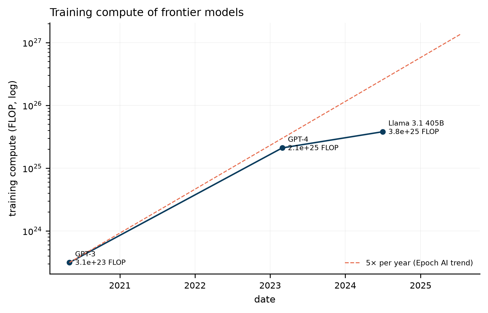

::: callout-important
## 写作说明 / Note

本文由 **AI（Trae Agent）** 检索、整理并撰写，**尚未经过人工逐条校对**。文中所有数字要么来自公开测量（`data/raw/benchmarks.csv`，逐行注明来源），要么来自随文附带的三个 Python 脚本（`experiments/01_trends.py`、`02_scaling.py`、`03_causal.py`，固定随机种子，可在普通 CPU 上重跑）。凡属模型模拟、思想实验或作者判断，均在文中单独标注。本文不预言任何公司或模型的命运。

This article was researched and written by an **AI system (Trae Agent)** and has **not been proofread line by line by a human**. Every number either comes from a public measurement (`data/raw/benchmarks.csv`, with a source on every row) or from one of the three Python scripts shipped with the post (`experiments/01_trends.py`, `02_scaling.py`, `03_causal.py`), which are seeded and run on an ordinary CPU. Model simulations, thought experiments and the author's judgements are labelled as such. Nothing here predicts the fate of any company or model.
:::

::: {.callout-note collapse="true"}
## 生成本文所用的提示词（压缩后） / Prompt used to generate this article (condensed)

> 写一篇中英双语研究随笔：LLM 会是通往 AGI 的最终道路吗？用可被数据反驳的方式回答"能力增长是否在系统性放缓"。手工整理 9 个基准、40 条公开成绩，做年化斜率、bootstrap 区间、Logistic/线性/指数 AIC 比较与变点分析；用 Chinchilla 参数做算力分配与数据墙计算；用一个匹配观测统计量的因果对照实验（被动观察 vs 随机干预）检验"预测下一个词是否等于理解世界"。必须记录负面结果与不确定性，区分事实、机制与判断。

> A bilingual research essay asking whether the LLM is the final road to AGI, answering "is capability growth systematically slowing?" in a way data can refute. Hand-curate 9 benchmarks and 40 public scores; compute annualised slopes, bootstrap intervals, AIC comparisons of logistic/linear/exponential fits and a change point; use Chinchilla constants for allocation and data-wall calculations; run a causal contrast (passive observation versus random intervention) matched on observational statistics to test whether next-token prediction implies understanding. Negative results and uncertainty must be recorded, and fact, mechanism and judgement kept apart.
:::

```{r}
#| label: setup
#| include: false
source(file.path(dirname(knitr::current_input()), "..", "..", "theme-blog.R"))
suppressPackageStartupMessages({
  library(jsonlite)
  library(knitr)
})

post_dir <- dirname(knitr::current_input())
met <- fromJSON(file.path(post_dir, "experiments", "outputs", "metrics.json"),
                simplifyVector = FALSE)

f <- function(x, d = 2) formatC(as.numeric(x), format = "f", digits = d)
sci <- function(x, d = 1) formatC(as.numeric(x), format = "e", digits = d)
pct <- function(x, d = 1) paste0(formatC(100 * as.numeric(x), format = "f", digits = d), "%")
num <- function(x, d = 0) format(round(as.numeric(x), d), big.mark = ",", scientific = FALSE)
```

## 1. 一张图里的两种叙事 / Two narratives in one figure

2022 年 11 月 30 日，一个聊天框让数亿人第一次感到"机器会思考了"。此后三年，每隔几个月就有新模型刷新榜单；再往后，更新依旧频繁，但许多人开始说："好像没那么震撼了。"

On 30 November 2022 a chat box made hundreds of millions of people feel, for the first time, that a machine could think. For three years afterwards new models topped the leaderboards every few months; then updates kept coming, but many people began to say that nothing felt impressive any more.

这两种感受都真实，却指向不同的问题。前者问的是**公众感知的跃迁**，后者问的是**能力本身的增长速度**。它们不是同一件事。一个模型可以在无人注意的基准上继续快速进步，也可以在万众瞩目的产品上只是换了界面。

Both feelings are real, but they point at different questions. The first is about **a jump in public perception**; the second about **the rate at which capability itself grows**. They are not the same thing. A model can keep improving quickly on benchmarks nobody watches, and a heavily promoted product can change nothing but its interface.

所以本文不打算从"感觉"出发，而是从可比较的测量出发，回答一个可以被数据反驳的问题。

So this article starts not from feeling but from comparable measurements, and asks a question that data can refute:

> **我们是否有足够的实证证据，认为大语言模型的能力增长正在系统性放缓？**
>
> **Do we have enough empirical evidence to conclude that large language models are systematically slowing down?**

先说结论：**没有。** 至少截至 2026 年 11 月，公开数据不支持"系统性放缓"这一判断。但这不意味着当前范式必然通向通用智能——这是两个独立的命题，后一个需要另外的论证。

The answer, stated up front, is **no**. As of November 2026 the public record does not support "systematic slowing". That does not mean the current paradigm necessarily leads to general intelligence: these are two independent claims, and the second needs a separate argument.

## 2. 从 AlexNet 到 GPT：十四年的加速度 / Fourteen years of acceleration

2012 年，AlexNet 在 ImageNet 上把错误率往下压了近十个百分点（Krizhevsky 等，2012）。那一年最重要的不是网络有多深，而是它证明了：**只要有足够的数据和算力，梯度下降可以在感知任务上打败精心设计的特征**。

In 2012 AlexNet pushed the ImageNet error rate down by nearly ten percentage points (Krizhevsky et al., 2012). The important thing that year was not depth; it was the demonstration that **with enough data and compute, gradient descent can beat hand-engineered features on a perceptual task**.

此后的路线几乎是沿着这个句子展开的：ResNet 解决深度（He 等，2016），Transformer 把序列建模统一成注意力（Vaswani 等，2017），GPT 系列把"预测下一个词"变成一个可扩展的目标（Brown 等，2020），Chinchilla 修正了参数与数据的分配（Hoffmann 等，2022），指令微调与人类反馈把能力包装成产品（Ouyang 等，2022；Bai 等，2022），思维链与强化学习把一部分计算从训练搬到推理（Wei 等，2022；Snell 等，2024）。中间还有一条支线：生成对抗网络把"学习"变成两个网络的博弈（Goodfellow 等，2014）。

What followed unfolded almost as a gloss on that sentence: ResNet solved depth (He et al., 2016), the Transformer unified sequence modelling as attention (Vaswani et al., 2017), the GPT series turned "predict the next token" into a scalable objective (Brown et al., 2020), Chinchilla corrected the allocation between parameters and data (Hoffmann et al., 2022), instruction tuning and human feedback packaged capability into products (Ouyang et al., 2022; Bai et al., 2022), and chain-of-thought plus reinforcement learning moved part of the compute from training to inference (Wei et al., 2022; Snell et al., 2024). A side branch turned "learning" into a game between two networks (Goodfellow et al., 2014).

图 1 把这些事件按类别排在两条时间轴上。值得注意的是，2012–2019 的主线是**架构**，2020 年之后的主线变成**规模与推理**：架构创新并没有停止，但它不再是能力跃迁的主要来源。

Figure 1 places these events on two timelines, coloured by category. Note that the main line of 2012–2019 was **architecture**, whereas after 2020 it became **scale and inference**: architecture work did not stop, but it is no longer the main source of capability jumps.

{fig-align="center" width="100%"}

与事件表配套的是算力。Epoch AI 根据硬件数量、训练时长与利用率重建了前沿模型的训练算力，给出的长期趋势约为每年 4–5 倍（Sevilla 等，2022；Epoch AI，2025）。图 2 画出了三个可查的估计值，并以每年 5 倍作为参考斜率——注意，这是**参考线**，不是对三个点的拟合。

The event table pairs with compute. Epoch AI reconstructs frontier training compute from hardware counts, training duration and utilisation, and reports a long-run trend of roughly 4–5× per year (Sevilla et al., 2022; Epoch AI, 2025). Figure 2 shows the three checkable estimates with a 5×/year reference slope — a **reference line**, not a fit to the three points.

{fig-align="center" width="70%"}

把这两张图放在一起，会得到一个不太浪漫的印象：过去十四年，这个领域的主要变量是**可用的计算量**，而不是某个突然降临的洞见。Sutton 把这种模式称为"苦涩的教训"（Sutton，2019）：能随算力扩展的方法最终会赢。这个观察是描述性的，不是规范性的——它不告诉我们这条路会通向哪里，只说它到目前为止很有效。

Put the two figures together and the impression is unromantic: for fourteen years the main variable in this field has been **available compute**, not a sudden insight. Sutton calls this the "bitter lesson" (Sutton, 2019): methods that scale with compute eventually win. The observation is descriptive, not normative — it says nothing about where the road leads, only that it has worked so far.

## 3. LLM 真的越来越慢了吗？ / Is progress actually slowing?

这是全文最重要的实证部分。方法必须交代清楚，否则结论没有意义。

This is the empirical core of the article. The method has to be stated plainly, or the conclusion means nothing.

### 3.1 数据与规则 / Data and rules

我手工整理了 `r met$llm_progress$n_benchmarks` 个基准、`r met$llm_progress$n_records` 条记录（`data/raw/benchmarks.csv`，访问日期 2026-11-17）。规则如下：

I hand-curated `r met$llm_progress$n_benchmarks` benchmarks and `r met$llm_progress$n_records` records (`data/raw/benchmarks.csv`, accessed 2026-11-17), under four rules:

1. **不跨版本拼接**。ARC-AGI-1 与 ARC-AGI-2 分开，SWE-bench 与 SWE-bench Verified 分开。\
    *Never splice versions. ARC-AGI-1 and ARC-AGI-2 are separate; so are SWE-bench and SWE-bench Verified.*
2. **不插值**。缺失的点就是缺失，不做平滑。\
    *Never interpolate. A missing point stays missing; no smoothing.*
3. **区分来源类型**。论文、厂商报告、第三方榜单、估算，四类分开记录。\
    *Distinguish source types: paper, vendor report, third-party leaderboard, estimate.*
4. **把 2026 年的部分条目视为暂定**。它们来自二级榜单，模型名有时被隐去。\
    *Treat some 2026 entries as provisional: they come from secondary leaderboards, and model names are sometimes withheld.*

这些规则会牺牲样本量，但能避免最常见的错误：把不同难度、不同评分口径的数字连成一条"趋势线"。

These rules cost sample size but block the most common error: joining numbers of different difficulty and different scoring conventions into one "trend line".

### 3.2 六条曲线 / Six curves

图 3 分别是 MMLU、GPQA、SWE-bench Verified、HLE、ARC-AGI 与 FrontierMath。纵轴都是"得分百分比"，但每个子图的横轴范围不同，因为各基准的寿命不同。这些数字大多来自厂商自己的系统卡与第三方榜单（Google DeepMind，2025；Anthropic，2025），不构成独立复现。

Figure 3 shows MMLU, GPQA, SWE-bench Verified, HLE, ARC-AGI and FrontierMath. The vertical axis is always percent score, but horizontal ranges differ because the benchmarks have different lifetimes. Most numbers come from vendor system cards and third-party leaderboards (Google DeepMind, 2025; Anthropic, 2025) and are not independent replications.

{fig-align="center" width="100%"}

肉眼可见的三件事：

Three things are visible by eye:

- **MMLU 已经接近天花板**。2020 年 GPT-3 的 43.9% 到 2024 年 GPT-4o 的 88.7%，四年涨了 45 个百分点；但再往上空间只剩 11 个点。\
    *MMLU is close to its ceiling: from 43.9% for GPT-3 in 2020 to 88.7% for GPT-4o in 2024, 45 points in four years — but only 11 points of headroom remain.*
- **GPQA 在 2023–2025 年经历了陡峭上升**，从 35.7% 到 91.9%，已经超过人类专家的平均水平。\
    *GPQA rose steeply over 2023–2025, from 35.7% to 91.9%, now above the average human expert.*
- **ARC-AGI-2 与 HLE 仍在快速上升**，而且离满分很远。ARC-AGI-2 在 2025 年一年内从 4.9% 跳到 84.6%（后者是延长推理的 Deep Think 模式），HLE 从 2.7% 到 54.8%（2026 年条目为暂定）。\
    *ARC-AGI-2 and HLE are still rising fast and are far from ceiling: ARC-AGI-2 jumped from 4.9% to 84.6% within 2025 (the latter in an extended-reasoning Deep Think mode), and HLE from 2.7% to 54.8% (2026 entries provisional).*

如果只看 MMLU，会得出"进步在放缓"的结论；如果只看 HLE，会得出"进步在加速"的结论。**两者都对，因为它们测的不是同一件事。**

Look only at MMLU and you conclude that progress is slowing; look only at HLE and you conclude that it is accelerating. **Both are right, because they do not measure the same thing.**

### 3.3 年化斜率与不确定性 / Annualised slopes and uncertainty

图 4 把每个（基准，版本）序列拟合成一条直线，给出"每年涨多少分"以及 95% 置信区间。这是一阶导数的最粗略版本。

Figure 4 fits a straight line to each (benchmark, version) series and reports points per year with a 95% confidence interval — the crudest possible first derivative.

{fig-align="center" width="85%"}

读法很重要：

How to read it:

- MMLU 约 `r f(met$llm_progress$slopes$MMLU$slope, 0)` 分/年，但它的高点已经逼近上限，斜率必然被压缩。\
    *MMLU gains about `r f(met$llm_progress$slopes$MMLU$slope, 0)` points per year, but its latest value is near the ceiling, so the slope is necessarily compressed.*
- GPQA 约 `r f(met$llm_progress$slopes$GPQA$slope, 0)` 分/年，SWE-bench 约 `r f(met$llm_progress$slopes[["SWE-bench"]]$slope, 0)` 分/年，HLE 约 `r f(met$llm_progress$slopes$HLE$slope, 0)` 分/年——三者在同一量级。\
    *GPQA about `r f(met$llm_progress$slopes$GPQA$slope, 0)`, SWE-bench about `r f(met$llm_progress$slopes[["SWE-bench"]]$slope, 0)` and HLE about `r f(met$llm_progress$slopes$HLE$slope, 0)` points per year — the same order of magnitude.*
- ARC-AGI-1 约 `r f(met$llm_progress$slopes[["ARC-AGI-1"]]$slope, 0)` 分/年，ARC-AGI-2 约 `r f(met$llm_progress$slopes[["ARC-AGI-2"]]$slope, 0)` 分/年，但后者的置信区间（±`r f(met$llm_progress$slopes[["ARC-AGI-2"]]$se, 0)`）宽到几乎没有信息量。\
    *ARC-AGI-1 about `r f(met$llm_progress$slopes[["ARC-AGI-1"]]$slope, 0)` and ARC-AGI-2 about `r f(met$llm_progress$slopes[["ARC-AGI-2"]]$slope, 0)` points per year, but the latter's standard error (±`r f(met$llm_progress$slopes[["ARC-AGI-2"]]$se, 0)`) is so wide that it carries almost no information.*
- FrontierMath 约 `r f(met$llm_progress$slopes$FrontierMath$slope, 0)` 分/年，显著低于其他基准。这是**唯一**一个"看起来慢"的曲线，而它恰好是难度最高、评测最严格的之一。\
    *FrontierMath gains about `r f(met$llm_progress$slopes$FrontierMath$slope, 0)` points per year, well below the others. It is the **only** curve that looks slow — and it happens to be among the hardest and most rigorously evaluated.*

这就引出一个关键区分：**基准的饱和速度 ≠ 能力的增长速度**。一个 90% 的基准每年只能再涨 10 分；一个 5% 的基准每年可以涨 80 分。用原始分数比较不同基准的"速度"，在数学上就是错的。合理的做法是看**剩余空间被填满的比例**，或者在对数几率（logit）尺度上比较。

This yields the key distinction: **the rate at which a benchmark saturates is not the rate at which capability grows**. A benchmark at 90% can gain at most 10 more points; one at 5% can gain 80. Comparing raw-score "speeds" across benchmarks is mathematically wrong. The right comparison is in terms of **the fraction of remaining headroom filled**, or on the logit scale.

### 3.4 饱和与"还要多久" / Saturation and "how long"

图 5 做了两件事：左边是各基准离满分还剩多少空间，右边是按最近一段的速度填满这些空间需要多少个月。

Figure 5 does two things: on the left, how much headroom each benchmark has to 100%; on the right, how many months the recent rate would need to fill it.

{fig-align="center" width="100%"}

数字本身不必当真——线性外推一定会低估饱和效应——但它揭示了一个结构性事实：**MMLU/GPQA 这类"知识型"基准正在耗尽，而 HLE/FrontierMath 这类"研究型"基准还有大量空间**。按当前斜率，MMLU 的剩余空间约 `r f(met$llm_progress$months_to_ceiling$MMLU, 1)` 个月填完，GPQA 约 `r f(met$llm_progress$months_to_ceiling$GPQA, 1)` 个月；而 FrontierMath 需要 `r f(met$llm_progress$months_to_ceiling$FrontierMath, 1)` 个月，HLE 需要 `r f(met$llm_progress$months_to_ceiling$HLE, 1)` 个月。当评测从"记住"转向"解决新问题"时，分数自然会掉下来，进步也会显得慢。这不是模型变笨了，而是尺子变长了。

The numbers should not be taken literally — linear extrapolation must underestimate saturation — but they reveal a structural fact: **"knowledge-type" benchmarks such as MMLU and GPQA are being exhausted, while "research-type" benchmarks such as HLE and FrontierMath still have a lot of room**. At the current slope the remaining MMLU headroom would close in about `r f(met$llm_progress$months_to_ceiling$MMLU, 1)` months and GPQA in about `r f(met$llm_progress$months_to_ceiling$GPQA, 1)`; FrontierMath would need `r f(met$llm_progress$months_to_ceiling$FrontierMath, 1)` months and HLE `r f(met$llm_progress$months_to_ceiling$HLE, 1)`. When evaluation moves from remembering to solving new problems, scores naturally drop and progress looks slow. The model has not become duller; the ruler has become longer.

### 3.5 哪种增长模型更像？ / Which growth model fits?

图 6 对 MMLU 与 GPQA 分别拟合了线性、指数与 Logistic 三条曲线，并给出 AIC。

Figure 6 fits linear, exponential and logistic curves to MMLU and GPQA and reports AIC.

{fig-align="center" width="100%"}

AIC 的结论很清楚：Logistic 胜出（MMLU：`r f(met$llm_progress$aic$MMLU$logistic, 1)` vs `r f(met$llm_progress$aic$MMLU$linear, 1)` vs `r f(met$llm_progress$aic$MMLU$exponential, 1)`；GPQA：`r f(met$llm_progress$aic$GPQA$logistic, 1)` vs `r f(met$llm_progress$aic$GPQA$linear, 1)` vs `r f(met$llm_progress$aic$GPQA$exponential, 1)`）。这符合直觉——任何有上限的测试，其分数增长最终都会变慢。**但请注意：Logistic 的饱和参数是拟合出来的，不是测出来的。** 用一条 Logistic 曲线去断言"2027 年就会饱和"，和在 2020 年用指数曲线断言"2023 年就会达到人类水平"一样不可靠。

The AIC verdict is clear: logistic wins (MMLU `r f(met$llm_progress$aic$MMLU$logistic, 1)` vs `r f(met$llm_progress$aic$MMLU$linear, 1)` vs `r f(met$llm_progress$aic$MMLU$exponential, 1)`; GPQA `r f(met$llm_progress$aic$GPQA$logistic, 1)` vs `r f(met$llm_progress$aic$GPQA$linear, 1)` vs `r f(met$llm_progress$aic$GPQA$exponential, 1)`). That matches intuition: any test with a ceiling must slow down eventually. **But note that the logistic asymptote is fitted, not measured.** Using a logistic curve to declare "saturation by 2027" is as unreliable as using an exponential curve in 2020 to declare "human level by 2023".

### 3.6 变点分析 / Change-point analysis

我还在 GPQA 上做了分段线性拟合，用 BIC 在候选变点上搜索。最优变点在 **`r f(met$llm_progress$gpqa_breakpoint_year, 1)` 年**附近，变点前斜率约 `r f(met$llm_progress$gpqa_slope_before, 0)` 分/年，变点后约 `r f(met$llm_progress$gpqa_slope_after, 1)` 分/年。

I also fitted a piecewise-linear model to GPQA, searching candidate breakpoints by BIC. The best breakpoint sits near **`r f(met$llm_progress$gpqa_breakpoint_year, 2)`**, with a slope of about `r f(met$llm_progress$gpqa_slope_before, 0)` points per year before it and about `r f(met$llm_progress$gpqa_slope_after, 1)` after it.

这个结果看起来支持"放缓"，但必须加上三条限制：

The result looks like support for "slowing", but three limits apply:

1. 只有 5 个数据点，变点位置极不稳定；\
    *with only five points, the breakpoint location is unstable;*
2. 变点之后的点只有 3 个，斜率的置信区间很宽；\
    *only three points follow the breakpoint, so the post-breakpoint slope has a wide interval;*
3. 变点恰好对应"接近天花板"，因此"放缓"与"饱和"在统计上无法区分。\
    *the breakpoint coincides with "near ceiling", so "slowing" and "saturation" cannot be separated statistically.*

**所以我不会把它当作放缓的证据。** 它更像是一个提醒：当基准接近上限时，任何增长模型都会显示变缓，这是测量问题，不一定是能力问题。

**So I do not treat it as evidence of slowing.** It is a reminder: near a ceiling every growth model flattens, and that is a measurement problem, not necessarily a capability one.

### 3.7 时间跨度：一个没有被饱和污染的量 / Time horizon: a measure not polluted by ceilings

如果所有基准最终都会饱和，有没有一个不容易撞墙的指标？METR 的"50% 时间跨度"是一个候选：让模型完成一系列软件任务，测量它能以 50% 成功率完成的任务的人类完成时长（Kwa 等，2025）。这个量没有天然上限（人类任务可以长达数月），因此在 log 尺度上观察它的斜率更有意义。

If every benchmark eventually saturates, is there a measure that does not hit a wall? METR's "50% time horizon" is a candidate: give a model a suite of software tasks and measure the human completion time of the tasks it finishes with 50% success (Kwa et al., 2025). The quantity has no natural ceiling (human tasks can take months), so its slope is more meaningful on a log scale.

![**图 7**　（a）METR 50% 时间跨度的公开估计，纵轴为分钟（对数）。拟合给出 4.8 个月翻倍，bootstrap 95% 区间 2.7–6.2 个月；METR 官方 Time Horizon 1.1 报告 2023 年后 130.8 天、2024 年后 89 天。（b）API 列表价格。注意 GPT-4 与 GPT-4o-mini 不是同一能力档位，此图不构成"同能力降价"的证据。 | **Figure 7.** (a) Public estimates of the METR 50% time horizon, log minutes on the vertical axis. The fit gives a 4.8-month doubling with a bootstrap 95% interval of 2.7–6.2 months; METR's own Time Horizon 1.1 reports 130.8 days after 2023 and 89 days after 2024. (b) API list prices. GPT-4 and GPT-4o-mini are not in the same capability class, so this is not evidence of equal-capability price decline.](figures/fig05_metr.png){fig-align="center" width="100%"}

用 6 个公开点做指数拟合，得到 **`r f(met$llm_progress$metr_doubling_months, 1)` 个月翻倍**，bootstrap 95% 区间 **`r f(met$llm_progress$metr_doubling_ci[[1]], 1)`–`r f(met$llm_progress$metr_doubling_ci[[2]], 1)` 个月**。METR 自己在 2026 年 1 月的更新中给出 `r f(met$llm_progress$metr_official_doubling_days_th11, 1)` 天（2023 年后）与 `r f(met$llm_progress$metr_official_doubling_days_since_2024, 1)` 天（2024 年后）（METR，2026）。三者互相印证：**在 2023–2026 年这段时间里，可自主完成的任务长度大约每 3–5 个月翻一倍。**

An exponential fit to the six public points gives a **doubling every `r f(met$llm_progress$metr_doubling_months, 1)` months**, with a bootstrap 95% interval of **`r f(met$llm_progress$metr_doubling_ci[[1]], 1)`–`r f(met$llm_progress$metr_doubling_ci[[2]], 1)` months**. METR's own January 2026 update reports `r f(met$llm_progress$metr_official_doubling_days_th11, 1)` days after 2023 and `r f(met$llm_progress$metr_official_doubling_days_since_2024, 1)` days after 2024 (METR, 2026). The three agree: **over 2023–2026 the length of autonomously completable tasks doubled roughly every three to five months.**

这是我在全部数据中看到的最强的"没有放缓"证据。它也有明显弱点：任务集在 2026 年被更新过（TH1.1），新旧任务分布不同；单点估计的置信区间很宽；而且"软件任务"是一个特定领域。

This is the strongest evidence against slowing in the whole dataset. It has clear weaknesses too: the task suite was updated in 2026 (TH1.1), so old and new task distributions differ; the interval on a single point estimate is wide; and "software tasks" are one specific domain.

### 3.8 成本：另一条曲线 / Cost: another curve

能力/美元是第三个维度。图 7(b) 画的是 API 列表价格：GPT-4 的 60 美元/百万输出 token，到 GPT-4o 的 10 美元，再到 GPT-4o-mini 的 0.6 美元，相差约 `r f(met$llm_progress$price_drop_factor, 0)` 倍。

Capability per dollar is a third dimension. Figure 7(b) plots API list prices: 60 USD per million output tokens for GPT-4, 10 for GPT-4o, 0.6 for GPT-4o-mini — a factor of about `r f(met$llm_progress$price_drop_factor, 0)`.

这个下降**不是同能力比较**：GPT-4o-mini 比 GPT-4 弱。斯坦福 AI Index 2025 报告的是"达到 GPT-3.5 水平"的推理成本在 2022–2024 年间下降约 280 倍（Stanford HAI，2025），那是同能力口径。两个数字不能混用。我在图注里明确写了这一点，因为这类混淆在二手报道中极其常见。

That drop is **not** capability-matched: GPT-4o-mini is weaker than GPT-4. The Stanford AI Index 2025 reports that the inference cost of reaching GPT-3.5-level performance fell about 280-fold between 2022 and 2024 (Stanford HAI, 2025) — that is the matched measure. The two numbers must not be mixed. The figure caption says so explicitly, because this confusion is extremely common in secondary reporting.

### 3.9 那么，到底有没有放缓？ / So, is it slowing?

把证据摊开：

Lay the evidence out:

| 观察 / Observation | 支持"放缓" / For slowing | 反对"放缓" / Against slowing |
|---|---|---|
| 简单基准（MMLU） / Easy benchmarks | 接近饱和，斜率下降 / near saturation, slope falling | 饱和是天花板效应，不是能力停滞 / saturation is a ceiling effect, not stagnation |
| 困难基准（HLE、ARC-AGI-2） / Hard benchmarks | — | 2025–2026 年仍在快速上升 / still rising fast in 2025–2026 |
| 数学（FrontierMath） / Mathematics | 年化斜率最低 / lowest annual slope | 起点极低，且评测最严格 / starts very low and is the most rigorous |
| 自主任务时长（METR） / Time horizon | — | 3–5 个月翻倍，2024 年后可能更快 / doubles in 3–5 months, perhaps faster after 2024 |
| 单位成本 / Unit cost | — | 同能力成本大幅下降 / matched cost fell sharply |
| 用户感知 / Public perception | 产品更新缺乏"惊艳感" / updates feel unremarkable | 感知受产品周期、期望值、媒体叙事影响 / perception follows product cycles and expectations |

这张表的两列并不对称：支持"放缓"的一列几乎全部可以由天花板效应解释，而反对"放缓"的一列包含两个尚未饱和的指标（HLE、METR）。**结论：没有系统性放缓的证据。** 相反，在几个未被饱和污染的指标上，进步速度甚至略高于 2023–2024 年。

The two columns are not symmetric: almost everything in the "for slowing" column can be explained by ceilings, while the "against" column contains two unsaturated measures (HLE, METR). **The conclusion is that there is no evidence of systematic slowing.** On several measures not polluted by saturation, progress is if anything slightly faster than in 2023–2024.

但这不是为当前范式背书。它只说明：**"LLM 遇到瓶颈"这个说法，目前是错的。** 一个错误的反对理由，会让人错过真正的问题。

This is not an endorsement of the paradigm. It says only that **"LLMs have hit a wall" is, for now, wrong**. A bad reason for opposing something makes people miss the real problem.

## 4. Scaling Law 究竟意味着什么？ / What scaling laws actually mean

### 4.1 两个幂律 / Two power laws

Kaplan 等人发现，语言模型的测试损失随参数量、数据量与计算量呈幂律下降（Kaplan 等，2020）：

Kaplan and colleagues found that test loss falls as a power law in parameters, data and compute (Kaplan et al., 2020):

$$
L(N) \approx \left(\frac{N_c}{N}\right)^{\alpha_N}, \qquad
L(D) \approx \left(\frac{D_c}{D}\right)^{\alpha_D}.
$$

Hoffmann 等人把它写成一个可加形式（Hoffmann 等，2022）：

Hoffmann and colleagues wrote it in additive form (Hoffmann et al., 2022):

$$
L(N,D) = E + \frac{A}{N^{\alpha}} + \frac{B}{D^{\beta}},
$$

其中 $E$ 是不可约损失，$A/N^{\alpha}$ 与 $B/D^{\beta}$ 分别是"参数不够"和"数据不够"的惩罚。用他们拟合的常数（$E=`r f(met$scaling$constants$E, 2)`$，$A=`r f(met$scaling$constants$A, 1)`$，$B=`r f(met$scaling$constants$B, 1)`$，$\alpha=`r f(met$scaling$constants$alpha, 2)`$，$\beta=`r f(met$scaling$constants$beta, 2)`$），并假设训练计算 $C \approx 6ND$，就可以算出任意预算下的最优分配。

Here $E$ is the irreducible loss, and $A/N^{\alpha}$ and $B/D^{\beta}$ are the penalties for too few parameters and too little data. With their fitted constants ($E=`r f(met$scaling$constants$E, 2)`$, $A=`r f(met$scaling$constants$A, 1)`$, $B=`r f(met$scaling$constants$B, 1)`$, $\alpha=`r f(met$scaling$constants$alpha, 2)`$, $\beta=`r f(met$scaling$constants$beta, 2)`$) and the approximation $C \approx 6ND$, the optimal allocation follows at any budget.

{fig-align="center" width="100%"}

### 4.2 一个容易被忽略的细节 / An easily overlooked detail

用这组参数做最优化，得到的"每参数多少 token"并不是常说的 20，而是 **`r f(met$scaling$tokens_per_param_at_1e23, 0)`**（$10^{23}$ FLOP 量级），在 $10^{21}$ 与 $10^{25}$ 两端分别更小与更大。也就是说，Chinchilla 拟合隐含的最优分配比"20 token/参数"这条经验法则更偏数据。

Optimising with this parameter set gives **`r f(met$scaling$tokens_per_param_at_1e23, 0)` tokens per parameter** at around $10^{23}$ FLOP — not the 20 usually quoted — with smaller and larger values at the $10^{21}$ and $10^{25}$ ends. In other words, the Chinchilla fit implies a more data-heavy optimum than the 20-tokens-per-parameter rule of thumb.

{fig-align="center" width="100%"}

这不是代码错误，而是一个真实的科学状况：**不同拟合方法给出的指数不同，因而给出的"最优"也不同。** Hoffmann 等人的三种拟合方法本身就有分歧，后续复现也发现参数估计对数据范围敏感（Besiroglu 等，2024）。所谓"20 token/参数"是一条经验法则，不是定律。

This is not a coding error but a scientific fact: **different fitting methods give different exponents, hence different "optima"**. Hoffmann et al.'s three fitting approaches already disagree with each other, and later replication found the estimates sensitive to the data range (Besiroglu et al., 2024). "20 tokens per parameter" is a rule of thumb, not a law.

这件事的意义在于：当你看到"某模型用了 20 倍 token，所以是 compute-optimal"这类说法时，它其实依赖一个特定的拟合选择，而不是一个普适常数。

The practical consequence: when you read "model X used 20× tokens, so it is compute-optimal", that claim depends on a particular fitting choice, not on a universal constant.

### 4.3 数据墙与边际收益 / The data wall and marginal returns

如果高质量文本是有限的，那么"加算力"最终会撞上"没数据"；而训练成本本身也在上升（Cottier 等，2024）。图 10 假设可用唯一 token 上限为 $`r sci(met$scaling$data_wall_tokens, 0)`$，比较无约束与有约束两条前沿。

If high-quality text is finite, then "more compute" eventually meets "no more data"; and training costs are rising anyway (Cottier et al., 2024). Figure 10 sets the unique-token ceiling at $`r sci(met$scaling$data_wall_tokens, 0)`$ and compares the unconstrained and constrained frontiers.

{fig-align="center" width="100%"}

这里有一个常被误读的点：图 10(b) 中"每 10 倍算力带来的收益"在下降，但这不是"收益递减"的新发现，而是幂律的算术后果。真正的问题是：**这些损失上的收益，能不能兑换成能力上的收益？**

A commonly misread point: in Figure 10(b) the gain per 10× compute is falling, but that is not a new discovery about diminishing returns; it is arithmetic under a power law. The real question is whether **gains in loss can be exchanged for gains in capability**.

答案是不能直接兑换。损失是平均的下一 token 预测误差，能力是任务上的成功率。二者之间隔着数据分布、任务格式、解码策略与评测设计。数据重复的收益也会递减：在固定 token 预算下，重复四个 epoch 之后的边际收益接近于零（Muennighoff 等，2023）。Schaeffer 等人甚至指出，所谓的"涌现"可能只是评测指标非线性造成的假象（Schaeffer 等，2023）——这个论点本身也有争议，但它提醒我们：**不要把损失曲线当成能力曲线。**

The answer is no, not directly. Loss is an average next-token prediction error; capability is a success rate on a task. Between them sit the data distribution, the task format, the decoding strategy and the evaluation design. Data repetition also saturates: under a fixed token budget the marginal return approaches zero after about four epochs (Muennighoff et al., 2023). Schaeffer and colleagues go further and argue that "emergence" may be an artefact of nonlinear metrics (Schaeffer et al., 2023) — a contested claim, but a useful warning: **do not read a loss curve as a capability curve.**

### 4.4 推理时计算与强化学习 / Test-time compute and reinforcement learning

2024 年之后，一个重要的变化是：**计算从训练阶段搬到了推理阶段**。思维链让模型在回答前生成中间步骤（Wei 等，2022），测试时扩展可以在固定模型上通过更多采样与搜索提升表现（Snell 等，2024），强化学习则把"会做题"变成"会探索"（DeepSeek-AI，2025；OpenAI，2024）。

After 2024 an important shift occurred: **compute moved from training to inference**. Chain of thought lets a model generate intermediate steps before answering (Wei et al., 2022); test-time scaling improves a fixed model through more sampling and search (Snell et al., 2024); and reinforcement learning turns "can solve" into "can explore" (DeepSeek-AI, 2025; OpenAI, 2024).

这改变了 Scaling Law 的形式：不再只有 $L(N,D)$，还要加上推理预算 $R$。一个粗略的写法是

This changes the form of the scaling law: it is no longer $L(N,D)$ but also a function of inference budget $R$. A rough form is

$$
L(N,D,R) \approx E + \frac{A}{N^\alpha} + \frac{B}{D^\beta} + \frac{G}{R^\gamma},
$$

其中 $\gamma$ 的取值目前没有共识。这个式子是**示意性的**，不是拟合结果。

where there is no consensus on $\gamma$. The expression is **illustrative**, not a fit.

它带来的工程后果很实际：当推理成本被计入总成本时，最优模型会变小。图 11 用同一个损失目标，比较 $10^9$、$10^{11}$、$10^{13}$ 次推理请求下的总计算成本。

The engineering consequence is concrete: once inference is counted, the optimal model gets smaller. Figure 11 compares total compute cost under $10^9$, $10^{11}$ and $10^{13}$ inference requests for the same loss target.

{fig-align="center" width="85%"}

这解释了为什么 2024–2026 年出现大量"小模型 + 长推理"的产品：不是模型变聪明了，而是**成本函数变了**。

This explains the wave of "small model plus long reasoning" products in 2024–2026: the cost function changed, not the intelligence.

## 5. 预测下一个词，等于理解世界吗？ / Does predicting the next token mean understanding the world?

### 5.1 三种常见的混淆 / Three common confusions

- **"自回归 = 不能有世界模型"**：不成立。预测下一个词需要在内部表示语法、事实、甚至一些物理规律；这本身就是一种世界模型，只是它的形式不是符号化的。世界模型研究已经表明，预测性的内部模型可以被用来做规划（Ha & Schmidhuber，2018）；预测编码理论也把感知本身看作自上而下的预测（Rao & Ballard，1999）。\
    *"Autoregressive means no world model" is false. Predicting the next token requires internal representations of syntax, facts and some physical regularities; that is a world model, just not a symbolic one. Work on world models shows that predictive internal models can support planning (Ha & Schmidhuber, 2018), and predictive coding treats perception itself as top-down prediction (Rao & Ballard, 1999).*
- **"相关性 = 因果性"**：不成立，但在数据充足且无干预时，二者在预测任务上不可区分——这正是问题所在。\
    *"Correlation equals causation" is false, but with enough data and no intervention the two are indistinguishable on a prediction task — which is exactly the problem.*
- **"现在不会 = 永远不会"**：不成立。能力可以随规模、架构、训练方式改变。\
    *"Cannot now means never" is false. Capability can change with scale, architecture and training.*

真正值得问的是一个更窄、更可检验的问题：

The question worth asking is narrower and testable:

> **仅从被动观察的序列中学习，能否识别出干预下仍然成立的因果结构？**
>
> **Can learning from passively observed sequences alone identify causal structure that survives intervention?**

### 5.2 一个配对实验 / A matched-pair experiment

我构造了两个环境，它们有两个可见变量 $x,y$，隐藏机制不同：

I built two environments with two visible variables $x,y$ and different hidden mechanisms:

- **环境 A（直接因果）**：$x_t = 0.8x_{t-1}+\varepsilon$，$y_t = 0.6x_t + 0.5y_{t-1}+\varepsilon$。\
    *Environment A (direct causation): $x_t = 0.8x_{t-1}+\varepsilon$, $y_t = 0.6x_t + 0.5y_{t-1}+\varepsilon$.*
- **环境 B（隐藏混杂）**：$z_t$ 是一个不可观测的 AR(1) 过程，$x_t = p z_t + \varepsilon$，$y_t = q z_t + 0.5y_{t-1}+\varepsilon$，**没有 $x\to y$ 的边**。\
    *Environment B (hidden confounder): $z_t$ is an unobserved AR(1) process, $x_t = p z_t + \varepsilon$, $y_t = q z_t + 0.5y_{t-1}+\varepsilon$, and **there is no $x\to y$ edge**.*

我调整 B 的参数，使两个环境的 $x$ 自相关、$y$ 自相关、$x$–$y$ 互相关在滞后 0–2 上尽量一致。最终最大偏差为 **`r f(met$causal_world$max_stat_mismatch, 3)`**（图 12c）。也就是说，**仅看观测数据，两个环境几乎无法区分**。

I tuned B's parameters so that the autocorrelation of $x$, the autocorrelation of $y$ and the cross-correlation of $x$ and $y$ at lags 0–2 match as closely as possible. The largest mismatch is **`r f(met$causal_world$max_stat_mismatch, 3)`** (Figure 12c). **On observational data alone the two environments are almost indistinguishable.**

{fig-align="center" width="100%"}

两个学习器使用**同一个模型类**（把 $y_t$ 回归到 $y_{t-1}$ 与 $x_t$），样本量也相同（20 000）：

Both learners use **the same model class** (regress $y_t$ on $y_{t-1}$ and $x_t$) and the same sample size (20,000):

- **被动学习器**：只从未干预的观测序列学习；\
    *passive: learns only from unperturbed observation sequences;*
- **主动学习器**：一半样本来自对 $x$ 的随机干预。\
    *active: half the samples come from random interventions on $x$.*

我另外加了一个"被动 + 10 倍数据"的对照，用来检验"多喂数据能否消除偏差"。

I added a "passive plus 10× data" control to test whether more data removes the bias.

### 5.3 结果 / Results

{fig-align="center" width="100%"}

关键数字：

The key numbers:

- 训练分布 $R^2$：A 被动 `r f(met$causal_world$r2_indist$A_passive, 2)`，B 被动 `r f(met$causal_world$r2_indist$B_passive, 2)`，B 主动 `r f(met$causal_world$r2_indist$B_active, 2)`。**都能拟合。**\
    *Training-distribution $R^2$: A passive `r f(met$causal_world$r2_indist$A_passive, 2)`, B passive `r f(met$causal_world$r2_indist$B_passive, 2)`, B active `r f(met$causal_world$r2_indist$B_active, 2)`. **All three fit.***
- 干预分布 $R^2$：B 被动 **`r f(met$causal_world$r2_shift$B_passive, 2)`**，B 主动 **`r f(met$causal_world$r2_shift$B_active, 2)`**，B 被动 10 倍数据 **`r f(met$causal_world$r2_shift$B_passive10x, 2)`**。\
    *Interventional-distribution $R^2$: B passive **`r f(met$causal_world$r2_shift$B_passive, 2)`**, B active **`r f(met$causal_world$r2_shift$B_active, 2)`**, B passive with 10× data **`r f(met$causal_world$r2_shift$B_passive10x, 2)`**.*
- 估计的 $x$ 系数：B 被动 **`r f(met$causal_world$coef_x$passive, 3)`**，B 主动 **`r f(met$causal_world$coef_x$active, 3)`**，B 被动 10 倍 **`r f(met$causal_world$coef_x$passive10x, 3)`**（真值 0）。\
    *Estimated coefficient on $x$: B passive **`r f(met$causal_world$coef_x$passive, 3)`**, B active **`r f(met$causal_world$coef_x$active, 3)`**, B passive 10× **`r f(met$causal_world$coef_x$passive10x, 3)`** (true value 0).*

多 10 倍数据没有让偏差变小。这是混杂的定义性特征：**偏差不会随样本量消失，它只会被估计得更精确。**

Ten times more data does not shrink the bias. That is the defining property of confounding: **bias does not vanish with sample size; it merely becomes more precisely estimated.**

### 5.4 反事实与"错符号" / Counterfactuals and a wrong sign

为了看后果，我又构造了环境 C：$x$ 确实会让 $y$ 下降（真实系数 $-0.6$），但混杂因子把观测关联推成正的。

To see the consequence I built environment C: $x$ really does lower $y$ (true coefficient $-0.6$), but the confounder pushes the observed association positive.

{fig-align="center" width="100%"}

被动学习器在 C 中给出 **`r f(met$causal_world$coef_x_envC_passive, 2)`**，主动学习器给出 **`r f(met$causal_world$coef_x_envC_active, 2)`**（真值 $-0.6$）。**一个符号错误，在控制任务中意味着朝反方向用力。**

The passive learner gives **`r f(met$causal_world$coef_x_envC_passive, 2)`** in C; the active learner gives **`r f(met$causal_world$coef_x_envC_active, 2)`** (true value $-0.6$). **A wrong sign in a control task means pushing in the opposite direction.**

### 5.5 这个实验不能说明什么 / What this experiment cannot show

必须说清楚限制：

The limits must be stated:

1. 这是**线性、双变量、平稳**的玩具环境。真实世界的因果结构是非线性、高维、非平稳的。\
    *The environment is **linear, bivariate and stationary**. Real causal structure is nonlinear, high-dimensional and non-stationary.*
2. 主动学习器之所以赢，是因为实验允许它做**随机干预**。在无法干预的领域（历史、天文、部分医学），这个优势不存在。\
    *The active learner wins because the experiment allows **random intervention**. In domains where intervention is impossible (history, astronomy, parts of medicine) the advantage disappears.*
3. 结论不是"LLM 学不到因果"，而是"**被动数据在原则上不足以识别某些因果结构**"。一个足够大的模型可以用先验知识弥补一部分，但先验本身来自别处的干预或演化。\
    *The conclusion is not "LLMs cannot learn causality" but "**passive data is in principle insufficient to identify some causal structures**". A large enough model can compensate with priors, but the priors come from interventions or evolution elsewhere.*
4. 反过来，干预也有代价：它改变系统、消耗资源、可能不可逆。\
    *Conversely, intervention has costs: it changes the system, consumes resources and may be irreversible.*

因果推断为此提供了两条替代路线：一是寻找在多个环境中保持不变的条件分布（不变因果预测；Peters 等，2016），二是学习可迁移的因果表示（Schölkopf 等，2021；Peters 等，2017）。领域泛化的实验也说明，仅仅在更多环境上训练并不自动带来不变性（Gulrajani & Lopez-Paz，2021）。

Causal inference offers two alternative routes: finding conditional distributions that stay invariant across environments (invariant causal prediction; Peters et al., 2016), and learning transferable causal representations (Schölkopf et al., 2021; Peters et al., 2017). Domain-generalisation experiments also show that training on more environments does not automatically produce invariance (Gulrajani & Lopez-Paz, 2021).

所以这一节的结论是温和的：**预测能力的提升，不等于因果理解的提升；而在需要干预的场合，二者会分道扬镳。** 这不构成对 LLM 的否定，只是划出一个它无法仅靠"更多文本"跨越的边界。

The conclusion of this section is therefore modest: **better prediction is not better causal understanding, and where intervention matters the two diverge.** This is not a refutation of LLMs; it draws a boundary that more text alone cannot cross.

## 6. 通往 AGI，需要的究竟是什么？ / What does AGI actually require?

### 6.1 定义先于争论 / Definition precedes argument

"AGI"至少有三种用法：

"AGI" is used in at least three ways:

- **能力清单式**：在若干任务上达到人类水平（Chollet 批评这种定义，2019）。\
    *A checklist of capabilities: human level on a set of tasks (a definition Chollet criticises, 2019).*
- **经济替代式**：能完成大多数有经济价值的工作。\
    *Economic substitution: able to do most economically valuable work.*
- **适应式**：能在新环境中快速获取新技能，而不只是执行已训练的技能。\
    *Adaptation: able to acquire new skills quickly in new environments, not merely execute trained ones.*

三种定义对应不同的证据。当前的基准主要测第一种；METR 的时间跨度部分触及第三种；第二种几乎没有严格测量。

The three definitions require different evidence. Current benchmarks mostly test the first; METR's time horizon partly touches the third; the second is almost never measured rigorously.

### 6.2 把"通用"拆开 / Decomposing "general"

| 维度 / Dimension | 已有明显进展 / Clear progress | 仍有争议或不足 / Contested or missing |
|---|---|---|
| 知识广度 / Breadth of knowledge | MMLU、GPQA 接近或超过专家 / near or above expert | 知识时效、幻觉 / freshness, hallucination |
| 代码与工具使用 / Code and tools | SWE-bench 从 49% 到 80% / 49% to 80% | 长程项目、真实仓库维护 / long projects, real repositories |
| 数学推理 / Mathematical reasoning | FrontierMath 从 25% 到 38% / 25% to 38% | 研究级数学仍很低 / research mathematics still low |
| 抽象与新颖问题 / Abstraction, novelty | ARC-AGI-2 快速上升 / rising fast | 高分依赖延长推理与算力 / depends on long reasoning |
| 长程自主 / Long-horizon autonomy | 时间跨度 3–5 个月翻倍 / doubling in 3–5 months | 可靠性、错误恢复 / reliability, recovery |
| 持续学习 / Continual learning | 上下文内学习很强 / strong in-context | 权重不更新，跨会话不积累 / frozen weights |
| 主动探索 / Active exploration | 强化学习环境内有效 / effective in RL environments | 开放世界样本效率低 / poor sample efficiency |
| 因果与干预 / Causality and intervention | 工具使用提供部分干预 / tools provide some intervention | 被动语料无法识别混杂 / passive corpora cannot identify confounding |
| 具身与行动 / Embodiment | 机器人进展缓慢 / slow progress | 数据与安全问题 / data and safety |

这张表是我的判读，不是元分析。它的作用是显示：**进展是高度不均匀的**，而不是"全面接近人类"或"全面停滞"。

This table is my reading, not a meta-analysis. Its purpose is to show that **progress is highly uneven** — neither uniformly approaching human level nor uniformly stalled.

### 6.3 那么，语言模型是最终道路吗？ / So, is the language model the final road?

我的回答分三层。

My answer has three layers.

**第一层（事实）**：截至 2026 年 11 月，没有证据表明 LLM 的能力增长在系统性放缓。多个未被饱和污染的指标仍在快速上升。任何以"LLM 已经撞墙"为前提的论证，目前都缺乏数据支持。

**Layer one (fact).** As of November 2026 there is no evidence that LLM capability growth is systematically slowing. Several unsaturated measures are still rising fast. Any argument premised on "LLMs have hit a wall" currently lacks data.

**第二层（机制）**：语言模型是一个极强的**认知引擎**：它压缩了大量人类知识，能在上下文里做类比、分解、验证。但它有两个结构性特征：训练是**被动的**（数据来自观察，而非干预），权重是**冻结的**（不会在部署中持续学习）。这两个特征不是缺陷，而是设计选择；它们决定了模型擅长"重述与组合"，不擅长"在陌生环境中通过行动获取新知识"。

**Layer two (mechanism).** A language model is an extremely strong **cognitive engine**: it compresses a great deal of human knowledge and can analogise, decompose and verify within a context. But it has two structural features: training is **passive** (data come from observation, not intervention), and weights are **frozen** (no continual learning in deployment). These are design choices rather than defects, and they make the model good at restating and recombining, poor at acquiring new knowledge by acting in an unfamiliar environment.

**第三层（判断）**：即使语言模型继续变强，**"超越语言预测的长期适应机制"仍然是另一个问题**。这不是说 LLM 必须被取代，而是说：如果 AGI 的定义包含"在开放环境中持续学习"，那么光靠扩大预训练与推理，可能不够。

**Layer three (judgement).** Even if language models keep improving, **a long-run adaptation mechanism beyond next-token prediction remains a separate problem**. This does not mean LLMs must be replaced; it means that if the definition of AGI includes continual learning in an open environment, scaling pre-training and inference may not suffice.

所以，与其问"LLM 是不是最终道路"，不如问一个更可操作的问题：

So instead of asking whether the LLM is the final road, ask a more operational question:

> **一个系统需要什么样的组织方式，才能在部署之后继续改变自己？**
>
> **How must a system be organised so that it can keep changing itself after deployment?**

这正是后两篇文章的主题：演化能否提供一种不同的答案（《智能不是被训练出来的，而是演化出来的吗？》），以及我们能否从更基本的计算规则出发，构造一个能长期演化的系统（《如果我们从未发明神经网络，人工智能会是什么样？》）。

That is the subject of the next two posts: whether evolution offers a different answer (*Is Intelligence Evolved or Trained?*), and whether a system that keeps evolving can be built from more basic computational rules (*What If We Never Invented Neural Networks?*).

## 7. 方法与局限 / Methods and limits

- **趋势拟合**：OLS 斜率 + 解析标准误；bootstrap 2 000 次重采样给出区间。样本量 3–7，区间很宽。\
    *Trend fitting: OLS slope with analytic standard error; 2,000 bootstrap resamples for intervals. Sample sizes are 3–7, so intervals are wide.*
- **模型比较**：线性/指数/Logistic 的 AIC；Logistic 的饱和参数是拟合值，不是测量值。\
    *Model comparison: AIC across linear, exponential and logistic fits; the logistic asymptote is fitted, not measured.*
- **变点**：BIC 网格搜索，仅在 GPQA 上做，结果不稳定，未作为主要证据。\
    *Change point: BIC grid search, GPQA only; unstable, and not used as primary evidence.*
- **因果实验**：线性高斯、平稳、双变量；参数经最小二乘匹配观测统计量；20 个随机种子；所有指标以均值 ± 标准差报告。\
    *Causal experiment: linear-Gaussian, stationary, bivariate; parameters fitted by least squares to match observational statistics; 20 seeds; all metrics reported as mean ± SD.*
- **未做的事**：没有对任何商用模型做独立评测；没有访问厂商内部数据；没有做跨基准的能力因子分析（样本量不足）。\
    *Not done: no independent evaluation of any commercial model; no access to vendor data; no cross-benchmark factor analysis of capability (insufficient sample size).*

脚本与数据都在本目录：`experiments/01_trends.py`（趋势、区间、AIC、变点）、`02_scaling.py`（分配、数据墙、推理成本）、`03_causal.py`（匹配环境与被动/主动学习）；`data/raw/benchmarks.csv` 每行都注明来源。重跑 `python experiments/01_trends.py` 即可复现全部数字与图。

Scripts and data sit in this directory: `experiments/01_trends.py` (trends, intervals, AIC, change point), `02_scaling.py` (allocation, data wall, inference cost) and `03_causal.py` (matched environments and passive/active learning); every row of `data/raw/benchmarks.csv` carries a source. Rerun `python experiments/01_trends.py` to reproduce all numbers and figures.

## 参考文献 / References

1.  Krizhevsky, A., Sutskever, I., & Hinton, G. E. (2012). ImageNet classification with deep convolutional neural networks. *Advances in Neural Information Processing Systems* 25, 1097–1105.
2.  He, K., Zhang, X., Ren, S., & Sun, J. (2016). Deep residual learning for image recognition. *CVPR*, 770–778. doi:10.1109/CVPR.2016.90
3.  Vaswani, A., et al. (2017). Attention is all you need. *NeurIPS* 30. arXiv:1706.03762
4.  Brown, T. B., et al. (2020). Language models are few-shot learners. *NeurIPS* 33. arXiv:2005.14165
5.  Hoffmann, J., et al. (2022). Training compute-optimal large language models. arXiv:2203.15556
6.  Ouyang, L., et al. (2022). Training language models to follow instructions with human feedback. *NeurIPS* 35. arXiv:2203.02155
7.  Bai, Y., et al. (2022). Constitutional AI: harmlessness from AI feedback. arXiv:2212.08073
8.  Wei, J., et al. (2022). Chain-of-thought prompting elicits reasoning in large language models. *NeurIPS* 35. arXiv:2201.11903
9.  Snell, C., Lee, J., Xu, K., & Kumar, A. (2024). Scaling LLM test-time compute optimally can be more effective than scaling model parameters. arXiv:2408.03314
10.  Goodfellow, I., et al. (2014). Generative adversarial nets. *NeurIPS* 27. arXiv:1406.2661
11.  Sevilla, J., et al. (2022). Compute trends across three eras of machine learning. arXiv:2202.05924
12.  Epoch AI (2025). Training compute of frontier AI models grows by 4–5× per year. https://epoch.ai/data-insights
13.  Sutton, R. S. (2019). The bitter lesson. http://www.incompleteideas.net/IncIdeas/BitterLesson.html
14.  Google DeepMind (2025). Gemini 3 model card. https://deepmind.google/models/gemini/
15.  Anthropic (2025). Claude Opus 4.5 system card. https://www.anthropic.com/research
16.  Rein, D., et al. (2023). GPQA: a graduate-level Google-proof Q&A benchmark. arXiv:2311.12022
17.  Jimenez, C. E., et al. (2023). SWE-bench: can language models resolve real-world GitHub issues? arXiv:2310.06770
18.  Phan, L., et al. (2025). Humanity's last exam. arXiv:2501.14249
19.  Glazer, E., et al. (2024). FrontierMath: a benchmark for evaluating advanced mathematical reasoning. arXiv:2411.04872
20.  Kwa, T., et al. (2025). Measuring AI ability to complete long tasks. arXiv:2503.14499
21.  METR (2026). Time horizon 1.1. https://metr.org/blog/2026-1-29-time-horizon-1-1/
22.  Stanford HAI (2025). The AI Index report 2025. https://aiindex.stanford.edu/report/
23.  Kaplan, J., et al. (2020). Scaling laws for neural language models. arXiv:2001.08361
24.  Besiroglu, T., Erdil, E., Barnett, M., & You, J. (2024). Chinchilla scaling: a replication attempt. arXiv:2404.10102
25.  Cottier, B., et al. (2024). The rising costs of training frontier AI models. arXiv:2405.21015
26.  Muennighoff, N., et al. (2023). Scaling data-constrained language models. *NeurIPS* 36. arXiv:2305.16264
27.  Schaeffer, R., Miranda, B., & Koyejo, S. (2023). Are emergent abilities of large language models a mirage? *NeurIPS* 36. arXiv:2304.15004
28.  DeepSeek-AI (2025). DeepSeek-R1: incentivizing reasoning capability in LLMs via reinforcement learning. arXiv:2501.12948
29.  OpenAI (2024). OpenAI o1 system card. https://openai.com/index/openai-o1-system-card/
30.  Ha, D., & Schmidhuber, J. (2018). World models. arXiv:1803.10122
31.  Rao, R. P. N., & Ballard, D. H. (1999). Predictive coding in the visual cortex. *Nature Neuroscience* 2, 79–87. doi:10.1038/4580
32.  Peters, J., Bühlmann, P., & Meinshausen, N. (2016). Causal inference by using invariant prediction. *JRSS-B* 78, 947–1012. doi:10.1111/rssb.12167
33.  Schölkopf, B., et al. (2021). Toward causal representation learning. *Proceedings of the IEEE* 109, 612–634. doi:10.1109/JPROC.2021.3058954
34.  Peters, J., Janzing, D., & Schölkopf, B. (2017). *Elements of Causal Inference*. MIT Press.
35.  Gulrajani, I., & Lopez-Paz, D. (2021). In search of lost domain generalization. *ICLR*. arXiv:2007.01434
36.  Chollet, F. (2019). On the measure of intelligence. arXiv:1911.01547

以上条目中，期刊论文给出 DOI，预印本给出 arXiv 编号，厂商系统卡与机构数据页给出官方链接；第 1 条为会议论文集条目，无 DOI。正文中的年份与条目一致。

Journal articles above carry a DOI, preprints an arXiv identifier, and vendor system cards or institutional data pages an official link; entry 1 is a proceedings item without a DOI. Years cited in the text match the entries.
