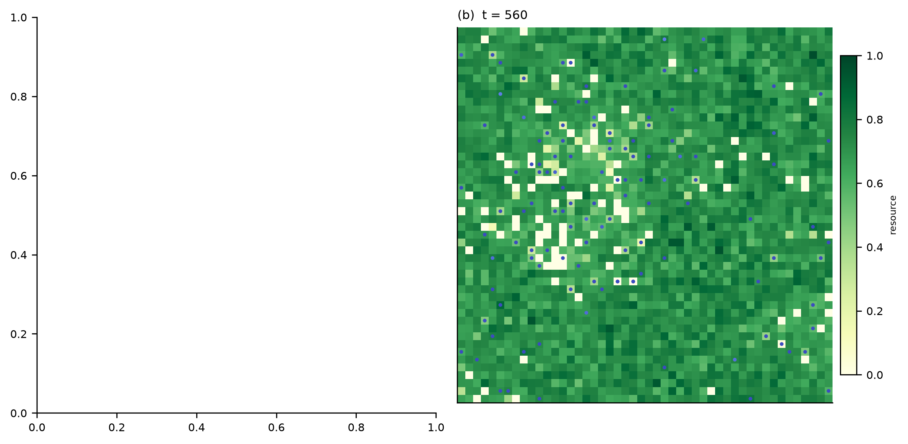
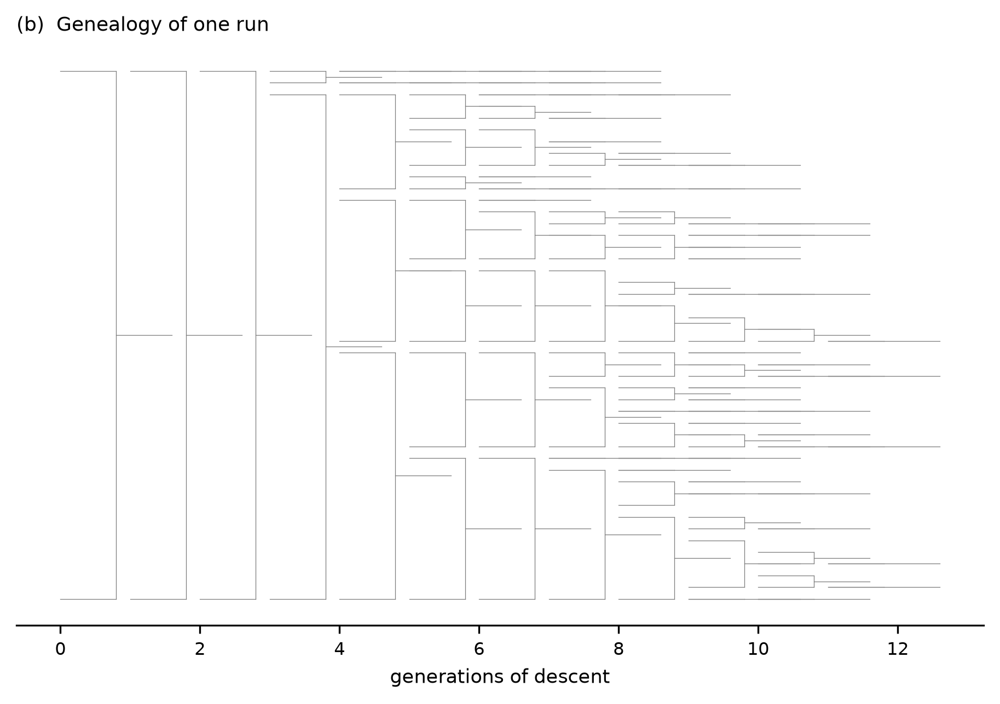
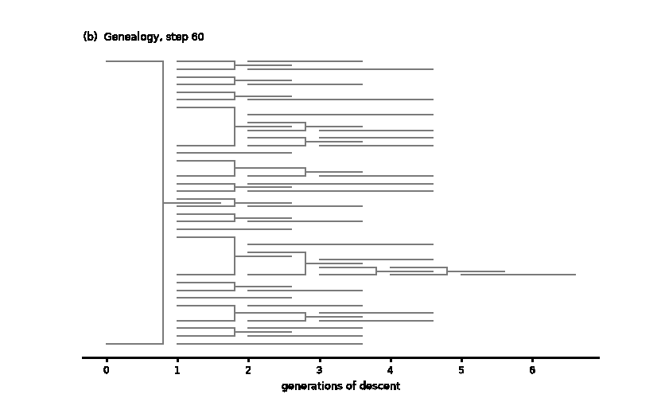

::: callout-important
## 写作说明 / Note

本文由 **AI（Trae Agent）** 检索、计算并撰写，**尚未经过人工逐条校对**。文中引用的生物学事实来自同行评审文献；所有模拟结果来自随文附带的四个 Python 脚本（`experiments/04_optimizers.py`、`05_structure.py`、`06_ecosystem.py`、`07_division.py`），固定随机种子、每个条件 20 次重复。模拟是玩具：它们隔离机制，不证明任何关于自然或智能的宏大结论。

This article was researched and written by an **AI system (Trae Agent)** and has **not been proofread line by line by a human**. The biological facts are taken from peer-reviewed literature; every simulation result comes from the four Python scripts shipped with the post (`experiments/04_optimizers.py`, `05_structure.py`, `06_ecosystem.py`, `07_division.py`), with fixed seeds and 20 repeats per condition. The simulations are toys: they isolate mechanisms and prove nothing grand about nature or intelligence.
:::

::: {.callout-note collapse="true"}
## 生成本文所用的提示词（压缩后） / Prompt used to generate this article (condensed)

> 写一篇中英双语研究随笔：智能不是被训练出来的，而是演化出来的吗？从细菌趋化、黏菌、群体感应与前神经系统的适应行为出发，把梯度下降与自然选择写成两个不同的数学对象（信息通道、变异来源、时间尺度、多样性），用同一个景观做受控比较；用最小 NEAT 与 MAP-Elites 检验"结构创新能否被选择出来"；构建一个人工生态系统观察冲击后的韧性与多样性代价；用分工实验检验多智能体的"涌现"叙事。必须包含负面结果（奇偶校验解不出、通信无效、单体可拆分时群体优势消失），并区分事实、模拟与推测。

> A bilingual research essay: is intelligence evolved rather than trained? Start from bacterial chemotaxis, slime moulds, quorum sensing and pre-neural adaptation; write gradient descent and natural selection as two different mathematical objects (information channel, variation, timescale, diversity) and compare them on one landscape; use a minimal NEAT and MAP-Elites to ask whether structural innovation can be selected; build an artificial ecosystem and measure resilience versus the cost in diversity; use a division-of-labour experiment to test the multi-agent "emergence" story. Include negative results (parity unsolved, signalling useless, group advantage vanishing when one agent can split its actions) and keep fact, simulation and speculation apart.
:::

```{r}
#| label: setup
#| include: false
source(file.path(dirname(knitr::current_input()), "..", "..", "theme-blog.R"))
suppressPackageStartupMessages({
  library(jsonlite)
  library(knitr)
})

post_dir <- dirname(knitr::current_input())
met <- fromJSON(file.path(post_dir, "experiments", "outputs", "metrics.json"),
                simplifyVector = FALSE)

f <- function(x, d = 2) formatC(as.numeric(x), format = "f", digits = d)
pct <- function(x, d = 1) paste0(formatC(100 * as.numeric(x), format = "f", digits = d), "%")
num <- function(x, d = 0) format(round(as.numeric(x), d), big.mark = ",", scientific = FALSE)
```

## 1. 引子：没有大脑的导航 / Navigation without a brain

大肠杆菌只有约 4.6 兆碱基的基因组，没有神经元，没有突触。但它能在几秒钟内判断"葡萄糖浓度在升高还是降低"，并据此调整鞭毛的旋转方向：浓度升高就直行，浓度下降就翻滚（Berg & Brown，1972）。

*E. coli* has a genome of about 4.6 megabases, no neurons and no synapses. Yet within seconds it can tell whether the glucose concentration is rising or falling and adjust the rotation of its flagella: run when it rises, tumble when it falls (Berg & Brown, 1972).

这不是比喻。趋化性的信号通路、受体甲基化与适应性反馈，已经被分解到分子层面（Alon 等，1999）。一个没有神经系统的细胞，完成了一次**感知—记忆—决策—行动**的闭环。

This is not a metaphor. The chemotaxis pathway, receptor methylation and adaptive feedback have been resolved at the molecular level (Alon et al., 1999). A cell with no nervous system closes a loop of **sense, remember, decide, act**.

如果把"智能"定义为"在环境中达成目标的能力"，那么这类行为至少是智能的雏形。如果把它定义为"符号推理"，那就不是。Chollet 干脆把智能定义为"在新任务上获取技能的效率"，这把适应放到了中心（Chollet，2019）。定义决定了答案。本文想讨论的，是介于两者之间的东西：

If intelligence is "the ability to reach goals in an environment", such behaviour is at least a precursor. If it is "symbolic reasoning", it is not. Chollet defines intelligence as "the efficiency of skill acquisition on novel tasks", putting adaptation at the centre (Chollet, 2019). The definition decides the answer. This article is about something in between:

> **演化能否提供一种不同于梯度下降的机制，用来构造会适应、会学习的系统？**
>
> **Can evolution provide a mechanism, different from gradient descent, for building systems that adapt and learn?**

## 2. 神经元出现之前 / Before neurons

生命大约有 38 亿年历史，神经元只出现了约 6 亿年。在此之前，细胞已经解决了感知、记忆、协作与分化。

Life is about 3.8 billion years old; neurons appeared only about 600 million years ago. Before that, cells had already solved sensing, memory, cooperation and differentiation.

**细菌趋化**是最干净的例子。受体结合配体后，通过磷酸化级联把信号传给鞭毛马达；甲基化酶与去甲基化酶提供一个慢速的负反馈，使系统记住"刚才的浓度"，从而检测**变化**而不是绝对值（Alon 等，1999）。这在控制论上就是一个带自适应阈值的微分器。

**Bacterial chemotaxis** is the cleanest example. Ligand binding triggers a phosphorylation cascade that reaches the flagellar motor, while methylating and demethylating enzymes provide slow negative feedback. The system remembers the recent concentration and therefore senses **change** rather than absolute level (Alon et al., 1999). In control-theoretic terms, it is a differentiator with an adaptive threshold.

**黏菌**走得更远。多头绒泡菌（*Physarum polycephalum*）在迷宫中能找到最短路径（Nakagaki 等，2000）；它的管状网络会在食物源之间重塑，形成类似交通网的拓扑。这里没有中心控制器，只有局部规则与全局约束（流量、压力、食物）的耦合。

**Slime moulds** go further. *Physarum polycephalum* finds the shortest path through a maze (Nakagaki et al., 2000), and its tubular network remodels between food sources into a transport-like topology. There is no central controller, only local rules coupled to global constraints — flow, pressure, food.

**群体感应**说明单细胞可以"投票"。细菌分泌小分子，浓度随密度上升，达到阈值后同步改变基因表达（Miller & Bassler，2001）。这不是"沟通"的隐喻，而是真实的公共信号。

**Quorum sensing** shows that single cells can vote. Bacteria secrete small molecules whose concentration rises with density; past a threshold, gene expression changes in unison (Miller & Bassler, 2001). This is not a metaphor for communication but a genuine public signal.

**多细胞化**则是一次重大的演化转变：细胞放弃部分自主性，换取整体的新能力（Grosberg & Strathmann，2007）。分化、发育、免疫耐受，都是这次转变的后果。图灵的反应—扩散模型说明，发育中的斑图可以仅由两种化学物质的局部相互作用产生（Turing，1952）——这是"复杂结构不需要中央设计者"的最早数学论证之一。

**Multicellularity** was a major evolutionary transition: cells gave up part of their autonomy for new capabilities of the whole (Grosberg & Strathmann, 2007). Differentiation, development and immune tolerance are consequences of that transition. Turing's reaction–diffusion model showed that developmental patterns can arise from local interactions between two chemicals alone (Turing, 1952) — one of the earliest mathematical arguments that complex structure needs no central designer.

但必须克制：**不能说细菌"知道"自己在做什么**。趋化是算法，不是意识；黏菌的网络优化是物理过程，不是规划。把适应行为直接称为智能，会让概念失去边界。本文的用法是：**适应 = 在反馈中改变自身，以维持或提升某个目标量**。这一定义不要求表征、不要求意识。

Restraint is required: **a bacterium does not "know" what it is doing**. Chemotaxis is an algorithm, not consciousness; network optimisation in a slime mould is a physical process, not planning. Calling adaptive behaviour intelligence dissolves the concept's boundary. The usage here is: **adaptation = changing oneself in response to feedback in order to maintain or improve some objective quantity**. This definition requires neither representation nor consciousness.

## 3. 梯度下降与自然选择：两个不同的数学对象 / Gradient descent and natural selection: two different objects

### 3.1 两个方程 / Two equations

梯度下降（或更一般的参数更新）写为

Gradient descent, or a more general parameter update, is written

$$
\theta_{t+1} = \theta_t - \eta \nabla_\theta L(\theta_t).
$$

自然选择在种群层面常用复制子方程描述（Taylor & Jonker，1978）：

At the population level natural selection is often written as the replicator equation (Taylor & Jonker, 1978):

$$
\dot{x}_i = x_i\left(f_i - \bar f\right), \qquad \bar f = \sum_j x_j f_j,
$$

其中 $x_i$ 是类型 $i$ 的频率，$f_i$ 是其适应度。加上突变项后：

where $x_i$ is the frequency of type $i$ and $f_i$ its fitness. Adding mutation:

$$
\dot{x}_i = x_i\left(f_i - \bar f\right) + \mu\left(\bar x - x_i\right).
$$

如果你想追踪"性状如何随选择改变"，Price 方程给出一个更一般的记账方式（Price，1970）；它不是动力学方程，而是把改变分解为选择项与传递项。

To track how a trait changes under selection, the Price equation gives a more general accounting identity (Price, 1970): not a dynamical law but a decomposition of change into a selection term and a transmission term.

### 3.2 六个关键差异 / Six key differences

| 维度 / Dimension | 梯度下降 / Gradient descent | 自然选择 / Natural selection |
|---|---|---|
| 优化对象 / Object | 一个参数向量 / a parameter vector | 一个种群的频率分布 / a frequency distribution |
| 信息 / Information | 局部斜率（一阶导） / local slope | 适应度的相对排序（零阶） / relative fitness order |
| 时间尺度 / Timescale | 一次更新一步 / one step per update | 一代一次，代际可重叠 / one step per generation |
| 变异来源 / Variation | 外部定义的目标函数 / externally defined loss | 突变、重组、漂移 / mutation, recombination, drift |
| 适应度 / Fitness | 固定或可微 / fixed or differentiable | 由环境决定，可随频率变化 / set by environment |
| 多样性 / Diversity | 通常收敛到一点 / converges to a point | 可以维持多态 / can maintain polymorphism |

最重要的差异是**信息通道**：梯度需要可微性，选择只需要"谁活得久"。这让选择可以处理**不可微、离散、有噪声、非平稳**的目标，代价是样本效率低。

The most important difference is the **information channel**: gradients need differentiability, selection needs only "who survives longer". Selection can therefore handle **non-differentiable, discrete, noisy and non-stationary** objectives, at the price of sample efficiency.

另一个差异常被忽略：**选择作用于结构，而不仅是数值**。梯度下降通常固定网络拓扑，只调权重；演化可以改变"有几个节点""谁连谁""什么时候表达"。这一点在第 4 节会展开。

Another difference is often missed: **selection acts on structure, not only on numbers**. Gradient descent usually fixes the topology and tunes weights; evolution can change how many nodes exist, who connects to whom, and when expression happens. Section 4 takes this up.

### 3.3 一个受控比较 / A controlled comparison

我把两种机制放在同一个景观上，给相同的评估预算（4 000 次函数求值），跑了 20 个种子。Rastrigin 只是众多多峰景观之一；Kauffman 的 NK 模型用一个参数 $K$ 调节崎岖程度，结论会随 $K$ 改变（Kauffman，1993）。

I put both mechanisms on the same landscape with the same evaluation budget (4,000 function evaluations) and 20 seeds. Rastrigin is only one of many multimodal landscapes; Kauffman's NK model tunes ruggedness with a single parameter $K$, and conclusions change with it (Kauffman, 1993).

{fig-align="center" width="100%"}

结果有点反直觉：**在这个多峰景观上，演化明显优于梯度**。梯度流收敛到起点附近的局部极小，损失停在 `r f(met$optimizers$final_loss_static$gradient, 2)`；选择 + 突变找到损失 `r f(met$optimizers$final_loss_static$selection, 2)` 的解。原因很简单：梯度是局部信息，而种群提供了全局采样。

The result is mildly counter-intuitive: **on this multimodal landscape evolution clearly beats gradient**. Gradient flow converges to a local minimum near its starting point and stalls at loss `r f(met$optimizers$final_loss_static$gradient, 2)`; selection plus mutation reaches a solution with loss `r f(met$optimizers$final_loss_static$selection, 2)`. The reason is simple: a gradient is local information, a population samples globally.

但这个结论不能反过来推广。在一个**凸**问题上，梯度用 `r f(met$optimizers$convex_bowl$gradient_steps, 0)` 步就达到 $10^{-3}$ 的精度，而选择需要 `r f(met$optimizers$convex_bowl$selection_evals, 0)` 次评估——慢 5 倍多。**没有哪种机制普遍更优，只有匹配与否。**

But the conclusion does not reverse. On a **convex** problem the gradient reaches $10^{-3}$ accuracy in `r f(met$optimizers$convex_bowl$gradient_steps, 0)` steps, while selection needs `r f(met$optimizers$convex_bowl$selection_evals, 0)` evaluations — more than five times slower. **Neither mechanism is universally better; only matched or mismatched.**

{fig-align="center" width="85%"}

图 2 给出两个更细的对照：

Figure 2 gives two finer contrasts:

- **移动目标**：梯度在每次环境改变后都要重新下降，且容易追错盆地；种群的分布让它能更快"转向"。\
    *Moving target: after each environmental change the gradient must descend again and easily follows the wrong basin; a population distribution turns faster.*
- **阶梯适应度**：当适应度只能取离散值时，梯度几乎处处为零。此时梯度法退化为随机搜索（损失 `r f(met$optimizers$staircase_loss$gradient, 1)`），而选择仍能爬到 `r f(met$optimizers$staircase_loss$selection, 1)`。\
    *Staircase fitness: when fitness takes only discrete values the slope is zero almost everywhere. Gradient descent degenerates into random search (loss `r f(met$optimizers$staircase_loss$gradient, 1)`), while selection still climbs to `r f(met$optimizers$staircase_loss$selection, 1)`.*

这正是生物学的情形：**适应度不是可微函数，它是存活与繁殖的离散结果。**

This is exactly the biological case: **fitness is not a differentiable function but a discrete outcome of survival and reproduction.**

### 3.4 不要把选择说成梯度下降 / Do not call selection a gradient

有一种流行的说法："自然选择就是在一座景观上做梯度下降。"这在数学上是错的，至多是类比。

A popular claim says that natural selection is gradient descent on a fitness landscape. Mathematically this is false; at best it is an analogy.

- 梯度下降沿着**已定义函数**的斜率走；选择没有函数，只有样本。\
    *Gradient descent follows the slope of a **defined function**; selection has no function, only samples.*
- 梯度下降的步长由学习率决定；选择的"步长"由突变分布与种群大小决定。\
    *The step size of gradient descent is the learning rate; the "step size" of selection is set by the mutation distribution and population size.*
- 梯度下降会收敛；选择在可变环境中永远不会收敛，它追踪的是一个移动的目标。\
    *Gradient descent converges; selection never converges in a changing environment — it tracks a moving target.*
- 梯度下降通常**降低多样性**；选择在频率依赖下可以**维持多样性**。\
    *Gradient descent usually **reduces diversity**; selection under frequency dependence can **maintain** it.*

当然，两者也不互斥。进化策略（evolution strategies）就是用种群估计梯度；而演化本身也可以看作一种"在参数空间里做随机搜索 + 选择"的算法。关键在于：**它们使用的信息不同**。

They are not mutually exclusive, of course. Evolution strategies estimate a gradient with a population, and evolution itself can be viewed as random search plus selection in parameter space. The point is that **they use different information**.

## 4. 演化能产生新的计算结构吗？ / Can evolution produce new computational structure?

### 4.1 从调参到改结构 / From tuning to topology

遗传算法固定一个表示，只搜索参数（Holland，1975）；遗传编程搜索程序；NEAT 同时演化拓扑与权重（Stanley & Miikkulainen，2002）。这条线索的核心问题是：**结构创新能否被选择出来？**

Genetic algorithms fix a representation and search parameters only (Holland, 1975); genetic programming searches programs; NEAT evolves topology and weights together (Stanley & Miikkulainen, 2002). The core question is whether **structural innovation can be selected**.

我做了一个最小版本的 NEAT：基因组由节点与连接组成，突变包括调权重、加连接、把一个连接"劈开"插入新节点。任务是 XOR 与 3 位奇偶校验。

I built a minimal NEAT: the genome consists of nodes and connections, and mutations adjust weights, add connections, or split a connection by inserting a node. The tasks are XOR and 3-bit parity.

{fig-align="center" width="100%"}

结果：

The results:

- XOR 在 80 代时约 `r pct(met$structure$xor_solved_by_gen80, 0)` 的种子解出；\
    *XOR is solved by about `r pct(met$structure$xor_solved_by_gen80, 0)` of seeds at generation 80;*
- 3 位奇偶校验**一个都没解出**（最高适应度约 0.92）；\
    *3-bit parity is **never solved** (best fitness about 0.92);*
- 两种任务的最优基因组连接数都从约 6 增长到 `r f(met$structure$mean_connections_xor, 1)`（XOR）与 `r f(met$structure$mean_connections_parity, 1)`（奇偶校验）。\
    *the best genome's connection count grows from about 6 to `r f(met$structure$mean_connections_xor, 1)` (XOR) and `r f(met$structure$mean_connections_parity, 1)` (parity).*

这里有一个诚实的负面结果：**结构会增长，但增长不等于解决**。奇偶校验需要至少两层非线性，而我的搜索在 80 代内没有找到。这既可能是算法太弱，也可能是任务太难；无论哪种，都不能说"演化自动产生复杂计算"。

Here is an honest negative result: **structure grows, but growth is not solution**. Parity needs at least two layers of nonlinearity, and my search did not find them within 80 generations. Either the algorithm is too weak or the task too hard; in neither case can one claim that "evolution automatically produces complex computation".

### 4.2 把"程序"当作基因组 / Treating a program as a genome

第二个实验换了一种表示：基因组是 32 位的元胞自动机规则表（半径 2 邻域），不是权重。任务是密度分类：给定一个 0/1 初始串，判断 1 的比例是否超过一半，并演化到全 0 或全 1。

The second experiment changes the representation: the genome is a 32-bit cellular-automaton rule table (radius 2), not weights. The task is density classification: given a 0/1 initial string, decide whether the fraction of ones exceeds one half and evolve to all-0 or all-1.

我用 MAP-Elites 维护一个"行为档案"，按最终密度与平均活动量分格，每格保留最好的规则（Mouret & Clune，2015）。

I used MAP-Elites to maintain a behaviour archive binned by final density and mean activity, keeping the best rule per cell (Mouret & Clune, 2015).

{fig-align="center" width="100%"}

档案覆盖了 `r num(met$structure$archive_size)` 个格子（覆盖率 `r pct(met$structure$archive_coverage, 0)`），最高分 `r f(met$structure$archive_best, 1)`（满分 1）。这说明：**在程序空间里，多样性可以被显式保存，而不是被单一目标挤掉。** 这与 novelty search 的动机一致：先保留"不同的做法"，再谈哪种更好（Lehman & Stanley，2011）。

The archive fills `r num(met$structure$archive_size)` cells (`r pct(met$structure$archive_coverage, 0)` coverage) with a best score of `r f(met$structure$archive_best, 1)` out of 1. This shows that **in program space, diversity can be preserved explicitly instead of being squeezed out by a single objective**. It matches the motivation of novelty search: keep the different ways first, then ask which is better (Lehman & Stanley, 2011).

这也暴露了 Quality-Diversity 方法的价值与局限：它能找到"很多种不同的做法"，但每一种都只是局部优秀；它不保证其中任何一种会通向通用能力。

It also exposes the value and the limit of quality–diversity methods: they find many different ways of doing something, but each is only locally good, and nothing guarantees that any of them leads to general capability.

## 5. 从个体到生态系统 / From individuals to ecosystems

### 5.1 一个人工生态系统 / An artificial ecosystem

我在一个 48×48 的环形网格上放了可消耗、可再生的资源，以及一群带基因组的个体。基因组有两个连续性状：移动概率与取食效率。个体消耗能量、繁殖（带突变）、死亡；环境在第 300 步发生一次冲击：70% 个体死亡，资源再生率下降。更早的数字生态系统——Tierra（Ray，1991）与 Avida（Ofria & Wilke，2004）——用更复杂的指令集做了类似的事。

I placed consumable, renewable resources on a 48×48 toroidal grid together with a population of individuals carrying a two-trait genome: movement probability and feeding efficiency. Individuals spend energy, reproduce with mutation, and die; at step 300 the environment shocks them — 70% die and the regeneration rate falls. Earlier digital ecosystems — Tierra (Ray, 1991) and Avida (Ofria & Wilke, 2004) — did similar things with richer instruction sets.

{fig-align="center" width="100%"}

数字：

The numbers:

- 冲击前平均种群 `r f(met$ecosystem$pop_pre_shift, 1)`，冲击后最低降到 `r f(met$ecosystem$pop_trough, 1)`，最终回到 `r f(met$ecosystem$pop_post_shift, 1)`（为冲击前的 `r f(met$ecosystem$recovery_ratio, 2)` 倍）；\
    *mean population `r f(met$ecosystem$pop_pre_shift, 1)` before the shock, a trough of `r f(met$ecosystem$pop_trough, 1)`, and a final `r f(met$ecosystem$pop_post_shift, 1)` (`r f(met$ecosystem$recovery_ratio, 2)`× the pre-shock level);*
- 性状多样性从 `r f(met$ecosystem$diversity_pre, 3)` 降到 `r f(met$ecosystem$diversity_post, 3)`，**没有恢复**。\
    *trait diversity falls from `r f(met$ecosystem$diversity_pre, 3)` to `r f(met$ecosystem$diversity_post, 3)` and **does not recover**.*

第一点是"韧性"：种群能快速反弹，因为资源再生与繁殖阈值允许快速增长。第二点是"代价"：**恢复的是数量，不是多样性**。一次瓶颈会把稀有变异清空，而突变需要很多代才能补回来。

The first point is resilience: the population rebounds quickly because regeneration and reproduction thresholds allow fast growth. The second is the cost: **what recovers is abundance, not diversity**. A bottleneck empties rare variants, and mutation needs many generations to refill them.

这正好对应保护生物学里的经验：种群瓶颈之后，遗传多样性下降，适应未来环境的能力被削弱——尽管数量可能看起来恢复了。

This matches experience in conservation biology: after a population bottleneck genetic diversity falls and the capacity to adapt to future environments weakens, even though the headcount may look recovered.

### 5.2 谱系 / Genealogy

图 6 是同一运行的两个空间快照：冲击前后，资源分布与个体位置（颜色表示移动概率）。图 7 是最终种群的谱系树。

Figure 6 shows two spatial snapshots from the same run, before and after the shock: resource distribution and individual positions, coloured by movement probability. Figure 7 is the genealogy of the final population.

{fig-align="center" width="100%"}

{fig-align="center" width="80%"}

{fig-align="center" width="80%"}

谱系树不是装饰。它把"谁的后代活下来了"变成可检查的结构：如果某一次冲击后所有个体都来自少数几个祖先，那么后续的适应速度就会受限于这点遗传变异。

The genealogy is not decoration. It turns "whose descendants survived" into an inspectable structure: if every individual after a shock descends from a few ancestors, later adaptation is limited by that remaining variation.

### 5.3 这个模型不能说明什么 / What this model cannot show

- 性状只有两个，行为极其简单；\
    *there are only two traits and the behaviour is trivial;*
- 没有性别、没有重组、没有空间结构对合作的影响；\
    *no sex, no recombination, no effect of spatial structure on cooperation;*
- "资源"是人为设定的；\
    *"resources" are set by hand;*
- 20 个种子只能给出粗略的区间。\
    *20 seeds give only crude intervals.*

它不是对生态系统的模拟，更不是对智能起源的模拟。人工生命传统把这类研究称为"用合成方法研究生命般的组织"（Langton，1986）；本章的模型只触及其中最小的一块。

It is not a simulation of an ecosystem, and even less of the origin of intelligence. The artificial-life tradition calls this "studying life-like organisation by synthesis" (Langton, 1986); this chapter touches only the smallest piece of it.

## 6. 多细胞生命能启发多智能体系统吗？ / Can multicellular life inform multi-agent systems?

生物的多细胞化之所以成功，是因为细胞分化带来了**分工收益**：不同细胞做不同的事，整体能做到单个细胞做不到的事。

Multicellularity succeeded because differentiation brought a **gain from division of labour**: different cells do different things, and the whole achieves what no single cell can.

AI 的多智能体系统常借用这个类比。但类比不等于证据。我设计了一个尽量干净的任务来检验：分工到底在什么条件下有优势？

Multi-agent AI systems often borrow the analogy. But an analogy is not evidence. I designed as clean a task as I could to ask when division of labour actually pays.

**任务**：两个资源斑块，奖励为 $q_k\sqrt{n_k}$（凹函数），但只有当 $n_k\ge 1$ 时才有奖励。每轮 8 个智能体，每个 1 次行动。

**Task**: two resource patches, reward $q_k\sqrt{n_k}$ (concave), paid only when $n_k \ge 1$. Eight agents per round, one action each.

**处理**：

**Treatments**:

- 同质群体：所有个体选当前更好的斑块；\
    *homogeneous: every agent picks the currently better patch;*
- 固定分工：4 个固定去斑块 0，4 个去斑块 1；\
    *fixed division: four always go to patch 0, four to patch 1;*
- 自适应分工：个体根据拥挤程度做最优反应；\
    *adaptive division: agents best-respond to crowding;*
- 可遗传分工：角色偏好作为基因，经过 10 代群体选择演化。\
    *heritable division: role preference is a gene, evolved by 10 generations of group selection.*

**关键对照**：一个智能体，给它 8 次行动，但每轮只能待在一个斑块；另一个对照允许它把 8 次行动拆分到两个斑块。

**Key controls**: a single agent given eight actions but confined to one patch per round; and a single agent allowed to split its eight actions across both patches.

{fig-align="center" width="100%"}

结果很清楚：

The results are clear:

- 同质群体 `r f(met$division$reward$homogeneous, 2)`；\
    *homogeneous `r f(met$division$reward$homogeneous, 2)`;*
- 固定分工 `r f(met$division$reward$fixed, 2)`，自适应 `r f(met$division$reward$adaptive, 2)`，可遗传 `r f(met$division$reward$heritable, 2)`；\
    *fixed `r f(met$division$reward$fixed, 2)`, adaptive `r f(met$division$reward$adaptive, 2)`, heritable `r f(met$division$reward$heritable, 2)`;*
- **单体但可拆分行动 `r f(met$division$reward[["single-split"]], 2)`**；\
    ***a single agent allowed to split its actions `r f(met$division$reward[["single-split"]], 2)`**;*
- 单体但只能去一个斑块 `r f(met$division$reward[["single-one-patch"]], 2)`。\
    *a single agent confined to one patch `r f(met$division$reward[["single-one-patch"]], 2)`.*

换句话说：**分工的收益来自"并行覆盖两个斑块"这个物理约束，而不是来自"智能体数量多"。** 一旦允许单个智能体拆分行动，群体优势就消失了。形态与身体约束了可执行的计算，这一点在机器人学里已有系统讨论（Pfeifer & Bongard，2006）。

In other words, **the gain comes from the physical constraint of covering two patches in parallel, not from having more agents**. Once a single agent can split its actions, the group advantage disappears. Morphology and body constrain the computation that can be executed, a point discussed systematically in robotics (Pfeifer & Bongard, 2006).

这是本文最重要的负面结论之一。多智能体系统经常被赋予"涌现"的期待，但在受控条件下，**数量本身不产生优势**；优势来自约束、分工与信息结构。

This is one of the most important negative results here. Multi-agent systems are often expected to "emerge" something, but under control **numbers alone buy nothing**; the advantage comes from constraints, division of labour and information structure.

另外，可遗传分工（`r f(met$division$reward$heritable, 2)`）并没有超过固定分工（`r f(met$division$reward$fixed, 2)`）。在这个对称任务里，最优角色分配就是 4/4，遗传机制没有额外价值。**如果一个机制在简单任务上没有增量，就不该假设它在复杂任务上会自动产生智能。**

Note also that heritable division (`r f(met$division$reward$heritable, 2)`) does not beat fixed division (`r f(met$division$reward$fixed, 2)`). On this symmetric task the optimal allocation is simply 4/4, and the genetic mechanism adds nothing. **A mechanism that shows no increment on a simple task should not be assumed to produce intelligence automatically on a complex one.**

## 7. 演化为何未必产生智能 / Why evolution need not produce intelligence

前面展示了演化的能力，现在必须展示它的失败条件。否则就是选择性地呈现证据。

Having shown what evolution can do, the failure conditions must be shown too; otherwise the evidence is selective.

**1. 适应度函数错了，一切都会错。** 如果适应度奖励"看起来像在解决问题"，选择就会演化出欺骗。奖励黑客（reward hacking）在人工系统中是常态，在生物中也有对应物：寄生、作弊、搭便车。

**1. A wrong fitness function makes everything wrong.** If fitness rewards looking like problem-solving, selection evolves deception. Reward hacking is routine in artificial systems, and biology has counterparts: parasitism, cheating, free-riding.

**2. 选择压力不足。** 如果环境太宽松，漂变（drift）会主导，适应性不会累积。Lenski 的长期演化实验说明，即便在选择压力稳定的环境里，适应也是路径依赖、由偶发突变驱动的（Lenski 等，2003；Blount 等，2008）。我的生态系统在资源充足时，基因频率的变化很大一部分是随机的。

**2. Insufficient selection pressure.** In a permissive environment drift dominates and adaptation does not accumulate. Lenski's long-term evolution experiment shows that even under stable selection adaptation is path-dependent and driven by contingent mutations (Lenski et al., 2003; Blount et al., 2008). In my ecosystem, when resources are plentiful a large part of the change in gene frequencies is random.

**3. 局部适应。** 我的 XOR 实验里，种群长期停在 0.75 的"常数输出"解；奇偶校验在 80 代内没有突破。**演化不是全局优化器**，它只保证"比邻居略好"。

**3. Local adaptation.** In my XOR runs the population sits for a long time on a constant-output solution at 0.75, and parity never breaks through within 80 generations. **Evolution is not a global optimiser**; it guarantees only being slightly better than neighbours.

**4. 复杂性不等于智能。** 基因组变长、连接变多，都是复杂性的度量，不是智能的度量。一个系统可以越来越复杂，却只是在更精细地拟合一个错误的目标。

**4. Complexity is not intelligence.** Longer genomes and more connections measure complexity, not intelligence. A system can grow more complex while fitting a wrong objective more finely.

**5. 开放式演化缺少统一评价。** 生物演化没有"目标函数"，它的"进步"是相对于局部环境的适应。人工系统若想模仿这种开放性，就必须放弃单一指标——但放弃指标，也就放弃了"更好"的定义。

**5. Open-ended evolution lacks a common yardstick.** Biological evolution has no objective function; its "progress" is adaptation to a local environment. An artificial system that imitates this openness must give up a single metric — but giving it up also gives up the definition of "better".

**6. 时间尺度。** 生物演化以百万年计；人工演化以小时计。这个差别不只是速度，还包括**世代重叠、生态位构建、多层级选择**这些在短时间尺度上无法出现的结构。

**6. Timescale.** Biological evolution runs in millions of years, artificial evolution in hours. The difference is not only speed but structures that cannot appear on short timescales: overlapping generations, niche construction, multi-level selection.

## 8. 结论：一个开放的问题 / Conclusion: an open question

演化确实提供了不同于梯度下降的机制：

Evolution does offer mechanisms that gradient descent lacks:

- 它不需要可微性，能处理离散、有噪声、非平稳的目标；\
    *it needs no differentiability and handles discrete, noisy, non-stationary objectives;*
- 它作用于结构，而不仅是参数；\
    *it acts on structure, not only parameters;*
- 它能维持多样性，从而在变化环境中保留选项；\
    *it maintains diversity and so keeps options open in a changing environment;*
- 它能产生分工，但分工的收益取决于约束，而不是个体数量。\
    *it can produce division of labour, but the gain depends on constraints, not on the number of agents.*

但它也有一整套失败模式：错误的目标、不足的压力、局部的陷阱、复杂性的假象。

It also has a full set of failure modes: wrong objectives, weak pressure, local traps, the illusion of complexity.

所以我的结论是：

My conclusion is therefore:

> **演化是产生复杂适应系统的重要机制，但它是否比梯度学习更适合通向 AGI，仍然是一个开放的研究问题。** 目前没有任何受控实验表明，演化能自动产生通用智能；也没有任何原理表明它不能。
>
> **Evolution is an important mechanism for producing complex adaptive systems, but whether it is a better road to AGI than gradient-based learning remains open.** No controlled experiment shows that evolution automatically produces general intelligence; and no principle shows that it cannot.

如果要说这篇文章给了我什么，那就是一个更精确的问题：**不是"演化还是梯度"，而是"在什么约束下，哪种机制能产生可持续的适应"。** 这个问题可以继续做实验——第三篇文章就是一次尝试。

If this article gave me anything, it is a sharper question: not "evolution or gradients" but "under which constraints does which mechanism produce sustainable adaptation". That question can be experimented on, and the third post is one attempt.

## 9. 方法与局限 / Methods and limits

- 优化器比较：Rastrigin 景观、4 000 次评估预算、20 个种子；梯度步长 0.01；选择为 40 个个体的锦标赛 + 高斯突变（σ=0.35）。\
    *Optimiser comparison: Rastrigin landscape, 4,000-evaluation budget, 20 seeds; gradient step 0.01; selection is a tournament of 40 individuals with Gaussian mutation (σ=0.35).*
- NEAT-lite：120 个体、80 代、20 个种子；无物种形成、无交叉，只有突变。\
    *NEAT-lite: 120 individuals, 80 generations, 20 seeds; no speciation, no crossover, mutation only.*
- MAP-Elites：8 000 次评估、28×28 网格、10 个初始条件；CA 为半径 2、32 格、20 步。\
    *MAP-Elites: 8,000 evaluations, 28×28 grid, 10 initial conditions; radius-2 CA with 32 cells and 20 steps.*
- 生态系统：48×48 网格、600 步、20 个种子；冲击为 70% 随机死亡 + 再生率减半。\
    *Ecosystem: 48×48 grid, 600 steps, 20 seeds; the shock is 70% random death plus a halved regeneration rate.*
- 分工实验：40 轮、8 个个体、20 个种子；奖励为 $q_k\sqrt{n_k}$。\
    *Division experiment: 40 rounds, 8 agents, 20 seeds; reward $q_k\sqrt{n_k}$.*
- **未做的事**：没有真实的生物数据拟合；没有多层级选择；没有开放式演化（open-endedness）的度量。\
    ***Not done**: no fit to real biological data; no multi-level selection; no measure of open-endedness.*

脚本都在本目录：`experiments/04_optimizers.py`（景观对照）、`05_structure.py`（NEAT-lite 与 MAP-Elites）、`06_ecosystem.py`（冲击与谱系）、`07_division.py`（分工与单体对照）。重跑任一脚本即可复现对应的数字与图。

Scripts sit in this directory: `experiments/04_optimizers.py` (landscape comparison), `05_structure.py` (NEAT-lite and MAP-Elites), `06_ecosystem.py` (shock and genealogy) and `07_division.py` (division and single-agent controls). Rerun any of them to reproduce the corresponding numbers and figures.

## 参考文献 / References

1.  Berg, H. C., & Brown, D. A. (1972). Chemotaxis in *Escherichia coli* analysed by three-dimensional tracking. *Nature* 239, 500–504. doi:10.1038/239500a0
2.  Alon, U., Surette, M. G., Barkai, N., & Leibler, S. (1999). Robustness in bacterial chemotaxis. *Nature* 397, 168–171. doi:10.1038/17383
3.  Nakagaki, T., Yamada, H., & Tóth, Á. (2000). Maze-solving by an amoeboid organism. *Nature* 407, 470. doi:10.1038/35035054
4.  Miller, M. B., & Bassler, B. L. (2001). Quorum sensing in bacteria. *Annual Review of Microbiology* 55, 165–199. doi:10.1146/annurev.micro.55.1.165
5.  Grosberg, R. K., & Strathmann, R. R. (2007). The evolution of multicellularity: a minor major transition? *Annual Review of Ecology, Evolution, and Systematics* 38, 621–654. doi:10.1146/annurev.ecolsys.36.102403.114735
6.  Turing, A. M. (1952). The chemical basis of morphogenesis. *Philosophical Transactions of the Royal Society B* 237, 37–72. doi:10.1098/rstb.1952.0012
7.  Chollet, F. (2019). On the measure of intelligence. arXiv:1911.01547
8.  Taylor, P. D., & Jonker, L. B. (1978). Evolutionary stable strategies and game dynamics. *Mathematical Biosciences* 40, 145–156. doi:10.1016/0025-5564(78)90077-9
9.  Price, G. R. (1970). Selection and covariance. *Nature* 227, 520–521. doi:10.1038/227520a0
10.  Kauffman, S. A. (1993). *The Origins of Order: Self-Organization and Selection in Evolution*. Oxford University Press.
11.  Holland, J. H. (1975). *Adaptation in Natural and Artificial Systems*. University of Michigan Press.
12.  Stanley, K. O., & Miikkulainen, R. (2002). Evolving neural networks through augmenting topologies. *Evolutionary Computation* 10, 99–127. doi:10.1162/106365602320169811
13.  Mouret, J.-B., & Clune, J. (2015). Illuminating search spaces by mapping elites. arXiv:1504.04909
14.  Lehman, J., & Stanley, K. O. (2011). Abandoning objectives: evolution through the search for novelty alone. *Evolutionary Computation* 19, 189–223. doi:10.1162/EVCO_a_00025
15.  Ray, T. S. (1991). An approach to the synthesis of life. In *Artificial Life II*, 371–408. Addison-Wesley.
16.  Ofria, C., & Wilke, C. O. (2004). Avida: a software platform for research in computational evolutionary biology. *Artificial Life* 10, 191–229. doi:10.1162/106454604773563612
17.  Langton, C. G. (1986). Studying artificial life with cellular automata. *Physica D* 22, 120–149. doi:10.1016/0167-2789(86)90237-X
18.  Lenski, R. E., Winkworth, C. L., & Riley, M. A. (2003). Rates of DNA sequence evolution in experimental populations of *Escherichia coli* during 20,000 generations. *Journal of Molecular Evolution* 56, 498–508. doi:10.1007/s00239-002-2423-0
19.  Blount, Z. D., Borland, C. Z., & Lenski, R. E. (2008). Historical contingency and the evolution of a key innovation in an experimental population of *Escherichia coli*. *PNAS* 105, 7899–7906. doi:10.1073/pnas.0709093105
20.  Pfeifer, R., & Bongard, J. (2006). *How the Body Shapes the Way We Think*. MIT Press.

以上条目均给出 DOI 或出版社信息；模拟脚本与数据不引外部文献，均随本文附在 `experiments/` 目录。

Every entry above carries a DOI or publisher information; the simulation scripts and data cite no external literature and are shipped in `experiments/`.
