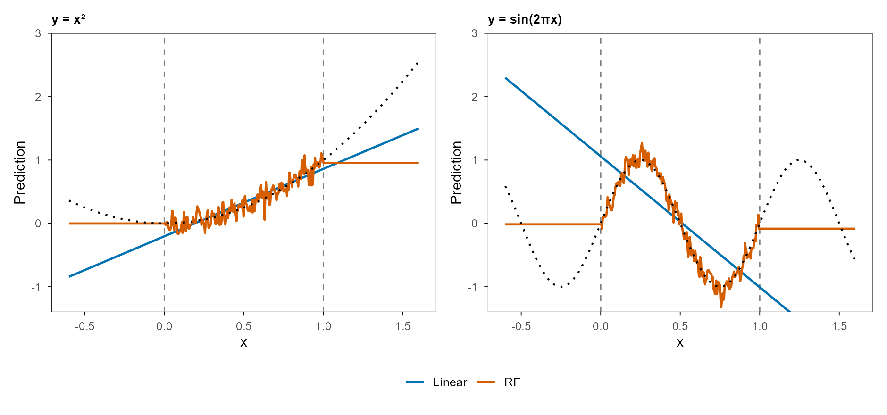

::: callout-important
## 写作说明 / Note

本文由 **AI（Trae Agent）** 检索、计算并撰写，**尚未经过人工逐条校对**。文中的每一个数字都来自随文附带的 15 个 R 脚本（`experiments/00_timeline.R` 至 `14_cart.R`）的真实运行：CART 由 `experiments/common/forest.R` 从零实现，规模化实验使用 `ranger` 的 C++ 后端，随机种子固定，结果写入 `experiments/outputs/metrics.json`，正文数值由 inline R 读取。三处必须说明的边界：分位数森林用的是 `ranger` 的 `quantreg = TRUE` 实现，不是本文自写；第 23 节的 T-learner 只是用两个随机森林相减，**不是** generalized random forests；第 22 节的 benchmark 里线性模型是未正则化的 `lm`/`glm`，它在 Sonar 上失败不代表线性模型的下限。计时数字依赖本机，换机器会变。

This article was researched, computed and written by an **AI system (Trae Agent)** and has **not been proofread line by line by a human**. Every number comes from an actual run of the fifteen R scripts shipped with the post (`experiments/00_timeline.R` … `14_cart.R`): CART is implemented from scratch in `experiments/common/forest.R`, the large experiments use `ranger`'s C++ backend, seeds are fixed, results are written to `experiments/outputs/metrics.json`, and inline R reads them into the text. Three boundaries matter: the quantile forest uses `ranger`'s `quantreg = TRUE`, not our own code; the T-learner in section 23 is just a difference of two random forests, **not** generalized random forests; and the linear model in the section 22 benchmark is an unregularised `lm`/`glm`, so its failure on Sonar is not the floor of linear models. Timings depend on this machine.
:::

::: {.callout-note collapse="true"}
## 生成本文所用的提示词（压缩后） / Prompt used to generate this article (condensed)

> 写一篇 20 节以上的中英双语专论，把随机森林当作一台方差机器来解剖：以 ρσ²+(1−ρ)σ²/B 为主线，同时保留 AID→CART→bootstrap→随机子空间→bagging→Random Forests→因果森林的历史线，以及 RF 与 GBDT、TabPFN 的现代对照线。每一节都要有数学、真实计算和可证伪的图；必须从零实现 CART，必须记录负面结果（OOB 在依赖数据上的乐观、MDI 的相关特征偏置、树分位数区间的不覆盖、外推失败），所有数字来自脚本运行，不凭记忆写 DOI。

> Write a bilingual monograph of 20+ sections that treats the random forest as a variance machine. Use Var(mean) = ρσ² + (1−ρ)σ²/B as the spine, keep the historical line AID → CART → bootstrap → random subspace → bagging → Random Forests → causal forests, and keep a modern line comparing RF with GBDT and TabPFN. Every section needs mathematics, real computation and a falsifiable figure. Implement CART from scratch, record negative results (optimistic OOB under dependence, MDI bias with correlated features, under-covering tree-quantile intervals, extrapolation failure), take every number from an actual run, and never write a DOI from memory.
:::

```{r}
#| label: setup
#| include: false
source(file.path(dirname(knitr::current_input()), "..", "..", "theme-blog.R"))
suppressPackageStartupMessages({
  library(jsonlite)
  library(knitr)
  library(dplyr)
})

post_dir <- dirname(knitr::current_input())
met <- fromJSON(file.path(post_dir, "experiments", "outputs", "metrics.json"),
                simplifyVector = FALSE)

f <- function(x, d = 2) formatC(as.numeric(x), format = "f", digits = d)
pct <- function(x, d = 1) paste0(formatC(100 * as.numeric(x), format = "f", digits = d), "%")
num <- function(x, d = 0) format(round(as.numeric(x), d), big.mark = ",", scientific = FALSE)
```

## 1. 一棵树与一千棵树 / One tree, a thousand trees

先看一张不需要任何公式的图。四百个点排成两个交错的半月，用同一份训练数据画八张决策边界：树的数量 $B\in\{1,3,10,100\}$，每次分裂可选的变量数 $\mathrm{mtry}\in\{1,2\}$。单棵树（$B=1$）的边界是几块生硬的矩形，训练误差 `r pct(met$e01_boundaries$train_error[[1]]$error, 2)`；一百棵树、每次只看一个变量的森林（$B=100,\ \mathrm{mtry}=1$）训练误差降到 `r pct(met$e01_boundaries$train_error[[2]]$error, 2)`，边界仍然是锯齿状的，但每一段都更贴近数据。

Here is a figure that needs no formula. Four hundred points form two interleaving half circles, and the same training data is used to draw eight decision boundaries: $B\in\{1,3,10,100\}$ trees and $\mathrm{mtry}\in\{1,2\}$ candidate variables per split. A single tree ($B=1$) gives a few hard rectangles with training error `r pct(met$e01_boundaries$train_error[[1]]$error, 2)`; a hundred trees that each see only one variable ($B=100,\ \mathrm{mtry}=1$) bring training error down to `r pct(met$e01_boundaries$train_error[[2]]$error, 2)`, and the boundary is still jagged, but every segment sits closer to the data.

{fig-align="center" width="100%"}

这张图容易被误读成"树越多越好"。真正的问题是：**平均为什么有效，它在哪里停下来？** 本文只回答这一个问题，并把答案拆成可以逐项测量的部件。

The figure is easy to misread as "more trees are better". The real question is: **why does averaging work, and where does it stop?** This article answers only that question, and breaks the answer into parts that can each be measured.

> **随机森林不是"很多棵树"，而是一台把预测方差拆成两项的机器：一项由树之间的相关性决定，加多少棵树都压不下去；另一项随树的数量衰减。所有零件——bootstrap、`mtry`、深树、OOB——都在调这两个数。**
>
> **A random forest is not "many trees" but a machine that splits prediction variance into two terms: one set by the correlation between trees, which no number of trees can remove, and one that decays with the number of trees. Every component — bootstrap, `mtry`, deep trees, OOB — tunes one of these two numbers.**

下面的路线分四段。第二至六节讲历史：每个零件为了解决上一版的什么问题而出现。第七至十一节讲数学：CART 的分裂、分段常数、平均的方差、`mtry` 与偏差-方差。第十二至二十节讲测量：bootstrap 与 OOB、$B$ 的收敛、$B\times\mathrm{mtry}$ 网格、一致性、依赖数据、解释性、校准、外推与成本。第二十一至二十五节讲今天的位置、变体、应用与决策清单。所有实验共用一套代码与固定种子，负面结果单独标注。

The route has four parts. Sections 2–6 cover history: which problem each component was invented to solve. Sections 7–11 cover mathematics: CART splits, piecewise-constant trees, the variance of an average, `mtry`, and bias–variance. Sections 12–20 cover measurement: bootstrap and OOB, convergence in $B$, the $B\times\mathrm{mtry}$ grid, consistency, dependent data, interpretation, calibration, extrapolation and cost. Sections 21–25 cover the modern position, variants, applications and a decision list. All experiments share one code base and fixed seeds; negative results are labelled as such.

## 2. 史前史：从 AID 到 CART / Before the forest: AID and CART

随机森林的第一块零件不是随机性，而是**递归划分**。1963 年，Morgan 与 Sonquist 在 survey data 上提出 AID（Automatic Interaction Detection）：不断把样本按某个变量的阈值切成两组，让组内平方和下降最多，直到分组不再值得（Morgan & Sonquist, 1963）。这正是今天每一棵 CART 的骨架，只是当时没有交叉验证、没有剪枝、也没有"森林"。

The first component of a random forest is not randomness but **recursive partitioning**. In 1963 Morgan and Sonquist proposed AID (Automatic Interaction Detection) for survey data: repeatedly split the sample at a threshold of one variable so that the within-group sum of squares falls most, and stop when splitting no longer pays (Morgan & Sonquist, 1963). That is the skeleton of every CART tree today; what was missing was cross-validation, pruning, and the forest itself.

1984 年，Breiman、Friedman、Olshen 与 Stone 把这件事写成一本完整的书：CART 用 Gini 或平方误差定义不纯度，用贪心搜索选分裂，用代价-复杂度剪枝控制树的大小，并给出缺失值与替代分裂的处理（Breiman et al., 1984）。CART 的关键贡献不是"能拟合"，而是**把过拟合变成一个可以定价的问题**：每多一个叶节点，训练误差下降多少，复杂度增加多少。

In 1984 Breiman, Friedman, Olshen and Stone turned this into a complete book: CART defines impurity by Gini or squared error, selects splits greedily, controls tree size by cost-complexity pruning, and handles missing values with surrogate splits (Breiman et al., 1984). CART's key contribution is not that it can fit, but that it **prices overfitting**: each extra leaf buys a certain drop in training error at a certain cost in complexity.

{fig-align="center" width="72%"}

单棵 CART 的问题在图 1 的左下角已经出现：换一批 bootstrap 样本，第一个分裂点就可能从 $x_1=0.62$ 跳到 $x_1=0.58$，整棵树随之改变。**树是低偏差、高方差的估计器**；它几乎能拟合任何训练集，但训练集的微小扰动会改变它的形状。后面所有零件，都是在不把偏差推回去的前提下削减这个方差。

The problem with a single CART tree is already visible in the lower-left panel of Figure 1: resample the data and the first split may move from $x_1=0.62$ to $x_1=0.58$, and the whole tree changes. **A tree is a low-bias, high-variance estimator**: it can fit almost any training set, but a small perturbation reshapes it. Every later component tries to cut that variance without pushing bias back up.

## 3. 1979：bootstrap 与 0.632 / 1979: the bootstrap and 0.632

Efron 在 1979 年给出的 bootstrap 原本是估计标准误的工具：从经验分布里有放回地抽 $n$ 个样本，重复很多次，看统计量怎么变（Efron, 1979）。它后来成了随机森林的第一台发动机——不是因为"重采样能造出新数据"，而是因为**它把"如果换一批数据，这个估计会怎么变"变成了可以实际执行的实验**。

Efron's 1979 bootstrap was originally a tool for standard errors: resample $n$ observations with replacement from the empirical distribution, repeat many times, and watch the statistic move (Efron, 1979). It became the first engine of the random forest — not because resampling creates new data, but because **it turns "how would this estimate change under another sample?" into an experiment one can actually run**.

一个具体的数字：从 $n$ 个样本里有放回地抽 $n$ 次，某个样本一次都没被抽中的概率是 $(1-1/n)^n$，当 $n\to\infty$ 时趋于 $e^{-1}\approx0.368$。所以每棵树的 bootstrap 样本平均只包含约 $1-e^{-1}=0.632$ 的不同观测；剩下的 36.8% 就是**袋外样本**（out-of-bag, OOB）。第十三节会用 `r f(met$e04_bootstrap$limit, 4)` 这个极限值把模拟结果对齐。

One concrete number: draw $n$ times with replacement from $n$ observations. The probability that a given observation is never drawn is $(1-1/n)^n$, which tends to $e^{-1}\approx0.368$. So a bootstrap sample contains on average only about $1-e^{-1}=0.632$ distinct observations; the remaining 36.8% are **out-of-bag** (OOB). Section 13 will align simulations with the limit `r f(met$e04_bootstrap$limit, 4)`.

bootstrap 在 1979 年还没有和树结合。它先被用来估计参数的标准误，后来被 Breiman 用来"平均模型"。这里的逻辑转折值得停一下：**平均不是为了让每棵树更准，而是为了让它们犯的错互相抵消**。如果每棵树的误差方向独立，平均 $B$ 棵就把方差压到 $1/B$；如果它们的误差高度同向，平均几乎没有用。随机森林后来的所有设计，都是在和"同向"作斗争。

In 1979 the bootstrap was not yet paired with trees. It was first used for standard errors and later by Breiman to average models. The logical turn is worth pausing on: **averaging is not meant to make each tree more accurate but to make their errors cancel**. If the errors point in independent directions, averaging $B$ trees cuts variance by $1/B$; if they point the same way, averaging barely helps. Every later design choice in the random forest fights that alignment.

## 4. 1995：随机子空间 / 1995: random subspace

如果所有树都在同一批变量上寻找最优分裂，它们会反复选中同样几个强变量，长得非常像——误差自然同向。1995 年，Tin Kam Ho 提出**随机子空间**：每次分裂只从 $p$ 个变量里随机抽一小部分候选（Ho, 1995, 1998）。两年后，Amit 与 Geman 在形状识别里用了同样的想法，并进一步随机化分裂阈值（Amit & Geman, 1997）。

If every tree searches for the best split among all variables, the same few strong variables get chosen again and again and the trees look alike — so their errors align. In 1995 Tin Kam Ho proposed the **random subspace**: at each split, consider only a random subset of the $p$ variables (Ho, 1995, 1998). Two years later Amit and Geman used the same idea in shape recognition and went further by randomising the split thresholds (Amit & Geman, 1997).

这是随机森林里唯一一个"故意让单棵树变差"的零件。限制候选变量会让每次分裂的增益下降，单棵树的偏差上升；但它让树之间看到不同的世界，相关性下降。**随机森林的核心交易就在这里：用一点偏差换很多相关性。** 第十一节会把这句话写成一个可测量的 $\rho(m)$ 曲线。

This is the only component of the random forest that deliberately makes each tree worse. Restricting the candidate variables lowers the gain of each split and raises the bias of a single tree, but it makes trees see different worlds and lowers their correlation. **The central trade of the random forest lives here: a little bias for a lot of decorrelation.** Section 11 turns this sentence into a measurable $\rho(m)$ curve.

## 5. 1996–2001：从 bagging 到 Random Forests / 1996–2001: from bagging to forests

1996 年，Breiman 把 bootstrap 与树结合，提出 **bagging**：对训练集做 $B$ 次 bootstrap，每次长一棵完整的树，再平均（Breiman, 1996）。bagging 已经能显著降低方差，但它有一个天花板：所有树都看同一批变量，强变量会被反复选中，树之间仍然高度相关。Breiman 在讨论 bagging 时已经指出，平均的方差不会趋于零，而会停在树之间的协方差上。

In 1996 Breiman combined the bootstrap with trees and proposed **bagging**: draw $B$ bootstrap samples, grow one full tree on each, and average (Breiman, 1996). Bagging already cuts variance substantially, but it has a ceiling: all trees see the same variables, strong variables get picked repeatedly, and the trees remain highly correlated. Breiman already noted in the bagging discussion that the variance of the average does not go to zero; it stops at the covariance between trees.

2001 年，Breiman 把 bagging 与 Ho 的随机子空间合在一起，写成 *Random Forests*（Breiman, 2001a）。这篇论文的四个贡献今天仍然是这个算法的定义：(1) 每次分裂只从 $m$ 个变量里选，分类常用 $m\approx\sqrt p$，回归常用 $m\approx p/3$；(2) 每棵树都长到很深，几乎不剪枝；(3) 用 OOB 估计泛化误差，不需要单独的验证集；(4) 用不纯度下降或置换给出变量重要性。它同时给出了那个著名的方差分解，也就是本文的主线。

In 2001 Breiman merged bagging with Ho's random subspace into *Random Forests* (Breiman, 2001a). Four contributions from that paper still define the algorithm: (1) each split considers only $m$ variables, commonly $m\approx\sqrt p$ for classification and $m\approx p/3$ for regression; (2) trees are grown deep and barely pruned; (3) generalisation error is estimated by OOB, without a separate validation set; (4) variable importance comes from impurity decrease or permutation. The paper also gives the variance decomposition that is the spine of this article.

值得强调的是，2001 年的论文并没有证明随机森林一致。它给出的是一套工程上极其成功的默认值，以及一个解释这些默认值为什么有效的近似公式。**理论上的随机森林与工程上的随机森林不是同一个对象**：后者有有限的 `mtry`、有 bootstrap、有叶节点最小样本数，前者需要一系列渐近条件。第十五节会把这条缝讲清楚。

It is worth stressing that the 2001 paper did not prove consistency. It gave a set of defaults that worked extremely well in practice, plus an approximation that explains why. **Theoretical random forests and engineering random forests are not the same object**: the latter has a finite `mtry`, a bootstrap, and a minimum leaf size; the former needs a set of asymptotic conditions. Section 15 makes that gap explicit.

## 6. 论文之后：森林的家族 / After the paper: the family

2001 年之后，随机森林没有停在"分类与回归"。它沿着四条线分化：**更随机**（extremely randomized trees，Geurts et al., 2006）、**更多输出**（分位数森林、生存森林）、**更多推断**（因果森林、generalized random forests）、**更大规模**（ranger 等 C++ 实现）。这些变体不是新算法，而是把同一套"bootstrap + 随机分裂 + 平均"的骨架接到不同的问题上。

After 2001 the random forest did not stop at classification and regression. It branched along four lines: **more randomness** (extremely randomized trees, Geurts et al., 2006), **more outputs** (quantile and survival forests), **more inference** (causal forests, generalized random forests), and **more scale** (C++ implementations such as ranger). These are not new algorithms so much as the same skeleton — bootstrap, random splits, averaging — attached to different questions.

| 变体 / Variant | 改了什么 / What changes | 解决什么 / What it solves |
|---|---|---|
| Extremely randomized trees | 分裂阈值也随机 / random split thresholds | 进一步降方差、更快 / more decorrelation, faster |
| Quantile regression forest | 用叶节点权重估计条件分布 / leaf weights estimate the conditional CDF | 预测区间 / prediction intervals |
| Random survival forest | 叶节点累积风险函数 / leaf-wise cumulative hazard | 删失生存数据 / censored survival data |
| Causal forest | 局部矩条件估计 CATE / local moment condition for CATE | 异质处理效应 / heterogeneous effects |
| Isolation forest | 随机切分找孤立点 / random splits isolate points | 无监督异常检测 / unsupervised anomaly detection |

*English*

| Variant | What changes | What it solves |
|---|---|---|
| Extremely randomized trees | split thresholds are randomised too | more decorrelation, faster |
| Quantile regression forest | leaf weights estimate the conditional CDF | prediction intervals |
| Random survival forest | leaf-wise cumulative hazard | censored survival data |
| Causal forest | local moment condition for the CATE | heterogeneous treatment effects |
| Isolation forest | random splits isolate points | unsupervised anomaly detection |

这张表也解释了为什么"随机森林"这个词在今天有两种用法：一种是 `randomForest`/`ranger` 里的那个具体算法，另一种是一整族以树为基学习器的集成方法。本文讨论的是前者，但在第二十三节会把后者的两个代表（分位数森林与因果森林）各测一次。

The table also explains why "random forest" has two meanings today: the concrete algorithm in `randomForest`/`ranger`, and a whole family of tree-based ensembles. This article is about the former, but section 23 measures two representatives of the latter: quantile forests and causal forests.

## 7. CART 的数学：不纯度与贪心分裂 / The mathematics of CART

把训练集写成 $(\mathbf x_i,y_i)_{i=1}^n$。CART 要做的事，是递归地把输入空间切成若干矩形 $R_1,\dots,R_M$，并在每个矩形里输出一个常数：

$$
\hat f(\mathbf x)=\sum_{j=1}^{M}\bar y_j\,\mathbf 1\{\mathbf x\in R_j\},\qquad
\bar y_j=\frac{1}{|R_j|}\sum_{i:\mathbf x_i\in R_j}y_i .
$$

Write the training set as $(\mathbf x_i,y_i)_{i=1}^n$. CART recursively cuts the input space into rectangles $R_1,\dots,R_M$ and outputs a constant in each:

$$
\hat f(\mathbf x)=\sum_{j=1}^{M}\bar y_j\,\mathbf 1\{\mathbf x\in R_j\},\qquad
\bar y_j=\frac{1}{|R_j|}\sum_{i:\mathbf x_i\in R_j}y_i .
$$

每次分裂只考虑一个变量 $j$ 和一个阈值 $s$，把当前节点 $R$ 分成 $R_L=\{x_j\le s\}$ 与 $R_R=\{x_j>s\}$。回归树用平方误差作为不纯度，

$$
I(R)=\sum_{i\in R}(y_i-\bar y_R)^2,
$$

分类树用 Gini 不纯度，

$$
I(R)=1-\sum_{k=1}^{K}\hat p_{Rk}^2,\qquad \hat p_{Rk}=\frac{1}{|R|}\sum_{i\in R}\mathbf 1\{y_i=k\}.
$$

分裂增益就是父节点不纯度减去两个子节点不纯度之和：

$$
\Delta(j,s)=I(R)-I(R_L)-I(R_R).
$$

Each split considers one variable $j$ and one threshold $s$, dividing the current node $R$ into $R_L=\{x_j\le s\}$ and $R_R=\{x_j>s\}$. A regression tree uses squared error,

$$
I(R)=\sum_{i\in R}(y_i-\bar y_R)^2,
$$

and a classification tree uses Gini impurity,

$$
I(R)=1-\sum_{k=1}^{K}\hat p_{Rk}^2,\qquad \hat p_{Rk}=\frac{1}{|R|}\sum_{i\in R}\mathbf 1\{y_i=k\}.
$$

The gain of a split is the parent impurity minus the two child impurities:

$$
\Delta(j,s)=I(R)-I(R_L)-I(R_R).
$$

算法是贪心的：在当前节点，对每个候选变量把样本排序，扫描 $n-1$ 个候选阈值，取 $\Delta$ 最大的一个，然后递归。每个节点的时间是 $O(m\,n\log n)$（$m$ 是 `mtry`，排序占主导）；这也是为什么减小 `mtry` 不只降相关性，也直接降计算量。贪心不保证全局最优划分，但它保证每一步都在训练集上最快地降低不纯度。

The algorithm is greedy: at the current node, sort the samples for each candidate variable, scan the $n-1$ thresholds, take the largest $\Delta$, and recurse. Each node costs $O(m\,n\log n)$ with $m$ equal to `mtry`, dominated by sorting; this is why lowering `mtry` not only decorrelates trees but directly cuts compute. Greedy search does not guarantee a globally optimal partition, but it guarantees the fastest local drop in impurity on the training set.

图 3 是用 `experiments/common/forest.R` 里从零实现的 CART，在一个二维回归面上长出的深度 3 的树：八个叶节点，训练 RMSE `r f(met$e14_cart$train_rmse, 3)`，根节点的增益是 `r f(met$e14_cart$root_gain, 2)`。表 1 是它实际选出的七个分裂。

Figure 3 is a depth-3 tree grown by the from-scratch CART in `experiments/common/forest.R` on a two-dimensional regression surface: eight leaves, training RMSE `r f(met$e14_cart$train_rmse, 3)`, and a root gain of `r f(met$e14_cart$root_gain, 2)`. Table 1 lists the seven splits it actually chose.

{fig-align="center" width="76%"}

```{r}
#| echo: false
sp <- bind_rows(lapply(met$e14_cart$splits, as.data.frame))
sp$variable <- paste0("x", sp$var)
sp$split <- round(sp$split, 3)
sp$gain <- round(sp$gain, 2)
knitr::kable(
  sp[, c("depth", "variable", "split", "gain", "n")],
  col.names = c("深度 / Depth", "变量 / Variable", "阈值 / Threshold",
                "增益 / Gain", "样本数 / n"),
  caption = "表 1　从零实现的 CART 选出的分裂。 / Table 1. Splits chosen by the from-scratch CART."
)
```

## 8. 树是分段常数：偏差从哪里来 / Trees are piecewise constant

分段常数是一个很强的限制。无论叶节点里有多少样本，输出都只有一个数；真实函数在一个叶节点内部的曲率，全部变成近似误差。把一个叶节点 $R$ 内的近似误差写成

$$
\mathrm{Err}(R)=\frac{1}{|R|}\sum_{i\in R}\big(f(\mathbf x_i)-\bar y_R\big)^2,
$$

就能看出两件事：叶节点越大，$\bar y_R$ 抹掉的曲率越多，近似误差越大；叶节点越小，近似误差越小，但每个叶节点只由少数样本决定，方差越大。这就是为什么单棵树要长深，而深树的方差要靠平均来救。

A piecewise-constant function is a strong restriction. No matter how many samples fall in a leaf, the output is one number; any curvature of the true function inside that leaf becomes approximation error. Writing the approximation error inside a leaf $R$ as

$$
\mathrm{Err}(R)=\frac{1}{|R|}\sum_{i\in R}\big(f(\mathbf x_i)-\bar y_R\big)^2,
$$

two things follow: larger leaves let $\bar y_R$ erase more curvature and raise the approximation error; smaller leaves lower it, but each leaf is decided by few samples and variance rises. This is why a single tree must grow deep, and why the variance of a deep tree has to be rescued by averaging.

对回归树，如果叶节点固定、叶内样本独立同分布、噪声方差为 $\sigma_\varepsilon^2$，那么叶均值的方差是 $\sigma_\varepsilon^2/|R|$。但真实的随机森林里，叶节点的**成员身份**本身是随机的：换一批数据，样本会掉进不同的叶子。所以树的方差不是 $\sigma_\varepsilon^2/|R|$，而是"叶均值作为随机变量"的方差；这个量通常远大于前者，也是 bagging 真正要处理的东西。

For a regression tree with a fixed leaf, independent samples within the leaf and noise variance $\sigma_\varepsilon^2$, the variance of the leaf mean is $\sigma_\varepsilon^2/|R|$. In a real forest, however, leaf **membership** is itself random: another sample sends observations to different leaves. The variance of a tree is therefore the variance of the leaf mean as a random object, not $\sigma_\varepsilon^2/|R|$; that quantity is usually much larger, and it is what bagging actually attacks.

分段常数还解释了后面两个"失败"：树不能在训练范围外外推（叶节点之外没有定义，只能重复边界值），也不能表示光滑的线性趋势（除非用很多台阶逼近）。第十九节会把这两件事各画一张图。

Piecewise constancy also explains two later "failures": a tree cannot extrapolate beyond the training range (there is no leaf outside, only the boundary value), and it cannot represent a smooth linear trend except as many steps. Section 19 draws both.

## 9. 平均的方差：$\rho\sigma^2+(1-\rho)\sigma^2/B$ / The variance of an average

现在把 $B$ 棵树看成随机变量 $T_1(\mathbf x),\dots,T_B(\mathbf x)$，假设它们同分布、方差都是 $\sigma^2$、两两相关系数都是 $\rho$。这三个假设在真实森林里只是近似，但足以推出主公式。令 $\bar T=\frac1B\sum_b T_b$，则

$$
\begin{aligned}
\mathrm{Var}(\bar T)
&=\frac{1}{B^2}\left[\sum_{b=1}^{B}\mathrm{Var}(T_b)+\sum_{b\ne b'}\mathrm{Cov}(T_b,T_{b'})\right]\\
&=\frac{1}{B^2}\left[B\sigma^2+B(B-1)\rho\sigma^2\right]\\
&=\rho\sigma^2+\frac{1-\rho}{B}\sigma^2 .
\end{aligned}
$$

Now treat the $B$ trees as random variables $T_1(\mathbf x),\dots,T_B(\mathbf x)$, assumed identically distributed with variance $\sigma^2$ and pairwise correlation $\rho$. These assumptions are only approximate in a real forest, but enough to derive the main formula. With $\bar T=\frac1B\sum_b T_b$,

$$
\begin{aligned}
\mathrm{Var}(\bar T)
&=\frac{1}{B^2}\left[\sum_{b=1}^{B}\mathrm{Var}(T_b)+\sum_{b\ne b'}\mathrm{Cov}(T_b,T_{b'})\right]\\
&=\frac{1}{B^2}\left[B\sigma^2+B(B-1)\rho\sigma^2\right]\\
&=\rho\sigma^2+\frac{1-\rho}{B}\sigma^2 .
\end{aligned}
$$

这个式子只有两项，含义却很清楚。第一项 $\rho\sigma^2$ 是**相关性地板**：只要树之间还有相关性，加多少棵树都压不下去。第二项随 $B$ 以 $1/B$ 衰减。如果 $\rho=0$，平均 $B$ 棵就把方差压到 $1/B$；如果 $\rho=1$，平均完全没有用。随机森林的 `mtry` 就是在调 $\rho$，而"树要长深"是在接受一个较大的 $\sigma^2$，换取一个较小的偏差。

The formula has only two terms, but they say everything. The first, $\rho\sigma^2$, is the **correlation floor**: as long as trees remain correlated, no number of trees removes it. The second decays as $1/B$. If $\rho=0$, averaging $B$ trees cuts variance to $1/B$; if $\rho=1$, averaging does nothing. `mtry` tunes $\rho$, while "grow deep trees" accepts a larger $\sigma^2$ in exchange for smaller bias.

图 4 是实测。对每个 `mtry`，我独立生成 80 个训练集，每个训练集长 60 棵树，在 500 个测试点上估计 $\rho$、$\sigma^2$ 与森林均值的方差。左图是 $\rho$：从 `mtry=1` 的 `r f(met$e02_variance$table[[1]]$rho, 4)` 升到 `mtry=10` 的 `r f(met$e02_variance$table[[5]]$rho, 4)`。中图是 $\sigma^2$：从 `r f(met$e02_variance$table[[1]]$sigma2, 2)` 降到 `r f(met$e02_variance$table[[5]]$sigma2, 2)`。右图把公式预测的方差与重复实验测到的方差放在一起，两者相差 `r pct(abs(met$e02_variance$min_ratio - 1), 1)` 到 `r pct(abs(met$e02_variance$max_ratio - 1), 1)`。

Figure 4 is the measurement. For each `mtry` I draw 80 independent training sets, grow 60 trees on each, and estimate $\rho$, $\sigma^2$ and the variance of the forest mean on 500 test points. The left panel shows $\rho$, rising from `r f(met$e02_variance$table[[1]]$rho, 4)` at `mtry=1` to `r f(met$e02_variance$table[[5]]$rho, 4)` at `mtry=10`. The middle panel shows $\sigma^2$, falling from `r f(met$e02_variance$table[[1]]$sigma2, 2)` to `r f(met$e02_variance$table[[5]]$sigma2, 2)`. The right panel puts the formula and the repeated-forest simulation side by side; they differ by `r pct(abs(met$e02_variance$min_ratio - 1), 1)` to `r pct(abs(met$e02_variance$max_ratio - 1), 1)`.

{fig-align="center" width="100%"}

```{r}
#| echo: false
t2 <- bind_rows(lapply(met$e02_variance$table, as.data.frame))
t2$rho <- round(t2$rho, 4)
t2$sigma2 <- round(t2$sigma2, 2)
t2$var_formula <- round(t2$var_formula, 3)
t2$var_empirical <- round(t2$var_empirical, 3)
t2$floor_share <- round(t2$floor_share, 3)
knitr::kable(
  t2[, c("mtry", "rho", "sigma2", "var_formula", "var_empirical", "floor_share")],
  col.names = c("mtry", "ρ", "σ²", "公式方差 / Formula", "实测方差 / Measured",
                "地板占比 / Floor share"),
  caption = "表 2　方差分解的实测值（B = 60，80 次重复）。 / Table 2. Measured variance decomposition (B = 60, 80 replicates)."
)
```

表 2 的最后一列值得单独看：在 $B=60$ 时，相关性地板已经占森林方差的 `r pct(met$e02_variance$table[[1]]$floor_share, 0)`（`mtry=1`）到 `r pct(met$e02_variance$table[[5]]$floor_share, 0)`（`mtry=10`）。换句话说，**大部分"再加树还能不能降误差"的答案，在 `mtry` 选定的时候就已经写好了**。

The last column of Table 2 deserves its own sentence: at $B=60$ the correlation floor already accounts for `r pct(met$e02_variance$table[[1]]$floor_share, 0)` of forest variance at `mtry=1` and `r pct(met$e02_variance$table[[5]]$floor_share, 0)` at `mtry=10`. In other words, **most of the answer to "will more trees help?" is already fixed once `mtry` is chosen**.

## 10. 更多树：收敛到哪里 / More trees: where it converges

图 5 把 $B$ 从 1 拉到 200，`mtry` 固定为 3。左图是测试 MSE：从 `r f(met$e03_B$mse_at_B1, 2)` 降到 `r f(met$e03_B$mse_at_B200, 2)`，大约三倍。右图是森林均值的方差：它收敛到 `r f(met$e03_B$asymptote, 3)`，而 $B=200$ 时实测是 `r f(met$e03_B$var_at_B200, 3)`，已经基本贴住渐近线。这里的 $\rho$ 是 `r f(met$e03_B$rho, 4)`，$\sigma^2$ 是 `r f(met$e03_B$sigma2, 2)`。

Figure 5 pushes $B$ from 1 to 200 with `mtry` fixed at 3. The left panel is test MSE: from `r f(met$e03_B$mse_at_B1, 2)` down to `r f(met$e03_B$mse_at_B200, 2)`, roughly a factor of three. The right panel is the variance of the forest mean: it converges to `r f(met$e03_B$asymptote, 3)`, and at $B=200$ the measured value is `r f(met$e03_B$var_at_B200, 3)`, essentially on the asymptote. Here $\rho$ is `r f(met$e03_B$rho, 4)` and $\sigma^2$ is `r f(met$e03_B$sigma2, 2)`.

{fig-align="center" width="96%"}

这张图给出两个实用结论。第一，**"树越多越好"在方差意义上成立，但在误差意义上很快饱和**：从 200 棵加到 2000 棵，方差只会从 `r f(met$e03_B$var_at_B200, 3)` 再往下走一点点，而计算时间线性增加。第二，**树的数量不能救偏差**：如果 `mtry` 太小、叶节点太大，或者真实函数在训练范围外，$B\to\infty$ 只会把预测收敛到一个有偏的极限。图 5 的左图变平的位置，是偏差与噪声在接管。

The figure yields two practical conclusions. First, **"more trees" is true for variance but saturates quickly for error**: going from 200 to 2000 trees moves variance only slightly below `r f(met$e03_B$var_at_B200, 3)` while compute grows linearly. Second, **the number of trees cannot rescue bias**: if `mtry` is too small, leaves too large, or the target lies outside the training range, $B\to\infty$ converges to a biased limit. The plateau in the left panel is where bias and noise take over.

## 11. `mtry`：人为降低相关性 / `mtry`: lowering ρ on purpose

`mtry` 是随机森林里唯一直接作用于 $\rho$ 的旋钮。图 4 的左图已经给出 $\rho(m)$：在这个数据上，它从 `r f(met$e02_variance$table[[1]]$rho, 4)` 单调升到 `r f(met$e02_variance$table[[5]]$rho, 4)`。与此同时，单棵树的方差 $\sigma^2$ 从 `r f(met$e02_variance$table[[1]]$sigma2, 2)` 降到 `r f(met$e02_variance$table[[5]]$sigma2, 2)`——因为更多候选变量让每棵树拟合得更好、更稳定。两个量朝相反方向动，森林方差才会出现一个内部最优点。

`mtry` is the only knob in the random forest that acts directly on $\rho$. The left panel of Figure 4 already gives $\rho(m)$: on this data it rises monotonically from `r f(met$e02_variance$table[[1]]$rho, 4)` to `r f(met$e02_variance$table[[5]]$rho, 4)`. At the same time, single-tree variance $\sigma^2$ falls from `r f(met$e02_variance$table[[1]]$sigma2, 2)` to `r f(met$e02_variance$table[[5]]$sigma2, 2)`, because more candidate variables make each tree fit better and more stably. The two quantities move in opposite directions, which is why forest variance has an interior optimum.

图 6 把 $B$ 与 `mtry` 放在同一张网格上。每一行都除以该行最好的 MSE，所以颜色表示"比这一行最好的配置差多少"。两个模式很清楚：$B=1$ 时，`mtry` 越大越好（单棵树需要所有变量）；$B$ 变大后，`mtry=1` 明显变差，而 2–7 之间的差别很小。全局最好的格子是 `mtry` 为 `r met$e06_grid$best_mtry`、$B$ 为 `r met$e06_grid$best_B`，MSE `r f(met$e06_grid$best_mse, 2)`；教科书默认的 $m=\lfloor\sqrt p\rfloor=3$（回归也常取 $p/3\approx3$）在同一张网格上是 `r f(met$e06_grid$mse_at_sqrt, 2)`，`mtry=1` 是 `r f(met$e06_grid$mse_mtry1, 2)`。

Figure 6 puts $B$ and `mtry` on one grid. Each row is divided by its own best MSE, so colour shows how far a cell is from the best configuration in that row. Two patterns are clear: at $B=1$ larger `mtry` is better (a single tree needs all variables); as $B$ grows, `mtry=1` becomes clearly worse while differences among 2–7 are small. The global best cell has `mtry` = `r met$e06_grid$best_mtry` and $B$ = `r met$e06_grid$best_B` with MSE `r f(met$e06_grid$best_mse, 2)`; the textbook default $m=\lfloor\sqrt p\rfloor=3$ (regression often uses $p/3\approx3$ as well) gives `r f(met$e06_grid$mse_at_sqrt, 2)` on the same grid, and `mtry=1` gives `r f(met$e06_grid$mse_mtry1, 2)`.

{fig-align="center" width="88%"}

这条曲线的实际含义是：`mtry` 不是"越小越随机、越好"，也不是"越大信息越多、越好"，而是在两个误差来源之间找平衡。第二十二节会看到，正是这个平衡让随机森林在中小表格上经常不需要调参就能接近最优；也正是这个平衡，让它在强加性、光滑的目标上输给梯度提升。

The practical meaning is that `mtry` is neither "smaller is more random and better" nor "larger carries more information and better"; it balances two sources of error. Section 22 shows that this balance is why a random forest often lands near the optimum on small and medium tabular data without tuning — and why it loses to gradient boosting on strongly additive, smooth targets.

## 12. 偏差-方差实测 / Bias–variance, measured

前面的公式是方差内部的分解。要同时看偏差，需要知道真实函数。Friedman #1 提供了这个条件：

$$
f(\mathbf x)=10\sin(\pi x_1x_2)+20(x_3-0.5)^2+10x_4+5x_5,\qquad
y=f(\mathbf x)+\varepsilon,\quad \varepsilon\sim N(0,1).
$$

The previous formula decomposes variance. To see bias as well, we need the true function. Friedman #1 provides it:

$$
f(\mathbf x)=10\sin(\pi x_1x_2)+20(x_3-0.5)^2+10x_4+5x_5,\qquad
y=f(\mathbf x)+\varepsilon,\quad \varepsilon\sim N(0,1).
$$

对每个配置，我独立生成 30 个训练集，每个训练集长 100 棵树，在 600 个固定测试点上重复预测，然后估计

$$
\widehat{\mathrm{bias}}^2=\frac1n\sum_{i=1}^n\big(\bar{\hat y}(\mathbf x_i)-f(\mathbf x_i)\big)^2,\qquad
\widehat{\mathrm{var}}=\frac1n\sum_{i=1}^n\widehat{\mathrm{Var}}\big(\hat y(\mathbf x_i)\big).
$$

For each configuration I draw 30 independent training sets, grow 100 trees on each, and predict on 600 fixed test points, then estimate

$$
\widehat{\mathrm{bias}}^2=\frac1n\sum_{i=1}^n\big(\bar{\hat y}(\mathbf x_i)-f(\mathbf x_i)\big)^2,\qquad
\widehat{\mathrm{var}}=\frac1n\sum_{i=1}^n\widehat{\mathrm{Var}}\big(\hat y(\mathbf x_i)\big).
$$

图 7 的上排是结果。`mtry=1` 时，偏差平方是 `r f(met$e05_bias_variance$table[[1]]$bias2, 2)`，方差只有 `r f(met$e05_bias_variance$table[[1]]$variance, 2)`；`mtry=10` 时，偏差平方降到 `r f(met$e05_bias_variance$table[[5]]$bias2, 2)`，方差升到 `r f(met$e05_bias_variance$table[[5]]$variance, 2)`。总误差从 `r f(met$e05_bias_variance$table[[1]]$mse_decomp, 2)` 降到 `r f(met$e05_bias_variance$table[[5]]$mse_decomp, 2)`。下排把三个叶节点尺寸放在一起：`min.node.size=20` 在低 `mtry` 端明显更差，因为叶节点太大，偏差被放大。

The top row of Figure 7 gives the result. At `mtry=1` the squared bias is `r f(met$e05_bias_variance$table[[1]]$bias2, 2)` and variance is only `r f(met$e05_bias_variance$table[[1]]$variance, 2)`; at `mtry=10` squared bias falls to `r f(met$e05_bias_variance$table[[5]]$bias2, 2)` and variance rises to `r f(met$e05_bias_variance$table[[5]]$variance, 2)`. Total error falls from `r f(met$e05_bias_variance$table[[1]]$mse_decomp, 2)` to `r f(met$e05_bias_variance$table[[5]]$mse_decomp, 2)`. The bottom row places three leaf sizes together: `min.node.size=20` is clearly worse at low `mtry`, because large leaves amplify bias.

{fig-align="center" width="96%"}

这张图解释了为什么"随机森林不需要调参"既对又不对。**对**，是因为总误差在 `mtry` 从 3 到 10 的区间里变化不大，默认值通常落在平台附近；**不对**，是因为在偏差主导的问题上（小 `mtry`、大叶节点），默认值会明显吃亏，而偏差不会因为加树而下降。图 7 的分解还给出一个诊断方法：如果增加 $B$ 后误差不动，而增加 `mtry` 后误差下降，那么问题在偏差，不在方差。

The figure explains why "random forests need no tuning" is both true and false. **True**, because total error changes little for `mtry` between 3 and 10 and the default usually lands near the plateau; **false**, because in bias-dominated regimes (small `mtry`, large leaves) the default loses clearly, and bias does not fall with more trees. The decomposition also gives a diagnostic: if error is flat in $B$ but falls in `mtry`, the problem is bias, not variance.

## 13. bootstrap 与 OOB 的真实数字 / Bootstrap and OOB, in numbers

第三节给了 $1-e^{-1}$ 的极限。图 8 左图是模拟：对每个 $n$，做 400 次 bootstrap，数一数有多少个不同观测。蓝线是实测，橙色虚线是 $1-(1-1/n)^n$，灰色点线是极限 `r f(met$e04_bootstrap$limit, 4)`。$n=10$ 时实测约 `r f(met$e04_bootstrap$boot[[1]]$observed, 4)`，$n=2000$ 时约 `r f(met$e04_bootstrap$boot[[8]]$observed, 4)`；理论与模拟在整个范围内贴合。

Section 3 gave the $1-e^{-1}$ limit. The left panel of Figure 8 is the simulation: for each $n$, draw 400 bootstraps and count distinct observations. The blue line is measured, the orange dashed line is $1-(1-1/n)^n$, and the grey dotted line is the limit `r f(met$e04_bootstrap$limit, 4)`. At $n=10$ the measurement is about `r f(met$e04_bootstrap$boot[[1]]$observed, 4)`; at $n=2000$ it is about `r f(met$e04_bootstrap$boot[[8]]$observed, 4)`; theory and simulation agree throughout.

右图是 OOB 的收敛：在 400 个样本、8 个变量的 Friedman 数据上长 300 棵树，逐棵累积 OOB 预测。$B=1$ 时 OOB MSE 是 `r f(met$e04_bootstrap$oob_start, 2)`，$B=300$ 时是 `r f(met$e04_bootstrap$oob_end, 2)`，相差 `r f(met$e04_bootstrap$oob_drop, 1)` 倍。OOB 的好处是**几乎免费**：它不需要额外切分训练集，每个观测只由没有见过它的树预测。坏处是它估计的是"用约 63% 数据训练的模型"的误差，而不是最终用全量数据训练的模型的误差；这个区别在第十四节会变成一个可测量的偏差。

The right panel is OOB convergence: grow 300 trees on 400 samples with 8 Friedman variables and accumulate OOB predictions tree by tree. At $B=1$ OOB MSE is `r f(met$e04_bootstrap$oob_start, 2)`; at $B=300$ it is `r f(met$e04_bootstrap$oob_end, 2)`, a factor of `r f(met$e04_bootstrap$oob_drop, 1)`. The advantage of OOB is that it is **almost free**: no extra split of the training set is needed, and each observation is predicted only by trees that never saw it. The disadvantage is that it estimates the error of a model trained on about 63% of the data, not the final model trained on all of it; section 14 turns that distinction into a measurable bias.

{fig-align="center" width="96%"}

## 14. OOB 在依赖数据上会骗人 / When OOB lies: dependent data

把 OOB、随机五折 CV、诚实 CV（按组或按时间块切）与一个独立测试集放在一起，就能看出估计量在估计什么。图 9 的纵轴是各估计量相对独立测试集 MSE 的比值，横轴是三种数据：iid、分组（60 个组，每组 10 个观测，组随机截距）、序列（AR(1) 误差，$\phi=0.9$）。

Putting OOB, random 5-fold CV, honest CV (split by group or time block) and an independent test set side by side shows what each estimator estimates. The vertical axis of Figure 9 is each estimator's MSE relative to the independent test set; the horizontal axis has three data regimes: iid, grouped (60 groups of 10 observations with a random group intercept), and serial (AR(1) errors with $\phi=0.9$).

{fig-align="center" width="88%"}

iid 下的数字是 `r f(met$e07_dependence$table[[1]]$oob, 2)`（OOB）、`r f(met$e07_dependence$table[[1]]$cv_random, 2)`（随机 CV）、`r f(met$e07_dependence$table[[1]]$cv_honest, 2)`（诚实 CV）与 `r f(met$e07_dependence$table[[1]]$test, 2)`（测试）。三者都高于测试，原因不是"泄漏"，而是训练集更小：OOB 的每棵树只看约 63% 数据，CV 的每折模型只看 80%。分组数据上，OOB 是 `r f(met$e07_dependence$table[[2]]$oob, 2)`，测试是 `r f(met$e07_dependence$table[[2]]$test, 2)`；随机 CV 是 `r f(met$e07_dependence$table[[2]]$cv_random, 2)`，而按组切分的诚实 CV 是 `r f(met$e07_dependence$table[[2]]$cv_honest, 2)`。序列数据上，OOB `r f(met$e07_dependence$table[[3]]$oob, 2)`、随机 CV `r f(met$e07_dependence$table[[3]]$cv_random, 2)`、诚实 CV `r f(met$e07_dependence$table[[3]]$cv_honest, 2)`、测试 `r f(met$e07_dependence$table[[3]]$test, 2)`。

The iid numbers are `r f(met$e07_dependence$table[[1]]$oob, 2)` (OOB), `r f(met$e07_dependence$table[[1]]$cv_random, 2)` (random CV), `r f(met$e07_dependence$table[[1]]$cv_honest, 2)` (honest CV) and `r f(met$e07_dependence$table[[1]]$test, 2)` (test). All three exceed the test error, not because of leakage but because training sets are smaller: each OOB tree sees about 63% of the data, each CV model 80%. On grouped data OOB is `r f(met$e07_dependence$table[[2]]$oob, 2)` and test is `r f(met$e07_dependence$table[[2]]$test, 2)`; random CV is `r f(met$e07_dependence$table[[2]]$cv_random, 2)`, while group-wise honest CV is `r f(met$e07_dependence$table[[2]]$cv_honest, 2)`. On serial data OOB is `r f(met$e07_dependence$table[[3]]$oob, 2)`, random CV `r f(met$e07_dependence$table[[3]]$cv_random, 2)`, honest CV `r f(met$e07_dependence$table[[3]]$cv_honest, 2)`, test `r f(met$e07_dependence$table[[3]]$test, 2)`.

这张图给出一条比"用 OOB 就行"更准确的规则：**估计量必须和部署时的信息结构一致**。如果部署时要预测新的组、未来的时间段或新的空间块，那么训练集里的组、时间块、空间块必须在验证时被整体隔离；否则 OOB 与随机 CV 会把"同一组内的相似性"当成泛化能力。随机森林没有豁免权，它只是把这个问题藏得更深。

The figure gives a sharper rule than "just use OOB": **the estimator must match the information structure at deployment**. If deployment requires predicting new groups, future time periods, or new spatial blocks, those groups, blocks or periods must be held out as whole units during validation; otherwise OOB and random CV mistake within-group similarity for generalisation. Random forests get no exemption; they only hide the problem deeper.

## 15. 一致性：Scornet–Biau–Vert / Consistency

2001 年的论文给了算法，没有给定理。把随机森林的 $L^2$ 一致性真正证出来，要等到 2015 年 Scornet、Biau 与 Vert 的工作（Scornet et al., 2015）。他们考虑的森林仍然带 bootstrap、每次分裂只从随机抽取的 $m_n$ 个变量里选，但为了让证明成立，需要叶节点大小 $k_n$ 满足

$$
k_n\to\infty,\qquad \frac{k_n\log n}{n}\to 0,
$$

同时候选变量数 $m_n\to\infty$，树的数量 $M_n\to\infty$。在这些条件下，森林的 $L^2$ 误差趋于零。

The 2001 paper gave the algorithm, not a theorem. Proving $L^2$ consistency of random forests had to wait for Scornet, Biau and Vert in 2015 (Scornet et al., 2015). The forests they analyse still use the bootstrap and still choose each split among $m_n$ randomly drawn variables, but the proof needs the leaf size $k_n$ to satisfy

$$
k_n\to\infty,\qquad \frac{k_n\log n}{n}\to 0,
$$

while the number of candidate variables $m_n\to\infty$ and the number of trees $M_n\to\infty$. Under these conditions the $L^2$ error of the forest goes to zero.

这个定理值得认真读，因为它同时说明了三件事。第一，$k_n\to\infty$ 意味着叶节点必须越来越大，树不能无限深；工程上"长到叶节点只有 1 个样本"的默认值不在定理覆盖范围内。第二，$k_n\log n/n\to0$ 意味着叶节点相对于 $n$ 仍然要足够小，否则树会退化成常数。第三，$m_n\to\infty$ 意味着候选变量不能固定为 $\sqrt p$；定理要求的是随 $n$ 增长的 $m_n$。**换句话说，定理证明的是"一类随机森林"的一致性，而不是 `ranger` 默认参数的一致性。**

The theorem deserves a careful read because it says three things at once. First, $k_n\to\infty$ means leaves must grow, so trees cannot be infinitely deep; the engineering default of leaves with a single observation is outside the theorem. Second, $k_n\log n/n\to0$ means leaves must still be small relative to $n$, or the tree degenerates to a constant. Third, $m_n\to\infty$ means the candidate count cannot stay fixed at $\sqrt p$; the theorem needs $m_n$ growing with $n$. **In other words, it proves consistency for a class of random forests, not for `ranger`'s default settings.**

这不是吹毛求疵。理论定理回答的是"当 $n\to\infty$ 时，这一类估计器会不会收敛"；工程默认回答的是"在 $n=500$、$p=20$ 时，哪个参数最省事"。两者之间还有一层：即使定理成立，收敛速度也可能慢到在有限样本上没有意义。Biau 的早期分析（Biau, 2012）与 Biau 和 Scornet 的综述（Biau & Scornet, 2016）都反复提醒这一点。第二十二节的 benchmark 会给出一个更现实的版本：在有限数据上，默认值常常够用，但"够用"不是"一致"。

This is not pedantry. A theorem answers "does this class of estimators converge as $n\to\infty$?"; an engineering default answers "which setting is least trouble at $n=500$, $p=20$?" Between them sits another layer: even when the theorem holds, the rate may be too slow to matter at finite $n$. Biau's early analysis (Biau, 2012) and the review by Biau and Scornet (Biau & Scornet, 2016) make this point repeatedly. The benchmark in section 22 gives a more realistic version: on finite data the defaults are often good enough, but "good enough" is not "consistent".

## 16. 解释性 I：MDI 与置换 / Importance I: MDI and permutation

随机森林最常被引用的两个重要性指标，定义完全不同。**MDI**（mean decrease in impurity）把每棵树里所有落在变量 $j$ 上的分裂增益按样本数加权相加，再对树平均：

$$
\mathrm{MDI}_j=\frac{1}{B}\sum_{b=1}^{B}\sum_{t\in T_b:\,v(t)=j}\frac{n_t}{n}\,\Delta I_t .
$$

**置换重要性**（permutation importance）则看"把这个变量打乱之后，模型性能掉多少"：

$$
\mathrm{PI}_j=\frac{1}{R}\sum_{r=1}^{R}\left[\mathrm{MSE}\big(\mathbf X^{\pi_j^{(r)}}\big)-\mathrm{MSE}(\mathbf X)\right],
$$

其中 $\pi_j^{(r)}$ 是第 $r$ 次对第 $j$ 列做的随机置换。

The two most cited importance measures in random forests are defined very differently. **MDI** (mean decrease in impurity) sums, over all splits on variable $j$ in all trees, the impurity gain weighted by the node size, then averages over trees:

$$
\mathrm{MDI}_j=\frac{1}{B}\sum_{b=1}^{B}\sum_{t\in T_b:\,v(t)=j}\frac{n_t}{n}\,\Delta I_t .
$$

**Permutation importance** asks how much performance drops when the variable is shuffled:

$$
\mathrm{PI}_j=\frac{1}{R}\sum_{r=1}^{R}\left[\mathrm{MSE}\big(\mathbf X^{\pi_j^{(r)}}\big)-\mathrm{MSE}(\mathbf X)\right],
$$

where $\pi_j^{(r)}$ is the $r$-th random permutation of column $j$.

图 10 是一个刻意设计的例子：$x_1$ 与 $x_4$ 真正驱动 $y$，$x_2=x_1+0.3\varepsilon$ 只是 $x_1$ 的代理，$x_3,x_5,x_6$ 是纯噪声。MDI 把 $x_2$ 排到 $x_1$ 的 `r pct(met$e08_importance$mdi_x2_over_x1, 0)`；置换重要性把 $x_2$ 降到 `r pct(met$e08_importance$perm_x2_over_x1, 0)`；条件置换只剩 `r pct(met$e08_importance$cond_x2_over_x1, 1)`。三个数字对应三种问题：MDI 问"模型用了谁"，置换问"打乱谁会让模型变差"，条件置换问"在已知 $x_1$ 的情况下，$x_2$ 还有没有额外信息"。

Figure 10 is a deliberately designed example: $x_1$ and $x_4$ truly drive $y$, $x_2=x_1+0.3\varepsilon$ is only a proxy for $x_1$, and $x_3,x_5,x_6$ are pure noise. MDI ranks $x_2$ at `r pct(met$e08_importance$mdi_x2_over_x1, 0)` of $x_1$; permutation importance drops it to `r pct(met$e08_importance$perm_x2_over_x1, 0)`; conditional permutation leaves only `r pct(met$e08_importance$cond_x2_over_x1, 1)`. The three numbers answer three different questions: MDI asks "what did the model use", permutation asks "what breaks the model when shuffled", and conditional permutation asks "what does $x_2$ add once $x_1$ is known".

{fig-align="center" width="88%"}

这张图是 Strobl 等人 2007 年那篇论文的简化版（Strobl et al., 2007）。他们的结论不是"MDI 不好"，而是"MDI 在相关特征与不同取值数下会偏"。随机森林的实现里通常同时提供 `importance = "impurity"` 与 `importance = "permutation"`；如果两个排序差很多，第一反应不应该是选一个，而是去看特征之间是否相关。

The figure is a simplified version of Strobl et al. (2007). Their conclusion is not "MDI is bad" but "MDI is biased under correlated features and differing numbers of distinct values". Random forest implementations usually offer both `importance = "impurity"` and `importance = "permutation"`; when the two rankings disagree, the first response should not be to pick one, but to check whether the features are correlated.

## 17. 解释性 II：条件置换与因果 / Importance II: conditional permutation and causation

条件置换的做法是：把 $x_j$ 的取值在 $z$ 的每个分箱内分别打乱，而不是全局打乱。这样 $x_j$ 与 $z$ 的联合分布被保留，只有"在给定 $z$ 之后 $x_j$ 的额外信息"被破坏。写成公式，

$$
\mathrm{PI}_{j\mid z}=\frac{1}{R}\sum_{r=1}^{R}\left[\mathrm{MSE}\big(\mathbf X^{\pi_{j\mid z}^{(r)}}\big)-\mathrm{MSE}(\mathbf X)\right],
$$

其中 $\pi_{j\mid z}^{(r)}$ 在每个 $z$-箱内置换 $x_j$。图 10 的蓝色柱就是这个量：$x_2$ 的额外信息几乎为零。

Conditional permutation shuffles the values of $x_j$ within each bin of $z$, rather than globally. This preserves the joint distribution of $x_j$ and $z$ and destroys only the extra information that $x_j$ carries given $z$. In symbols,

$$
\mathrm{PI}_{j\mid z}=\frac{1}{R}\sum_{r=1}^{R}\left[\mathrm{MSE}\big(\mathbf X^{\pi_{j\mid z}^{(r)}}\big)-\mathrm{MSE}(\mathbf X)\right],
$$

where $\pi_{j\mid z}^{(r)}$ permutes $x_j$ within each $z$-bin. The blue bars in Figure 10 are exactly this quantity: the extra information in $x_2$ is essentially zero.

这里有一个比"选哪个重要性"更重要的区分：**重要性是预测概念，不是因果概念**。一个变量可以非常重要（模型离不开它），却对干预没有因果效应；反过来，一个变量可以有很强的因果效应，却因为被另一个变量完全中介而在重要性里排得很低。因果森林（Wager & Athey, 2018; Athey et al., 2019）换了一个问题：不是"这个变量对预测有多重要"，而是"如果干预这个变量，结果会怎么变"。第二十三节会用一个 T-learner 演示后者，并明确它为什么不是因果森林。

There is a distinction more important than "which importance to pick": **importance is a predictive concept, not a causal one**. A variable can be crucial for prediction while having no causal effect under intervention; conversely, a variable can have a strong causal effect yet rank low in importance because another variable fully mediates it. Causal forests (Wager & Athey, 2018; Athey et al., 2019) ask a different question: not "how important is this variable for prediction" but "how would the outcome change if this variable were intervened on". Section 23 demonstrates the latter with a T-learner and is explicit about why it is not a causal forest.

## 18. 概率校准 / Probability calibration

分类森林的输出通常被当作概率：500 棵树里 300 棵投给类别 1，就输出 0.6。但这个数只是**投票比例**，不是 $P(y=1\mid x)$。图 11 把预测概率分箱，画每个箱里的实际频率。$n=3000$、叶节点较小时，曲线贴近对角线；$n=200$、`min.node.size=1` 时，曲线在两端明显偏离——低概率被压得更低、高概率被推得更高，也就是**过度自信**。

A classification forest's output is usually read as a probability: if 300 of 500 trees vote for class 1, it outputs 0.6. But that number is only a **vote share**, not $P(y=1\mid x)$. Figure 11 bins predicted probabilities and plots the observed frequency in each bin. With $n=3000$ and small leaves the curve is close to the diagonal; with $n=200$ and `min.node.size=1` it bends away at both ends — low probabilities are pushed lower and high probabilities higher, i.e. **overconfidence**.

![**图 11**　概率校准。左：可靠性曲线，按 $n$ 与叶节点大小分面；右：Brier 分数。小样本、深树时曲线偏离对角线，Brier 分数从 `r f(met$e09_calibration$brier_small_n_leaf1, 3)`（$n=200$，叶 1）降到 `r f(met$e09_calibration$brier_large_n_leaf1, 3)`（$n=3000$，叶 1）。 | **Figure 11.** Probability calibration. Left: reliability curves by $n$ and leaf size; right: Brier score. With small samples and deep trees the curve leaves the diagonal, and the Brier score falls from `r f(met$e09_calibration$brier_small_n_leaf1, 3)` ($n=200$, leaf 1) to `r f(met$e09_calibration$brier_large_n_leaf1, 3)` ($n=3000$, leaf 1).](figures/fig09_calibration.png){fig-align="center" width="92%"}

数字上，$n=200$、叶 1 的 Brier 是 `r f(met$e09_calibration$brier_small_n_leaf1, 3)`，叶 10 是 `r f(met$e09_calibration$scores[[3]]$brier, 3)`；$n=3000$ 时两者分别是 `r f(met$e09_calibration$scores[[2]]$brier, 3)` 与 `r f(met$e09_calibration$scores[[4]]$brier, 3)`。差别不大，但方向一致：**样本越少、叶节点越小，投票比例越像"硬投票"，校准越差**。如果下游需要概率（风险评分、期望损失、阈值决策），要么增加叶节点、要么做等渗/Platt 校准，要么换一个直接优化对数损失的模型。

Numerically, the Brier score at $n=200$ and leaf 1 is `r f(met$e09_calibration$brier_small_n_leaf1, 3)`, and at leaf 10 it is `r f(met$e09_calibration$scores[[3]]$brier, 3)`; at $n=3000$ the two are `r f(met$e09_calibration$scores[[2]]$brier, 3)` and `r f(met$e09_calibration$scores[[4]]$brier, 3)`. The differences are modest but consistent: **fewer samples and smaller leaves make the vote share look like a hard vote, and calibration gets worse**. If downstream decisions need probabilities (risk scores, expected loss, thresholding), either increase leaf size, apply isotonic/Platt calibration, or switch to a model that optimises log loss directly.

## 19. 它做不到的事：外推 / What it cannot do: extrapolation

图 12 把训练范围限制在 $[0,1]$，测试范围拉到 $[-0.6,1.6]$。左图是 $y=x^2$，右图是 $y=\sin(2\pi x)$。随机森林在训练范围内拟合得很好（RMSE `r f(met$e10_extrapolation$table[[1]]$rf_inside, 3)` 与 `r f(met$e10_extrapolation$table[[2]]$rf_inside, 3)`），一旦离开 $[0,1]$ 就变成一条水平线；范围外的 RMSE 是 `r f(met$e10_extrapolation$table[[1]]$rf_outside, 3)` 与 `r f(met$e10_extrapolation$table[[2]]$rf_outside, 3)`。线性模型正好相反：它在范围内更差（正弦上 `r f(met$e10_extrapolation$table[[2]]$lm_inside, 3)`），但会沿着自己的斜率继续走——在正弦上错得更离谱（`r f(met$e10_extrapolation$table[[2]]$lm_outside, 3)`），在二次函数上反而和森林差不多。

Figure 12 confines training to $[0,1]$ and extends the test range to $[-0.6,1.6]$. The left panel is $y=x^2$, the right is $y=\sin(2\pi x)$. The random forest fits well inside the training range (RMSE `r f(met$e10_extrapolation$table[[1]]$rf_inside, 3)` and `r f(met$e10_extrapolation$table[[2]]$rf_inside, 3)`), but becomes a flat line once it leaves $[0,1]$; outside RMSE is `r f(met$e10_extrapolation$table[[1]]$rf_outside, 3)` and `r f(met$e10_extrapolation$table[[2]]$rf_outside, 3)`. The linear model is the mirror image: worse inside (on the sine, `r f(met$e10_extrapolation$table[[2]]$lm_inside, 3)`), but it keeps its slope outside — disastrously wrong on the sine (`r f(met$e10_extrapolation$table[[2]]$lm_outside, 3)`), roughly on par with the forest on the quadratic.

{fig-align="center" width="96%"}

这不是实现 bug，而是分段常数的定义。把森林写成核平滑的形式会更清楚：$\hat f(x)=\sum_i w_i(x)y_i$，其中 $w_i(x)$ 是"样本 $i$ 与 $x$ 落在同一叶节点"的频率（Lin & Jeon, 2006）。$x$ 落在训练范围外时，所有叶节点的权重都不再变化，预测自然是常数。**所以随机森林是一个自适应最近邻估计器**；它的强项是局部适应，弱项是全局趋势。

This is not an implementation bug; it is the definition of piecewise constancy. Writing the forest as a kernel smoother makes it clearer: $\hat f(x)=\sum_i w_i(x)y_i$, where $w_i(x)$ is the frequency with which observation $i$ and $x$ fall in the same leaf (Lin & Jeon, 2006). Once $x$ is outside the training range, no leaf weight changes, so the prediction is constant. **A random forest is an adaptive nearest-neighbour estimator**; its strength is local adaptation, its weakness is global trend.

## 20. 计算成本 / Cost

图 13 是三个维度的拟合时间：样本量 $n$、变量数 $p$、树的数量 $B$。双对数坐标下的斜率分别是 `r f(met$e11_cost$slope_n, 2)`、`r f(met$e11_cost$slope_p, 2)`、`r f(met$e11_cost$slope_B, 2)`。$n$ 的斜率接近 1（排序与扫描是线性的），$B$ 的斜率接近 1（每棵树独立），$p$ 的斜率只有约 0.43——因为每个节点只考察 `mtry` 个变量，而 `mtry` 随 $\sqrt p$ 增长。

Figure 13 shows fit time along three dimensions: sample size $n$, number of variables $p$, and number of trees $B$. On log–log axes the slopes are `r f(met$e11_cost$slope_n, 2)`, `r f(met$e11_cost$slope_p, 2)` and `r f(met$e11_cost$slope_B, 2)`. The slope in $n$ is near 1 (sorting and scanning are linear), the slope in $B$ is near 1 (trees are independent), and the slope in $p$ is only about 0.43 — because each node examines only `mtry` variables, and `mtry` grows like $\sqrt p$.

{fig-align="center" width="96%"}

这解释了一个常见的工程现象：随机森林对**宽度**不敏感，对**长度**和**树数**敏感。$p$ 从 10 加到 100，时间只从 `r f(met$e11_cost$table_p[[2]]$time, 2)` 秒涨到 `r f(met$e11_cost$time_p_100, 2)` 秒；$n$ 从 300 加到 4800，时间涨到 `r f(met$e11_cost$time_n_4800, 2)` 秒；$B$ 从 50 加到 800，时间涨到 `r f(met$e11_cost$time_B_800, 2)` 秒。在 $p\gg n$ 的基因表达或质谱数据上，这通常是好事；在 $n$ 很大、需要很多棵树的场景里，成本会线性堆起来。

This explains a familiar engineering pattern: a random forest is insensitive to **width**, sensitive to **length** and **tree count**. Going from $p=10$ to $p=100$ raises time only from `r f(met$e11_cost$table_p[[2]]$time, 2)` seconds to `r f(met$e11_cost$time_p_100, 2)`; going from $n=300$ to $n=4800$ raises it to `r f(met$e11_cost$time_n_4800, 2)` seconds; going from $B=50$ to $B=800$ raises it to `r f(met$e11_cost$time_B_800, 2)` seconds. On $p\gg n$ expression or mass-spectrometry data this is usually good news; when $n$ is large and many trees are needed, the cost piles up linearly.

## 21. 另一条路：boosting / The other ensemble: boosting

随机森林是**并行**集成：每棵树独立，平均降方差。梯度提升是**串行**集成：每棵树拟合上一步的残差，累加降偏差（Friedman, 2001）。两者的误差哲学相反：

- 随机森林：单棵树低偏差、高方差；用平均把方差压下去，偏差基本不动。\
    *Random forest: a single tree has low bias and high variance; averaging cuts variance and leaves bias roughly alone.*
- 梯度提升：单棵树高偏差、低方差；用残差把偏差一点点推下去，方差靠学习率与早停控制。\
    *Gradient boosting: a single tree has high bias and low variance; residuals push bias down step by step, while variance is controlled by learning rate and early stopping.*

A random forest is a **parallel** ensemble: trees are independent and averaging cuts variance. Gradient boosting is a **sequential** ensemble: each tree fits the residual of the previous step and the sum cuts bias (Friedman, 2001). Their error philosophies are opposite:

这决定了它们的分工。强加性、光滑、低噪声的目标（比如 Friedman #1）上，boosting 的偏差削减更有效；中小样本、噪声大、交互复杂、特征尺度混乱的表格上，随机森林的"不用调参"更值钱。第二十二节的 benchmark 会给出这张分工表的一个小样本版本。

This determines the division of labour. On strongly additive, smooth, low-noise targets such as Friedman #1, boosting's bias reduction is more effective; on small or medium samples with heavy noise, complex interactions and messy feature scales, the random forest's "no tuning required" is worth more. The benchmark in section 22 gives a small-sample version of that division.

## 22. 今天的位置：GBDT 与表格基础模型 / Today: GBDT and tabular foundation models

图 14 是五个数据集、五个模型的五折 CV：随机森林（默认 `mtry`）、`mtry=1` 的随机森林、XGBoost、未正则化的线性/逻辑模型、K 近邻。纵轴是"相对该数据集最好模型的误差"，横轴是五折总耗时。

Figure 14 is five-fold CV on five datasets with five models: a random forest at the default `mtry`, a random forest with `mtry=1`, XGBoost, an unregularised linear/logistic model, and K-nearest neighbours. The vertical axis is error relative to the best model on that dataset; the horizontal axis is total time for the five folds.

{fig-align="center" width="96%"}

具体数字：Friedman #1 上 RF 的 RMSE 是 `r f(met$e12_benchmark$table[[1]]$metric, 2)`，XGBoost 是 `r f(met$e12_benchmark$table[[3]]$metric, 2)`；Boston 上分别是 `r f(met$e12_benchmark$table[[6]]$metric, 2)` 与 `r f(met$e12_benchmark$table[[8]]$metric, 2)`；Pima 上 RF 是 `r f(met$e12_benchmark$table[[11]]$metric, 3)`，XGBoost 是 `r f(met$e12_benchmark$table[[13]]$metric, 3)`；Sonar 上 RF 是 `r f(met$e12_benchmark$table[[16]]$metric, 3)`，XGBoost 是 `r f(met$e12_benchmark$table[[18]]$metric, 3)`；BreastCancer 上 `mtry=1` 的 RF 是 `r f(met$e12_benchmark$table[[22]]$metric, 4)`，XGBoost 是 `r f(met$e12_benchmark$table[[23]]$metric, 4)`。RF 在五个数据集里赢三个、接近一个、输一个。

The numbers: on Friedman #1 the RF RMSE is `r f(met$e12_benchmark$table[[1]]$metric, 2)` and XGBoost is `r f(met$e12_benchmark$table[[3]]$metric, 2)`; on Boston they are `r f(met$e12_benchmark$table[[6]]$metric, 2)` and `r f(met$e12_benchmark$table[[8]]$metric, 2)`; on Pima the RF is `r f(met$e12_benchmark$table[[11]]$metric, 3)` and XGBoost `r f(met$e12_benchmark$table[[13]]$metric, 3)`; on Sonar the RF is `r f(met$e12_benchmark$table[[16]]$metric, 3)` and XGBoost `r f(met$e12_benchmark$table[[18]]$metric, 3)`; on BreastCancer the `mtry=1` RF is `r f(met$e12_benchmark$table[[22]]$metric, 4)` and XGBoost `r f(met$e12_benchmark$table[[23]]$metric, 4)`. The RF wins three of five, nearly ties one, and loses one.

这和环境的关系，Grinsztajn、Oyallon 与 Varoquaux 在 2022 年做过系统比较：在中等规模的表格数据上，树模型仍然优于深度学习，原因不是"树更聪明"，而是表格数据的不可约噪声、无旋转不变性、以及需要局部、轴对齐的决策边界（Grinsztajn et al., 2022）。2025 年，TabPFN v2 用"在合成表格先验上预训练"的 transformer 反过来挑战这个结论：在 $n$ 较小、$p$ 中等的表格上，它可以在一次前向里接近甚至超过调过参的树模型（Hollmann et al., 2025）。随机森林没有消失，但它从"默认答案"变成了"默认基线"。

Grinsztajn, Oyallon and Varoquaux made the systematic comparison in 2022: on medium-sized tabular data, tree models still beat deep learning, not because trees are smarter but because tabular data have irreducible noise, no rotation invariance, and require local, axis-aligned decision boundaries (Grinsztajn et al., 2022). In 2025 TabPFN v2 challenged that conclusion from the other side: a transformer pre-trained on synthetic tabular priors can, in a single forward pass, approach or beat tuned tree models on small and medium tables (Hollmann et al., 2025). The random forest has not disappeared, but it has moved from "the default answer" to "the default baseline".

## 23. 森林的变体：分位数、因果与生存 / Variants: quantiles, causality, survival

随机森林的骨架可以换输出。**分位数回归森林**（quantile regression forest）不再只输出条件均值，而是估计整个条件分布（Meinshausen, 2006）。它给每个训练观测一个权重

$$
w_i(x)=\frac{1}{B}\sum_{b=1}^{B}\frac{\mathbf 1\{i\in L_b(x)\}}{|L_b(x)|},
$$

再用加权经验分布

$$
\hat F(y\mid x)=\sum_{i=1}^{n}w_i(x)\,\mathbf 1\{y_i\le y\}
$$

取分位数。这样得到的区间不是"树预测的分布"，而是"叶节点权重的分布"；两者的差别很大。

The skeleton of a random forest can be attached to different outputs. A **quantile regression forest** does not output only a conditional mean; it estimates the whole conditional distribution (Meinshausen, 2006). It assigns each training observation a weight

$$
w_i(x)=\frac{1}{B}\sum_{b=1}^{B}\frac{\mathbf 1\{i\in L_b(x)\}}{|L_b(x)|},
$$

and then takes quantiles of the weighted empirical distribution

$$
\hat F(y\mid x)=\sum_{i=1}^{n}w_i(x)\,\mathbf 1\{y_i\le y\}.
$$

The resulting interval is not "the distribution of tree predictions" but "the distribution induced by leaf weights"; the two differ substantially.

图 15 的上排就是这个差别。把每棵树的预测当样本、直接取 5%/95% 分位（橙色），在 95% 名义覆盖率下只覆盖 `r pct(met$e13_variants$quantile[[6]]$coverage_naive, 1)`；用 `ranger` 的 `quantreg=TRUE`、叶节点 5（黄色）覆盖 `r pct(met$e13_variants$quantile[[6]]$coverage_qrf, 1)`；把叶节点放大到 50（蓝色）才升到 `r pct(met$e13_variants$quantile[[6]]$coverage_qrf50, 1)`。对应的平均区间宽度从 `r f(met$e13_variants$quantile[[6]]$width_naive, 2)` 涨到 `r f(met$e13_variants$quantile[[6]]$width_qrf50, 2)`。

The top row of Figure 15 shows the difference. Taking each tree's prediction as a sample and reading the 5%/95% quantiles (orange) covers only `r pct(met$e13_variants$quantile[[6]]$coverage_naive, 1)` at a nominal 95%; `ranger`'s `quantreg=TRUE` with leaf 5 (yellow) covers `r pct(met$e13_variants$quantile[[6]]$coverage_qrf, 1)`; enlarging leaves to 50 (blue) raises coverage to `r pct(met$e13_variants$quantile[[6]]$coverage_qrf50, 1)`. Mean interval width rises from `r f(met$e13_variants$quantile[[6]]$width_naive, 2)` to `r f(met$e13_variants$quantile[[6]]$width_qrf50, 2)`.

{fig-align="center" width="88%"}

**因果森林**换的是目标，不是输出格式。它估计条件平均处理效应

$$
\tau(x)=\mathbb E\big[Y(1)-Y(0)\mid X=x\big],
$$

用局部矩条件与 honest splitting 构造估计（Wager & Athey, 2018; Athey et al., 2019）。图 15 下排是一个更朴素的版本：分别对处理组与对照组各长一个随机森林，再相减，

$$
\hat\tau(x)=\hat\mu_1(x)-\hat\mu_0(x).
$$

在模拟数据上，这个 T-learner 的 $\hat\tau$ 与真值的相关系数是 `r f(met$e13_variants$cate_cor, 3)`，RMSE 是 `r f(met$e13_variants$cate_rmse, 3)`，分箱均值的最大偏差是 `r f(met$e13_variants$cate_cal_max_gap, 3)`。它看起来不错，但**它不是因果森林**：没有正交化、没有 honesty、没有对倾向得分的建模，处理效应在重叠不好的区域会偏。把它放在这里，是为了说明"用森林做因果"与"因果森林"之间的距离。

A **causal forest** changes the target, not the output format. It estimates the conditional average treatment effect

$$
\tau(x)=\mathbb E\big[Y(1)-Y(0)\mid X=x\big],
$$

using local moment conditions and honest splitting (Wager & Athey, 2018; Athey et al., 2019). The bottom row of Figure 15 is a plainer version: grow one random forest on the treated and one on the controls, then subtract,

$$
\hat\tau(x)=\hat\mu_1(x)-\hat\mu_0(x).
$$

On the simulated data this T-learner's $\hat\tau$ correlates with the truth at `r f(met$e13_variants$cate_cor, 3)`, with RMSE `r f(met$e13_variants$cate_rmse, 3)` and a maximum binned gap of `r f(met$e13_variants$cate_cal_max_gap, 3)`. It looks decent, but **it is not a causal forest**: no orthogonalisation, no honesty, no propensity model, and treatment effects can be biased where overlap is poor. It is here to show the distance between "using a forest for causality" and "a causal forest".

另外两个变体值得知道。**随机生存森林**把叶节点的输出换成累积风险函数，用 log-rank 分裂准则处理删失数据（Ishwaran et al., 2008）；**孤立森林**用随机切分把点孤立起来，路径长度就是异常分数——它没有 bootstrap，也没有平均预测，但共享"随机树"的骨架。前者在临床生存分析里很常见，后者在无监督异常检测里很常见；两者都不在本文的实测范围内，列出来是为了说明"随机森林"这个名字覆盖的家族有多宽。

Two more variants are worth knowing. A **random survival forest** replaces the leaf output with a cumulative hazard and uses a log-rank split criterion for censored data (Ishwaran et al., 2008); an **isolation forest** isolates points with random splits, and path length becomes the anomaly score — no bootstrap, no averaged prediction, but the same random-tree skeleton. The former is common in clinical survival analysis, the latter in unsupervised anomaly detection; neither is measured in this article, and both are listed to show how wide the family under the name "random forest" really is.

## 24. 应用地图：为什么是森林 / An application map: why forests

把应用按**机制**分组，比按领域罗列更有用。随机森林擅长的情形有四类：

Grouping applications by **mechanism** is more useful than listing domains. Random forests are strong in four situations:

- **$p$ 大、$n$ 小、交互多、尺度混杂**：基因组、转录组、代谢组、微生物组。树不需要标准化，能自动捕捉交互，OOB 在 $p\gg n$ 时仍然可用。典型例子是把随机森林用于化合物分类与 QSAR（Svetnik et al., 2003）。\
    *Large $p$, small $n$, many interactions, mixed scales: genomics, transcriptomics, metabolomics, microbiomes. Trees need no scaling, capture interactions automatically, and OOB remains usable when $p\gg n$. A canonical example is compound classification and QSAR (Svetnik et al., 2003).*
- **需要不确定性**：生态分布模型、遥感分类、临床风险评分。OOB、分位数森林、生存森林都能给出"这个预测有多不稳"的估计；生态学里的系统评估见 Cutler et al. (2007)。\
    *Need uncertainty: species distribution models, remote sensing, clinical risk scores. OOB, quantile forests and survival forests all estimate how unstable a prediction is; Cutler et al. (2007) give a systematic assessment in ecology.*
- **需要异质效应**：经济学、公共卫生、教育。因果森林把"平均处理效应"拆成"谁受益更多"。\
    *Need heterogeneous effects: economics, public health, education. Causal forests decompose an average treatment effect into "who benefits more".*
- **纯预测基线**：金融风控、材料筛选、天体测光红移。它不需要调参就能跑，适合作为第一个基线。\
    *A pure prediction baseline: credit risk, materials screening, photometric redshifts. It runs without tuning and is a sensible first baseline.*

这张地图也标出了不该用森林的地方。**强加性、光滑、低噪声**的目标上，梯度提升通常更好（第二十二节的 Friedman #1 就是例子）；**需要外推**的任务上，森林从定义上就失败；**需要可解释的线性系数**的场景里，稀疏线性模型仍然更合适；**需要因果结论**时，重要性不等于效应，必须用因果森林或实验设计。Breiman 在"两种文化"里说，统计建模有两套目标——解释数据生成机制与预测——随机森林是第二套的代表（Breiman, 2001b）。把它当第一套用，是大多数误用的来源。

The map also marks where forests should not be used. On **strongly additive, smooth, low-noise** targets gradient boosting is usually better (Friedman #1 in section 22 is an example); on tasks that **require extrapolation** a forest fails by definition; where **interpretable linear coefficients** are needed, sparse linear models remain more appropriate; and where **causal conclusions** are needed, importance is not effect, and one must use causal forests or an experimental design. Breiman's "two cultures" essay distinguishes explaining how data are generated from predicting; the random forest is a representative of the second (Breiman, 2001b). Treating it as the first is the source of most misuse.

## 25. 决策清单 / A decision list

下面这张清单可以直接贴在分析脚本旁边。每一条都对应本文前面的一个测量。

The list below can sit next to an analysis script. Every item corresponds to a measurement earlier in this article.

1. **先问目标**：要预测、要解释、要因果，还是要区间？四者对应不同的工具，随机森林只直接回答第一个。\
    *First ask what the target is: prediction, explanation, causation, or intervals? The four need different tools; a random forest directly answers only the first.*
2. **看 $n$ 与 $p$ 的比例**：$p\gg n$、尺度混杂、交互多时，随机森林是强基线；$n$ 很大且目标光滑时，先试 boosting。\
    *Look at the $n:p$ ratio: with $p\gg n$, mixed scales and many interactions, a forest is a strong baseline; with large $n$ and a smooth target, try boosting first.*
3. **从默认值开始**：$B=500$，`mtry` 取 $\lfloor\sqrt p\rfloor$，回归与分类都用 `min.node.size=1`。\
    *Start from the defaults: $B=500$, `mtry` = floor(sqrt(p)), and `min.node.size=1` for both regression and classification.*
4. **只调两个旋钮**：在 OOB 或 CV 上扫 `mtry`；如果概率要用于决策，再扫 `min.node.size`。\
    *Tune only two knobs: sweep `mtry` on OOB or CV; if probabilities drive decisions, sweep `min.node.size` too.*
5. **验证要诚实**：分组、时间、空间数据必须按组/块切分，不能随机切。\
    *Validate honestly: grouped, temporal and spatial data must be split by group or block, never at random.*
6. **树的数量加到收敛**：看 OOB 或重复实验的方差，不要盲目加到一万棵；$B$ 的收益是 $1/B$。\
    *Add trees until convergence: watch OOB or the variance across repeats; do not blindly grow to 10,000, because the return is $1/B$.*
7. **不要只看 MDI**：至少同时看置换重要性；特征相关时用条件置换。\
    *Do not look at MDI alone: always check permutation importance, and use conditional permutation when features are correlated.*
8. **重要性不是因果**：要效应，用因果森林、实验或明确的识别策略。\
    *Importance is not causation: for effects, use causal forests, experiments, or an explicit identification strategy.*
9. **概率要校准**：投票比例不是概率；小样本、深树时尤其如此。\
    *Calibrate probabilities: a vote share is not a probability, especially with small samples and deep trees.*
10. **检查外推**：测试集是否落在训练范围之外？如果是，森林会给出常数。\
    *Check extrapolation: does the test set lie outside the training range? If so, a forest returns a constant.*
11. **和别的模型比**：至少和线性模型、boosting 比；表格数据上没有免费的午餐。\
    *Compare with other models: at least a linear model and boosting; there is no free lunch on tabular data.*
12. **记录种子与版本**：随机森林的结果依赖随机种子与实现版本，报告 OOB、CV 与独立测试三组数。\
    *Record seeds and versions: random forest results depend on both, so report OOB, CV and an independent test set.*

## 26. 参考文献 / References

1.  Morgan, J. N., & Sonquist, J. A. (1963). Problems in the analysis of survey data, and a proposal. *Journal of the American Statistical Association* 58, 415–434. doi:10.1080/01621459.1963.10500855
2.  Breiman, L., Friedman, J. H., Olshen, R. A., & Stone, C. J. (1984). *Classification and Regression Trees*. Wadsworth. doi:10.1201/9781315139470
3.  Efron, B. (1979). Bootstrap methods: another look at the jackknife. *The Annals of Statistics* 7, 1–26. doi:10.1214/aos/1176344552
4.  Ho, T. K. (1995). Random decision forests. *Proceedings of the 3rd International Conference on Document Analysis and Recognition*, 278–282. doi:10.1109/ICDAR.1995.598994
5.  Ho, T. K. (1998). The random subspace method for constructing decision forests. *IEEE Transactions on Pattern Analysis and Machine Intelligence* 20, 832–844. doi:10.1109/34.709601
6.  Amit, Y., & Geman, D. (1997). Shape quantization and recognition with randomized trees. *Neural Computation* 9, 1545–1588. doi:10.1162/neco.1997.9.7.1545
7.  Breiman, L. (1996). Bagging predictors. *Machine Learning* 24, 123–140. doi:10.1023/A:1018054314350
8.  Breiman, L. (2001a). Random forests. *Machine Learning* 45, 5–32. doi:10.1023/A:1010933404324
9.  Breiman, L. (2001b). Statistical modeling: the two cultures. *Statistical Science* 16, 199–231. doi:10.1214/ss/1009213726
10. Geurts, P., Ernst, D., & Wehenkel, L. (2006). Extremely randomized trees. *Machine Learning* 63, 3–42. doi:10.1007/s10994-006-6226-1
11. Meinshausen, N. (2006). Quantile regression forests. *Journal of Machine Learning Research* 7, 983–999.
12. Ishwaran, H., Kogalur, U. B., Blackstone, E. H., & Lauer, M. S. (2008). Random survival forests. *The Annals of Applied Statistics* 2, 841–860. doi:10.1214/08-AOAS169
13. Strobl, C., Boulesteix, A.-L., Zeileis, A., & Hothorn, T. (2007). Bias in random forest variable importance measures: illustrations, sources and a solution. *BMC Bioinformatics* 8, 25. doi:10.1186/1471-2105-8-25
14. Scornet, E., Biau, G., & Vert, J.-P. (2015). Consistency of random forests. *The Annals of Statistics* 43, 1716–1741. doi:10.1214/15-AOS1321
15. Biau, G. (2012). Analysis of a random forests model. *Journal of Machine Learning Research* 13, 1059–1095.
16. Biau, G., & Scornet, E. (2016). A random forest guided tour. *TEST* 25, 197–227. doi:10.1007/s11749-016-0481-7
17. Wager, S., & Athey, S. (2018). Estimation and inference of heterogeneous treatment effects using random forests. *Journal of the American Statistical Association* 113, 1228–1242. doi:10.1080/01621459.2017.1319839
18. Athey, S., Tibshirani, J., & Wager, S. (2019). Generalized random forests. *The Annals of Statistics* 47, 1148–1178. doi:10.1214/18-AOS1709
19. Wager, S., Hastie, T., & Efron, B. (2014). Confidence intervals for random forests: the jackknife and the infinitesimal jackknife. *Journal of Machine Learning Research* 15, 1625–1651.
20. Mentch, L., & Hooker, G. (2016). Quantifying uncertainty in random forests via confidence intervals and hypothesis tests. *Journal of Machine Learning Research* 17(26), 1–41.
21. Lin, Y., & Jeon, Y. (2006). Random forests and adaptive nearest neighbors. *Journal of the American Statistical Association* 101, 578–590. doi:10.1198/016214505000001230
22. Friedman, J. H. (2001). Greedy function approximation: a gradient boosting machine. *The Annals of Statistics* 29, 1189–1232. doi:10.1214/aos/1013203451
23. Grinsztajn, L., Oyallon, E., & Varoquaux, G. (2022). Why do tree-based models still outperform deep learning on typical tabular data? *Advances in Neural Information Processing Systems* 35, 507–520. doi:10.52202/068431-0037
24. Hollmann, N., Müller, S., Purucker, L., Krishnakumar, A., Körfer, M., Hoo, S. B., Schirrmeister, R. T., & Hutter, F. (2025). Accurate predictions on small data with a tabular foundation model. *Nature* 637, 319–326. doi:10.1038/s41586-024-08328-6
25. Wright, M. N., & Ziegler, A. (2017). ranger: a fast implementation of random forests for high dimensional data in C++ and R. *Journal of Statistical Software* 77(1), 1–17. doi:10.18637/jss.v077.i01
26. Liaw, A., & Wiener, M. (2002). Classification and regression by randomForest. *R News* 2(3), 18–22.
27. Probst, P., Wright, M. N., & Boulesteix, A.-L. (2019). Hyperparameters and tuning strategies for random forest. *WIREs Data Mining and Knowledge Discovery* 9, e1301. doi:10.1002/widm.1301
28. Cutler, D. R., Edwards, T. C., Beard, K. H., Cutler, A., Hess, K. T., Gibson, J., & Lawler, J. J. (2007). Random forests for classification in ecology. *Ecology* 88, 2783–2792. doi:10.1890/07-0539.1
29. Svetnik, V., Liaw, A., Tong, C., Culberson, J. C., Sheridan, R. P., & Feuston, B. P. (2003). Random forest: a classification and regression tool for compound classification and QSAR modeling. *Journal of Chemical Information and Computer Sciences* 43, 1947–1958. doi:10.1021/ci034160g
30. Fernández-Delgado, M., Cernadas, E., Barro, S., & Amorim, D. (2014). Do we need hundreds of classifiers to solve real world classification problems? *Journal of Machine Learning Research* 15, 3133–3181.

所有 DOI 均在 2026-11-18 通过 Crossref 查询核对；五篇 JMLR 论文（Meinshausen 2006、Biau 2012、Wager et al. 2014、Mentch & Hooker 2016、Fernández-Delgado et al. 2014）没有 DOI，按卷页引用。R 包 `ranger` 的版本与随机种子记录在 `experiments/` 的脚本中。

All DOIs were checked against Crossref on 2026-11-18. The five JMLR papers (Meinshausen 2006; Biau 2012; Wager et al. 2014; Mentch & Hooker 2016; Fernández-Delgado et al. 2014) have no DOI and are cited by volume and pages. The `ranger` version and random seeds are recorded in the scripts under `experiments/`.


