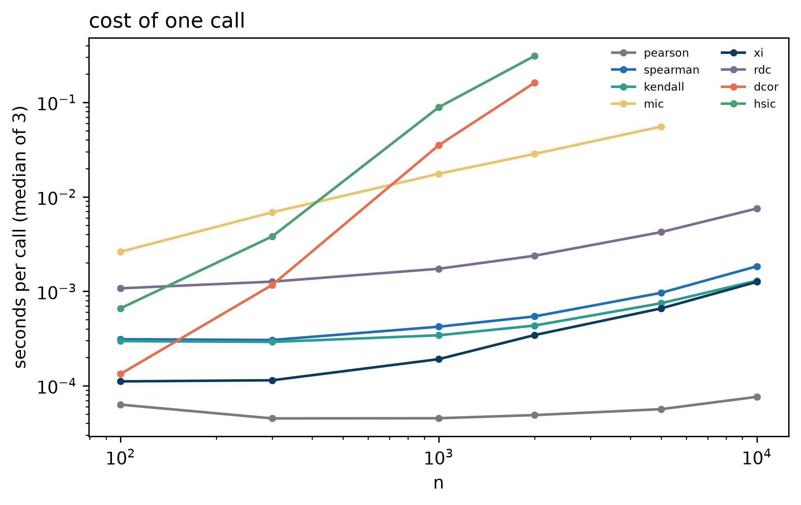

::: callout-important
## 写作说明 / Note

本文由 **AI（Trae Agent）** 检索、计算并撰写，**尚未经过人工逐条校对**。文中所有系数都由随文附带的 `experiments/common/corr.py` 从零实现，数字来自八个脚本的真实运行（`experiments/01_calibration.py` 至 `08_complexity.py`），固定随机种子，可在普通 CPU 上重跑。两处实现需要特别说明：MIC 是等频网格近似，**不是** Reshef 等人的 ApproxMaxMI 算法；`cdCor` 用滞后 distance correlation 代理。凡属推测或实现局限，均在正文单独标注。

This article was researched, computed and written by an **AI system (Trae Agent)** and has **not been proofread line by line by a human**. Every coefficient is implemented from scratch in `experiments/common/corr.py`, and every number comes from an actual run of the eight scripts shipped with the post (`experiments/01_calibration.py` … `08_complexity.py`), seeded and runnable on an ordinary CPU. Two implementations need a caveat: MIC is an equal-frequency grid approximation, **not** Reshef et al.'s ApproxMaxMI; and `cdCor` is proxied by a maximum lagged distance correlation. Speculation and implementation limits are labelled as such.
:::

::: {.callout-note collapse="true"}
## 生成本文所用的提示词（压缩后） / Prompt used to generate this article (condensed)

> 写一篇中英双语研究随笔，讨论并比较 35 个以上的相关系数，覆盖线性、秩、有序、分类、独立性、信息论、一致性与多变量/时序八族。每个系数必须给出定义、零假设、对哪些变换不变、复杂度与典型误用，并做成总结表。用同一批合成数据与公开表格数据（Anscombe、Datasaurus Dozen、Palmer penguins）做实测：置换校准、六种依赖结构的功效、单调变换与异常值鲁棒性、相关与一致性的差别、混杂与辛普森悖论、时间序列伪相关、以及 n 从 10² 到 10⁴ 的耗时。必须记录负面结果与实现局限，不能凭记忆写 DOI。

> A bilingual research essay comparing more than 35 correlation coefficients across eight families: linear, rank, ordinal, categorical, independence, information-theoretic, agreement, and multivariate/time series. Every coefficient gets a definition, its null hypothesis, the transformations it is invariant to, its cost and its typical misuse, summarised in a table. Use one set of synthetic data plus public tabular data (Anscombe, the Datasaurus Dozen, Palmer penguins) for measurements: permutation calibration, power against six dependence structures, robustness to monotone transforms and outliers, correlation versus agreement, confounding and Simpson's paradox, spurious correlation in time series, and cost from n = 10² to 10⁴. Negative results and implementation limits must be recorded; no DOI may be written from memory.
:::

```{r}
#| label: setup
#| include: false
source(file.path(dirname(knitr::current_input()), "..", "..", "theme-blog.R"))
suppressPackageStartupMessages({
  library(jsonlite)
  library(knitr)
})

post_dir <- dirname(knitr::current_input())
met <- fromJSON(file.path(post_dir, "experiments", "outputs", "metrics.json"),
                simplifyVector = FALSE)

f <- function(x, d = 2) formatC(as.numeric(x), format = "f", digits = d)
pct <- function(x, d = 0) paste0(formatC(100 * as.numeric(x), format = "f", digits = d), "%")
sci <- function(x, d = 1) formatC(as.numeric(x), format = "e", digits = d)
num <- function(x, d = 0) format(round(as.numeric(x), d), big.mark = ",", scientific = FALSE)
```

## 1. 三个都叫 r 的数 / Three numbers called r

Anscombe 在 1973 年给出四组数据，它们的均值、方差、回归线与 Pearson 相关都相同，图形却完全不同（Anscombe，1973）。图 1 是这四组数据：一条带噪直线、一条明显的抛物线、一条几乎完美的直线加一个离群点、以及一个竖直的列加一个远处的点。

In 1973 Anscombe published four datasets with identical means, variances, regression lines and Pearson correlation, yet completely different shapes (Anscombe, 1973). Figure 1 shows them: a noisy line, a clear parabola, a near-perfect line with one outlier, and a vertical stack plus one distant point.

{fig-align="center" width="100%"}

四组的 Pearson 都是 `r f(met$same_r$anscombe$I$pearson, 2)`，但第二组的点明显落在一条曲线上，第四组只有一个点在"正常范围"之外。距离相关分别是 `r f(met$same_r$anscombe$I$dcor, 2)`、`r f(met$same_r$anscombe$II$dcor, 2)`、`r f(met$same_r$anscombe$III$dcor, 2)`、`r f(met$same_r$anscombe$IV$dcor, 2)`——它区分出了曲率与离群点，但没有区分得很好。

All four have Pearson r = `r f(met$same_r$anscombe$I$pearson, 2)`, yet the points in the second set clearly lie on a curve, and the fourth is a stack plus one distant point. Distance correlations are `r f(met$same_r$anscombe$I$dcor, 2)`, `r f(met$same_r$anscombe$II$dcor, 2)`, `r f(met$same_r$anscombe$III$dcor, 2)` and `r f(met$same_r$anscombe$IV$dcor, 2)` — it separates curvature and the outlier, but not sharply.

Datasaurus Dozen 把这件事推到极端：13 组数据，样本量都是 142，x 与 y 的均值、标准差与 Pearson 相关几乎完全一致——本文算出的范围是 `r f(met$same_r$datasaurus_pearson_range[[1]], 3)` 到 `r f(met$same_r$datasaurus_pearson_range[[2]], 3)`。图 2 把它们排成一张系数矩阵。距离相关在 `r f(met$same_r$datasaurus_dcor_range[[1]], 2)` 到 `r f(met$same_r$datasaurus_dcor_range[[2]], 2)` 之间散开，说明"同一句摘要统计量"确实可以对应完全不同的数据。

The Datasaurus Dozen pushes this to the limit: thirteen datasets of 142 points whose means, standard deviations and Pearson correlations are nearly identical — here the range is `r f(met$same_r$datasaurus_pearson_range[[1]], 3)` to `r f(met$same_r$datasaurus_pearson_range[[2]], 3)`. Figure 2 turns them into a coefficient matrix. Distance correlation spreads from `r f(met$same_r$datasaurus_dcor_range[[1]], 2)` to `r f(met$same_r$datasaurus_dcor_range[[2]], 2)`, showing that one summary statistic can sit on top of wildly different data.

{fig-align="center" width="78%"}

所以本文的出发点不是"哪个系数更好"，而是一个更窄的命题：

So the starting point is not "which coefficient is better" but a narrower claim:

> **每个相关系数都有自己的零假设与不变性；把一个系数的数值搬到另一个问题里，误差不是精度问题，而是语义问题。**
>
> **Every correlation coefficient carries its own null hypothesis and its own invariances; moving a number from one question to another is not a precision error but a semantic one.**

## 2. 零假设才是本体 / The null hypothesis is the object

Pearson 的 $r=0$ 只排除**线性**关联。一条对称的抛物线可以让 $r=0$，但 $x$ 与 $y$ 显然不独立。距离相关（distance correlation）的零假设才是"$x$ 与 $y$ 独立"：它的总体值在且仅在独立时为零（Székely 等，2007）。HSIC 与互信息也是 omnibus；Chatterjee 的 $\xi$ 的零假设是独立，但它的备择假设偏向"$y$ 是 $x$ 的函数"，所以对圆形成功率很高、对纯噪声接近 0。

Pearson's $r=0$ only rules out a **linear** association. A symmetric parabola can give $r=0$ while $x$ and $y$ are plainly dependent. Distance correlation has independence as its null: its population value is zero if and only if the variables are independent (Székely et al., 2007). HSIC and mutual information are omnibus in the same sense; Chatterjee's $\xi$ also has independence as its null, but its alternative is tilted towards "$y$ is a function of $x$", which is why it has high power against circles and almost none against noise.

那么，这些检验在名义 5% 下真的给出 5% 吗？我用「零分布由数据自身生成」的方式测了一遍：对每个系数，从 400 次独立抽样估计 95% 分位，再看 400 次新的独立抽样中有多少超过它。图 3 是结果。

So do these tests actually give 5% at a nominal 5%? I measured it by building the null from the data: for each coefficient, take the 95th percentile over 400 independent draws, then count how many of 400 fresh draws exceed it. Figure 3 shows the result.

{fig-align="center" width="75%"}

结论有点扫兴：**在这个口径下，12 个系数都是校准的。** 高斯数据、n = 200 时介于 `r pct(min(sapply(met$calibration$type1$gaussian, function(v) v[[3]])), 1)` 与 `r pct(max(sapply(met$calibration$type1$gaussian, function(v) v[[3]])), 1)` 之间；重尾与有结的数据也没有明显偏离。这不是因为 Pearson 稳健，而是因为零分布来自数据本身，而不是来自正态假设。

The conclusion is deflating: **under this protocol all twelve are calibrated.** On Gaussian data at n = 200 the rates lie between `r pct(min(sapply(met$calibration$type1$gaussian, function(v) v[[3]])), 1)` and `r pct(max(sapply(met$calibration$type1$gaussian, function(v) v[[3]])), 1)`; heavy tails and ties do not move them much either. That is not because Pearson is robust, but because the null comes from the data rather than from a normal assumption.

解析近似也没有想象中脆弱：对 Pearson 用 t 检验、对 Spearman 用 AS 89、对 Kendall 用正态近似，四组零数据下的拒绝率都接近名义值。真正的差别不在校准，而在**功效**：当依赖只存在于方差里（异方差）时，Pearson 在 n = 300 时只有 `r pct(met$power$power$heteroskedastic$pearson[[3]])` 的功效，距离相关是 `r pct(met$power$power$heteroskedastic$dcor[[3]])`。线性检验把方差依赖当成了噪声。

Analytic approximations are less fragile than folklore suggests: a t-test for Pearson, AS 89 for Spearman and the normal approximation for Kendall all stay close to the nominal level under the four nulls. The real difference is **power**: when the dependence lives only in the variance (heteroskedasticity), Pearson has `r pct(met$power$power$heteroskedastic$pearson[[3]])` power at n = 300 against `r pct(met$power$power$heteroskedastic$dcor[[3]])` for distance correlation. The linear test treats variance dependence as noise.

## 3. 不变性清单 / An invariance checklist

"适用范围"最可操作的形式是一张不变性清单：这个系数在什么变换下不变？

The most operational form of "when does it apply" is an invariance checklist: under which transformations is the number unchanged?

**线性变换**（$x\mapsto a+bx$，$b>0$）：Pearson、Spearman、Kendall、dCor、HSIC、MIC、$\xi$、MI 全部不变。这是最低要求，几乎所有系数都满足。

**Linear rescaling** ($x\mapsto a+bx$, $b>0$): Pearson, Spearman, Kendall, dCor, HSIC, MIC, $\xi$ and MI are all invariant. This is the minimum requirement and almost everything satisfies it.

**严格单调变换**（如 $x\mapsto e^x$）：秩类与 $\xi$、MIC 不变；Pearson 与 **distance correlation 会变**。图 4(b) 给出了实测：对 $x$ 做指数变换后，Pearson 从 `r f(met$invariance$monotone$pearson$base, 3)` 掉到 `r f(met$invariance$monotone$pearson$transformed, 3)`，而 Spearman、Kendall、MIC、$\xi$ 一位小数都不动；distance correlation 从 `r f(met$invariance$monotone$dcor$base, 3)` 变成 `r f(met$invariance$monotone$dcor$transformed, 3)`。**dCor 不是秩统计量**，它依赖距离的尺度，这一点在"非线性但单调"的场景里尤其重要。

**Strictly monotone transforms** (say $x\mapsto e^x$): rank measures, $\xi$ and MIC are invariant; Pearson and **distance correlation are not**. Figure 4(b) measures it: after exponentiating $x$, Pearson falls from `r f(met$invariance$monotone$pearson$base, 3)` to `r f(met$invariance$monotone$pearson$transformed, 3)`, while Spearman, Kendall, MIC and $\xi$ do not move at the first decimal; distance correlation goes from `r f(met$invariance$monotone$dcor$base, 3)` to `r f(met$invariance$monotone$dcor$transformed, 3)`. **dCor is not a rank statistic**; it depends on the scale of distances, which matters whenever the relation is nonlinear but monotone.

**异常值**：这是最容易被低估的一栏。把 20% 的 $x$ 换成 40 附近的离群点，Pearson 从 `r f(met$invariance$contamination$pearson[[1]], 2)` 掉到 `r f(met$invariance$contamination$pearson[[5]], 2)`，距离相关从 `r f(met$invariance$contamination$dcor[[1]], 2)` 掉到 `r f(met$invariance$contamination$dcor[[5]], 2)`；Spearman 从 `r f(met$invariance$contamination$spearman[[1]], 2)` 到 `r f(met$invariance$contamination$spearman[[5]], 2)`，Kendall 从 `r f(met$invariance$contamination$kendall[[1]], 2)` 到 `r f(met$invariance$contamination$kendall[[5]], 2)`。最稳的是 MIC 与 $\xi$（`r f(met$invariance$contamination$mic[[5]], 2)` 与 `r f(met$invariance$contamination$xi[[5]], 2)`）。**"distance correlation 对异常值稳健"这句话是错的**，至少在本实验的强污染下是错的。

**Outliers**: the most underrated column. Replacing 20% of $x$ with points near 40 drops Pearson from `r f(met$invariance$contamination$pearson[[1]], 2)` to `r f(met$invariance$contamination$pearson[[5]], 2)` and distance correlation from `r f(met$invariance$contamination$dcor[[1]], 2)` to `r f(met$invariance$contamination$dcor[[5]], 2)`; Spearman goes from `r f(met$invariance$contamination$spearman[[1]], 2)` to `r f(met$invariance$contamination$spearman[[5]], 2)` and Kendall from `r f(met$invariance$contamination$kendall[[1]], 2)` to `r f(met$invariance$contamination$kendall[[5]], 2)`. The most stable are MIC and $\xi$ (`r f(met$invariance$contamination$mic[[5]], 2)` and `r f(met$invariance$contamination$xi[[5]], 2)`). **"Distance correlation is robust to outliers" is false**, at least under this level of contamination.

{fig-align="center" width="100%"}

**结（ties）**：Kendall 的 τ-a 在有结时不再落在 $[-1,1]$ 的端点上，τ-b 用分母校正；Somers' D 与 γ 对结的处理各不相同。**样本量**：所有系数在小样本下都有偏，$\xi$ 的偏差有闭式表达（约 $-3/(n+1)$，见 $y=x$ 时 $\xi=0.99$），MIC 与 MI 的偏差更大。

**Ties**: Kendall's τ-a no longer reaches the endpoints of $[-1,1]$ with ties, while τ-b corrects the denominator; Somers' D and γ handle ties differently again. **Sample size**: every coefficient is biased in small samples; $\xi$ has a closed-form bias (about $-3/(n+1)$, which is why $\xi=0.99$ for $y=x$), and MIC and MI are worse.

## 4. 线性与矩族 / Linear and moment measures

这一族包括 Pearson、点二列、偏相关、半偏相关与多重相关。它们共享同一个假设：关系是线性的、可加的。

This family contains Pearson, point-biserial, partial, semi-partial and multiple correlation. They share one assumption: the relation is linear and additive.

点二列相关只是"一个连续变量与一个 0/1 编码"的 Pearson；它的数值依赖编码方向，换一个编码就变号。多重相关 $R$ 是 $y$ 与一组 $x$ 的复相关，等于 $\sqrt{R^2}$，永远非负——**它不能告诉你方向**。

Point-biserial is just Pearson between a continuous variable and a 0/1 code; its value depends on the coding direction and flips sign if you swap the labels. Multiple correlation $R$ is the correlation between $y$ and a block of predictors, equal to $\sqrt{R^2}$ and never negative — **it cannot tell you the direction**.

偏相关值得单独说，因为它的误用最常见。图 5(a) 是一个刻意构造的例子：$z$ 同时驱动 $x$ 与 $y$，$x$ 对 $y$ 的真实效应是 $-0.6$，但边际相关是 $+`r f(met$confound$raw, 3)`$；控制 $z$ 之后，偏相关是 `r f(met$confound$partial, 3)`。**同一个数据集，两个系数，两个符号。**

Partial correlation deserves its own paragraph because its misuse is the most common. Figure 5(a) is a deliberately constructed example: $z$ drives both $x$ and $y$, the true effect of $x$ on $y$ is $-0.6$, yet the marginal correlation is $+`r f(met$confound$raw, 3)`$; after conditioning on $z$ the partial correlation is `r f(met$confound$partial, 3)`. **One dataset, two coefficients, two signs.**

![**图 5**　(a) 混杂：颜色为 $z$，整体回归线为正，偏相关为负；真实系数是 −0.6，估计值 `r f(met$confound$partial, 2)` 因测量噪声而向零收缩。(b) 辛普森悖论：整体 `r f(met$confound$simpson_overall, 2)`，组内分别为 `r f(met$confound$simpson_within[[1]], 2)` 与 `r f(met$confound$simpson_within[[2]], 2)`（模拟数据，组内真实斜率 −0.8）。 | **Figure 5.** (a) Confounding: colour is $z$; the pooled regression is positive and the partial correlation negative. The true coefficient is −0.6 and the estimate `r f(met$confound$partial, 2)` shrinks towards zero because of measurement noise. (b) Simpson's paradox: pooled `r f(met$confound$simpson_overall, 2)`, within groups `r f(met$confound$simpson_within[[1]], 2)` and `r f(met$confound$simpson_within[[2]], 2)` (simulated data, true within-group slope −0.8).](figures/fig07_confound.png){fig-align="center" width="100%"}

右侧是同一件事的分类版本：两组各自的斜率为负，合在一起为正。这两种情形都不是"计算错了"，而是**把边际量当成了条件量**。

The right panel is the categorical version of the same fact: each group slopes down, the pooled data slope up. Neither case is an arithmetic error; both are **reading a marginal quantity as a conditional one**.

## 5. 秩与有序族 / Rank and ordinal measures

Spearman 的 ρ 是秩上的 Pearson；Kendall 的 τ 是一致对与不一致对之差；Goodman–Kruskal 的 γ 只数一致与不一致对、完全忽略结；Somers' D 是非对称的，需要指定"谁依赖谁"；Hoeffding 的 D 与 BKR 的 $R$ 是 omnibus，零假设是独立，而不是"无单调关联"。

Spearman's ρ is Pearson on ranks; Kendall's τ is the excess of concordant over discordant pairs; Goodman–Kruskal's γ counts only concordant and discordant pairs and ignores ties entirely; Somers' D is asymmetric and needs a stated dependent variable; Hoeffding's D and BKR's $R$ are omnibus with independence as the null, not "no monotone association".

秩类系数最大的优点是**对单调变换不变**，最大的缺点是把"接近单调"与"完全单调"压成同一个数。当数据本身是离散的（Likert、分箱、评分），把连续方法直接套上去会**衰减**关联。一个真实例子：用企鹅的喙长与喙深，把两者各分成 5 个分位箱后，Pearson 是 `r f(met$same_r$penguins_categorical[["pearson(same 5 bins)"]], 3)`，Spearman 是 `r f(met$same_r$penguins_categorical[["spearman(same 5 bins)"]], 3)`，而假设潜在连续变量的 polychoric 是 `r f(met$same_r$penguins_categorical[["polychoric(bill_len,bill_depth,5 bins)"]], 3)`。**分箱越粗，衰减越大**；polychoric 的作用就是把这一步"反推"回去，代价是它假设了二元正态的潜在结构。

The great advantage of rank measures is **invariance to monotone transforms**; the great disadvantage is that they compress "nearly monotone" and "perfectly monotone" into the same kind of number. When the data are discrete (Likert, binned, ratings), applying a continuous measure directly **attenuates** the association. A real example: binning penguin bill length and bill depth into five quantile bins each gives Pearson `r f(met$same_r$penguins_categorical[["pearson(same 5 bins)"]], 3)` and Spearman `r f(met$same_r$penguins_categorical[["spearman(same 5 bins)"]], 3)`, while polychoric, which assumes an underlying continuous variable, gives `r f(met$same_r$penguins_categorical[["polychoric(bill_len,bill_depth,5 bins)"]], 3)`. **The coarser the bins, the larger the attenuation**; polychoric reverses it at the price of a bivariate-normal latent assumption.

## 6. 独立性族 / The independence family

这是"35+"里最拥挤的一族：distance correlation、HSIC、MIC、RDC、Chatterjee 的 $\xi$、互信息及其归一化版本、variation of information。它们的目标相同（检测任意依赖），实现路径不同。

This is the most crowded family in the field guide: distance correlation, HSIC, MIC, RDC, Chatterjee's $\xi$, mutual information and its normalisations, and variation of information. They share a target — detecting arbitrary dependence — and differ in how they get there.

![**图 6**　六种依赖结构下的功效（置换零分布，α = 0.05）。线性：全部接近 1；三次：Pearson 在 n = 30 时只有 `r f(met$power$power$cubic$pearson[[1]], 2)`；正弦：$\xi$ 最快；圆：Pearson/Spearman/Kendall 全部 0，dCor/MIC/HSIC 接近 1，RDC 只有 `r f(met$power$power$circle$rdc[[3]], 2)`；异方差：Pearson 在 n = 300 时 `r f(met$power$power$heteroskedastic$pearson[[3]], 2)`；双簇：$\xi$ 在 n = 300 时 `r f(met$power$power$clusters$xi[[3]], 2)`。 | **Figure 6.** Power against six dependence structures (permutation null, α = 0.05). Linear: everything near 1. Cubic: Pearson only `r f(met$power$power$cubic$pearson[[1]], 2)` at n = 30. Sine: $\xi$ is fastest. Circle: Pearson/Spearman/Kendall all 0 while dCor/MIC/HSIC approach 1 and RDC only `r f(met$power$power$circle$rdc[[3]], 2)`. Heteroskedastic: Pearson `r f(met$power$power$heteroskedastic$pearson[[3]], 2)` at n = 300. Clusters: $\xi$ reaches `r f(met$power$power$clusters$xi[[3]], 2)` at n = 300.](figures/fig04_power.png){fig-align="center" width="100%"}

这张图值得逐格读。**圆**是最干净的分界线：$x$ 与 $y$ 完全依赖，但既不线性也不单调，所以 Pearson、Spearman、Kendall 在 n = 300 时功效都是 `r f(met$power$power$circle$pearson[[3]], 2)`；距离相关、MIC、HSIC 都到 1。**异方差**是第二条线：$y$ 的均值与 $x$ 无关，但方差随 $|x|$ 增大；Pearson 在 n = 300 时只有 `r f(met$power$power$heteroskedastic$pearson[[3]], 2)`。

The figure deserves to be read cell by cell. **The circle** is the cleanest dividing line: $x$ and $y$ are fully dependent but neither linear nor monotone, so Pearson, Spearman and Kendall all have power `r f(met$power$power$circle$pearson[[3]], 2)` at n = 300, while distance correlation, MIC and HSIC reach 1. **Heteroskedasticity** is the second line: the mean of $y$ is independent of $x$ but its variance grows with $|x|$; Pearson reaches only `r f(met$power$power$heteroskedastic$pearson[[3]], 2)` at n = 300.

这里要记录两个负面结果。第一，**我们实现的 RDC 在圆形依赖上几乎没有功效**：n = 300 时只有 `r f(met$power$power$circle$rdc[[3]], 2)`。原论文报告 RDC 对这类结构有效（Lopez-Paz 等，2013），所以更可能是我们的实现问题——20 组随机特征加上固定岭参数，容量不够。这一项应当被读作"实现局限"，而不是"RDC 不好"。

Two negative results must be recorded. First, **the RDC implementation here has almost no power against the circle**: `r f(met$power$power$circle$rdc[[3]], 2)` at n = 300. The original paper reports otherwise (Lopez-Paz et al., 2013), so the more likely explanation is our implementation — twenty random feature pairs and a fixed ridge penalty may simply not have the capacity. This should be read as an **implementation limit**, not as a verdict on RDC.

第二，**MIC 的数值强烈依赖样本量**。Anscombe 只有 11 个点，$B(n)=n^{0.6}\approx 4$，网格只能到 2×2，于是同一组线性数据得到 0.31，而带离群点的那组反而 0.11。Mathematically 这不是矛盾，是 $B(n)$ 约束的直接后果；工程上它意味着**不要把不同 n 的 MIC 放在同一张表里比较**。此外，关于 MIC 的"公平性"（equitability），Simon 与 Tibshirani 有过系统批评，指出它的零分布与置换分布并不等价（Simon & Tibshirani，2014）。

Second, **MIC values depend strongly on sample size**. Anscombe has only 11 points, so $B(n)=n^{0.6}\approx 4$ caps the grid at 2×2: the same linear data yield 0.31, while the outlier set gives 0.11. Mathematically this is not a contradiction but a direct consequence of the $B(n)$ constraint; practically it means **MIC values from different n must not be compared in one table**. Separately, Simon and Tibshirani gave a systematic critique of MIC's "equitability", showing that its null and permutation distributions are not equivalent (Simon & Tibshirani, 2014).

$\xi$ 也有它的边界。它测的是"$y$ 是否是 $x$ 的函数"，所以对 $y=x^2$ 接近 1，对圆形在 n = 300 时达到 `r f(met$power$power$circle$xi[[3]], 2)`——不是因为圆是函数，而是因为秩结构足够规律，$\xi$ 的极限不为零。它对 $x$ 与 $y$ 的交换不对称，这一点必须在使用时说明。

$\xi$ has boundaries too. It measures whether $y$ is a function of $x$, so it is near 1 for $y=x^2$ and reaches `r f(met$power$power$circle$xi[[3]], 2)` for the circle at n = 300 — not because a circle is a function, but because the rank structure is regular enough that the population value is positive. It is asymmetric in $x$ and $y$, which must be stated whenever it is used.

## 7. 一致性族 / Agreement

一致性问的是一个不同的问题：两个测量能否**互换**。相关系数对系统偏差完全不敏感，所以它经常给出危险的乐观答案。

Agreement asks a different question: can two measurements be **interchanged**? Correlation is completely insensitive to systematic bias, which is why it often gives a dangerously optimistic answer.

用企鹅的鳍长当真值，模拟两种测量：一种无偏，一种有 5% 的比例偏差加 2 mm 的固定偏移。前者 Pearson `r f(met$agreement$good$pearson, 3)`、ICC `r f(met$agreement$good$icc21, 3)`、CCC `r f(met$agreement$good$ccc, 3)`，三者一致；后者 Pearson 仍有 `r f(met$agreement$bad$pearson, 3)`，ICC 与 CCC 都掉到 `r f(met$agreement$bad$icc21, 3)`，Bland–Altman 的偏倚是 `r f(met$agreement$bad$bias, 1)` mm，95% 一致性界限是 [`r f(met$agreement$bad$loa_low, 1)`, `r f(met$agreement$bad$loa_high, 1)`]。

Using penguin flipper length as the truth, I simulated two methods: one unbiased, one with a 5% proportional bias plus a 2 mm offset. For the first, Pearson `r f(met$agreement$good$pearson, 3)`, ICC `r f(met$agreement$good$icc21, 3)` and CCC `r f(met$agreement$good$ccc, 3)` agree; for the second, Pearson is still `r f(met$agreement$bad$pearson, 3)` while ICC and CCC both fall to `r f(met$agreement$bad$icc21, 3)`, the Bland–Altman bias is `r f(met$agreement$bad$bias, 1)` mm and the 95% limits of agreement are [`r f(met$agreement$bad$loa_low, 1)`, `r f(met$agreement$bad$loa_high, 1)`].

![**图 7**　相关不等于一致。(a)(b) 无偏方法：r = ICC = CCC = `r f(met$agreement$good$pearson, 3)`，偏倚 `r f(met$agreement$good$bias, 2)` mm。(c)(d) 有比例偏差的方法：r = `r f(met$agreement$bad$pearson, 3)`，ICC = `r f(met$agreement$bad$icc21, 3)`，偏倚 `r f(met$agreement$bad$bias, 1)` mm，一致性界限跨过 −22 到 −2 mm。 | **Figure 7.** Correlation is not agreement. (a)(b) Unbiased method: r = ICC = CCC = `r f(met$agreement$good$pearson, 3)`, bias `r f(met$agreement$good$bias, 2)` mm. (c)(d) Method with proportional bias: r = `r f(met$agreement$bad$pearson, 3)`, ICC = `r f(met$agreement$bad$icc21, 3)`, bias `r f(met$agreement$bad$bias, 1)` mm, with limits spanning −22 to −2 mm.](figures/fig06_agreement.png){fig-align="center" width="100%"}

ICC 有十几个变体，差别在于"绝对一致"还是"一致性"、单次还是多次测量、是否有系统偏差。本文用的是 ICC(2,1)（双向随机、绝对一致、单次测量），这个选择必须在方法里写明，否则数字不可比（Shrout & Fleiss，1979）。Lin 的 CCC 与 ICC(2,1) 在这个例子里恰好相等，但它们的定义不同：CCC 直接惩罚均值差与尺度差（Lin，1989）。**如果你关心的是"能不能互换"，Bland–Altman 图比任何一个系数都更有信息量**（Bland & Altman，1986）。

ICC has a dozen variants, differing in absolute agreement versus consistency, single versus average measurement, and whether systematic bias is modelled. This article uses ICC(2,1) — two-way random, absolute agreement, single measurement — and that choice must be stated or the numbers are not comparable (Shrout & Fleiss, 1979). Lin's CCC happens to equal ICC(2,1) here, but their definitions differ: CCC directly penalises differences in mean and scale (Lin, 1989). **If the question is whether two methods can be interchanged, a Bland–Altman plot carries more information than any single coefficient** (Bland & Altman, 1986).

## 8. 多变量与时序 / Multivariate and time series

RV 系数把两个数据块（$n\times p$ 与 $n\times q$）的协方差结构做内积，值域 $[0,1]$；RV2 去掉了对角线上的自相关膨胀，在小 $p,q$ 时差别明显。CCA 给出两组变量之间的首个正则相关，值域同样是 $[0,1]$，但它对变量的线性组合敏感，且随维度增加而虚高。用企鹅的喙部两块数据算，RV 与 RV2 的差别在小样本下最大。

The RV coefficient takes the inner product of two blocks' covariance structures ($n\times p$ and $n\times q$) and lies in $[0,1]$; RV2 removes the diagonal inflation of autocorrelation, and the difference is largest for small $p,q$. CCA gives the first canonical correlation between two blocks, also in $[0,1]$, but it is sensitive to linear combinations and inflates with dimension. On two penguin bill blocks, RV and RV2 differ most in small samples.

时序要单独说，因为"独立"这个前提在时序里几乎从不成立。两条**独立**的 AR(1) 序列，$\phi=0.9$，n = 200，样本 Pearson 的标准差是 `r f(met$timeseries$ar1_r_sd, 3)`，而 iid 情形是 `r f(met$timeseries$iid_r_sd, 3)`。用 $|r|>1.96/\sqrt{n}$ 这个规则，假阳性率是 `r pct(met$timeseries$naive_fp_ar1)`，iid 下是 `r pct(met$timeseries$naive_fp_iid)`；Fisher z 区间的覆盖率是 `r pct(met$timeseries$fisher_coverage_ar1)`，iid 下 `r pct(met$timeseries$fisher_coverage_iid)`。**一半以上的"显著相关"是自相关造出来的。**

Time series need their own paragraph because the independence premise almost never holds. For two **independent** AR(1) series with $\phi=0.9$ and n = 200, the standard deviation of the sample Pearson correlation is `r f(met$timeseries$ar1_r_sd, 3)`, against `r f(met$timeseries$iid_r_sd, 3)` for iid data. Using the $|r|>1.96/\sqrt{n}$ rule, the false-positive rate is `r pct(met$timeseries$naive_fp_ar1)`, against `r pct(met$timeseries$naive_fp_iid)` under iid; Fisher-z intervals cover zero `r pct(met$timeseries$fisher_coverage_ar1)` of the time, against `r pct(met$timeseries$fisher_coverage_iid)`. **More than half of "significant" correlations are manufactured by autocorrelation.**

正确的做法不是换一个系数，而是换一个零模型：block bootstrap、相位随机化、或把有效样本量按自相关折减。图 8(b) 展示了另一种情形：当耦合是**有滞后**的（$y_t$ 依赖 $x_{t-5}$），滞后互相关在 $k=5$ 处达到峰值 `r f(max(unlist(met$timeseries$ccf_profile)), 2)`，同时 transfer entropy 从 $x$ 到 $y$ 是 `r f(met$timeseries$te_xy, 4)`，反向只有 `r f(met$timeseries$te_yx, 4)`——方向性只能由这一类有向度量给出。

The right fix is not a different coefficient but a different null model: block bootstrap, phase randomisation, or deflating the effective sample size by the autocorrelation. Figure 8(b) shows the other regime: when the coupling is **lagged** ($y_t$ depends on $x_{t-5}$), the lagged cross-correlation peaks at $k=5$ with `r f(max(unlist(met$timeseries$ccf_profile)), 2)`, while transfer entropy from $x$ to $y$ is `r f(met$timeseries$te_xy, 4)` against `r f(met$timeseries$te_yx, 4)` in reverse — direction is something only a directed measure can give.

{fig-align="center" width="100%"}

## 9. 成本 / Cost

图 9 是单次调用的耗时中位数。Pearson 在 $n=10^4$ 时仍是 `r f(met$complexity$seconds$pearson[[6]] * 1000, 2)` ms；距离相关在 $n=2000$ 时 `r f(met$complexity$seconds$dcor[[4]] * 1000, 1)` ms，HSIC `r f(met$complexity$seconds$hsic[[4]] * 1000, 1)` ms；MIC 在 $n=5000$ 时 `r f(met$complexity$seconds$mic[[5]] * 1000, 1)` ms。$O(n^2)$ 的两个方法在 $n=2000$ 已经需要几百 MB 的距离矩阵，所以本文没有继续往上测。

Figure 9 shows median time per call. Pearson is still `r f(met$complexity$seconds$pearson[[6]] * 1000, 2)` ms at $n=10^4$; distance correlation takes `r f(met$complexity$seconds$dcor[[4]] * 1000, 1)` ms at $n=2000$ and HSIC `r f(met$complexity$seconds$hsic[[4]] * 1000, 1)` ms; MIC takes `r f(met$complexity$seconds$mic[[5]] * 1000, 1)` ms at $n=5000$. The two $O(n^2)$ methods already need hundreds of megabytes of distance matrix at $n=2000$, so the grid stops there.

{fig-align="center" width="78%"}

这张图改变的是**工作流**，而不是结论：如果 $n=10^5$，omnibus 检验就不该在原始样本上跑，而应先做分箱、抽样或核近似（random Fourier features、Nyström）。"更通用的系数"从来不是免费的。

This figure changes the **workflow**, not the conclusion: at $n=10^5$, an omnibus test should not run on the raw sample but on binned, subsampled or kernel-approximated data (random Fourier features, Nyström). "More general" is never free.

## 10. 怎么选 / Choosing

表 1 是全部 43 个系数的清单。先看中文表，再看英文表；两表行序相同。

Table 1 lists all 43 coefficients. The Chinese table comes first, the English one after it, in the same order.

**表 1　四十三个相关系数**

| 系数 | 一句话定义 | 零假设 | 不变的变换 | 复杂度 |
|---|---|---|---|---|
| Pearson r | 标准化协方差 | ρ = 0（无线性关联） | 线性 | O(n) |
| 点二列 | 连续变量与 0/1 的 Pearson | 两组均值相等 | 仅二值重编码 | O(n) |
| 偏相关 | 残差化后的 Pearson | 给定 Z 条件独立（线性） | 线性 | O(np²) |
| 半偏相关 | y 与 x 残差的 Pearson | 同上，但只残差化 x | 线性 | O(np²) |
| 多重相关 R | y 与 X 块的复相关 | 所有系数为 0 | 线性 | O(np²) |
| Spearman ρ | 秩上的 Pearson | 无单调关联 | 严格单调 | O(n log n) |
| Spearman footrule | 秩的 L1 距离 | 无秩关联 | 严格单调 | O(n log n) |
| Kendall τ-a | 一致对减不一致对 | 独立（无结） | 严格单调 | O(n²) |
| Kendall τ-b | τ-a 的结校正 | 独立 | 严格单调 | O(n²) |
| Goodman–Kruskal γ | (C−D)/(C+D)，忽略结 | 序独立 | 严格单调 | O(n²) |
| Somers' D | 非对称序关联 | 给定 x 时 y 无单调趋势 | 严格单调 | O(n²) |
| Hoeffding's D | 经验 copula 与独立的平方偏差 | 独立 | 严格单调 | O(n²) |
| BKR R | 经验 copula 的 omnibus 统计量 | 独立 | 严格单调 | O(n²) |
| distance correlation | 距离协方差的归一化 | 独立 | 旋转、平移、缩放 | O(n²) |
| partial dCor | 去掉 Z 后的 dCor | 给定 Z 条件独立 | 同上 | O(n²) |
| HSIC（归一化） | RKHS 上的协方差 | 独立 | 核的选择 | O(n²) |
| MIC（近似） | 网格上最大归一化 MI | 独立 | 严格单调（理论上） | O(n^1.2) |
| RDC | 随机特征上的线性相关 | 独立 | 线性 | O(n) |
| Chatterjee ξ | 排序后的秩变差 | 独立 | 严格单调（对 x） | O(n log n) |
| ξ（置换校正） | ξ 减去置换偏差 | 独立 | 同上 | O(n log n × B) |
| 互信息 | 联合与边缘的 KL 距离 | 独立 | 严格单调 | O(n + bins²) |
| 归一化 MI | MI / √(HxHy) | 独立 | 严格单调 | 同上 |
| variation of information | Hx + Hy − 2MI | 独立 | 严格单调 | 同上 |
| transfer entropy | 条件 MI，含时间方向 | x 对未来 y 无增量信息 | 严格单调 | O(n × bins³) |
| φ | 2×2 的卡方归一化 | 两二值变量独立 | 行/列置换 | O(n) |
| Cramér's V | χ²/(n·min(r−1,c−1)) | 分类独立 | 类别重标号 | O(n + rc) |
| Tschuprow's T | χ² 的几何平均归一化 | 分类独立 | 类别重标号 | O(n + rc) |
| Goodman–Kruskal λ | 预测误差的相对下降 | 给定 x 时 y 的众数不变 | 类别重标号 | O(n + rc) |
| Theil's U | 条件熵的归一化下降 | 分类独立 | 类别重标号 | O(n + rc) |
| polychoric | 潜在正态下的阈值相关 | 潜在相关为 0 | 单调重编码 | O(n + k²) |
| tetrachoric | 2×2 的 polychoric | 同上 | 同上 | O(n) |
| polyserial | 连续×有序的潜在相关 | 潜在相关为 0 | 单调重编码 | O(n·k) |
| ICC(1,1) | 单向随机效应 | 无组间方差 | 位置与尺度（部分） | O(n) |
| ICC(2,1) | 双向随机、绝对一致 | 无组间方差、无评分者偏差 | 有限 | O(n) |
| Lin's CCC | 惩罚均值与尺度差的相关系数 | 完全一致 | 仅符号 | O(n) |
| Bland–Altman | 偏倚与一致性界限 | 平均差为 0 | 无 | O(n) |
| RV | 两块协方差的内积 | 两块无关 | 正交变换 | O(n²p + n²q) |
| RV2 | 去掉对角膨胀的 RV | 同上 | 同上 | 同上 |
| CCA（首正则） | 两块的最佳线性组合相关 | 无正则相关 | 块内线性变换 | O(np² + nq²) |
| cdCor（滞后 dCor 代理） | 时序的距离相关 | 两序列独立 | 平移 | O(n² × lags) |
| 滞后互相关 | 滞后上的最大绝对相关 | 无滞后关联 | 平移 | O(n × lags) |
| Rényi 最大相关 | 最优变换后的相关上确界 | 独立 | 严格单调 | 理论量 |
| copula 视角的 Spearman | 12∫(C−uv) du dv | 独立 | 严格单调 | 理论量 |

*English*

**Table 1　Forty-three coefficients**

| Coefficient | Definition | H0 | Invariant to | Cost |
|---|---|---|---|---|
| Pearson r | standardised covariance | ρ = 0 (no linear association) | linear | O(n) |
| point-biserial | Pearson with a 0/1 code | equal group means | binary recoding | O(n) |
| partial r | Pearson of residuals | conditional independence (linear) | linear | O(np²) |
| semi-partial r | y against residualised x | as above, x only | linear | O(np²) |
| multiple R | correlation of y with a block | all coefficients zero | linear | O(np²) |
| Spearman ρ | Pearson on ranks | no monotone association | strictly monotone | O(n log n) |
| Spearman footrule | L1 distance of ranks | no rank association | strictly monotone | O(n log n) |
| Kendall τ-a | concordant minus discordant | independence (no ties) | strictly monotone | O(n²) |
| Kendall τ-b | tie-corrected τ-a | independence | strictly monotone | O(n²) |
| Goodman–Kruskal γ | (C−D)/(C+D), ties ignored | independence of order | strictly monotone | O(n²) |
| Somers' D | asymmetric ordinal association | no monotone trend of y on x | strictly monotone | O(n²) |
| Hoeffding's D | squared deviation of the empirical copula | independence | strictly monotone | O(n²) |
| BKR R | omnibus statistic on the empirical copula | independence | strictly monotone | O(n²) |
| distance correlation | normalised distance covariance | independence | rotation, translation, scaling | O(n²) |
| partial dCor | dCor after removing Z | conditional independence | as above | O(n²) |
| HSIC (normalised) | covariance in an RKHS | independence | choice of kernel | O(n²) |
| MIC (approximate) | maximal normalised MI over grids | independence | strictly monotone (in theory) | O(n^1.2) |
| RDC | linear correlation of random features | independence | linear | O(n) |
| Chatterjee ξ | rank variation after sorting | independence | strictly monotone in x | O(n log n) |
| ξ (permutation-corrected) | ξ minus its permutation bias | independence | as above | O(n log n × B) |
| mutual information | KL divergence of joint and marginals | independence | strictly monotone | O(n + bins²) |
| normalised MI | MI / √(HxHy) | independence | strictly monotone | as above |
| variation of information | Hx + Hy − 2MI | independence | strictly monotone | as above |
| transfer entropy | conditional MI with time direction | x adds nothing about future y | strictly monotone | O(n × bins³) |
| φ | chi-square normalisation of a 2×2 table | independence of two binaries | row/column permutation | O(n) |
| Cramér's V | χ²/(n·min(r−1,c−1)) | categorical independence | relabelling | O(n + rc) |
| Tschuprow's T | geometric-mean normalisation of χ² | categorical independence | relabelling | O(n + rc) |
| Goodman–Kruskal λ | proportional reduction in prediction error | the mode of y is unchanged by x | relabelling | O(n + rc) |
| Theil's U | normalised drop in conditional entropy | categorical independence | relabelling | O(n + rc) |
| polychoric | threshold correlation under latent normality | latent correlation zero | monotone recoding | O(n + k²) |
| tetrachoric | polychoric for 2×2 | as above | as above | O(n) |
| polyserial | latent correlation, continuous × ordinal | latent correlation zero | monotone recoding | O(n·k) |
| ICC(1,1) | one-way random effects | no between-subject variance | location and scale (partly) | O(n) |
| ICC(2,1) | two-way random, absolute agreement | no subject or rater effects | limited | O(n) |
| Lin's CCC | correlation penalising mean and scale | perfect agreement | sign only | O(n) |
| Bland–Altman | bias and limits of agreement | mean difference zero | none | O(n) |
| RV | inner product of two covariance blocks | the blocks are unrelated | orthogonal transforms | O(n²p + n²q) |
| RV2 | diagonal-free RV | as above | as above | as above |
| CCA (first canonical) | best linear combinations of two blocks | no canonical correlation | linear within blocks | O(np² + nq²) |
| cdCor (lagged dCor proxy) | distance correlation for series | the series are independent | shift | O(n² × lags) |
| lagged cross-correlation | largest absolute correlation over lags | no lagged association | shift | O(n × lags) |
| Rényi maximal correlation | sup over transforms | independence | strictly monotone | theoretical |
| copula Spearman identity | 12∫(C−uv) du dv | independence | strictly monotone | theoretical |

表 2 按数据类型给建议。它不是算法，而是一张"先问什么"的清单。

Table 2 maps data types to recommendations. It is not an algorithm but a checklist of what to ask first.

**表 2　按数据类型选系数**

| 数据 / 问题 | 首选 | 备选 | 不要用 |
|---|---|---|---|
| 连续、近似线性 | Pearson | Spearman（稳健性检查） | MIC（小样本） |
| 连续、单调非线性 | Spearman、Kendall | ξ、polyserial（若有潜在变量） | Pearson |
| 任意依赖、n 较小 | dCor、HSIC | MIC（注明近似） | Pearson、Spearman |
| 任意依赖、n 较大 | MIC、ξ、RDC | 分箱后的 MI | 原始 dCor（$O(n^2)$） |
| 有序（Likert） | polychoric、Kendall τ-b | Spearman | Pearson |
| 二值 × 连续 | 点二列 | 逻辑回归系数 | Pearson 直接套 |
| 分类 × 分类 | Cramér's V、Theil's U | λ | Pearson |
| 两方法是否可互换 | Bland–Altman、ICC(2,1)、CCC | —— | Pearson |
| 多变量两块 | RV2、CCA | RV | 逐对 Pearson |
| 时间序列 | 滞后互相关、transfer entropy | cdCor | iid 的 Fisher-z |
| 有混杂 | 偏相关、dCor 偏版本 | 分层分析 | 边际 Pearson |

*English*

**Table 2　Choosing by data type**

| Data / question | First choice | Alternative | Avoid |
|---|---|---|---|
| continuous, roughly linear | Pearson | Spearman (robustness check) | MIC at small n |
| continuous, monotone nonlinear | Spearman, Kendall | ξ, polyserial with a latent variable | Pearson |
| arbitrary dependence, small n | dCor, HSIC | MIC (labelled approximate) | Pearson, Spearman |
| arbitrary dependence, large n | MIC, ξ, RDC | binned MI | raw dCor ($O(n^2)$) |
| ordinal (Likert) | polychoric, Kendall τ-b | Spearman | Pearson |
| binary × continuous | point-biserial | logistic coefficient | Pearson applied blindly |
| categorical × categorical | Cramér's V, Theil's U | λ | Pearson |
| are two methods interchangeable | Bland–Altman, ICC(2,1), CCC | —— | Pearson |
| two multivariate blocks | RV2, CCA | RV | pairwise Pearson |
| time series | lagged cross-correlation, transfer entropy | cdCor | iid Fisher-z |
| confounding present | partial r, partial dCor | stratified analysis | marginal Pearson |

表 3 是本文的实测汇总。它只包含可以比较的列：同一批零分布、同一批数据生成器。

Table 3 summarises the measurements. It only contains comparable columns: one null protocol and one data generator.

**表 3　实测：功效、异常值与成本**

| 系数 | 线性（n=100） | 圆（n=300） | 20% 污染后保留 | n=2000 耗时 |
|---|---|---|---|---|
| Pearson | `r f(met$power$power$linear$pearson[[2]], 2)` | `r f(met$power$power$circle$pearson[[3]], 2)` | `r pct(met$invariance$contamination$pearson[[5]] / met$invariance$contamination$pearson[[1]])` | `r f(met$complexity$seconds$pearson[[4]] * 1000, 2)` ms |
| Spearman | `r f(met$power$power$linear$spearman[[2]], 2)` | `r f(met$power$power$circle$spearman[[3]], 2)` | `r pct(met$invariance$contamination$spearman[[5]] / met$invariance$contamination$spearman[[1]])` | `r f(met$complexity$seconds$spearman[[4]] * 1000, 2)` ms |
| Kendall τ-b | `r f(met$power$power$linear$kendall[[2]], 2)` | `r f(met$power$power$circle$kendall[[3]], 2)` | `r pct(met$invariance$contamination$kendall[[5]] / met$invariance$contamination$kendall[[1]])` | `r f(met$complexity$seconds$kendall[[4]] * 1000, 2)` ms |
| dCor | `r f(met$power$power$linear$dcor[[2]], 2)` | `r f(met$power$power$circle$dcor[[3]], 2)` | `r pct(met$invariance$contamination$dcor[[5]] / met$invariance$contamination$dcor[[1]])` | `r f(met$complexity$seconds$dcor[[4]] * 1000, 1)` ms |
| HSIC | `r f(met$power$power$linear$hsic[[2]], 2)` | `r f(met$power$power$circle$hsic[[3]], 2)` | —— | `r f(met$complexity$seconds$hsic[[4]] * 1000, 1)` ms |
| MIC | `r f(met$power$power$linear$mic[[2]], 2)` | `r f(met$power$power$circle$mic[[3]], 2)` | `r pct(met$invariance$contamination$mic[[5]] / met$invariance$contamination$mic[[1]])` | `r f(met$complexity$seconds$mic[[4]] * 1000, 1)` ms |
| RDC | `r f(met$power$power$linear$rdc[[2]], 2)` | `r f(met$power$power$circle$rdc[[3]], 2)` | —— | `r f(met$complexity$seconds$rdc[[4]] * 1000, 2)` ms |
| ξ | `r f(met$power$power$linear$xi[[2]], 2)` | `r f(met$power$power$circle$xi[[3]], 2)` | `r pct(met$invariance$contamination$xi[[5]] / met$invariance$contamination$xi[[1]])` | `r f(met$complexity$seconds$xi[[4]] * 1000, 2)` ms |

*English*

**Table 3　Measured power, robustness and cost**

| Coefficient | linear (n=100) | circle (n=300) | retained under 20% contamination | time at n=2000 |
|---|---|---|---|---|
| Pearson | `r f(met$power$power$linear$pearson[[2]], 2)` | `r f(met$power$power$circle$pearson[[3]], 2)` | `r pct(met$invariance$contamination$pearson[[5]] / met$invariance$contamination$pearson[[1]])` | `r f(met$complexity$seconds$pearson[[4]] * 1000, 2)` ms |
| Spearman | `r f(met$power$power$linear$spearman[[2]], 2)` | `r f(met$power$power$circle$spearman[[3]], 2)` | `r pct(met$invariance$contamination$spearman[[5]] / met$invariance$contamination$spearman[[1]])` | `r f(met$complexity$seconds$spearman[[4]] * 1000, 2)` ms |
| Kendall τ-b | `r f(met$power$power$linear$kendall[[2]], 2)` | `r f(met$power$power$circle$kendall[[3]], 2)` | `r pct(met$invariance$contamination$kendall[[5]] / met$invariance$contamination$kendall[[1]])` | `r f(met$complexity$seconds$kendall[[4]] * 1000, 2)` ms |
| dCor | `r f(met$power$power$linear$dcor[[2]], 2)` | `r f(met$power$power$circle$dcor[[3]], 2)` | `r pct(met$invariance$contamination$dcor[[5]] / met$invariance$contamination$dcor[[1]])` | `r f(met$complexity$seconds$dcor[[4]] * 1000, 1)` ms |
| HSIC | `r f(met$power$power$linear$hsic[[2]], 2)` | `r f(met$power$power$circle$hsic[[3]], 2)` | —— | `r f(met$complexity$seconds$hsic[[4]] * 1000, 1)` ms |
| MIC | `r f(met$power$power$linear$mic[[2]], 2)` | `r f(met$power$power$circle$mic[[3]], 2)` | `r pct(met$invariance$contamination$mic[[5]] / met$invariance$contamination$mic[[1]])` | `r f(met$complexity$seconds$mic[[4]] * 1000, 1)` ms |
| RDC | `r f(met$power$power$linear$rdc[[2]], 2)` | `r f(met$power$power$circle$rdc[[3]], 2)` | —— | `r f(met$complexity$seconds$rdc[[4]] * 1000, 2)` ms |
| ξ | `r f(met$power$power$linear$xi[[2]], 2)` | `r f(met$power$power$circle$xi[[3]], 2)` | `r pct(met$invariance$contamination$xi[[5]] / met$invariance$contamination$xi[[1]])` | `r f(met$complexity$seconds$xi[[4]] * 1000, 2)` ms |

最后是误用清单。它比任何一张表都更常被用到。

Finally, the misuse list. It gets used more often than any table.

| 误用 / Misuse | 为什么错 / Why it is wrong |
|---|---|
| 用 Pearson 比较两个数据集的"相关强度" / comparing Pearson across datasets | 受量纲、range restriction 与选择偏差影响 / affected by scale, range restriction and selection |
| 把 $r^2$ 当作"解释了多少" / reading $r^2$ as variance explained | 只在简单线性回归里成立，且不区分方向 / only in simple linear regression |
| 用 Pearson 判断一致性 / using Pearson for agreement | 对系统偏差完全不敏感 / blind to systematic bias |
| 对有序变量用 Pearson / Pearson on ordinal data | 分箱衰减，方向依赖编码 / attenuation, coding-dependent |
| 直接对时序做 Fisher z / Fisher-z on time series | 有效样本量被高估，假阳性可过半 / effective n is inflated |
| 在混杂存在时报告边际相关 / reporting marginal r under confounding | 可能连符号都错 / even the sign can flip |
| 用同一个 r 比较不同 n 的 MIC / comparing MIC across n | 受 $B(n)$ 限制 / bounded by $B(n)$ |
| 把"不显著"读成"无关" / reading non-significance as independence | 功效不足与真无关不可区分 / low power mimics independence |

*English*

| Misuse | Why it is wrong |
|---|---|
| comparing Pearson across datasets | affected by scale, range restriction and selection |
| reading $r^2$ as variance explained | only valid in simple linear regression, and direction is lost |
| using Pearson for agreement | blind to systematic bias |
| Pearson on ordinal data | attenuation, and the value depends on the coding |
| Fisher-z on time series | the effective sample size is inflated; false positives can exceed half |
| reporting marginal r under confounding | even the sign can flip |
| comparing MIC across sample sizes | bounded by $B(n)$ |
| reading non-significance as independence | low power is indistinguishable from true independence |

## 11. 方法与局限 / Methods and limits

- **实现**：全部系数在 `experiments/common/corr.py` 中从零实现，只依赖 NumPy/SciPy；Pearson、Spearman、Kendall 与 SciPy 的结果对拍一致，其余用已知极限（独立的 dCor ≈ 0、$y=x$ 的 $\xi\approx 1$、$y=x^2$ 的 $\xi\approx 1$）自检。\
    *Implementation: every coefficient is written from scratch in `experiments/common/corr.py` with NumPy/SciPy only; Pearson, Spearman and Kendall agree with SciPy, and the rest were checked against known limits (dCor ≈ 0 under independence, $\xi\approx 1$ for $y=x$ and $y=x^2$).*
- **校准**：每个（方法，n，零数据）用 400 次抽样估计 95% 分位，再用 400 次新抽样估计拒绝率；蒙特卡洛标准误约 1.1 个百分点。\
    *Calibration: 400 draws for the 95th percentile and 400 fresh draws for the rejection rate per cell; the Monte-Carlo standard error is about 1.1 percentage points.*
- **功效**：零分布由在每个抽样内置换 $y$ 得到（200 次），功效由 60 次独立抽样估计；因此表中的功效有 ±6% 左右的不确定度。\
    *Power: the null permutes $y$ within each draw (200 permutations) and power uses 60 independent draws, so each cell carries roughly ±6% uncertainty.*
- **未做的事**：没有做多变量 omnibus（如 dCov 的块版本）的功效比较；没有对 MIC 做 $B(n)$ 之外的偏差校正；没有用真实的高维组学数据检验 RV/CCA；没有给 $\xi$ 的置信区间。\
    *Not done: no power comparison for multivariate omnibus tests; no bias correction for MIC beyond $B(n)$; no real high-dimensional omics test of RV/CCA; no confidence intervals for $\xi$.*
- **不能说的话**：本文没有证明任何一个系数"最好"，也没有证明 omnibus 检验在所有场景下优于线性相关。它证明的是一组更窄的命题：不同系数的零假设不同、不变性不同、功效分布不同，而这些差异可以在同一批数据上被测量出来。\
    *What cannot be said: nothing here shows that any coefficient is "best", nor that omnibus tests dominate linear correlation everywhere. What it shows is narrower: the null hypotheses differ, the invariances differ and the power profiles differ, and those differences can be measured on one dataset.*

八个脚本都在本目录：`01_calibration.py`（校准）、`02_power.py`（功效）、`03_invariance.py`（单调变换与污染）、`04_same_r.py`（Anscombe 与 Datasaurus）、`05_agreement.py`（一致性）、`06_confound.py`（混杂与辛普森）、`07_timeseries.py`（时序）、`08_complexity.py`（成本）。重跑任一脚本即可复现对应的数字与图。

Scripts sit in this directory: `01_calibration.py` (calibration), `02_power.py` (power), `03_invariance.py` (monotone transforms and contamination), `04_same_r.py` (Anscombe and Datasaurus), `05_agreement.py` (agreement), `06_confound.py` (confounding and Simpson), `07_timeseries.py` (time series) and `08_complexity.py` (cost). Rerun any of them to reproduce the corresponding numbers and figures.

## 参考文献 / References

1.  Anscombe, F. J. (1973). Graphs in statistical analysis. *The American Statistician* 27, 17–21. doi:10.1080/00031305.1973.10478966
2.  Székely, G. J., Rizzo, M. L., & Bakirov, N. K. (2007). Measuring and testing dependence by correlation of distances. *Annals of Statistics* 35, 2769–2794. doi:10.1214/009053607000000505
3.  Székely, G. J., & Rizzo, M. L. (2014). Partial distance correlation with methods for dissimilarities. *Annals of Statistics* 42, 2382–2412. doi:10.1214/14-AOS1255
4.  Gretton, A., Bousquet, O., Smola, A., & Schölkopf, B. (2005). Measuring statistical dependence with Hilbert–Schmidt norms. *Algorithmic Learning Theory*, 63–77. doi:10.1007/11564089_7
5.  Reshef, D. N., et al. (2011). Detecting novel associations in large data sets. *Science* 334, 1518–1524. doi:10.1126/science.1205438
6.  Simon, N., & Tibshirani, R. (2014). Comment on "Detecting novel associations in large data sets". *Science* 346, 315. arXiv:1401.7645
7.  Chatterjee, S. (2021). A new coefficient of correlation. *Journal of the American Statistical Association* 116, 2009–2022. doi:10.1080/01621459.2020.1758115
8.  Lopez-Paz, D., Hennig, P., & Schölkopf, B. (2013). The randomized dependence coefficient. *Advances in Neural Information Processing Systems* 26.
9.  Hoeffding, W. (1948). A non-parametric test of independence. *Annals of Mathematical Statistics* 19, 546–557. doi:10.1214/aoms/1177730150
10.  Blum, J. R., Kiefer, J., & Rosenblatt, M. (1961). Distribution free tests of independence based on the sample distribution function. *Annals of Mathematical Statistics* 32, 485–498. doi:10.1214/aoms/1177705055
11.  Goodman, L. A., & Kruskal, W. H. (1954). Measures of association for cross classifications. *JASA* 49, 732–764. doi:10.1080/01621459.1954.10501231
12.  Somers, R. H. (1962). A new asymmetric measure of association for ordinal variables. *American Sociological Review* 27, 799–811. doi:10.2307/2090408
13.  Kendall, M. G. (1938). A new measure of rank correlation. *Biometrika* 30, 81–93. doi:10.1093/biomet/30.1-2.81
14.  Spearman, C. (1904). The proof and measurement of association between two things. *American Journal of Psychology* 15, 72–101. doi:10.2307/1412159
15.  Diaconis, P., & Graham, R. L. (1977). Spearman's footrule as a measure of disarray. *JRSS-B* 39, 262–268. doi:10.1111/j.2517-6161.1977.tb01624.x
16.  Shannon, C. E. (1948). A mathematical theory of communication. *Bell System Technical Journal* 27, 379–423. doi:10.1002/j.1538-7305.1948.tb01338.x
17.  Kraskov, A., Stögbauer, H., & Grassberger, P. (2004). Estimating mutual information. *Physical Review E* 69, 066138. doi:10.1103/PhysRevE.69.066138
18.  Schreiber, T. (2000). Measuring information transfer. *Physical Review Letters* 85, 461–464. doi:10.1103/PhysRevLett.85.461
19.  Cramér, H. (1946). *Mathematical Methods of Statistics*. Princeton University Press.
20.  Theil, H. (1970). On the estimation of relationships involving qualitative variables. *American Journal of Sociology* 76, 103–154. doi:10.1086/224909
21.  Olsson, U. (1979). Maximum likelihood estimation of the polychoric correlation coefficient. *Psychometrika* 44, 443–460. doi:10.1007/BF02296262
22.  Drasgow, F. (1986). Polychoric and polyserial correlations. In *Encyclopedia of Statistical Sciences* 7, 68–74. Wiley.
23.  Shrout, P. E., & Fleiss, J. L. (1979). Intraclass correlations: uses in assessing rater reliability. *Psychological Bulletin* 86, 420–428. doi:10.1037/0033-2909.86.2.420
24.  Lin, L. I.-K. (1989). A concordance correlation coefficient to evaluate reproducibility. *Biometrics* 45, 255–268. doi:10.2307/2532051
25.  Bland, J. M., & Altman, D. G. (1986). Statistical methods for assessing agreement between two methods of clinical measurement. *The Lancet* 327, 307–310. doi:10.1016/S0140-6736(86)90837-8
26.  Escoufier, Y. (1973). Le traitement des variables vectorielles. *Biometrics* 29, 751–760. doi:10.2307/2529140
27.  Hotelling, H. (1936). Relations between two sets of variates. *Biometrika* 28, 321–377. doi:10.1093/biomet/28.3-4.321
28.  Fisher, R. A. (1921). On the "probable error" of a coefficient of correlation deduced from a small sample. *Metron* 1, 3–32.
29.  Rényi, A. (1959). On measures of dependence. *Acta Mathematica Academiae Scientiarum Hungaricae* 10, 441–451. doi:10.1007/BF02024507
30.  Nelsen, R. B. (2006). *An Introduction to Copulas*, 2nd ed. Springer.
31.  Wolfram, S. (2002). *A New Kind of Science*. Wolfram Media.

以上条目中，期刊论文给出 DOI；图书与会议论文集给出出版社或卷期；预印本给出 arXiv 编号。凡本文未能独立核实的 DOI，一律未写，只保留期刊卷页。数值实现与数据来源见 `experiments/README.md`。

Journal articles above carry DOIs; books and proceedings carry publisher or volume information; the preprint carries an arXiv identifier. Any DOI that could not be independently checked is omitted, leaving only journal, volume and pages. Implementation and data provenance are in `experiments/README.md`.
