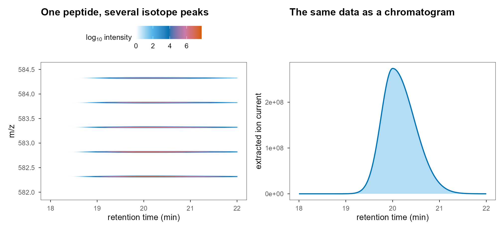

::: callout-important
## 写作说明 / Note

本文由 **AI（Claude）** 检索、整理并撰写，**尚未经过人工逐条校对**。所有数字都由文末脚本在本机实际运行得到，数据来自公开的 CPTAC Study 6 子集；公式的推导与模拟器的假设在正文中写明，但仪器参数（Orbitrap 分辨率、AGC 目标、检测器标定）随厂商与型号变化，具体数值只作量级示意。

This article was researched and written by an **AI system (Claude)** and has **not been proofread line by line by a human**. Every number comes from scripts that were actually run on the author's machine, using a public subset of CPTAC Study 6; the derivations and simulator assumptions are stated in the text, but instrument parameters (Orbitrap resolution, AGC targets, detector calibration) vary by vendor and model, so specific values are order-of-magnitude illustrations only.
:::

::: {.callout-note collapse="true"}
## 生成本文所用的提示词（压缩后） / Prompt used to generate this article (condensed)

> 写一篇双语长文，解释蛋白质组学里的 intensity、LFQ intensity、iBAQ 等数字到底是什么。要求从仪器原理（ESI、质量分析器、检测器、AGC）、化学原理（电离效率、同位素包络、离子抑制）、计算原理（XIC 积分、MaxLFQ 的成对比值与最小二乘、iBAQ 的可观测肽段数、TMT 报告离子压缩）逐层推导，给出公式，并用真实数据与模拟展示数字的分布、归一化效果和方法差异。图表要多，可以用 R、Python 与 mermaid。所有数字必须来自实际运行，正文用 inline R 引用。

> Write a bilingual long-form explainer of what intensity, LFQ intensity and iBAQ actually are. Start from the instrument (ESI, analyser, detector, AGC), then the chemistry (ionisation efficiency, isotope envelope, ion suppression), then the computation (XIC integration, MaxLFQ's pairwise ratios and least squares, iBAQ's observable-peptide denominator, TMT reporter compression). Derive the formulas and use both real data and simulations to show distributions, normalisation effects and method differences. Use many figures, in R, Python or mermaid. Every number must come from code that was actually run, and inline R should cite it.
:::

```{r}
#| label: setup
#| include: false
source(file.path(dirname(knitr::current_input()), "..", "..", "theme-blog.R"))

suppressPackageStartupMessages({
  library(dplyr)
  library(tidyr)
  library(knitr)
  library(jsonlite)
})

met <- fromJSON(file.path(dirname(knitr::current_input()), "outputs", "metrics.json"),
                simplifyVector = TRUE)
f <- function(x, d = 2) formatC(as.numeric(x), format = "f", digits = d)
pct <- function(x, d = 1) paste0(formatC(100 * as.numeric(x), format = "f", digits = d), "%")
```

## 1. 一个数字的七层约定 / Seven conventions behind one number

打开 `proteinGroups.txt`，找到 SODC_HUMAN（UPS1 里的超氧化物歧化酶），在 `Intensity 6A_7` 这一列读到 175,850。这个数不是分子数，不是浓度，也不是摩尔量。它是七次约定串联之后的结果：分子先被电离，离子被电场送进质量分析器，检测器把离子数变成电流，软件把同位素峰合成一个包络，再把一段保留时间内的信号积分成峰面积，搜库把峰分配给肽段，最后把若干肽段聚合成蛋白。

Open `proteinGroups.txt`, find SODC_HUMAN (superoxide dismutase from the UPS1 spike-in), and read 175,850 in the `Intensity 6A_7` column. That number is not a molecule count, a concentration, or an amount in moles. It is the end of a chain of seven conventions: molecules are ionised, ions are steered into the analyser, a detector turns ion numbers into current, software merges the isotope peaks into one envelope, the signal is integrated over a retention-time window, a search engine assigns the peak to a peptide, and finally several peptides are rolled up into a protein.

**任何一层换了约定，数字就换了一个意思。** 这篇文章的路线就是沿着这条链走一遍：每一层先写清楚它"守恒"了什么，再用真实数据或模拟去违反这个假设，看数字怎么变。

**Change the convention at any layer and the number means something else.** This post walks the chain: at each layer we first state what is being conserved, then violate that assumption on real data or in simulation, and watch the number move.

## 2. 守恒量表 / The conservation ledger

归一化文章里我们用过"守恒量"这个说法，这里把它推广到整个定量流程。每一种读数，本质上都在声明"我除以了什么、我假设什么不变"。

We used the idea of a conserved quantity in the normalisation post; here it generalises to the whole quantification pipeline. Every readout is a statement about what is divided out and what is assumed constant.

| 读数 / Readout | 公式（核心） / Core formula | 除以 / 守恒了什么 | 何时失效 |
|---|---|---|---|
| Intensity | $\sum_{t}\sum_{k} I_{i,k}(t)$ | 什么都不除，任意的检测器刻度 | 跨样本、跨仪器比较 |
| LFQ intensity | MaxLFQ 的成对比值解 | 每次运行的肽段上样差异 | 肽段太少、共享肽 |
| iBAQ | $\sum_i I_i / N_{\text{obs}}$ | 可观测胰蛋白酶肽段数 | 电离效率差异、膜蛋白 |
| Top3 | 三个最强肽段的均值 | 肽段数目的极端值 | 肽段少于 3、共调节 |
| NSAF | $\frac{SC_p/L_p}{\sum_q SC_q/L_q}$ | 蛋白长度与总谱数 | 长度偏差、谱计数饱和 |
| emPAI | $10^{N_{\text{obs,det}}/N_{\text{obs}}}-1$ | 可观测肽段数，取指数 | 上界为 9，强非线性 |
| TMT / iTRAQ | 报告离子强度比 | 混样后的上样量 | 共隔离背景、比值压缩 |
| SILAC | 重/轻同位素对 | 混样、上样、电离 | 只能用于可培养样本 |
| DIA | 碎片离子 XIC 面积 | 每个窗口的总信号 | 干扰、库质量 |
| 谱计数 | PSM / 谱数 | 无 | 采样随机、动态范围窄 |

*English*

| Readout | Core formula | What is divided out | When it fails |
|---|---|---|---|
| Intensity | $\sum_{t}\sum_{k} I_{i,k}(t)$ | Nothing; an arbitrary detector scale | Cross-sample, cross-instrument comparison |
| LFQ intensity | MaxLFQ pairwise-ratio solution | Per-run peptide loading | Too few peptides, shared peptides |
| iBAQ | $\sum_i I_i / N_{\text{obs}}$ | Number of observable tryptic peptides | Flyability differences, membrane proteins |
| Top3 | Mean of the three strongest peptides | Extreme peptide counts | Fewer than three peptides, co-regulation |
| NSAF | $\frac{SC_p/L_p}{\sum_q SC_q/L_q}$ | Protein length and total spectra | Length bias, spectral saturation |
| emPAI | $10^{N_{\text{obs,det}}/N_{\text{obs}}}-1$ | Observable peptide count, exponentially | Capped at 9, strongly nonlinear |
| TMT / iTRAQ | Reporter-ion ratio | Post-mixing loading | Co-isolation background, ratio compression |
| SILAC | Heavy/light pair | Mixing, loading, ionisation | Culturable samples only |
| DIA | Fragment XIC area | Total signal per window | Interference, library quality |
| Spectral count | PSM / spectrum count | Nothing | Stochastic sampling, narrow dynamic range |

下图把所有读数按"除以什么"分成几支：从同一个峰表出发，不同的除法得到不同的列。

The diagram below groups all readouts by what they divide out: one peak table, different divisors, different columns.

```{mermaid}
flowchart LR
  A[LC-MS run] --> B[MS1 precursor]
  A --> C[MS2 fragments]
  B --> D[Intensity]
  B --> E[LFQ intensity]
  E --> F[iBAQ]
  D --> G[Top3]
  C --> H[TMT / iTRAQ]
  C --> I[SILAC]
  C --> J[DIA]
  C --> K[Spectral count]
  K --> L[emPAI / NSAF]
```

## 3. 数据：一份有标准答案的实验 / Data: an experiment with a known answer

要检验"哪个数字更接近真值"，必须知道真值。本文使用 CPTAC Study 6 的一个公开子集：酵母背景中掺入 48 个人源蛋白（UPS1），两个浓度水平 A = 0.25 fmol/µL 与 B = 0.74 fmol/µL，各三次技术重复。UPS1 蛋白的期望 log2 变化是 $\log_2(0.74/0.25)=1.566$，酵母背景的真值是 0。这份数据同时提供了"应该变化"和"不应该变化"两类答案。

To test which number is closer to truth, you need truth. This post uses a public subset of CPTAC Study 6: 48 human proteins (UPS1) spiked into a yeast background at two levels, A = 0.25 fmol/µL and B = 0.74 fmol/µL, with three technical replicates each. The expected log2 change for UPS1 proteins is $\log_2(0.74/0.25)=1.566$, and the truth for the yeast background is 0. The dataset supplies both "should change" and "should not change" answers at once.

清洗掉 decoy、污染物与只由修饰位点鉴定的条目后，剩下 `r met$e00$n_protein_clean` 个蛋白组与 `r met$e00$n_peptides` 个肽段，其中 `r met$e00$n_ups` 个蛋白组带 UPS1 标记。肽段的 log2 强度跨度为 `r f(met$e00$pep_log2_range, 1)` 个数量级，`r pct(met$e00$pep_missing)` 的肽段-运行单元没有读数。

After removing decoys, contaminants and entries identified only by a modified site, `r met$e00$n_protein_clean` protein groups and `r met$e00$n_peptides` peptides remain, of which `r met$e00$n_ups` protein groups carry the UPS1 label. Peptide log2 intensities span `r f(met$e00$pep_log2_range, 1)` orders of magnitude, and `r pct(met$e00$pep_missing)` of peptide-run cells have no value.

{fig-align="center" width="100%"}

## 4. 仪器层：离子在哪里变成数字 / Where ions become numbers

液相色谱把肽段按疏水性分开，电喷雾（ESI）把溶液中的肽段变成气相离子。离子经过传输、聚焦，进入质量分析器。Orbitrap 测量的是离子在电场中振荡产生的镜像电流，再经傅里叶变换得到 m/z 与强度；飞行时间（TOF）测量的是飞行时间。无论哪种，**"强度"首先是一个与到达检测器的离子数成正比的电信号**，单位是任意的 counts。

Liquid chromatography separates peptides by hydrophobicity, electrospray ionisation (ESI) turns them into gas-phase ions, and the ions are transmitted and focused into the analyser. An Orbitrap measures the image current of ions oscillating in an electric field and Fourier-transforms it into m/z and intensity; a time-of-flight (TOF) analyser measures flight time. Either way, **"intensity" is first of all an electrical signal proportional to the number of ions reaching the detector**, in arbitrary counts.

下图把这条链画成一条流水线，每个箭头都引入一次约定。

The diagram below draws the chain as a pipeline, where every arrow introduces a convention.

```{mermaid}
flowchart TD
  S[Sample + digest] --> L[LC separation]
  L --> E[ESI: ions in gas phase]
  E --> M[Analyser: m/z]
  M --> D[Detector: ion current]
  D --> C[Centroid + isotope envelope]
  C --> X[XIC integration]
  X --> P[Peptide intensity]
  P --> R[Protein roll-up]
  R --> T[Statistics]
```

这也解释了为什么不同仪器、不同实验室的 `Intensity` 不能直接比较：检测器增益、离子传输效率、AGC 目标、喷雾稳定性都不同。**能跨样本比较的，只能是比值；能跨蛋白比较的，必须先除以某个约定。**

This also explains why `Intensity` cannot be compared across instruments or labs: detector gain, ion transmission, AGC targets and spray stability all differ. **What can be compared across samples is a ratio; what can be compared across proteins must first be divided by some convention.**

## 5. 同位素包络：一个肽段是多个峰 / The isotope envelope: one peptide, several peaks

肽段由 C、H、N、O、S 组成，每种元素都有天然重同位素。一个 12 个氨基酸的肽段有约 60 个碳原子，至少含一个 ^13^C 的概率接近一半。于是单同位素峰之外还有 +1、+2、+3 等峰，形成一个包络。

Peptides are built from C, H, N, O and S, each with natural heavy isotopes. A 12-residue peptide has roughly 60 carbon atoms, so the chance of at least one ^13^C is close to one half. Beyond the monoisotopic peak there are +1, +2, +3 peaks, forming an envelope.

对本文示例肽段 LVNELTEFAK，单同位素峰只占包络的 `r pct(met$e01$isotopologue_share_mono)`。包络的形状随长度与组成变化：肽段越长，峰越多、越平。**如果只积分单同位素峰，你天然就丢掉了一半信号。**

For the example peptide LVNELTEFAK, the monoisotopic peak holds only `r pct(met$e01$isotopologue_share_mono)` of the envelope. The shape depends on length and composition: longer peptides give more, flatter peaks. **Integrate only the monoisotopic peak and you throw away half the signal by construction.**

{fig-align="center" width="86%"}

## 6. 色谱峰与积分：面积是一个选择 / The chromatographic peak and its integral

在保留时间 × m/z 的平面上，一个肽段是一条窄带：沿 m/z 方向是同位素包络，沿保留时间方向是洗脱曲线。软件把这个二维区域内的信号加总，得到提取离子色谱图（XIC），再对时间积分得到峰面积。

On the retention-time × m/z plane a peptide is a narrow band: an isotope envelope along m/z and an elution profile along time. Software sums the signal in that two-dimensional region into an extracted ion chromatogram (XIC) and integrates it over time to get a peak area.

{fig-align="center" width="100%"}

积分边界是人为的。取峰顶 ±1σ、只积一个同位素峰，只能拿到真实面积的 `r pct(met$e01$area_1sigma_1isotope)`；取 ±2σ、积五个同位素峰，能拿到 `r pct(met$e01$area_2sigma_5isotopes)`。**这不是仪器误差，而是软件参数的直接后果。**

Integration boundaries are a choice. Taking ±1σ around the apex and one isotope peak recovers only `r pct(met$e01$area_1sigma_1isotope)` of the true area; ±2σ and five isotopes recover `r pct(met$e01$area_2sigma_5isotopes)`. **This is not instrument error but a direct consequence of software parameters.**

{fig-align="center" width="86%"}

## 7. AGC：刻度是仪器设定 / AGC: the scale is a setting

Orbitrap 与离子阱用自动增益控制（AGC）决定每个扫描填入多少离子：设一个目标离子数，用注入时间把离子累积到目标。样本量固定时，改变 AGC 目标或最大注入时间，读数就整体平移；低丰度肽段还会先撞上"注入时间用完"的天花板。

Orbitraps and ion traps use automatic gain control (AGC) to decide how many ions enter each scan: a target ion number is set, and the injection time accumulates ions until the target is reached. For a fixed sample, changing the AGC target or the maximum injection time shifts the reading globally; low-abundance peptides hit the "injection time exhausted" ceiling first.

{fig-align="center" width="86%"}

**结论：`Intensity` 的绝对值没有跨实验的意义。** 它只有在"同一肽段、同一仪器设置、不同样本"的对比里才有意义。

**Conclusion: the absolute value of `Intensity` has no cross-experiment meaning.** It only means something when the same peptide is compared across samples on the same instrument with the same settings.

## 8. 饱和：比值为什么会被压平 / Saturation: why ratios flatten

检测器与离子传输都有上限。当两个样本的同一个肽段相差 100 倍时，高的一端可能已经饱和，低的一端仍在范围内，观测到的比值就小于真实比值。这是 label-free 定量在高比值端系统性低估的物理来源之一。

Detectors and ion transmission have limits. When the same peptide differs 100-fold between two samples, the high end may already be saturated while the low end is still in range, so the observed ratio is smaller than the truth. This is one physical source of the systematic underestimation of large fold changes in label-free quantification.

{fig-align="center" width="86%"}

## 9. 化学层：同样的量，不同的信号 / Same amount, different signal

即使没有饱和，不同肽段的电离效率也差很多：精氨酸/赖氨酸的存在、疏水性、长度、二级结构都会影响进入气相的效率。同一个蛋白的不同肽段，强度可以相差一个数量级以上。

Even without saturation, peptides differ widely in ionisation efficiency: the presence of arginine or lysine, hydrophobicity, length and secondary structure all affect how efficiently a peptide enters the gas phase. Peptides from the same protein can differ by more than an order of magnitude.

{fig-align="center" width="100%"}

这条性质决定了定量策略：**要比较的是同一个肽段在不同样本间的比值，而不是不同肽段之间的绝对值。** MaxLFQ 的全部设计都建立在这句话上。

This property dictates the strategy: **compare the ratio of the same peptide across samples, not the absolute values of different peptides.** The entire design of MaxLFQ rests on this sentence.

## 10. 缺失不是随机的 / Missingness is not random

蛋白质组数据里，`r pct(met$e00$pep_missing)` 的肽段-运行单元是空的。缺失与丰度强相关：信号越弱，越容易被漏采或低于检测限。这就是 MNAR（missing not at random）。

In proteomics data, `r pct(met$e00$pep_missing)` of peptide-run cells are empty. Missingness correlates strongly with abundance: the weaker the signal, the more likely it is missed or below the limit of detection. This is MNAR (missing not at random).

{fig-align="center" width="100%"}

缺失直接进入"求和"这一层：一个蛋白的强度是它所有被观测到的肽段之和。一个低丰度蛋白如果少观测到两个肽段，求和结果就系统性偏低；**而缺失又偏偏发生在低丰度端**，于是偏差与丰度绑在一起。

Missingness feeds straight into the summation step: a protein's intensity is the sum of its observed peptides. If a low-abundance protein loses two peptides, the sum is systematically too low; **and missingness happens preferentially at low abundance**, so the bias is tied to abundance itself.

## 11. 为什么不能简单求和 / Why summing peptides fails

三种常见的聚合规则，对缺失的反应完全不同：

The three common aggregation rules react very differently to missingness:

-   **求和（sum）**：把所有观测到的肽段强度相加。缺失的肽段按 0 计，整组缺失时该蛋白在这一运行就是 0；\
    *Sum*: add every observed peptide. Missing peptides count as zero, and a run with no peptides gives zero for that protein.
-   **均值（mean log）**：对观测到的肽段取 log 后平均。它忽略肽段数目，但会把"只剩一个肽段"的蛋白估得很不稳；\
    *Mean log*: average the logs of observed peptides. It ignores peptide counts but becomes unstable for proteins with a single surviving peptide.
-   **MaxLFQ**：只用肽段之间的比值，再用最小二乘把所有运行放到同一条相对曲线上。\
    *MaxLFQ*: use only peptide ratios, then put all runs on one relative curve by least squares.

{fig-align="center" width="100%"}

## 12. MaxLFQ 的三步 / MaxLFQ in three steps

MaxLFQ 的目标不是"更准地求和"，而是**只使用能在样本间配对的肽段比值**。它分三步。

MaxLFQ does not try to sum more accurately; it tries to **use only peptide ratios that can be paired across samples**. It proceeds in three steps.

**第一步，运行间归一化。** 选一个参考运行，对每个运行计算所有肽段的 log 比值中位数，作为该运行的偏移量并扣除。这一步去掉上样量差异。

**Step one, between-run normalisation.** Pick a reference run, compute the median log ratio of all peptides for each run, and subtract it. This removes loading differences.

**第二步，蛋白内的肽段比值。** 对蛋白 $p$ 与两次运行 $A,B$，在所有同时被定量到的肽段 $i$ 上取

**Step two, peptide ratios within a protein.** For protein $p$ and two runs $A,B$, take the median over all peptides $i$ quantified in both:

$$
\Delta_{AB}^{(p)} = \operatorname{median}_i \left( \log_2 I_{iA}^{(p)} - \log_2 I_{iB}^{(p)} \right)
$$

因为同一个肽段在两次运行中的电离效率相同，取比值时它被约掉。剩下的差异主要来自上样与回收率。

Because the same peptide has the same ionisation efficiency in both runs, that efficiency cancels in the ratio. What remains is mostly loading and recovery.

**第三步，最小二乘。** 设蛋白在运行 $s$ 的 log 丰度为 $x_s$，最小化

**Step three, least squares.** Let $x_s$ be the protein's log abundance in run $s$ and minimise

$$
\sum_{A<B} w_{AB}\left(x_A - x_B - \Delta_{AB}^{(p)}\right)^2
$$

其中 $w_{AB}$ 是两次运行共同定量的肽段数。这是一个带权拉普拉斯方程，解法等价于在图上做一次加权平均；固定一个 $x_1=0$ 即可求解，最后整体平移回观测强度的几何均值。**这一步把"两两比值"拼成一条一致的曲线，并让肽段多的运行对结果影响更大。**

where $w_{AB}$ is the number of peptides quantified in both runs. This is a weighted Laplacian system, equivalent to a weighted average on a graph; fix $x_1=0$ to solve it, then shift the whole profile back to the geometric mean of the observed intensities. **This step stitches pairwise ratios into one consistent curve and gives more weight to runs with more peptides.**

## 13. 手算一个例子 / A worked example

两个蛋白、每个三条肽段、三次运行，运行 2 上样 2 倍、运行 3 上样 4 倍，并且运行 2 丢了一个肽段。左图是 log2 强度矩阵，右图是三种估计与真实上样曲线。

Two proteins with three peptides each, three runs, with run 2 loaded 2× and run 3 loaded 4×, and one peptide missing in run 2. The left panel is the log2 intensity matrix; the right panel compares three estimates with the true loading curve.

![**图 10**　A：六条肽段在三次运行中的 log2 强度，行是肽段、列是运行，A1 在运行 2 缺失。B：MaxLFQ 恢复的曲线（蓝）、直接求和（黄）与真实上样（橙）。MaxLFQ 的恢复值为 `r paste(f(met$e03$example_recovered, 2), collapse = "、")`，真值为 `r paste(met$e03$example_true_loading, collapse = "、")`；求和因为缺了一个肽段而低估了运行 2。 | **Figure 10.** A: log2 intensities of six peptides across three runs, with A1 missing in run 2. B: the curve recovered by MaxLFQ (blue), the naive sum (yellow) and the true loading (orange). MaxLFQ recovers `r paste(f(met$e03$example_recovered, 2), collapse = ", ")` against a truth of `r paste(met$e03$example_true_loading, collapse = ", ")`; the naive sum underestimates run 2 because one peptide is missing.](figures/fig09_maxlfq_example.png){fig-align="center" width="100%"}

注意它恢复的是**相对曲线**，不是绝对量。MaxLFQ 的输出仍然是一个任意尺度的强度，只是把"运行间的上样差异"从蛋白曲线里剥掉了。

Note that it recovers a **relative curve**, not absolute amounts. MaxLFQ output is still an intensity on an arbitrary scale; it has merely removed between-run loading differences from the protein profile.

## 14. 与官方实现对照 / Checking against the official column

我们用 `peptides.txt` 自实现了同一套算法，再与 MaxQuant 的 `LFQ intensity` 列比较。先把每个蛋白的六个值减去自己的均值，只比较"运行间的形状"，因为两者的绝对尺度不同。

We re-implemented the same algorithm from `peptides.txt` and compared it with MaxQuant's `LFQ intensity` column. Each protein's six values are centred on their own mean so that only the between-run shape is compared, because the two absolute scales differ.

![**图 11**　自实现 MaxLFQ 与 MaxQuant LFQ 的对照（每个蛋白内部中心化）。虚线是 $y=x$。相关系数 `r f(met$e03$real_lfq_cor, 3)`，基于 `r format(met$e03$real_lfq_n, big.mark = ",")` 个蛋白-运行对；跨蛋白的秩相关为 `r f(met$e03$real_lfq_rank, 3)`。 | **Figure 11.** Self-implemented MaxLFQ against MaxQuant LFQ, centred within each protein. The dashed line is $y=x$. The correlation is `r f(met$e03$real_lfq_cor, 3)` over `r format(met$e03$real_lfq_n, big.mark = ",")` protein-run pairs; the between-protein rank correlation is `r f(met$e03$real_lfq_rank, 3)`.](figures/fig10_maxlfq_real.png){fig-align="center" width="72%"}

相关性不是 1，原因很具体：MaxQuant 要求至少两个"比值计数"才输出 LFQ 值，我们的实现没有这个门槛；MaxQuant 的运行间归一化细节也没有完全公开；共享肽的 razor 分配在两边可能不同。**这正是"读表"必须知道的事：同一列名字，背后可能有两套略有差异的实现。**

The correlation is not 1 for concrete reasons: MaxQuant requires at least two "ratio counts" before reporting an LFQ value, while our implementation has no such threshold; MaxQuant's between-run normalisation details are not fully public; and razor assignment of shared peptides can differ. **This is exactly what "reading the table" requires: the same column name can hide two slightly different implementations.**

## 15. 用已知答案检验 / Testing against a known fold change

现在把五种读数放到同一把尺子上：UPS1 蛋白的期望变化是 `r f(met$e00$expected_lfc, 2)`，酵母背景是 0。每组至少两个观测才纳入。

Now put five readouts on the same ruler: the expected change for UPS1 proteins is `r f(met$e00$expected_lfc, 2)` and the yeast background is 0. A protein is included only if it has at least two observations per group.

![**图 12**　五种读数在已知 2.96 倍变化下的分布。黄色是 UPS1，灰色是酵母背景，虚线是期望值 1.57，点线是 0。被截断到 [−3, 4] 以便看清主体。 | **Figure 12.** Distributions of five readouts under a known 2.96-fold change. Yellow is UPS1, grey is the yeast background, the dashed line is the expected 1.57 and the dotted line is 0. The y axis is clipped to [−3, 4] to show the bulk.](figures/fig11_lfc_methods.png){fig-align="center" width="100%"}

| 方法 / Method | 可定量蛋白 | 可定量 UPS1 | UPS1 误差 | 背景误差 |
|---|---|---|---|---|
| Intensity | `r met$e03$bench$n_eligible[1]` | `r met$e03$bench$n_ups[1]` | `r f(met$e03$bench$ups_error[1], 3)` | `r f(met$e03$bench$yeast_error[1], 3)` |
| LFQ (MaxQuant) | `r met$e03$bench$n_eligible[2]` | `r met$e03$bench$n_ups[2]` | `r f(met$e03$bench$ups_error[2], 3)` | `r f(met$e03$bench$yeast_error[2], 3)` |
| LFQ (this post) | `r met$e03$bench$n_eligible[3]` | `r met$e03$bench$n_ups[3]` | `r f(met$e03$bench$ups_error[3], 3)` | `r f(met$e03$bench$yeast_error[3], 3)` |
| Top3 | `r met$e03$bench$n_eligible[4]` | `r met$e03$bench$n_ups[4]` | `r f(met$e03$bench$ups_error[4], 3)` | `r f(met$e03$bench$yeast_error[4], 3)` |
| Sum | `r met$e03$bench$n_eligible[5]` | `r met$e03$bench$n_ups[5]` | `r f(met$e03$bench$ups_error[5], 3)` | `r f(met$e03$bench$yeast_error[5], 3)` |

*English*

| Method | Quantified proteins | Quantified UPS1 | UPS1 error | Background error |
|---|---|---|---|---|
| Intensity | `r met$e03$bench$n_eligible[1]` | `r met$e03$bench$n_ups[1]` | `r f(met$e03$bench$ups_error[1], 3)` | `r f(met$e03$bench$yeast_error[1], 3)` |
| LFQ (MaxQuant) | `r met$e03$bench$n_eligible[2]` | `r met$e03$bench$n_ups[2]` | `r f(met$e03$bench$ups_error[2], 3)` | `r f(met$e03$bench$yeast_error[2], 3)` |
| LFQ (this post) | `r met$e03$bench$n_eligible[3]` | `r met$e03$bench$n_ups[3]` | `r f(met$e03$bench$ups_error[3], 3)` | `r f(met$e03$bench$yeast_error[3], 3)` |
| Top3 | `r met$e03$bench$n_eligible[4]` | `r met$e03$bench$n_ups[4]` | `r f(met$e03$bench$ups_error[4], 3)` | `r f(met$e03$bench$yeast_error[4], 3)` |
| Sum | `r met$e03$bench$n_eligible[5]` | `r met$e03$bench$n_ups[5]` | `r f(met$e03$bench$ups_error[5], 3)` | `r f(met$e03$bench$yeast_error[5], 3)` |

三个值得注意的现象。第一，**直接求和与原始 Intensity 的 UPS1 误差最大**，分别是 `r f(met$e03$bench$ups_error[5], 2)` 与 `r f(met$e03$bench$ups_error[1], 2)`，因为低浓度端的缺失把比值推高。第二，**MaxQuant 的 LFQ 只定量到 `r met$e03$bench$n_ups[2]` 个 UPS1 蛋白**，而我们没有"两个比值计数"的门槛，因此覆盖到 `r met$e03$bench$n_ups[3]` 个；覆盖率与可靠性在这里是取舍。第三，**Top3 在已定量的蛋白上误差最小**（`r f(met$e03$bench$ups_error[4], 2)`），但它对肽段数的依赖很强，遇到只有一两个肽段的蛋白会失效。

Three observations. First, **the naive sum and raw Intensity have the largest UPS1 errors**, `r f(met$e03$bench$ups_error[5], 2)` and `r f(met$e03$bench$ups_error[1], 2)`, because missingness at the low-concentration end inflates ratios. Second, **MaxQuant LFQ quantifies only `r met$e03$bench$n_ups[2]` UPS1 proteins**, whereas our version without the two-ratio-count threshold covers `r met$e03$bench$n_ups[3]`; coverage and reliability trade off here. Third, **Top3 has the smallest error among the proteins it quantifies** (`r f(met$e03$bench$ups_error[4], 2)`), but it depends heavily on peptide count and fails for proteins with one or two peptides.

## 16. 缺失与共享肽 / Missingness and shared peptides

MaxLFQ 的优势在缺失时最明显。模拟中，当 35% 的肽段随机缺失时，求和的 RMSE 升到 `r f(met$e03$sim_rmse$rmse[met$e03$sim_rmse$miss == 0.35 & met$e03$sim_rmse$method == "sum of peptides"], 3)`，MaxLFQ 只有 `r f(met$e03$sim_rmse$rmse[met$e03$sim_rmse$miss == 0.35 & met$e03$sim_rmse$method == "MaxLFQ"], 3)`；保留蛋白比例分别是 `r pct(met$e03$sim_rmse$retained[met$e03$sim_rmse$miss == 0.35 & met$e03$sim_rmse$method == "sum of peptides"])` 与 `r pct(met$e03$sim_rmse$retained[met$e03$sim_rmse$miss == 0.35 & met$e03$sim_rmse$method == "MaxLFQ"])`。

MaxLFQ's advantage is clearest under missingness. In the simulation, at 35% missing peptides the sum's RMSE rises to `r f(met$e03$sim_rmse$rmse[met$e03$sim_rmse$miss == 0.35 & met$e03$sim_rmse$method == "sum of peptides"], 3)`, while MaxLFQ stays at `r f(met$e03$sim_rmse$rmse[met$e03$sim_rmse$miss == 0.35 & met$e03$sim_rmse$method == "MaxLFQ"], 3)`; the retained fractions are `r pct(met$e03$sim_rmse$retained[met$e03$sim_rmse$miss == 0.35 & met$e03$sim_rmse$method == "sum of peptides"])` and `r pct(met$e03$sim_rmse$retained[met$e03$sim_rmse$miss == 0.35 & met$e03$sim_rmse$method == "MaxLFQ"])` respectively.

共享肽是另一个坑。当蛋白 A 不变、蛋白 B 翻倍，而 A 的一部分肽段同时属于 B 时，把共享肽算给 A 会把 B 的变化"进口"到 A 上。若 A 的肽段全部共享，观测到的变化是 `r f(met$e03$shared_bias_full, 3)`，而真值是 0。

Shared peptides are another trap. When protein A is unchanged, protein B doubles, and some of A's peptides also belong to B, assigning the shared peptides to A imports B's change into A. If all of A's peptides are shared, the observed change is `r f(met$e03$shared_bias_full, 3)` when the truth is 0.

{fig-align="center" width="86%"}

## 17. iBAQ 的分母 / The iBAQ denominator

iBAQ 的思路是：一个蛋白的强度大致正比于它的摩尔量乘以"能电离的肽段数"。如果能把后者除掉，就能比较不同蛋白的相对丰度。分母 $N_{\text{obs}}$ 的定义是：对蛋白序列做胰蛋白酶理论酶切（K/R 之后切，脯氨酸之前不切），只保留长度 6–30 aa 的肽段，计数。

The idea of iBAQ is that a protein's intensity is roughly proportional to its molar amount times the number of "ionisable" peptides. Divide out the latter and you can compare relative abundances across proteins. The denominator $N_{\text{obs}}$ is defined as the number of tryptic peptides of length 6–30 aa from an in-silico digest (cleave after K/R, not before proline).

![**图 14**　左：可观测肽段数与蛋白长度的关系，斜率 `r f(met$e05$nobs_vs_length_slope, 2)`。右：可观测肽段数的分布，中位数 `r met$e05$nobs_median`，范围 `r met$e05$nobs_range[1]`–`r met$e05$nobs_range[2]`。分母本身跨两个数量级，说明它对"长短蛋白"的校正不是一个小修正。 | **Figure 14.** Left: observable peptides versus protein length, slope `r f(met$e05$nobs_vs_length_slope, 2)`. Right: distribution of observable peptide counts, median `r met$e05$nobs_median`, range `r met$e05$nobs_range[1]`–`r met$e05$nobs_range[2]`. The denominator spans two orders of magnitude, so this is not a small correction.](figures/fig14_observable.png){fig-align="center" width="100%"}

注意这个定义本身是约定：长度窗口换成 7–30 或 6–40，分母就变；漏切、修饰、膜蛋白跨膜段都会改变"理论上可观测"的数量。**iBAQ 的分子是测量，分母是规则。**

Note that the definition is itself a convention: change the window to 7–30 or 6–40 and the denominator changes; missed cleavages, modifications and transmembrane segments all alter what is "theoretically observable". **The numerator of iBAQ is measured; the denominator is a rule.**

## 18. iBAQ 修正了什么 / What iBAQ corrects

为了把"长度效应"单独拿出来，我们构造一个所有蛋白真实丰度相同、只有长度不同的模拟。此时原始求和强度会随可观测肽段数上升，斜率接近 1；除以 $N_{\text{obs}}$ 后，斜率应该回到 0。

To isolate the length effect, simulate proteins with identical true abundance and different lengths only. Raw summed intensity then rises with the number of observable peptides, with a slope near 1; dividing by $N_{\text{obs}}$ should bring the slope back to 0.

{fig-align="center" width="100%"}

这也解释了 iBAQ 的使用边界：**它能校正"肽段数目"这一项，但不能校正"每个肽段的电离效率"。** 真实数据里长度与生物学丰度相关，直接把真实强度对长度回归会得到负斜率；那反映的是"高丰度蛋白往往更短"这类生物学事实，而不是技术偏倚。所以要检验方法，必须在模拟里控制真值。

This also explains the boundary of iBAQ: **it corrects the "number of peptides" term but not the "ionisation efficiency per peptide".** In real data, length correlates with biological abundance, so regressing real intensity on length gives a negative slope; that reflects biology such as "abundant proteins tend to be shorter", not technical bias. Hence method checks need simulations with controlled truth.

## 19. 六种读数 / Six readouts

把 iBAQ、Top3、谱计数、NSAF、emPAI 与原始求和放在同一批模拟蛋白上，横轴是真实丰度。

Put iBAQ, Top3, spectral count, NSAF, emPAI and the raw sum on the same set of simulated proteins, with true abundance on the x axis.

![**图 16**　六种读数对真实丰度的响应。纵轴是各自报告的值（对数刻度，各面板独立）。iBAQ 与 Top3 的秩相关分别是 `r f(met$e05$readout_spearman$rho[met$e05$readout_spearman$readout == "iBAQ"], 3)` 与 `r f(met$e05$readout_spearman$rho[met$e05$readout_spearman$readout == "Top3"], 3)`；谱计数 `r f(met$e05$readout_spearman$rho[met$e05$readout_spearman$readout == "spectral count"], 3)`；emPAI 只有 `r f(met$e05$readout_spearman$rho[met$e05$readout_spearman$readout == "emPAI"], 3)`，并且在上界附近压平。 | **Figure 16.** Response of six readouts to true abundance. The y axis is each readout's own value on a log scale, independent per panel. Spearman correlations are `r f(met$e05$readout_spearman$rho[met$e05$readout_spearman$readout == "iBAQ"], 3)` for iBAQ, `r f(met$e05$readout_spearman$rho[met$e05$readout_spearman$readout == "Top3"], 3)` for Top3, `r f(met$e05$readout_spearman$rho[met$e05$readout_spearman$readout == "spectral count"], 3)` for spectral count and only `r f(met$e05$readout_spearman$rho[met$e05$readout_spearman$readout == "emPAI"], 3)` for emPAI, which flattens near its ceiling.](figures/fig16_readouts.png){fig-align="center" width="100%"}

emPAI 的上界不是拟合假象：$N_{\text{obs,det}} \le N_{\text{obs}}$，所以 emPAI 最大只能是 $10^1-1=9$。**它天生是一个有饱和的读数，适合做"有没有"的判断，不适合做精确的定量。**

emPAI's ceiling is not a fitting artefact: $N_{\text{obs,det}} \le N_{\text{obs}}$, so emPAI cannot exceed $10^1-1=9$. **It is a readout with a built-in saturation, suitable for presence/absence rather than precise quantification.**

## 20. iBAQ 的盲点：电离效率 / The blind spot: flyability

iBAQ 假设所有蛋白的"每肽段平均电离效率"相同。这个假设一旦被打破，误差是系统性的，而且不会因为重复测量而消失。

iBAQ assumes every protein has the same average ionisation efficiency per peptide. Once that assumption breaks, the error is systematic and does not average away with replicates.

![**图 17**　每蛋白电离效率异质性对 iBAQ 误差的影响。横轴是 flyability 的 log 标准差，纵轴是 iBAQ 的 log10 误差。σ 从 0.3 增到 1.1 时，误差的标准差从 `r f(met$e05$flyability_bias_sd$sd_bias[1], 2)` 增到 `r f(met$e05$flyability_bias_sd$sd_bias[3], 2)` 个数量级。 | **Figure 17.** Effect of per-protein ionisation heterogeneity on iBAQ error. The x axis is the log standard deviation of flyability and the y axis the log10 iBAQ error. As σ grows from 0.3 to 1.1, the error's standard deviation grows from `r f(met$e05$flyability_bias_sd$sd_bias[1], 2)` to `r f(met$e05$flyability_bias_sd$sd_bias[3], 2)` orders of magnitude.](figures/fig17_flyability.png){fig-align="center" width="86%"}

膜蛋白、极端 pI、富含半胱氨酸的蛋白，都是这个假设的重灾区。**iBAQ 让不同蛋白"可比"，但没有让它们"可绝对定量"。**

Membrane proteins, extreme pI and cysteine-rich proteins are the worst offenders. **iBAQ makes proteins comparable, not absolutely quantifiable.**

## 21. 从 iBAQ 到拷贝数 / From iBAQ to copies per cell

如果知道每个细胞的蛋白总质量 $M$（常用 100–400 pg），就能把 iBAQ 的比例换算成拷贝数：

If you know the total protein mass per cell $M$ (often taken as 100–400 pg), the iBAQ fraction converts to copy number:

$$
\text{copies}_p = \frac{\text{iBAQ}_p}{\sum_q \text{iBAQ}_q}\cdot\frac{M}{MW_p}\cdot N_A
$$

{fig-align="center" width="86%"}

所以文献里的"每个细胞约 10^6 个某蛋白"必须连同三个前提一起读：总蛋白质量、iBAQ 分母的规则、以及该蛋白是否落在 flyability 假设之内。**一个数带着三个约定，缺一个就无法复现。**

A statement like "about 10^6 copies of protein X per cell" must be read with three premises: total protein mass, the iBAQ denominator rule, and whether the protein satisfies the flyability assumption. **A number carries three conventions; drop one and it cannot be reproduced.**

## 22. TMT 与 iTRAQ：报告离子的压缩 / Isobaric reporter ions

同重标把不同样本标记后混样，在 MS2 里读报告离子。好处是缺失少、通量高；坏处是共隔离（co-isolation）：目标肽段与背景离子一起被碎裂，报告离子里混进了背景，比值被拉向 1。MS3 能显著降低背景，但灵敏度下降。

Isobaric labelling tags samples, mixes them, and reads reporter ions in MS2. The advantages are few missing values and high throughput; the cost is co-isolation: the target peptide fragments together with background ions, the reporter channels pick up that background, and ratios are pulled toward 1. MS3 reduces background substantially but loses sensitivity.

![**图 19**　上：不同共隔离背景下的报告离子比值。下：真实 4 倍比值在各背景水平下还剩多少。背景为 2 时只剩 `r pct(met$e07$tmt_surviving_4x[5])`。 | **Figure 19.** Top: reporter-ion ratios under different co-isolation backgrounds. Bottom: how much of a true 4-fold ratio survives at each background level. At a background of 2 only `r pct(met$e07$tmt_surviving_4x[5])` is left.](figures/fig19_tmt.png){fig-align="center" width="80%"}

这就是"TMT 的比值不能直接当 fold change"的物理原因。若研究结论依赖大比值，MS3 或互补离子方法不是可选项，而是必需项。

This is the physical reason why "a TMT ratio is not a fold change". If a conclusion depends on large ratios, MS3 or complementary-ion methods are not optional but necessary.

## 23. DIA：另一种缺失 / DIA: a different kind of missing

DDA 每个循环挑最强的前体做 MS2，弱信号被随机漏掉，所以缺失是"抽样式"的；DIA 把整个质量范围切成窗口，每个窗口都碎裂，理论上每个肽段在每次运行都有信号，缺失主要来自低于检测限与干扰。

DDA picks the strongest precursors each cycle, so weak signals are stochastically skipped and missingness is "sampling-like"; DIA slices the mass range into windows and fragments every window, so in principle every peptide has signal in every run, and missingness comes mainly from being below the limit of detection or from interference.

{fig-align="center" width="100%"}

DIA 的代价是"干扰"：同一个窗口里所有前体的碎片混在一起，提取 XIC 时必须靠谱图库与色谱形状去区分。**缺失从"随机漏采"变成了"系统干扰"，换了一种偏差，不是消失了。**

The cost of DIA is interference: fragments from all precursors in a window are mixed, and extracting an XIC relies on spectral libraries and peak shape. **Missingness changes from "stochastic skipping" to "systematic interference": a different bias, not the absence of one.**

## 24. 谱计数与它的亲戚 / Spectral counting and its relatives

谱计数只数"这个蛋白被打到多少次 MS2"。它简单、稳健，但动态范围窄，且对丰度是阶梯式的。

Spectral counting simply counts how many MS2 spectra were assigned to a protein. It is simple and robust, but its dynamic range is narrow and its response to abundance is step-like.

{fig-align="center" width="80%"}

谱计数家族的其它成员：**emPAI** 用观测肽段数除以可观测肽段数再取指数；**NSAF** 把谱数除以蛋白长度再归一化；**Top3** 取三个最强肽段的均值；**APEX** 用谱数乘以分子量再除以可观测肽段数。它们共同的问题是：**都把"肽段数"当成丰度的代理，而肽段数受长度、酶切效率与采样深度影响。**

Other members of the family: **emPAI** exponentiates the ratio of observed to observable peptides; **NSAF** divides spectral counts by length before normalising; **Top3** averages the three strongest peptides; **APEX** multiplies spectral counts by molecular weight and divides by observable peptides. Their common problem: **all treat peptide counts as a proxy for abundance, while counts depend on length, digestion efficiency and sampling depth.**

## 25. 全景表 / The panorama

| 读数 / Readout | 需要什么 / Needs | 动态范围 / Range | 缺失 / Missing | 适合回答 / Best for |
|---|---|---|---|---|
| Intensity | 原始 MS1 | 宽 | 中 | 同一肽段跨样本 |
| LFQ intensity | ≥2 肽段 | 宽 | 高 | 大队列相对定量 |
| iBAQ | 序列 + 理论酶切 | 宽 | 高 | 蛋白间相对丰度 |
| Top3 | ≥3 肽段 | 中 | 高 | 快速筛选 |
| NSAF | 谱数 + 长度 | 中 | 低 | 跨研究比较 |
| emPAI | 谱数 + 可观测肽段 | 窄 | 低 | 有无判断 |
| TMT / iTRAQ | 标记 + MS2/MS3 | 窄 | 低 | 多样本同时比较 |
| SILAC | 培养标记 | 宽 | 低 | 细胞系精确比值 |
| DIA | 谱图库 | 宽 | 低 | 大队列稳定定量 |
| 谱计数 | MS2 | 窄 | 低 | 粗筛 |

*English*

| Readout | Needs | Range | Missing | Best for |
|---|---|---|---|---|
| Intensity | raw MS1 | wide | medium | same peptide across samples |
| LFQ intensity | ≥2 peptides | wide | high | large cohorts, relative |
| iBAQ | sequence + digest | wide | high | relative abundance across proteins |
| Top3 | ≥3 peptides | medium | high | fast screening |
| NSAF | spectra + length | medium | low | cross-study comparison |
| emPAI | spectra + observable | narrow | low | presence/absence |
| TMT / iTRAQ | labels + MS2/MS3 | narrow | low | many samples at once |
| SILAC | metabolic label | wide | low | precise ratios in cell lines |
| DIA | spectral library | wide | low | stable large cohorts |
| Spectral count | MS2 | narrow | low | coarse screening |

## 26. 怎么读 `proteinGroups.txt` / Reading `proteinGroups.txt`

| 列 / Column | 含义 / Meaning | 能不能直接进模型 |
|---|---|---|
| `Intensity <run>` | 该运行中所有肽段的 MS1 强度之和 | 不能跨样本直接比较 |
| `LFQ intensity <run>` | MaxLFQ 归一化后的强度 | 可以，需先 log 与缺失处理 |
| `iBAQ` | 强度除以可观测肽段数 | 可以，但只做相对比较 |
| `MS/MS count <run>` | 该运行中该蛋白的谱数 | 可以做谱计数模型 |
| `Unique peptides` | 唯一肽段数 | 是过滤条件，不是定量值 |
| `Razor + unique peptides` | 含共享肽的计数 | 影响定量，但会引入邻居 |
| `Reverse` | decoy | 必须删除 |
| `Potential contaminant` | 污染物标记 | 通常删除，但要看研究问题 |
| `Only identified by site` | 只由修饰位点鉴定 | 通常删除 |

*English*

| Column | Meaning | Safe in a model? |
|---|---|---|
| `Intensity <run>` | Sum of MS1 intensities of all peptides in that run | Not comparable across samples directly |
| `LFQ intensity <run>` | MaxLFQ-normalised intensity | Yes, after log and missing handling |
| `iBAQ` | Intensity divided by observable peptides | Yes, for relative comparisons only |
| `MS/MS count <run>` | Spectra assigned to the protein in that run | Yes, for count models |
| `Unique peptides` | Number of unique peptides | A filter, not a quantity |
| `Razor + unique peptides` | Count including shared peptides | Affects quantification but imports neighbours |
| `Reverse` | Decoy | Must be removed |
| `Potential contaminant` | Contaminant flag | Usually removed; depends on the question |
| `Only identified by site` | Identified only by a modified site | Usually removed |

## 27. 十个常见误解 / Ten misconceptions

| 误解 / Misconception | 实际上 / What is true |
|---|---|
| Intensity 是浓度 | 是与离子数成正比的任意刻度，随 AGC 与增益变化 |
| LFQ 是另一种仪器 | 是一种基于肽段比值的归一化算法 |
| iBAQ 是绝对定量 | 是相对丰度，依赖电离效率假设 |
| 缺失等于 0 | 缺失是 MNAR，填 0 会系统性压低低丰度蛋白 |
| 谱计数与强度等价 | 谱计数动态范围窄，且在高丰度端饱和 |
| TMT 比值就是 fold change | 共隔离会把比值拉向 1 |
| 蛋白组的 Intensity 是"总量" | 只是被鉴定到的肽段之和，未鉴定部分不可见 |
| DIA 没有缺失 | 有，来自干扰与检测限 |
| 共享肽可以随便分配 | razor 分配会把邻居的变化带进来 |
| 换软件数字应该一样 | 归一化与阈值不同，数字本来就不同 |

*English*

| Misconception | What is true |
|---|---|
| Intensity is a concentration | It is an arbitrary scale proportional to ion counts, set by AGC and gain |
| LFQ is a different instrument | It is a normalisation algorithm based on peptide ratios |
| iBAQ is absolute quantification | It is relative abundance and depends on ionisation-efficiency assumptions |
| Missing means zero | Missingness is MNAR; zero-filling systematically deflates low-abundance proteins |
| Spectral counts equal intensity | Counts have a narrow range and saturate at the high end |
| A TMT ratio is a fold change | Co-isolation pulls ratios toward 1 |
| Protein-group Intensity is "total protein" | It is the sum of identified peptides; the unidentified part is invisible |
| DIA has no missing values | It does, from interference and the limit of detection |
| Shared peptides can be assigned freely | Razor assignment imports the neighbour's change |
| Different software should give the same number | Normalisation and thresholds differ, so the numbers differ by design |

## 28. 决策树 / A decision tree

把上面的表压缩成一棵决策树：先问要比较什么，再问数据结构。

Compress the table into a decision tree: ask what is being compared, then ask about the data structure.

```{mermaid}
flowchart TD
  Q1{Compare samples<br/>or proteins?}
  Q1 -->|samples| Q2{Many missing<br/>values?}
  Q2 -->|no| A1[Intensity + median<br/>normalisation]
  Q2 -->|yes| A2[LFQ intensity]
  Q1 -->|proteins| Q3{Need absolute<br/>amounts?}
  Q3 -->|no| A3[iBAQ]
  Q3 -->|yes| Q4{Spike-in or<br/>proteomic ruler?}
  Q4 -->|spike-in| A4[External standard]
  Q4 -->|ruler| A5[iBAQ + total mass<br/>+ copy number]
  Q1 -->|many samples<br/>at once| Q5{Labelling<br/>possible?}
  Q5 -->|yes| A6[TMT / iTRAQ]
  Q5 -->|no| A7[DIA with a library]
```

## 29. 复现说明 / Reproducing this post

本文的所有图与数字由以下脚本生成，运行顺序固定：

All figures and numbers in this post come from these scripts, run in this order:

-   `scripts/00_data.R`：下载并缓存 CPTAC 子集，抓取 UniProt 序列，计算理论酶切肽段数；\
    `scripts/00_data.R`: download and cache the CPTAC subset, fetch UniProt sequences, compute theoretical peptide counts;
-   `scripts/01_signal.R`：同位素包络、XIC 积分、AGC 与饱和；\
    `scripts/01_signal.R`: isotope envelopes, XIC integration, AGC and saturation;
-   `scripts/02_real_profile.R`：真实分布、缺失、肽段离散；\
    `scripts/02_real_profile.R`: real distributions, missingness, peptide spread;
-   `scripts/03_maxlfq.R`：MaxLFQ 示例、与官方对照、spike-in 基准、缺失与共享肽模拟；\
    `scripts/03_maxlfq.R`: MaxLFQ example, comparison with the official column, spike-in benchmark, missingness and shared-peptide simulations;
-   `scripts/04_ibaq.R`：可观测肽段、长度偏倚、六种读数、flyability、拷贝数；\
    `scripts/04_ibaq.R`: observable peptides, length bias, six readouts, flyability, copy number;
-   `scripts/05_panorama.R`：TMT 压缩、DDA/DIA、谱计数。\
    `scripts/05_panorama.R`: TMT compression, DDA/DIA, spectral counting.

R 包：`dplyr`、`tidyr`、`ggplot2`、`patchwork`、`jsonlite`、`knitr`、`ragg`、`scales`。数据来源为 `statOmics/msqrob2data` 仓库中的 `dda/cptacAvsB_lab3`，原始实验为 CPTAC Study 6；序列来自 UniProt REST API。正文中的每一个数字都由 `outputs/metrics.json` 经 inline R 生成，没有手抄。

R packages: `dplyr`, `tidyr`, `ggplot2`, `patchwork`, `jsonlite`, `knitr`, `ragg`, `scales`. The data come from `dda/cptacAvsB_lab3` in the `statOmics/msqrob2data` repository, originally CPTAC Study 6; sequences come from the UniProt REST API. Every number in the text is generated by inline R from `outputs/metrics.json`, none is copied by hand.

## 30. 参考文献 / References

1.  Cox, J., et al. (2014). Accurate proteome-wide label-free quantification by delayed normalization and maximal peptide ratio extraction, termed MaxLFQ. *Molecular & Cellular Proteomics* 13, 2513–2526. doi:10.1074/mcp.M113.031591
2.  Cox, J., & Mann, M. (2008). MaxQuant enables high peptide identification rates, individualized p.p.b.-range mass accuracies and proteome-wide protein quantification. *Nature Biotechnology* 26, 1367–1372. doi:10.1038/nbt.1511
3.  Schwanhäusser, B., et al. (2011). Global quantification of mammalian gene expression control. *Nature* 473, 337–342. doi:10.1038/nature10098
4.  Wiśniewski, J. R., et al. (2014). A "proteomic ruler" for protein copy number and concentration estimation without spike-in standards. *Molecular & Cellular Proteomics* 13, 3497–3506.
5.  Tabb, D. L., et al. (2010). Repeatability and reproducibility in proteomic identifications by liquid chromatography–tandem mass spectrometry. *Journal of Proteome Research* 9, 761–776. (CPTAC Study 6)
6.  Gillet, L. C., et al. (2012). Targeted data extraction of the MS/MS spectra generated by data-independent acquisition: a new concept for consistent and accurate proteome analysis. *Molecular & Cellular Proteomics* 11, O111.016717.
7.  Ishihama, Y., et al. (2005). Exponentially modified protein abundance index (emPAI) for estimation of absolute protein amount in proteomics. *Molecular & Cellular Proteomics* 4, 1265–1272.
8.  Zybailov, B., et al. (2006). Statistical analysis of membrane proteome expression changes in *Saccharomyces cerevisiae*. *Journal of Proteome Research* 5, 2339–2347. (NSAF)
9.  Silva, J. C., et al. (2006). Absolute quantification of proteins by LCMSE. *Molecular & Cellular Proteomics* 5, 144–156. (Top3)
10. Willforss, J., et al. (2018). NormalyzerDE: online tool for improved normalization of omics expression data and high-sensitivity differential expression analysis. *Journal of Proteome Research* 17, 2565–2571.
11. Gatto, L., & Lilley, K. S. (2012). MSnbase—an R/Bioconductor package for isobaric tagged mass spectrometry data visualization, processing and quantitation. *Bioinformatics* 28, 1120–1127.
12. `statOmics/msqrob2data`：<https://github.com/statOmics/msqrob2data>（CPTAC 子集与注释文件）。
13. UniProt Consortium (2025). UniProt: the Universal Protein Knowledgebase. *Nucleic Acids Research*. <https://www.uniprot.org>

前三条的 DOI 已核对；其余条目给出期刊、卷与页码，DOI 未逐条核实，引用前请自行确认。软件包与数据仓库以官方链接为准。

The DOIs for the first three references were checked; the remaining entries give journal, volume and pages without a verified DOI, so please confirm before citing. Software packages and data repositories are cited by their official links.
