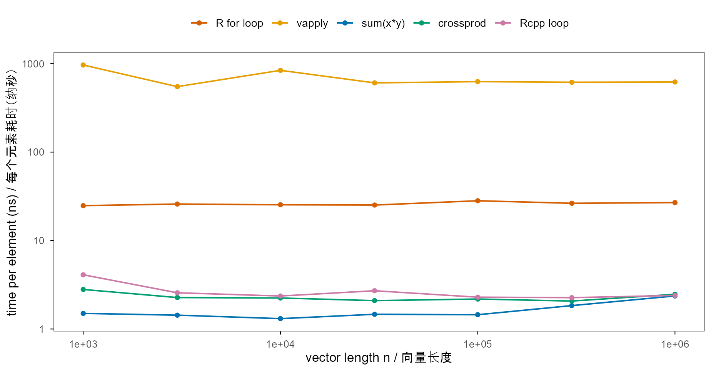
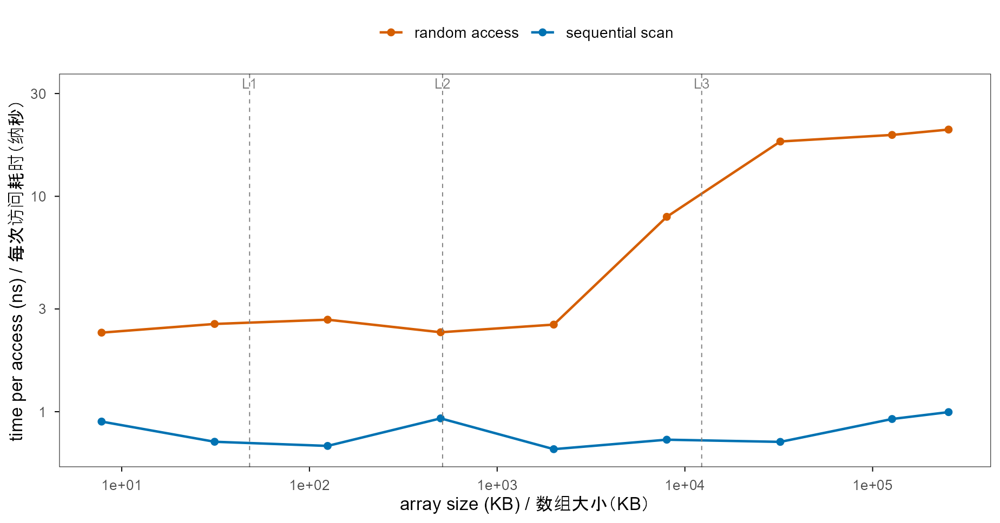
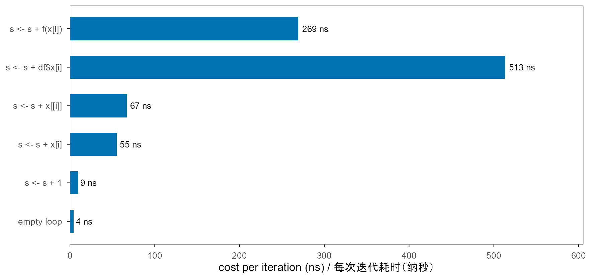
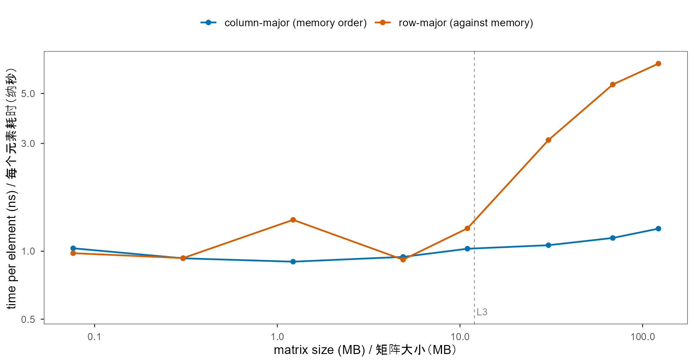
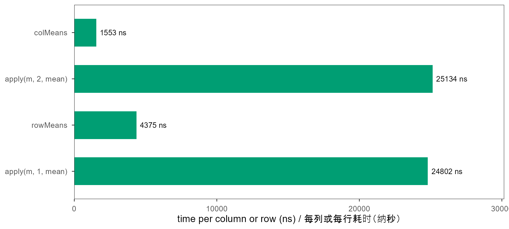
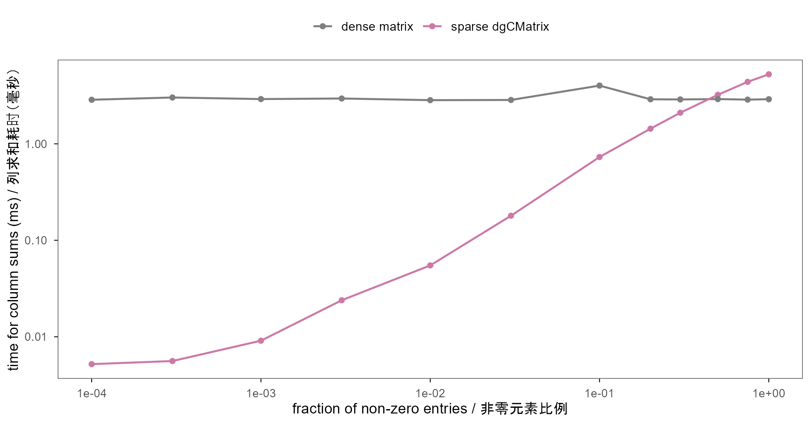
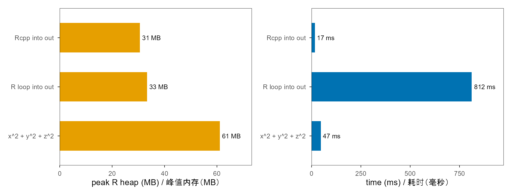
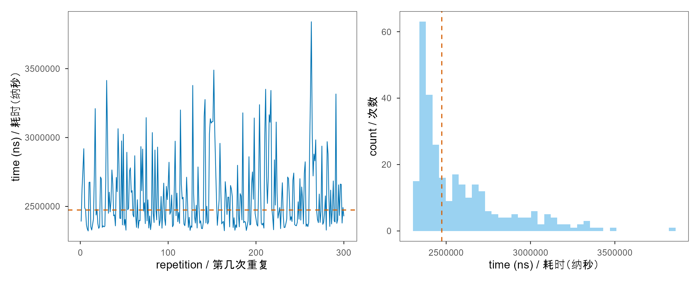
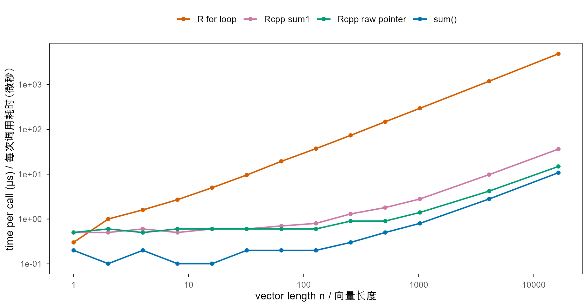

::: callout-important
## 写作说明 / Note

本文由 **AI（Trae Agent）** 检索、整理并撰写，**尚未经过人工逐行校对**。所有数字都来自随文附带的脚本（`scripts/01_loop.R` 至 `04_method.R`）在**一台具体的机器**上的实测：Intel i5-11500（6 核 12 线程，L1d 48 KB/核、L2 512 KB/核、L3 12 MB 共享）、16 GB 内存、Windows、R 4.5.1。绝对耗时随机器、编译器、R 版本变化，**有意义的只有比值与趋势**；换一台机器重跑脚本，曲线形状应当相似而数值不同。文中引用的理论量级来自参考文献，实测值一律以 `outputs/metrics.json` 为准。

This article was researched and written by an **AI system (Trae Agent)** and has **not been proofread line by line by a human**. Every number comes from an actual run of the shipped scripts (`scripts/01_loop.R` to `04_method.R`) on **one specific machine**: Intel i5-11500 (6 cores, 12 threads, 48 KB L1d per core, 512 KB L2 per core, 12 MB shared L3), 16 GB RAM, Windows, R 4.5.1. Absolute timings change with the machine, the compiler and the R version; **only ratios and trends are meaningful**. Re-run the scripts elsewhere and the curves should keep their shape while the numbers move. Theoretical orders of magnitude are cited from the references; measured values come from `outputs/metrics.json`.
:::

::: {.callout-note collapse="true"}
## 生成本文所用的提示词（压缩后） / Prompt used to generate this article (condensed)

> 写一篇中英双语长文，解剖「为什么 R 的 for 循环慢、向量化快」。要求：先讲清内存层次（L1/L2/L3/DRAM 的延迟与带宽）与解释器每次迭代的固定开销，再用在同一台机器上可复现的九个实验验证：空循环与各种 R 级操作的单次成本、向量化与循环的每元素成本、随机访问的缓存台阶、行优先与列优先遍历、apply 家族、稀疏与稠密的分界、中间对象的内存峰值、基准测试自身的抖动、以及 R 与 Rcpp（含裸指针版本）的调用开销与交叉点。所有数字由脚本生成并在正文用 inline R 引用；明确说明结果是机器相关的，只有比值有意义。

> A long bilingual post dissecting why R's for loops are slow and vectorised code is fast: the memory hierarchy (L1/L2/L3/DRAM latency and bandwidth) and the interpreter's per-iteration overhead, checked by nine reproducible experiments on one machine — per-iteration cost of R operations, per-element cost of loops vs vectorised code, the random-access staircase, row- vs column-major traversal, the apply family, the sparse/dense crossover, peak memory from temporaries, the jitter of a benchmark itself, and the call-cost crossover between R and Rcpp (including a raw-pointer variant). Every number is generated by the scripts and quoted with inline R; state clearly that results are machine-specific and only ratios matter.
:::

```{r}
#| label: setup
#| include: false
source(file.path(dirname(knitr::current_input()), "..", "..", "theme-blog.R"))

suppressPackageStartupMessages({
  library(dplyr)
  library(knitr)
  library(jsonlite)
})

met <- fromJSON(file.path(dirname(knitr::current_input()), "outputs", "metrics.json"),
                simplifyVector = TRUE)
f <- function(x, d = 1) formatC(as.numeric(x), format = "f", digits = d)
us <- function(ns) f(ns / 1000, 1)
i1 <- function(n) which(met$e01$n == n)
i3 <- function(size) which.min(abs(met$e03$size_kb - size))
i4 <- function(n) which(met$e04$n == n)
i6 <- function(d) which.min(abs(met$e06$density - d))
i9 <- function(n) which(met$e09$n == n)
```

## 1. 一个数字 / A number

同样的内积 $\sum_i x_i y_i$，长度 $10^6$，用 R 写 `for` 循环每个元素花 `r f(met$e01$loop_ns[i1(1e6)])` 纳秒；换成 `crossprod(x, y)`，每个元素花 `r f(met$e01$crossprod_ns[i1(1e6)], 2)` 纳秒。差 `r f(met$e01$ratio_loop_over_crossprod_1e6, 1)` 倍。如果用 `vapply` 而不是 `for`，每个元素要 `r f(met$e01$vapply_ns[i1(1e6)], 0)` 纳秒，比 `for` 还慢 `r f(met$e01$ratio_vapply_over_loop_1e6, 0)` 倍。

The same inner product $\sum_i x_i y_i$ at length $10^6$: written as an R `for` loop it costs `r f(met$e01$loop_ns[i1(1e6)])` nanoseconds per element; as `crossprod(x, y)` it costs `r f(met$e01$crossprod_ns[i1(1e6)], 2)` nanoseconds. That is a factor of `r f(met$e01$ratio_loop_over_crossprod_1e6, 1)`. And `vapply` is worse than the `for` loop: `r f(met$e01$vapply_ns[i1(1e6)], 0)` ns per element, `r f(met$e01$ratio_vapply_over_loop_1e6, 0)` times slower.

「向量化更快」是一句正确但没用的话。这篇文章要把这 10 倍拆开，说明它由三件互相独立的事组成，并给出每一件的量级。

"Vectorised code is faster" is true and useless. This post takes the factor of ten apart into three independent things and puts a number on each.



## 2. 「快」是三件事 / Speed is three things

一次计算花多长时间，取决于三件可以分别测量的东西：

How long a computation takes depends on three separately measurable things:

1. **指令数**：要做多少次加法、多少次乘法。这一项由算法决定，与语言无关。\
    *Instruction count: how many additions and multiplications. Set by the algorithm, not the language.*
2. **每次操作的固定开销**：解释器为「取一个元素」「调一个函数」付出的额外工作。这一项只和写法有关，`for` 循环把它乘以 $n$。\
    *Fixed overhead per operation: the extra work the interpreter does to fetch an element or call a function. This depends only on how you write it, and a `for` loop multiplies it by $n$.*
3. **数据在哪里**：寄存器、L1、L2、L3、内存，每远一层都更慢。这一项只和数据大小与访问顺序有关。\
    *Where the data is: registers, L1, L2, L3, memory — each step further out is slower. This depends only on data size and access order.*

写成式子：

As an expression:

$$
T \;\approx\; n \cdot \underbrace{c_{\text{dispatch}}}_{\text{解释器 / interpreter}}
\;+\; n \cdot \underbrace{c_{\text{op}}}_{\text{指令 / instructions}}
\;+\; \underbrace{N_{\text{miss}} \cdot L_{\text{mem}}}_{\text{访存 / memory}} .
$$

向量化做的事是**把第一项消掉**：把循环交给 C，解释器只负责一次分派。它不减少第二项（加法次数一样多），也不保证改善第三项——这就是为什么有些向量化代码并不快。后面的每一节，对应这个式子里的某一项。

What vectorisation does is **remove the first term**: the loop runs in C and the interpreter dispatches once. It does not reduce the second term (the same number of additions), and it does not automatically improve the third — which is why some vectorised code is not fast. Each of the following sections pins down one term of this expression.

## 3. 内存层次的量级 / The memory hierarchy

处理器和内存之间隔着几层缓存。教科书给的典型延迟是：L1 约 1 ns（4 个周期），L2 约 4 ns，L3 约 15 ns，内存约 80 ns。带宽则是另一个方向：本机上顺序扫描一个大数组，每个元素 `r f(min(met$e03$sequential_ns), 2)` ns，也就是约 `r f(8 / min(met$e03$sequential_ns), 0)` GB/s。

Between the processor and memory sit several caches. Textbooks give typical latencies of about 1 ns for L1 (4 cycles), 4 ns for L2, 15 ns for L3, and 80 ns for memory. Bandwidth goes the other way: on this machine a sequential scan costs `r f(min(met$e03$sequential_ns), 2)` ns per element, which is about `r f(8 / min(met$e03$sequential_ns), 0)` GB/s.

| 层级 / Level | 容量 / Size | 教科书延迟 / Textbook latency | 本机实测 / Measured here |
|---|---|---|---|
| L1 | 48 KB / 核 | ~1 ns | `r f(met$e03$random_ns[i3(8)], 1)` ns（8 KB 数组） |
| L2 | 512 KB / 核 | ~4 ns | `r f(met$e03$random_ns[i3(125)], 1)` ns（125 KB） |
| L3 | 12 MB 共享 | ~15 ns | `r f(met$e03$random_ns[i3(8008)], 1)` ns（8 MB） |
| 内存 / DRAM | 16 GB | ~80 ns | `r f(met$e03$random_ns[i3(253906)], 1)` ns（254 MB） |

实测值和教科书差得不少，原因有两个，都值得记住。第一，测到的是**吞吐**不是**延迟**：循环里成百上千次访问彼此独立，乱序执行会把它们重叠起来，所以每次访问的代价远低于单次延迟。第二，随机访问本身要读一个索引数组，那部分是顺序的、几乎免费。

The measured numbers differ from the textbook for two reasons worth remembering. First, what is measured is **throughput**, not **latency**: hundreds of accesses in a loop are independent, out-of-order execution overlaps them, and the per-access cost ends up far below the single-access latency. Second, a random access also has to read the index vector, and that part is sequential and nearly free.

## 4. 随机访问的台阶 / The staircase

把数组从 8 KB 增大到 254 MB，用预先抽好的随机下标反复取值，每次访问的耗时就会分几步抬起来：小数组时约 2 ns（L1/L2），过了 2 MB 开始上升，到 32 MB 以后稳定在 20 ns 左右（内存）。

Growing the array from 8 KB to 254 MB while reading at pre-drawn random positions makes the per-access cost climb in steps: about 2 ns while the array fits in L1/L2, rising past 2 MB, and settling near 20 ns beyond 32 MB, in memory.



最坏情况下，随机访问比顺序扫描慢 `r f(met$e03$random_over_seq_max, 0)` 倍。这就是「遍历顺序」为什么重要：同样的加法、同样的元素个数，只要碰内存的顺序不同，耗时就可能差好几倍。

At worst, random access is `r f(met$e03$random_over_seq_max, 0)` times slower than a sequential scan. This is why traversal order matters: same additions, same number of elements, but a different order of touching memory can cost several times more.

## 5. 一次迭代的成本 / What one iteration costs

现在看第二项。固定 $n = 10^5$，只改循环体里做的一件事，量出每次迭代的代价：

Now the second term. Fix $n = 10^5$ and change only what the body does, measuring the cost per iteration:

| 循环体 / Loop body | 每次迭代 / Per iteration |
|---|---|
| `for (i in seq_len(n)) {}` | `r f(met$e02$ns[1])` ns |
| `s <- s + 1` | `r f(met$e02$ns[2])` ns |
| `s <- s + x[i]` | `r f(met$e02$ns[3])` ns |
| `s <- s + x[[i]]`（list） | `r f(met$e02$ns[4])` ns |
| `s <- s + f(x[i])`（函数调用） | `r f(met$e02$ns[6])` ns |
| `s <- s + df$x[i]`（data.frame） | `r f(met$e02$ns[5])` ns |



空循环只要 `r f(met$e02$ns[1])` ns，说明循环本身的骨架并不贵；真正贵的是**在循环体里做的事情**。取一个数值向量元素是 `r f(met$e02$ns[3])` ns，取一个列表元素要到 `r f(met$e02$ns[4])` ns，调一次函数是 `r f(met$e02$ns[6])` ns，而通过 `$` 从 data.frame 里取列再取元素要 `r f(met$e02$ns[5])` ns——因为 `$` 每次都要做一次名字匹配。

An empty loop costs `r f(met$e02$ns[1])` ns, so the loop skeleton is cheap; what is expensive is **what happens in the body**. Fetching a numeric vector element is `r f(met$e02$ns[3])` ns; fetching from a list is `r f(met$e02$ns[4])` ns; calling a function is `r f(met$e02$ns[6])` ns; and pulling a column out of a data.frame through `$` before indexing costs `r f(met$e02$ns[5])` ns, because `$` re-does a name lookup every time.

把这一列数字乘以 $n$，就得到整个循环的额外开销。$n = 10^6$ 时，光「取元素」这一项就是 `r f(met$e02$ns[3] * 1e6 / 1e6, 0)` 毫秒；这就是为什么 `vapply` 会慢：它在每次迭代里额外调一次函数，`r f(met$e02$ns[6])` ns 乘以一百万。

Multiply these numbers by $n$ and you get the loop's extra cost. At $n = 10^6$, just fetching elements costs `r f(met$e02$ns[3] * 1e6 / 1e6, 0)` milliseconds; that is why `vapply` is slow — it adds one function call per iteration, `r f(met$e02$ns[6])` ns, a million times.

## 6. 向量化做了什么 / What vectorisation actually does

`sum(x * y)` 里的 `*` 和 `sum` 都是 C 函数：R 把两个向量交给它们，C 用指针走一遍，中间不再回到解释器。所以第一项从「$n$ 次分派」变成「一次分派」。

In `sum(x * y)`, both `*` and `sum` are C functions: R hands them the vectors, C walks them with a pointer, and control never returns to the interpreter. The first term drops from "$n$ dispatches" to "one dispatch".

但注意两件事。第一，`sum(x * y)` 会**多分配一个长度为 $n$ 的中间向量**——这是第三项和内存的代价，下一节会量化。第二，它并没有减少加法次数；它只是让每次加法由编译后的代码执行。所以向量化的上限，就是内存带宽：`r f(met$e01$product_ns[i1(1e6)], 2)` ns 每个元素，对应约 `r f(16 / met$e01$product_ns[i1(1e6)], 0)` GB/s（每个元素读两个 double）。回看第一节那张图：`for` 与 `vapply` 是两条平坦的高原，向量化与编译代码贴着地面——那个地面就是带宽。

Two things to notice. First, `sum(x * y)` **allocates an extra vector of length $n$** — a third-term and memory cost, quantified in a later section. Second, it does not reduce the number of additions; it only makes each one run as compiled code. So the ceiling for vectorised code is memory bandwidth: `r f(met$e01$product_ns[i1(1e6)], 2)` ns per element, about `r f(16 / met$e01$product_ns[i1(1e6)], 0)` GB/s (two doubles read per element). Look back at the first figure: the `for` loop and `vapply` are two flat plateaus, while vectorised and compiled code sit on the floor — and that floor is the bandwidth.

## 7. 列优先：矩阵在内存里怎么放 / Column-major

R 的矩阵是**列优先**存储的：`matrix(1:6, 3, 3)` 在内存里是 `1,2,3,4,5,6`，即第一列、第二列、第三列连着放。所以「沿着列走」是顺着内存，「沿着行走」是每隔一行跳一次。

R matrices are stored **column-major**: `matrix(1:6, 3, 3)` sits in memory as `1,2,3,4,5,6`, i.e. column one, then column two, then column three. Walking down a column follows memory; walking across a row jumps by one column each step.

用两个 C++ 函数做同一件事（把矩阵所有元素加起来），只改遍历顺序，在 122 MB 的矩阵上差别是 `r f(met$e04$ratio_at_4000, 1)` 倍：顺着内存 `r f(met$e04$col_major_ns[i4(4000)], 2)` ns 每元素，逆着内存 `r f(met$e04$row_major_ns[i4(4000)], 2)` ns。

Two C++ functions do the same thing — sum every element — and differ only in traversal order. On a 122 MB matrix they differ by `r f(met$e04$ratio_at_4000, 1)` times: `r f(met$e04$col_major_ns[i4(4000)], 2)` ns per element along memory, `r f(met$e04$row_major_ns[i4(4000)], 2)` ns against it.



矩阵小于 L3（12 MB）时两条线几乎重合——数据都在缓存里，方向无所谓；超过 L3 之后，逆着内存走会触发预取失败，代价随规模上升。R 的 `rowSums` 之所以比 `colSums` 慢，就是这个原因，而不是因为「行和比列和难算」。

Below L3 (12 MB) the two lines nearly coincide: everything is in cache and direction does not matter. Above L3, walking against memory defeats the prefetcher and the cost grows with size. This — not any difficulty in computing row sums — is why `rowSums` is slower than `colSums` in R.

## 8. apply 家族 / The apply family

`apply(m, 2, mean)` 本质上是 R 里的一个循环：它为每一列构造一个子向量，再调一次 `mean`。`colMeans` 是 C 函数，一遍扫完。在一个 2000 × 2000 的矩阵上：

`apply(m, 2, mean)` is, at heart, an R-level loop: it builds a sub-vector per column and calls `mean` each time. `colMeans` is a C function that sweeps once. On a 2000 × 2000 matrix:

| 写法 / Call | 每列（或每行）耗时 / Per column (or row) |
|---|---|
| `colMeans(m)` | `r f(met$e05$ns[1], 0)` ns |
| `apply(m, 2, mean)` | `r f(met$e05$ns[2], 0)` ns |
| `rowMeans(m)` | `r f(met$e05$ns[3], 0)` ns |
| `apply(m, 1, mean)` | `r f(met$e05$ns[4], 0)` ns |



两个效应叠加：`apply` 比对应的内置函数慢 `r f(met$e05$apply_col_over_colmeans, 1)` 倍（列方向），而按行遍历又比按列遍历慢——后者是缓存的方向问题。`apply(m, 1, mean)` 同时吃这两个亏，所以最慢。

Two effects compound: `apply` is `r f(met$e05$apply_col_over_colmeans, 1)` times slower than the built-in in the column direction, and row-wise work is slower than column-wise work because of the memory layout. `apply(m, 1, mean)` pays both and ends up slowest.

## 9. 稀疏矩阵的分界 / Where sparse wins

稀疏矩阵用三个数组存非零元素（值、行号、列起点），代价与非零元素个数成正比；稠密矩阵不管有没有零都扫一遍，代价与 $n^2$ 成正比。所以必有一个交叉点：本次实验里它在非零比例约 `r f(met$e06$crossover_density, 2)` 处。

A sparse matrix stores non-zeros in three arrays (values, row indices, column pointers), so its cost scales with the number of non-zeros; a dense matrix scans everything regardless, so its cost scales with $n^2$. There must be a crossover, and in this experiment it sits at a non-zero fraction of about `r f(met$e06$crossover_density, 2)`.



在 0.01% 的非零比例下，稀疏矩阵比稠密快 `r f(met$e06$dense_ns[i6(0.0001)] / met$e06$sparse_ns[i6(0.0001)], 0)` 倍；但非零比例到 30% 时优势已经很小，到 50% 就反过来了。除了时间，内存差别更大：同样 2000×2000，稠密占 `r f(met$e06$dense_mb[1], 1)` MB，稀疏在 0.01% 时只占 `r f(met$e06$sparse_mb[i6(0.0001)], 3)` MB。

At 0.01% non-zeros, the sparse version is `r f(met$e06$dense_ns[i6(0.0001)] / met$e06$sparse_ns[i6(0.0001)], 0)` times faster; by 30% the advantage is small and by 50% it has reversed. Memory differs more: for the same 2000×2000 shape, dense takes `r f(met$e06$dense_mb[1], 1)` MB while sparse takes `r f(met$e06$sparse_mb[i6(0.0001)], 3)` MB at 0.01%.

## 10. 快的代价：中间对象 / The price of speed: temporaries

`x^2 + y^2 + z^2` 会依次分配三个长度为 $n$ 的临时向量，再相加得到结果；一个写进预分配输出的循环只分配一个输出。在 $n = 4 \times 10^6$ 时：

`x^2 + y^2 + z^2` allocates three temporary vectors of length $n$ and then adds them; a loop writing into a preallocated output allocates only the output. At $n = 4 \times 10^6$:

| 写法 / Version | 峰值堆内存 / Peak heap | 耗时 / Time |
|---|---|---|
| `x^2 + y^2 + z^2` | `r f(met$e07$peak_mb[1], 0)` MB | `r f(met$e07$ms[1], 0)` ms |
| R 循环写入 out | `r f(met$e07$peak_mb[2], 0)` MB | `r f(met$e07$ms[2], 0)` ms |
| Rcpp 写入 out | `r f(met$e07$peak_mb[3], 0)` MB | `r f(met$e07$ms[3], 0)` ms |



向量化版本比 Rcpp 版本多占 `r f(met$e07$chain_over_cpp_mem, 1)` 倍内存，还比它慢 `r f(met$e07$chain_over_cpp_time, 1)` 倍；而 R 循环比 Rcpp 慢 `r f(met$e07$ms[2] / met$e07$ms[3], 0)` 倍。这张图给出了完整的答案：**要快且省，就写 C；要写起来短、愿意多花两倍内存，就用向量化；两者都不在乎，才会写 R 循环。**

The vectorised version needs `r f(met$e07$chain_over_cpp_mem, 1)` times the memory of the Rcpp version and is still `r f(met$e07$chain_over_cpp_time, 1)` times slower, while the R loop is `r f(met$e07$ms[2] / met$e07$ms[3], 0)` times slower than Rcpp. The picture gives the full answer: **fast and lean means C; short to write and willing to spend twice the memory means vectorised; neither means an R loop.**

## 11. 基准测试本身有多不可信 / How untrustworthy a benchmark is

把同一个 `crossprod` 跑 300 次，最短 `r f(met$e08$min_ns / 1e6, 2)` ms，中位数 `r f(met$e08$median_ns / 1e6, 2)` ms，最长 `r f(met$e08$max_ns / 1e6, 2)` ms——最长是最短的 `r f(met$e08$max_over_min, 1)` 倍。抖动来自操作系统调度、中断、GC 和频率变化。

Run the same `crossprod` 300 times: the fastest is `r f(met$e08$min_ns / 1e6, 2)` ms, the median `r f(met$e08$median_ns / 1e6, 2)` ms, the slowest `r f(met$e08$max_ns / 1e6, 2)` ms — a factor of `r f(met$e08$max_over_min, 1)`. The jitter comes from OS scheduling, interrupts, GC and frequency changes.



所以本文所有计时都取**最小值**：噪声只会让操作变慢，不会让它变快，最小值最接近代码本身的成本。这也是 `microbenchmark` 的用法要点——先预热，再重复多次，报告最小值或中位数，绝不报告单次结果。

That is why every timing here is a **minimum**: noise only makes an operation slower, never faster, so the minimum is the closest thing to the code's own cost. This is also how to use `microbenchmark`: warm up, repeat many times, report the minimum or the median, never a single run.

## 12. 什么时候该写 C / When to write C

编译代码不是免费的：每次调用都要过一遍 R 的 `SEXP` 接口，代价约 `r f(met$e09$cpp_us_at_n1, 2)` 微秒，而内置的 `sum()` 只要 `r f(met$e09$builtin_us_at_n1, 2)` 微秒。所以对很短的向量，写 C++ 反而更慢。

Compiled code is not free: every call crosses R's `SEXP` interface and costs about `r f(met$e09$cpp_us_at_n1, 2)` microseconds, while the built-in `sum()` costs `r f(met$e09$builtin_us_at_n1, 2)` microseconds. For short vectors, C++ is therefore slower.



这张图还有一个细节值得说：在 $n = 16384$ 时，Rcpp 版本比 `sum()` 慢约 `r f(met$e09$cpp_us[i9(16384)] / met$e09$builtin_us[i9(16384)], 1)` 倍。原因不是 C 慢，而是**访问方式**：`x[i]` 走的是 Rcpp 的访问器，每次都要检查；把它换成裸指针（`const double* p = x.begin()`）就降到 `r f(met$e09$cpp_ptr_us[i9(16384)], 1)` 微秒。写 C 并不自动等于快，写 C 只是把优化的责任交给了你。

One more detail in this figure: at $n = 16384$ the Rcpp version is about `r f(met$e09$cpp_us[i9(16384)] / met$e09$builtin_us[i9(16384)], 1)` times slower than `sum()`. The reason is not that C is slow but **how it accesses the data**: `x[i]` goes through Rcpp's accessor with a check on every step. Switching to a raw pointer (`const double* p = x.begin()`) brings it down to `r f(met$e09$cpp_ptr_us[i9(16384)], 1)` microseconds. Writing C does not automatically mean fast; it means you now own the optimisation.

## 13. 一张决策图 / A decision tree

把上面的结论压成一张图。看到「R 慢」的时候，按顺序问自己四个问题：

The conclusions compressed into one diagram. When R feels slow, ask four questions in order:

```{mermaid}
flowchart TD
  A["循环里每次迭代的固定开销 > 100 ns？"] -->|是| B["换成向量化 / 内置函数"]
  A -->|否| C["数据大于 L3（~12 MB）？"]
  C -->|是| D["检查遍历顺序与稀疏性"]
  C -->|否| E["它是热点，且 n > 10^4？"]
  E -->|是| F["写 C++，并用裸指针"]
  E -->|否| G["不值得优化，保持可读"]
  B --> H["再看中间对象的内存峰值"]
```

## 14. 检查清单 / A checklist

1. 先测，不要猜：用 `microbenchmark` 预热后重复，报告最小值；\
    *Measure before guessing: warm up, repeat with `microbenchmark`, report the minimum.*
2. 能把循环换成内置函数（`colSums`、`crossprod`、`rowsum`）就先换；\
    *Replace loops with built-ins (`colSums`, `crossprod`, `rowsum`) first.*
3. 遍历矩阵时让内层循环走列，不要走行；\
    *In nested loops over a matrix, let the inner loop run down a column, never across a row.*
4. 向量化之后看一眼峰值内存，别让三个临时向量把 RAM 吃光；\
    *After vectorising, check peak memory so three temporaries do not eat the RAM.*
5. 只有热点、且 $n$ 足够大时才写 C++，并且注意访问器与裸指针的区别。\
    *Write C++ only for hot spots with large $n$, and mind the difference between accessors and raw pointers.*

## 15. 局限 / Limitations

第一，所有数字来自一台机器、一个 R 版本、一个编译器，换环境（尤其是 Linux、不同 BLAS、不同编译器优化等级）会有系统性偏移；比值比绝对值稳，但比值也会变。第二，本文只讨论单线程：真实的加速还有并行（`parallel`、`future`、OpenMP）与向量指令（SIMD）两条路，它们能把「内存带宽天花板」抬高，也会引入新的开销。第三，`microbenchmark` 的最小值会低估「在真实函数里、带着其他分配」时的成本；在生产代码里评估性能，最好直接在目标函数上计时。

First, every number comes from one machine, one R version and one compiler; a different environment (Linux, a different BLAS, different optimisation flags) shifts them systematically. Ratios are more stable than absolutes, but ratios move too. Second, this post is single-threaded: real speed-ups also come from parallelism (`parallel`, `future`, OpenMP) and SIMD, which raise the bandwidth ceiling and add their own overhead. Third, the minimum from `microbenchmark` underestimates the cost inside a real function with other allocations around it; to judge production performance, time the target function itself.

## 参考文献 / References

1.  Drepper, U. (2007). What every programmer should know about memory. *Red Hat Technical Report*. <https://people.freebsd.org/~lstewart/articles/cpumemory.pdf>
2.  R Core Team. *R Internals*. <https://cran.r-project.org/doc/manuals/r-release/R-ints.html>
3.  Wickham, H. *Advanced R* (2nd ed.), chapters on performance and Rcpp. <https://adv-r.hadley.nz/>
4.  Eddelbuettel, D., & François, R. (2011). Rcpp: Seamless R and C++ integration. *Journal of Statistical Software* 40, 1–18. doi:10.18637/jss.v040.i08
5.  Mytkowicz, T., Diwan, A., Hauswirth, M., & Sweeney, P. F. (2009). Producing wrong data without doing anything obviously wrong! *ASPLOS '09*, 265–276. doi:10.1145/1508244.1508275
6.  Kane, M., et al. *microbenchmark*: Accurate timing functions. <https://cran.r-project.org/package=microbenchmark>

第 4、5 条有 DOI；第 1、2、3、6 条是报告、手册与软件，给的是官方链接。
